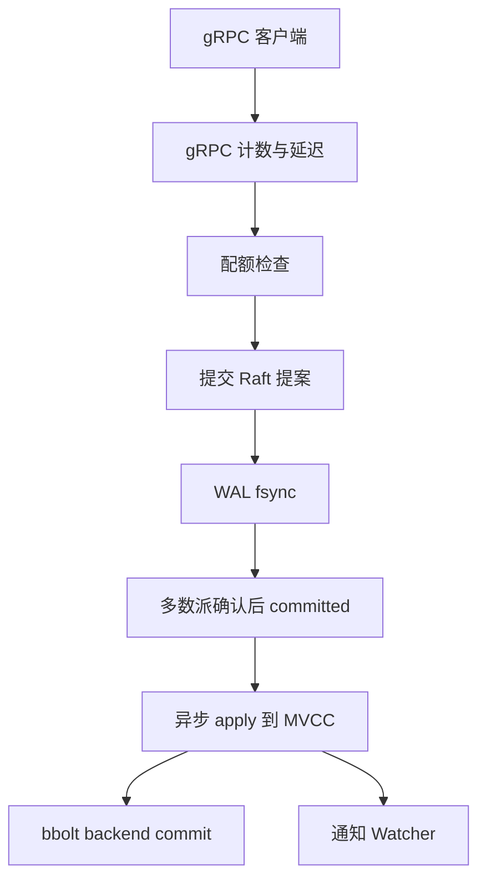
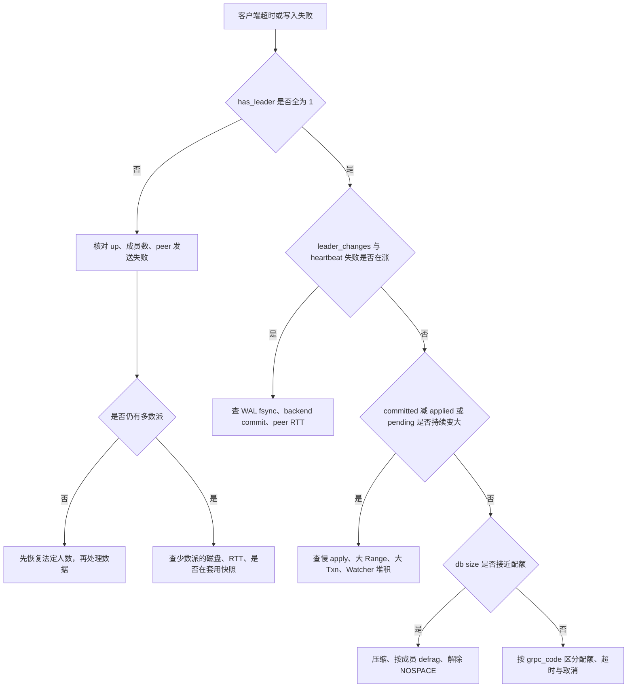
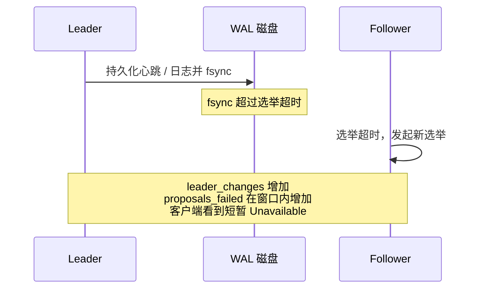

* Do not remove this line (it will not be displayed)
{:toc}

> 本文对照 [etcd 3.6 Metrics](https://etcd.io/docs/v3.6/metrics/) 与随文档发布的指标清单 [etcd-metrics-latest.txt](https://etcd.io/docs/v3.6/metrics/etcd-metrics-latest.txt)，并结合 [Monitoring etcd](https://etcd.io/docs/v3.6/op-guide/monitoring/)、[Maintenance](https://etcd.io/docs/v3.6/op-guide/maintenance/) 和 v3.6 仓库里的 [Prometheus mixin 告警](https://github.com/etcd-io/etcd/blob/release-3.6/contrib/mixin/alerts/alerts.libsonnet)。Raft、MVCC 与读写路径的背景见 [ETCD in Action]()。
{: .prompt-info }

etcd 在生产里通常承担 Kubernetes 对象、服务发现、分布式锁和配置的元数据存储。它的故障很少表现为进程直接退出，更多是 Leader 抖动、写延迟爬升、数据库顶满配额后集群变成只读。这些现象在客户端超时之前，都会先出现在 `/metrics` 上。

# 原理与核心概念

## 指标从哪里来

每个 etcd 成员在客户端端口（默认 `2379`）的 `/metrics` 暴露 Prometheus 文本格式。客户端端口启用了双向 TLS 时，可以用 `--listen-metrics-urls` 单独开一个给采集器和负载均衡用的地址；自 3.3 起，这个地址同时提供 `/health`。自 3.4 起还有 `/livez`（进程是否还活着）和 `/readyz`（是否可以接流量）。`/readyz?verbose` 会拆开 `data_corruption`、`serializable_read`、`linearizable_read` 等检查项。

指标**不落盘**。成员重启后 Counter 从零开始，用 `increase()` / `rate()` 时要避开重启台阶，或接受一次尖刺。

采集时应对**每一个成员**各抓一份，而不是只抓当前 Leader。Raft 的落后、磁盘抖动和碎片都是成员级问题，聚合掉 `instance` 之后看不出来。

## 两类命名空间

官方把指标分成两层：

| 前缀 | 用途 | 稳定性 |
| :--- | :--- | :--- |
| `etcd_` | 监控与告警 | 稳定。变更会写进 release notes |
| `etcd_debugging_` | 排障 | 随实现变化，可能在新版本改名或删除，不宜做长期告警的唯一依据 |

命名遵循 Prometheus 惯例：`etcd_<subsystem>_<name>`。子系统包括 `server`、`disk`、`network`、`mvcc`、`snap` 等。`go_*` 与 `process_*` 来自 Prometheus Go 客户端，其中 `process_open_fds` / `process_max_fds` 在 Darwin（macOS）上不可用。

[etcd-metrics-latest.txt](https://etcd.io/docs/v3.6/metrics/etcd-metrics-latest.txt) 是一份**名称与类型清单**，文件头样例仍写着 `server_version="3.5.0-pre"`。正文 Metrics 页列出了 `etcd_network_peer_sent_failures_total`，这份样例清单里没有它；v3.6 mixin 的 `etcdMembersDown` 却在用它。上线后以本集群 `curl -s http://<member>:2379/metrics` 的输出为准，样例清单用来查名字和类型。

## 一次写请求会碰到哪些指标

写路径把「共识是否还在」「磁盘是否拖后腿」「状态机是否消化得动」「库文件是否要顶满配额」拆开了。读路径默认是线性读，要做 ReadIndex，因此还会碰到 `etcd_server_slow_read_indexes_total` 与 `etcd_server_read_indexes_failed_total`。



对应关系：

| 阶段 | 主要指标 |
| :--- | :--- |
| 客户端 RPC | `grpc_server_handled_total`、`grpc_server_handling_seconds`（直方图开启时） |
| 配额 | `etcd_server_quota_backend_bytes`、`etcd_mvcc_db_total_size_in_bytes` |
| 提案 | `etcd_server_proposals_pending`、`etcd_server_proposals_failed_total` |
| WAL | `etcd_disk_wal_fsync_duration_seconds` |
| 提交与应用 | `etcd_server_proposals_committed_total`、`etcd_server_proposals_applied_total`、`etcd_server_slow_apply_total` |
| 后端刷盘 | `etcd_disk_backend_commit_duration_seconds` |
| 成员间复制 | `etcd_network_peer_round_trip_time_seconds`、收发字节数 |

`proposals_committed_total` 与 `proposals_applied_total` 在文档里的类型是 **Gauge**（单调上升，重启归零）。比较同一时刻各成员的差值，比把它们当 Counter 做跨成员 `sum(rate())` 更可靠。

# 生产环境要盯的核心指标

下面按故障域列出建议进入仪表盘和告警的指标。阈值取自 v3.6 `contrib/mixin`，并补充日常基线：mixin 的线是「已经威胁可用性」，健康集群应明显低于这些线。

## 共识与可用性

文档要求生产集群密切监控全部 `etcd_server_*`。最先看这几个：

| 指标 | 类型 | 健康时 | 异常含义 |
| :--- | :--- | :--- | :--- |
| `etcd_server_has_leader` | Gauge | 每个成员都是 `1` | `0` 表示该成员看不到 Leader，本成员不可用；全体为 `0` 则集群不可用 |
| `etcd_server_is_leader` | Gauge | 全集群恰好一个 `1` | 长期为 `0` 的个数等于成员数，说明正在选举或已失去法定人数 |
| `etcd_server_leader_changes_seen_total` | Counter | 长时间不增长 | 快速增长说明 Leader 不稳，常见原因是网络或过载 |
| `etcd_server_proposals_committed_total` | Gauge | 随写入增长 | 某一成员相对 Leader 持续落后，说明该成员慢或在追日志 |
| `etcd_server_proposals_applied_total` | Gauge | 紧跟 committed | 差值持续变大，说明 apply 过载（大范围查询、大事务） |
| `etcd_server_proposals_pending` | Gauge | 接近 0，随负载小幅波动 | 持续上升：客户端写入过多，或成员无法完成提交 |
| `etcd_server_proposals_failed_total` | Counter | 仅在选举窗口少量增加 | 持续增加：选举失败，或丢法定人数后的长时间不可用 |
| `etcd_server_heartbeat_send_failures_total` | Counter | 不增长 | Leader 心跳发送失败。指标说明写的是 likely overloaded from slow disk |
| `etcd_server_slow_apply_total` | Counter | 不增长或极慢增长 | apply 过慢，同样常由慢盘引起 |
| `etcd_server_slow_read_indexes_total` | Counter | 不增长 | 线性读的 ReadIndex 与 Leader 不同步或超时 |
| `etcd_server_snapshot_apply_in_progress_total` | Gauge | `0` | `1` 表示正在应用收到的快照，该成员暂时追赶中 |

`has_leader` 是成员本地视角。网络分区时，少数派成员会变成 `0`，多数派仍可能是 `1`。告警要按成员看，同时用 `up` 判断采集对象是否还在。

Leader 变更次数在每个成员上各计各的。官方 `etcdHighNumberOfLeaderChanges` 先对成员取 `max`，再看 15 分钟内的增量，避免把同一次选举乘以成员数。

## 磁盘延迟

磁盘是 etcd 稳定性的第一约束。多数派必须把每条日志 `fsync` 到 WAL 之后，提案才能提交；backend commit 则把状态机增量检查点写进 bbolt。两条都慢时，请求延迟上升，心跳也可能超时并触发选举。

| 指标 | 含义 | mixin 阈值 |
| :--- | :--- | :--- |
| `etcd_disk_wal_fsync_duration_seconds` | WAL `fsync` 延迟直方图 | p99 > 0.5s 持续 10 分钟为 warning；> 1s 持续 10 分钟为 critical |
| `etcd_disk_backend_commit_duration_seconds` | backend commit 延迟直方图 | p99 > 0.25s 持续 10 分钟为 warning |
| `etcd_disk_backend_defrag_duration_seconds` | 碎片整理耗时 | 用来估计维护窗口，不作为日常 SLO |
| `etcd_disk_backend_snapshot_duration_seconds` | backend 快照耗时 | 恢复与追赶时观察 |
| `etcd_disk_wal_write_bytes_total` | WAL 写入字节 | 观察写入带宽，判断恢复需要多久 |

默认心跳间隔 100ms、选举超时 1000ms。WAL fsync 的 p99 到了数百毫秒，就已经和选举超时同一量级。mixin 的 0.5s / 1s 是「选举可能失败」的线。本地 SSD 上，健康的 WAL fsync p99 通常在数毫秒到十几毫秒；p99 连续多分钟停在几十毫秒，就应该在告警触发前查磁盘和邻居进程。

硬件建议见 [Hardware recommendations](https://etcd.io/docs/v3.6/op-guide/hardware/)：普通负载大约 50 顺序 IOPS，重负载建议 500 顺序 IOPS 量级的本地 SSD。云厂商公布的往往是并发 IOPS，顺序 IOPS 可能只有其约十分之一。

调试命名空间里还有 `etcd_debugging_disk_backend_commit_write_duration_seconds`、`commit_rebalance`、`commit_spill`，用于把 backend commit 拆开。稳定告警仍以 `etcd_disk_*` 为准。

## 后端容量、碎片与压缩

etcd 保留键空间历史。压缩（compaction）丢掉指定 revision 之前的旧版本，逻辑占用下降；文件里会留下空洞，物理大小要等碎片整理（defrag）才还给文件系统。删除业务数据之后 DB 文件不缩小，原因就在这里。

| 指标 | 含义 |
| :--- | :--- |
| `etcd_server_quota_backend_bytes` | 当前后端配额，单位字节。默认 2 GiB，以该 Gauge 的实际值为准 |
| `etcd_mvcc_db_total_size_in_bytes` | 物理分配大小，含碎片空洞。3.4 起由 `etcd_debugging_mvcc_db_total_size_in_bytes` 提升而来 |
| `etcd_mvcc_db_total_size_in_use_in_bytes` | 逻辑在用大小。压缩后它下降，物理大小不一定下降 |
| `etcd_mvcc_db_open_read_transactions` | 当前打开的读事务数。长期偏高说明读并发或长事务多 |
| `etcd_mvcc_put_total` / `delete_total` / `range_total` / `txn_total` | 本成员看到的各类操作计数，用来区分写放大和读放大 |

官方维护文档的判断方式：`in_use` 接近 `total_size` 且两者都靠近配额时，需要压缩历史，否则会触发空间配额。`in_use` 已经远小于 `total_size` 时，压缩已经生效，接下来该 defrag。

任一成员的后端超过配额，会升起**全集群**的 `NOSPACE` 告警，集群进入维护模式：接受读和删除，拒绝普通写入。客户端看到 `database space exceeded`（gRPC `ResourceExhausted`）。

mixin 三条相关规则：

- **etcdDatabaseQuotaLowSpace**（critical）：`db_total_size / quota > 95%`，持续 10 分钟。
- **etcdExcessiveDatabaseGrowth**（warning）：用过去 4 小时对 `db_total_size` 做 `predict_linear`，预测再过 4 小时将超过配额。
- **etcdDatabaseHighFragmentationRatio**（warning）：`in_use / total_size < 0.5`，且 `in_use > 100 MiB`，持续 10 分钟。

调试指标里，`etcd_debugging_mvcc_db_compaction_*` 与 `etcd_debugging_mvcc_current_revision`、`etcd_debugging_mvcc_keys_total` 用来确认自动压缩是否在跑、键数量是否异常增长。它们适合排障面板，不适合作为唯一告警源。

## 网络与成员通信

| 指标 | 含义 |
| :--- | :--- |
| `etcd_network_peer_round_trip_time_seconds` | 到对端 `To` 的 RTT 直方图 |
| `etcd_network_peer_sent_bytes_total` | 发往某对端的字节数。Leader 通常明显高于 Follower |
| `etcd_network_peer_received_bytes_total` | 从某对端收到的字节数。Follower 通常只从 Leader 收复制流量 |
| `etcd_network_active_peers` | 当前活跃的对端连接 |
| `etcd_network_client_grpc_sent_bytes_total` / `received_bytes_total` | 与 gRPC 客户端之间的字节数 |
| `etcd_network_peer_sent_failures_total` / `peer_received_failures_total` | 文档列出的对端收发失败计数。样例清单未收录，mixin 用发送失败判断成员失联 |

**etcdMemberCommunicationSlow**：对端 RTT 的 p99 > 0.15s，持续 10 分钟，记为 warning。默认选举超时只有 1s，150ms 的 RTT 已经占掉相当一部分预算。同机房健康 RTT 应在 1–2ms 量级；跨机房要同时阅读 [Tuning](https://etcd.io/docs/v3.6/tuning/)，加长心跳和选举超时，而不是只调告警。

字节数不对称是正常的：Leader 负责把日志复制出去。某个 Follower 的接收曲线突然变平，同时 `snapshot_apply_in_progress_total` 变成 1，说明它落后太多，Leader 已不再发增量日志，改为发快照。

## 客户端 gRPC

gRPC 指标由 go-grpc-prometheus 提供，按 `grpc_service`、`grpc_method`、`grpc_type`、`grpc_code` 分开。样例清单里能看到的方法包括 `Put`、`Range`、`Txn`、`Watch`、`LeaseGrant`、`Compact`、`Defragment`、`Snapshot`、`HashKV` 等。

mixin 关注两类：

- **失败比例**。分母是全部 `grpc_server_handled_total`，分子只计 `Unknown`、`FailedPrecondition`、`ResourceExhausted`、`Internal`、`Unavailable`、`DataLoss`、`DeadlineExceeded`。超过 1% 持续 10 分钟为 warning，超过 5% 持续 5 分钟为 critical。`Canceled` 多来自客户端主动取消，没有算进这条规则。
- **延迟**。一元调用（`grpc_type="unary"`）的 p99 > 0.15s，持续 10 分钟为 critical，并排除 `Defragment`。Defrag 会阻塞该成员的读写，耗时长是预期行为。

这条延迟规则依赖 `grpc_server_handling_seconds` 直方图。样例清单重点列出的是 `grpc_server_handled_total`、`grpc_server_started_total` 和消息字节计数。部署后先确认直方图在不在；没有直方图时，用 `etcd_server_slow_apply_total`、磁盘直方图和 `etcd_server_slow_read_indexes_total` 覆盖同一类问题。

`etcd_server_client_requests_total` 带 `client_api_version` 和 `type`（`unary` / `stream`），适合发现仍在使用过旧客户端的调用方。

## 进程与文件描述符

| 指标 | 关注点 |
| :--- | :--- |
| `process_open_fds` 与 `process_max_fds` | 使用量接近上限时，etcd 可能无法创建新的 WAL 文件并 panic |
| `process_resident_memory_bytes` | 缓存与 Watcher 是主要占用。官方硬件建议常规约 8GB，大量 Watcher 与百万级键需要 16–64GB |
| `go_goroutines` | 持续单调上升且不随 QPS 回落，优先怀疑 Watch 泄漏或对端重连风暴 |
| `process_cpu_seconds_total` | 重负载会吃 CPU。官方建议常规 2–4 核，每秒上万请求或数千客户端时考虑 8–16 个独占核 |

## 排障时再打开的调试指标

| 指标 | 用来回答的问题 |
| :--- | :--- |
| `etcd_debugging_mvcc_watcher_total` / `watch_stream_total` | Watch 连接是否过多 |
| `etcd_debugging_mvcc_slow_watcher_total` | 是否有 Watcher 跟不上当前 revision |
| `etcd_debugging_mvcc_pending_events_total` | 事件是否在内存里堆积 |
| `etcd_debugging_lease_granted_total` / `renewed_total` / `revoked_total` | Lease 续期是否形成写放大（Kubernetes 节点心跳、分布式锁常见） |
| `etcd_mvcc_hash_duration_seconds` / `hash_rev_duration_seconds` | `Hash` / `HashKV` 是否过慢。完整性校验会占资源，不宜在高峰对全部成员同时做 |
| `etcd_debugging_snap_save_total_duration_seconds` | 文档点名的快照保存延迟。异常偏高同样指向磁盘，并可能让集群不稳 |

# 使用方法

## 采集

客户端端口没有 mTLS 时，直接抓 `2379`。有 mTLS 时把采集指到 `--listen-metrics-urls`，避免把客户端证书配进 Prometheus。

```yaml
scrape_configs:
  - job_name: etcd
    scrape_interval: 10s
    static_configs:
      - targets:
          - 10.0.0.11:2379
          - 10.0.0.12:2379
          - 10.0.0.13:2379
        labels:
          cluster: prod-a
```

官方监控文档里的 Prometheus 启动参数还是早期写法。现行 Prometheus 使用 `--config.file` 与 `--web.listen-address`。抓取间隔 10s 足够覆盖 mixin 里 1 分钟级的 `etcdNoLeader`。

Kubernetes 上的 etcd 往往只在本机回环或 peer 网络暴露。采集器需要与 etcd 同网络，或通过官方允许的 metrics 端口。`up == 0` 要区分「进程挂了」和「网络策略把采集器挡住了」：前者通常伴随 peer RTT 与发送失败一起变差，后者往往只有 `up` 下降、成员之间的复制指标仍正常。

## 先看健康，再下钻指标

```bash
etcdctl --endpoints=10.0.0.11:2379,10.0.0.12:2379,10.0.0.13:2379 \
  endpoint status -w table
etcdctl endpoint health
etcdctl alarm list
curl -sS http://10.0.0.11:2379/readyz?verbose
```

`endpoint status` 给出每个成员的 DB 大小、是否 Leader、Raft term 和 Raft index。指标已经报警时，用它确认是单成员落后还是全集群一起慢。`alarm list` 出现 `NOSPACE` 时，写请求会被拒绝，此时再去看 gRPC 的 `ResourceExhausted` 只是同一件事的客户端侧面。

## 一组可以直接上仪表盘的 PromQL

WAL fsync 与 backend commit 的 p99。`histogram_quantile` 必须保留 `le`：

```promql
histogram_quantile(0.99,
  sum by (instance, le) (
    rate(etcd_disk_wal_fsync_duration_seconds_bucket[5m])
  )
)

histogram_quantile(0.99,
  sum by (instance, le) (
    rate(etcd_disk_backend_commit_duration_seconds_bucket[5m])
  )
)
```

Apply 落后与待提交提案：

```promql
etcd_server_proposals_committed_total - etcd_server_proposals_applied_total

etcd_server_proposals_pending
```

配额使用率与碎片比例：

```promql
etcd_mvcc_db_total_size_in_bytes
  / etcd_server_quota_backend_bytes

etcd_mvcc_db_total_size_in_use_in_bytes
  / etcd_mvcc_db_total_size_in_bytes
```

Leader 变更（先按集群取各成员看到的最大值，避免重复计数）：

```promql
max by (job) (increase(etcd_server_leader_changes_seen_total[15m]))
```

对端 RTT：

```promql
histogram_quantile(0.99,
  sum by (instance, To, le) (
    rate(etcd_network_peer_round_trip_time_seconds_bucket[5m])
  )
)
```

gRPC 非预期失败比例，标签按方法和实例保留：

```promql
100 * sum by (instance, grpc_service, grpc_method) (
  rate(grpc_server_handled_total{
    grpc_code=~"Unknown|FailedPrecondition|ResourceExhausted|Internal|Unavailable|DataLoss|DeadlineExceeded"
  }[5m])
)
/ sum by (instance, grpc_service, grpc_method) (
  rate(grpc_server_handled_total[5m])
)
```

文件描述符使用率：

```promql
process_open_fds / process_max_fds
```

# 常见异常：如何提前发现和规避

排查时按这条顺序走：先确认还有没有 Leader 和法定人数，再看磁盘与网络把选举拖垮没有，然后看 apply 与配额，最后才到客户端与 Watch。



## 没有 Leader，或法定人数不够

**现象。** 读写都失败，客户端报 `Unavailable` 或超时。Kubernetes 里表现为 APIServer 无法完成写对象。

**指标。** `etcd_server_has_leader == 0` 持续 1 分钟，mixin 记为 critical（`etcdNoLeader`）。`sum(up == 1)` 低于 `(成员数 + 1) / 2` 持续 3 分钟，记为 critical（`etcdInsufficientMembers`）。三节点集群里这表示存活且可采集的成员少于 2。`proposals_failed_total` 会跟着涨。

**常见原因。** 两台以上机器或磁盘同时不可用；网络分区使多数派凑不齐；错误的成员替换（先加后删的顺序反了，或 Learner 尚未追上就拆掉投票成员）。

**规避。**

- 投票成员用 3、5、7。丢一台仍要能形成多数派。
- 成员放在不同故障域，但 RTT 必须留在选举超时以内。默认同机房部署；跨机房先改心跳和选举超时并压测。
- 计划内替换用 Learner：`etcd_server_is_learner == 1` 期间它不投票。追上后再提升，`etcd_server_learner_promote_successes` 可作操作审计。
- `etcdMembersDown` 把 `up == 0` 与 peer 发送失败放在一起，持续 20 分钟才 warning。它适合发现「一台已经掉了一段时间」，不能代替 1 分钟级的无主告警。

## Leader 频繁切换

**现象。** 集群整体仍可用，但写延迟周期性尖刺，线性读偶尔超时。`endpoint status` 里 Raft term 不停增加。

**指标。** 15 分钟内 Leader 变更达到 4 次及以上，且持续 5 分钟，mixin 记为 warning。同时看 `etcd_server_heartbeat_send_failures_total`、WAL fsync p99、backend commit p99、peer RTT p99。

慢盘把选举打起来的过程：



**常见原因。** 与日志、数据库或其他 etcd 共用一块盘；云盘延迟尖刺；CPU 被同机的压缩、备份或 kubelet 抢占；对端 RTT 接近选举超时；时钟无关，etcd 选举靠心跳而不是墙钟，但长时间 STW（Go GC、冻结的虚拟机）会让心跳发不出去。

**规避。**

- 数据目录使用独占本地 SSD，fsync 不被日志采集或备份打满。
- 机器规格按官方档位留出余量，etcd 进程与 WAL 盘不要再叠加重 I/O 业务。
- 告警用 p99 加持续时间，忽略单次尖刺；仪表盘同时保留 p99 与平均值，平均值正常而 p99 很高就是抖动。
- 一次选举带来的少量 `proposals_failed` 是预期。mixin 使用 `rate(etcd_server_proposals_failed_total[15m]) > 5` 持续 15 分钟才 warning。`rate` 的单位是每秒，这条规则对应的是失败速率很高的情况。v3.4 时代的 `etcd3_alert.rules` 用过 `increase(...[15m]) > 5`，对零星失败更敏感。生产上可以两条都留：mixin 抓持续高压，`increase` 抓选举之外的异常尖刺，再与 `leader_changes` 对照，避免把正常换主当成故障。

## 提案提交了，状态机消化不动

**现象。** Leader 还在，写入时延变高，Watch 事件变慢。有的请求在 Raft 层已经提交，客户端仍在等 apply 结果。

**指标。** `proposals_committed_total - proposals_applied_total` 在高负载下短暂到几千可以接受，文档的判断是：差值**持续上升**才说明过载。`proposals_pending` 一起上升时，提交本身也堵了。`etcd_server_slow_apply_total` 增加，说明 apply 路径慢，指标说明同样指向慢盘或昂贵请求。

**常见原因。** 大范围 `Range`、一次事务里改大量键、Watch 从很老的 revision 重放、压缩跟不上写入。Kubernetes 里典型场景是单个命名空间下数万对象再加频繁的全量 List，以及 Event 对象把历史 revision 撑大。这类问题在 [ETCD in Action]() 的「最佳实践」里也有讨论。

**规避。**

- 客户端做分页和限制返回数量，避免无 `limit` 的大 Range。
- 打开自动压缩。`--auto-compaction-mode=periodic` 时，更新频繁的键用 `30m` 到 `1h`，更新少的用 `24h` 到 `72h`，通用默认可以取官方示例里的 `10h`。只需要固定条数历史时用 `--auto-compaction-mode=revision`。
- 用 `etcd_mvcc_range_total`、`txn_total`、`put_total` 的速率分清是读放大还是写放大，再决定限流点在客户端还是在拆分 etcd 集群。
- 线性读会等本成员 apply 追上 Leader。能接受稍旧数据的旁路统计改用串行读（serializable），把 ReadIndex 从热路径拿掉。

## 磁盘变慢

**现象。** 写延迟整体抬升，随后 Leader 变更变多。有时各成员的磁盘监控（操作系统的 await）看起来还不高，etcd 仍然超时：Raft 要等**多数派里较慢的那一次 fsync**，单个成员的平均 await 掩盖了尾延迟。

**指标。** WAL fsync 与 backend commit 的 p99，外加 `etcd_snap_fsync_duration_seconds`、`etcd_snap_db_save_total_duration_seconds`。快照保存变慢时，落后的成员更难追上。

**规避。**

- 用 fio 测顺序写延迟，而不是只看云厂商的并发 IOPS 标称值。
- 仪表盘按 `instance` 展开。一个成员的 fsync p99 单独变坏时，优先换盘或迁走该成员，不要先重启整个集群。
- 备份用 `etcdctl snapshot save`，控制频率。保存期间观察快照耗时直方图，避免和 defrag 叠在同一成员、同一分钟。

## 配额耗尽与 NOSPACE

**现象。** 写入突然全部失败，错误是 `etcdserver: mvcc: database space exceeded`。读和删除仍可用。`etcdctl alarm list` 显示 `NOSPACE`。

**指标。** 使用率越过 95% 是 critical。更早的信号是 `predict_linear`：按最近 4 小时的增速，4 小时内会顶满。`etcd_mvcc_put_total` 或 Lease 授予速率突然抬升，而 `in_use` 几乎不随删除下降，说明历史 revision 没被压缩。

**处理顺序。** 配额告警是全集群的，但 defrag 只作用于被点名的那一个成员，并且**阻塞该成员的读写**。一次只整理一个，先 Follower，最后 Leader。

```bash
rev=$(etcdctl endpoint status -w json \
  | jq -r '.[0].Status.header.revision')
etcdctl compact "$rev"
etcdctl defrag --endpoints=http://10.0.0.12:2379
etcdctl alarm disarm
```

压缩之后先看 `in_use` 是否下降、`total_size` 是否仍顶着配额。只有 `total_size` 在 defrag 之后降下来，才具备解除告警的空间。官方还提醒：API 层与 Apply 层都会检查配额，有可能客户端已经收到 `ErrGRPCNoSpace`，而这条写在 Apply 层仍然落进了后端并随后升起告警。解除告警后要用一次新的写入确认集群恢复，而不是只看错误码消失。

**规避。**

- 使用率 70% 做预警，95% 做 critical，中间留出压缩和 defrag 的时间。
- 控制单条 value 的大小。etcd 适合元数据，不适合把大对象直接塞进键值。
- Kubernetes 为 Event 设置合理保留，避免 Event 历史把默认 2 GiB 配额写满。业务键更新非常频繁时缩短自动压缩窗口。
- 提高 `--quota-backend-bytes` 只能换时间。官方建议在配额内运行；社区实践里 DB 过大还会拉长快照和启动时间。配额调大之后，内存、快照带宽和恢复时间要重新按硬件文档估算。

## 碎片过高

**现象。** 业务上已经删除大量键，磁盘上的 DB 文件几乎不缩小，节点磁盘使用率仍在涨。

**指标。** `in_use / total_size < 0.5` 且逻辑占用超过 100 MiB。这就是 mixin 的碎片告警。比例低表示空洞多，不表示逻辑数据多。

**规避。** 把 defrag 做成例行维护：在碎片比例越过阈值、且业务低峰时，逐个成员执行。整理期间该成员的 gRPC 延迟会明显变坏，`etcd_disk_backend_defrag_duration_seconds` 用来记录这次停顿有多长。不要对 `--endpoints` 里的所有成员并发 defrag，否则等于人为拆掉法定人数。

## 网络分区与慢对端

**现象。** 一部分客户端正常，打到少数派或落后成员上的客户端超时。有时 Leader 在多数派里，监控若只看平均值会显示「集群是绿的」。

**指标。** 按 `To` 看 RTT；`etcd_network_active_peers` 是否缺边；peer 发送失败是否升高；落后成员的 `proposals_committed_total` 是否停滞；`etcd_server_snapshot_apply_in_progress_total` 是否为 1。

**规避。**

- 同机房、低抖动网络。常规集群 1GbE 足够，大库恢复更看带宽：大约 10MB/s 可以在 15 秒内追上 100MB，大集群官方建议 100MB/s 量级以便在 15 秒内追上 1GB。
- 成员列表与防火墙按对端放行，避免只放行客户端端口、对端端口时通时断。
- 发现单成员 RTT 或 fsync 持续超标，用成员替换把它移出投票集，比在原机器上反复重启更有效。

## gRPC 失败与慢请求

把 `grpc_code` 和前面的集群指标对上，可以少走弯路：

| gRPC code | 优先对照的指标 |
| :--- | :--- |
| `Unavailable` | `has_leader`、Leader 变更、peer 失败。选举窗口内会成批出现 |
| `DeadlineExceeded` | WAL / backend p99、apply 差值、ReadIndex 失败与慢 ReadIndex |
| `ResourceExhausted` | DB 使用率、`NOSPACE`、是否有超大请求 |
| `FailedPrecondition` | 成员角色不对（例如对 Learner 发起了它不能服务的请求）、集群状态不允许该操作 |
| `DataLoss` | 立即核对 `/readyz` 的 `data_corruption`，停止继续写入并按灾难恢复流程处理 |

延迟告警把 `Defragment` 排除在外。自行写规则时，`Snapshot`、`Hash`、`HashKV`、`Compact` 也是维护操作，不应和 `Put` / `Range` 用同一条 150ms 的 SLO。

**规避。** 客户端设置超时、退避和成员列表，而不是把所有请求钉死在一个 IP 上。etcd 客户端自带故障切换；调用方再包一层「失败就立刻重试且不退避」，会在选举期间把集群打满。`Range` 的 p99 单独变坏时，先查请求是否缺少分页，而不是先扩容。

## Watcher、文件描述符与内存

**现象。** etcd 内存缓慢上涨，Watch 延迟变大，严重时无法创建新文件并崩溃。Kubernetes 侧可能出现 `too old resource version`：Watcher 落后到压缩点之前，只能全量重新 List。

**指标。** `process_open_fds / process_max_fds` 超过 0.8 就应处理。`etcd_debugging_mvcc_watcher_total`、`slow_watcher_total`、`pending_events_total` 用于确认是连接数问题还是事件堆积。`go_goroutines` 与 RSS 一起看，区分「缓存了较大的键空间」和「连接泄漏」。

**规避。**

- 提高进程 nofile，并让告警早于极限，而不是等 panic。
- 控制 Watch 的前缀范围。数千个客户端各 Watch 一大段前缀，内存会先于 QPS 成为瓶颈。
- 自动压缩窗口要留给慢 Watcher 追赶的时间。窗口越短，落后者越容易被压缩点打断并触发全量 List，全量 List 又会把 `range` 和 apply 打高。
- 调试指标可能随版本改名。面板上把它们标成「排障」，告警仍以 `etcd_` 与 `process_` 为主。

## 快照、校验与 defrag 造成的自我伤害

**现象。** 低峰期反而出现延迟尖刺，时间与备份或巡检脚本重合。

**指标。** `etcd_disk_backend_defrag_duration_seconds`、`etcd_snap_db_save_total_duration_seconds`、`etcd_mvcc_hash_duration_seconds` 在同一时刻出现新的观测；被操作的那个成员 `grpc` 延迟升高，其他成员正常。

**规避。** 维护动作串行、按成员进行，先 Follower。`Hash` / `HashKV` 用来做一致性巡检，不要在写入高峰对所有成员同时调用。集群已经无主或正在套用快照时，不要再叠加 defrag。

# 告警示例

下面是一套与 v3.6 mixin 对齐的最小规则，标签按实际的 `job` 修改。Prometheus 规则里的双花括号是告警模板，不是文章模板。


```yaml
groups:
  - name: etcd
    rules:
      - alert: etcdNoLeader
        expr: etcd_server_has_leader{job="etcd"} == 0
        for: 1m
        labels:
          severity: critical
        annotations:
          summary: etcd 成员看不到 Leader
          description: "{{ $labels.instance }} 已持续 1 分钟没有 Leader。"

      - alert: etcdHighNumberOfLeaderChanges
        expr: |
          increase(
            (max without (instance) (etcd_server_leader_changes_seen_total{job="etcd"}))[15m:1m]
          ) >= 4
        for: 5m
        labels:
          severity: warning
        annotations:
          summary: etcd Leader 变更过多

      - alert: etcdHighFsyncDurations
        expr: |
          histogram_quantile(0.99,
            rate(etcd_disk_wal_fsync_duration_seconds_bucket{job="etcd"}[5m])
          ) > 0.5
        for: 10m
        labels:
          severity: warning
        annotations:
          summary: WAL fsync p99 超过 0.5s

      - alert: etcdDatabaseQuotaLowSpace
        expr: |
          (
            etcd_mvcc_db_total_size_in_bytes{job="etcd"}
            / etcd_server_quota_backend_bytes{job="etcd"}
          ) * 100 > 95
        for: 10m
        labels:
          severity: critical
        annotations:
          summary: etcd 后端空间超过配额的 95%
```


mixin 里还有成员不足、gRPC 失败率、gRPC 慢请求、peer RTT、backend commit、预测性增长和碎片比例。直接使用上游 [alerts.libsonnet](https://github.com/etcd-io/etcd/blob/release-3.6/contrib/mixin/alerts/alerts.libsonnet) 可以少维护表达式。Grafana 侧导入官方 mixin 生成的 etcd 仪表盘，数据源名称要与仪表盘 JSON 里的 `datasource` 一致。

建议在 mixin 之外补两条更早的预警，数值按本集群基线调整：

```promql
# WAL fsync p99 已经离开日常基线，但还没到 0.5s 的选举危险线
histogram_quantile(0.99,
  sum by (instance, le) (rate(etcd_disk_wal_fsync_duration_seconds_bucket[5m]))
) > 0.05

# 配额使用率 70%，留给压缩和 defrag
etcd_mvcc_db_total_size_in_bytes / etcd_server_quota_backend_bytes > 0.7
```

# 最佳实践

- **按成员画图，按集群告警。** Leader 数量、法定人数、配额百分比可以聚合；fsync、RTT、apply 差值、碎片比例必须保留 `instance`。
- **先定基线再套 mixin 阈值。** 上线第一周记录 WAL fsync、backend commit、peer RTT 的 p99。健康 SSD、同机房的集群，这三项应远低于 0.5s、0.25s、0.15s。基线突然抬升比绝对阈值更早。
- **告警要有持续时间。** 选举本身会让 `has_leader` 闪一下、`proposals_failed` 跳一下。`for: 1m` 的无主告警和 `for: 10m` 的磁盘告警，就是为了躲开这种窗口。
- **磁盘、配额、法定人数分三条升级路径。** 磁盘问题去查设备和邻居 I/O；配额问题去压缩和 defrag；法定人数问题先恢复成员。三条同时红时，先恢复多数派，再整理磁盘上的那台落后成员。
- **压缩与碎片整理写成例行任务。** 压缩可以自动做；defrag 必须按成员手动或由控制器逐个做，并避开备份窗口。
- **客户端与服务端一起看。** 服务端 `DeadlineExceeded` 上升时，同时看客户端超时配置。超时设得比 etcd apply 还短，会把慢请求放大成重试风暴。
- **版本与角色做成面板。** `etcd_server_version`、`etcd_cluster_version`、`etcd_server_is_learner` 能解释滚动升级期间的短暂异常。升级时预期看到 Learner 或单成员重启，不应把它误判成磁盘故障。
- **用 `/readyz` 做存活探针的补充，而不是用 `/metrics` 的成功抓取代替读探针。** 进程还在、`up == 1`，线性读仍可能因为没有 Leader 而失败。

# 注意事项

> 指标在进程重启时清零。`rate` 与 `increase` 跨重启会算出一个尖刺。无主、磁盘、配额这类告警都带了 `for`，就是为了不被一次重启打穿。排查「过去 15 分钟失败了多少」时，先看 `process_start_time_seconds` 是否落在窗口内。
{: .prompt-warning }

> defrag 只影响被调用的成员，并且阻塞这个成员上的读写。对整个 `--cluster` 并发执行，等于同时让所有成员停顿。配额告警已经是全集群只读时，仍要逐个整理出空间，再 `alarm disarm`。
{: .prompt-danger }

- `etcd_debugging_*` 可以进排障仪表盘。把它们写进值班手册里的一级告警之前，先确认该版本仍然导出这个名字。
- `process_open_fds` 在 macOS 上没有。本地开发用 Docker 里的 Linux etcd 验证告警，不要以 macOS 进程指标缺失判断采集失败。
- 样例清单 [etcd-metrics-latest.txt](https://etcd.io/docs/v3.6/metrics/etcd-metrics-latest.txt) 与 Metrics 正文、mixin 三者不完全重合。以运行中的 `/metrics` 为准，升级小版本后 diff 一次指标名。
- `proposals_committed_total` 在成员之间本来就会短暂不一致：有的成员刚启动还在追日志，Leader 的提交数最高。告警条件是**同一个成员相对 Leader 的差距持续变大**，不是「三个成员的数字不完全相等」。
- 提高配额、加长选举超时、关掉线性读，都只是在特定约束下的调节。慢盘上加长选举超时可以减少抖动，也会加长真正故障时的不可用窗口，调节后要用故障注入验证。
- 分布式追踪在 3.5 之后通过 OpenTelemetry 提供，3.6 文档仍标为实验特性，开启后大约有 2%–4% 的 CPU 开销。它用来串联单次请求，不能代替上面的 RED 与磁盘指标。

# 参考资源

- [Metrics（etcd 3.6）](https://etcd.io/docs/v3.6/metrics/)：`etcd` 与 `etcd_debugging` 的分层，以及 server、disk、network 的稳定指标说明
- [etcd-metrics-latest.txt](https://etcd.io/docs/v3.6/metrics/etcd-metrics-latest.txt)：指标名称、类型与直方图桶
- [Monitoring etcd](https://etcd.io/docs/v3.6/op-guide/monitoring/)：`/metrics`、`/health`、`/livez`、`/readyz` 与 Prometheus 抓取
- [Maintenance](https://etcd.io/docs/v3.6/op-guide/maintenance/)：压缩、defrag、空间配额与 `NOSPACE` 解除顺序
- [Hardware recommendations](https://etcd.io/docs/v3.6/op-guide/hardware/)：CPU、内存、顺序 IOPS 与网络
- [v3.6 Prometheus mixin 告警](https://github.com/etcd-io/etcd/blob/release-3.6/contrib/mixin/alerts/alerts.libsonnet)：本文引用的阈值与持续时间
- [Tuning](https://etcd.io/docs/v3.6/tuning/)：跨数据中心时的心跳与选举超时
- 站内 [ETCD in Action]()：Raft 读写路径、配额与 Watch 背景
