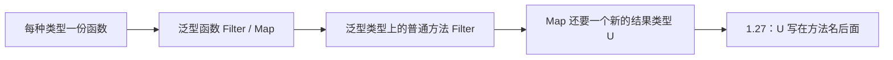
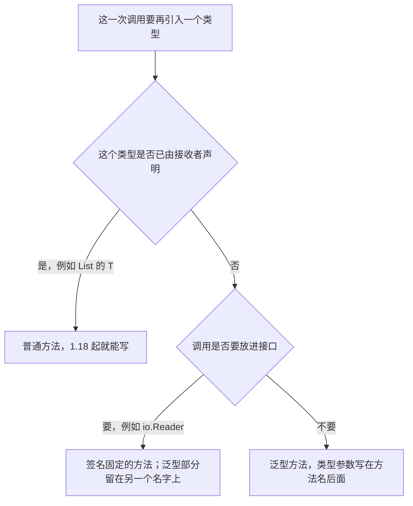
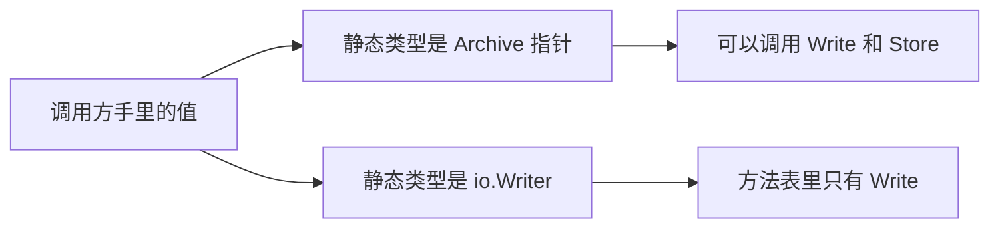

* Do not remove this line (it will not be displayed)
{:toc}

> 本文对照 [Go 1.27 Release Notes](https://go.dev/doc/go1.27)、[Go 1.27.0 发布记录](https://go.dev/doc/devel/release#go1.27.0)、语言规范中的 [Method declarations](https://go.dev/ref/spec#Method_declarations) 与 [Instantiations](https://go.dev/ref/spec#Instantiations)，以及已接受并在 1.27 实现的提案 [spec: generic methods for Go（#77273）](https://github.com/golang/go/issues/77273)。站内 [Being Confused About When To Use Generics]() 记录的是 Go 1.18 到 1.26 的规则：方法不能声明类型参数。那条限制从 1.27 起放开。何时该用泛型，仍见 [100 Go Mistakes]() 第 9 条。
{: .prompt-info }

Go 1.27.0 于 2026-08-19 发布。这一版允许具体方法在方法名后面声明自己的类型参数。要看清它补的是哪一个缺口，得先把 Go 1.18 已经做到的两件事分开：泛型函数，以及写在泛型类型上、但不再引入新类型参数的普通方法。下面用同一份用户列表，从「每种类型写一份函数」写到 `users.Filter(...).Map(...)`。

# 原理与核心概念

## 要算的结果

示例数据是三名用户。先保留 `Active` 为 true 的用户，再取出他们的名字，得到 `[]string{"Ann", "Cy"}`。如果接着用 `len` 计算这些名字的长度，得到 `[]int{3, 2}`：Ann 是 3，Cy 是 2。

```go
type User struct {
	Name   string
	Active bool
}

func sample() []User {
	return []User{
		{"Ann", true},
		{"Bo", false},
		{"Cy", true},
	}
}
```

后面每一步都得到同样的结果。变的只是这段计算写在函数上还是方法上，以及类型参数写在哪里。循环本身不变。

## 第一步：没有泛型时，每种类型写一份

Go 1.18 之前，参数的元素类型必须写死。处理用户列表要一套函数；换成订单列表，就得再写一套：

```go
func activeUsers(users []User) []User {
	out := make([]User, 0, len(users))
	for _, u := range users {
		if u.Active {
			out = append(out, u)
		}
	}
	return out
}

func userNames(users []User) []string {
	out := make([]string, len(users))
	for i, u := range users {
		out[i] = u.Name
	}
	return out
}

names := userNames(activeUsers(sample())) // []string{"Ann", "Cy"}
```

这两段循环换成 `[]Order` 也能用，差别只有切片里的元素类型。类型一变，函数就得再抄一份。另一种办法是改成 `[]any`，取出元素时再做类型断言。断言把错误留到运行时：实际是 `int32` 时，写成 `.(int64)` 会直接 panic。

这一步的问题是同一段逻辑要按类型复制多份。泛型要抽掉的，就是「元素究竟是 `User` 还是 `Order`」。

## 第二步：Go 1.18 用类型参数把元素类型抽掉

类型参数是声明里的占位符，调用时换成具体类型。方括号写在函数名后面，`any` 表示这个占位符接受任意类型：

```go
func Filter[T any](items []T, keep func(T) bool) []T {
	out := make([]T, 0, len(items))
	for _, v := range items {
		if keep(v) {
			out = append(out, v)
		}
	}
	return out
}

func Map[T, U any](items []T, f func(T) U) []U {
	out := make([]U, len(items))
	for i, v := range items {
		out[i] = f(v)
	}
	return out
}
```

`Filter` 只有一个类型参数 `T`，输入和输出都是 `[]T`。`Map` 有两个：`T` 是输入元素的类型，`U` 是函数 `f` 的结果类型。同一份 `Map` 既能把 `User` 映射成 `string`，也能把 `string` 映射成 `int`。

```go
users := sample()
names := Map(Filter(users, func(u User) bool { return u.Active }),
	func(u User) string { return u.Name })
// names == []string{"Ann", "Cy"}

lens := Map(names, func(s string) int { return len(s) })
// lens == []int{3, 2}
```

调用处不用写 `Map[User, string]`。编译器从实参推断：`users` 的类型是 `[]User`，所以 `T` 是 `User`；传给 `Map` 的函数返回 `string`，所以 `U` 是 `string`。这种推断从 1.18 起就适用于泛型函数。

到这一步，按类型复制函数的重复已经没有了。`Filter` 和 `Map` 仍是包级函数，数据放在第一个参数里。下一步才把同样的操作写成方法。

## 第三步：方法能挂在泛型类型上，只要不再引入新类型

方法是带接收者的函数。在 `users.Filter(...)` 里，点号左边的 `users` 就是接收者。Go 只允许把方法写在**本包用 `type` 定义出来的类型**上。`[]User` 是写出来就存在的切片类型，不是用 `type` 定义的名字，因此下面这种接收者不合法，编译器会拒绝在 `[]User` 上声明 `Filter`：

```go
func (users []User) Filter(keep func(User) bool) []User { /* ... */ }
```

要让 `Filter` 出现在值的方法列表里，先用 `type` 给这种切片起一个名字，再把方法写在这个名字上：

```go
type List[T any] []T

func (l List[T]) Filter(keep func(T) bool) List[T] {
	out := make(List[T], 0, len(l))
	for _, v := range l {
		if keep(v) {
			out = append(out, v)
		}
	}
	return out
}
```

先看第一行。`type List[T any] []T` 从左到右是四段：

| 片段 | 含义 |
| :--- | :--- |
| `type List` | 在本包定义一个新类型，名字叫 `List` |
| `[T any]` | `T` 是元素类型的占位符；`any` 表示换成 `User`、`int` 或其他类型都可以 |
| `[]T` | 这个新类型的底层结构是切片，元素类型就是 `T` |

只写 `type UserList []User` 也能挂方法，但名字和元素类型绑死了，订单列表还得再定义一个 `OrderList`。加上 `[T any]` 之后，同一个 `List` 可以写成 `List[User]` 或 `List[Order]`，`Filter` 只写一次。

`List[User]` 和 `[]User` 的元素相同，内存里都是一块切片。差别是 `List[User]` 是本包定义的类型，方法可以写在它上面；`[]User` 不是，所以 `users.Filter` 这种调用只存在于 `List[User]` 的值上。调用前要把 `[]User` 转成 `List[User]`，见下一行。

```go
users := List[User](sample())
```

`sample()` 返回 `[]User`，里面是 Ann、Bo、Cy。`List[User](...)` 把这份切片转换成命名类型 `List[User]`。转换之后，`users` 的元素类型已经确定为 `User`，后面的方法不用再选一次 `T`。

再看方法声明。可以把它拆成四段：

```text
func (l List[T]) Filter(keep func(T) bool) List[T]
     接收者        方法名  参数                  返回值
```

圆括号里的 `l List[T]` 是接收者，不是普通参数。调用 `users.Filter(...)` 时，点号左边的 `users` 会传进 `l`。方法体里的 `l` 就是这份用户列表。

这里的 `[T]` 写在 `List` 后面，不写在 `Filter` 后面。它没有给 `Filter` 增加新的类型参数，只是把类型定义里的 `T` 引进方法，让参数和返回值能写 `T`。约束仍然是类型定义上的 `any`，方法上不能再写一遍。值的类型是 `List[User]` 时，方法里所有的 `T` 都是 `User`：

| 写法 | `T` 换成 `User` 之后 |
| :--- | :--- |
| 接收者 `l List[T]` | `l` 的类型是 `List[User]` |
| 参数 `keep func(T) bool` | `keep` 的类型是 `func(User) bool`：接收一名用户，返回是否保留 |
| 返回值 `List[T]` | 返回的仍是 `List[User]`，元素类型没有变成别的类型 |

`keep` 由调用方传入。下面这个函数在用户的 `Active` 为 true 时返回 true：

```go
active := users.Filter(func(u User) bool { return u.Active })
```

方法体按这个顺序处理三名用户：

1. `make(List[T], 0, len(l))` 先造一个新的空列表 `out`。长度是 0，所以里面还没有元素；容量是 `len(l)`，也就是 3，后面追加时通常不用再申请一块新数组。`out` 和 `l` 不是同一份切片。
2. `for _, v := range l` 依次取出 Ann、Bo、Cy。下划线表示不要下标。`v` 的类型是 `T`，在这次调用里就是 `User`。
3. `keep(v)` 为 true 时，`append(out, v)` 把这名用户追加到 `out`。Ann 和 Cy 的 `Active` 是 true，会进入 `out`；Bo 是 false，被跳过。
4. `return out` 把新列表返回。`l` 仍是原来的三名用户，因为追加发生在 `out` 上。

因此 `active` 的类型还是 `List[User]`，元素是 Ann 和 Cy。`Filter` 只筛选，不改变元素类型。

这在 Go 1.18 就是合法的。`Filter` 没有自己的类型参数：`[T]` 写在接收者上，不写在方法名后面。`Len`、`Append` 也属于这一类，因为元素类型在写成 `List[User]` 时就已经确定。



## 第四步：Map 的结果类型不在接收者上

同一个 `List[User]`，这次要映射成名字（`string`），下次要映射成名字的长度（`int`）。结果类型由这一次传入的函数决定，不能写进 `List` 的定义。写进去的话，一个 `List[User]` 就只能映射成一种结果。

把这个结果类型叫做 `U`，放在方法名后面：

```go
func (l List[T]) Map[U any](f func(T) U) List[U] {
	out := make(List[U], len(l))
	for i, v := range l {
		out[i] = f(v)
	}
	return out
}
```

对照前一步的 `Filter`：

| | `T` 从哪里来 | 还要不要别的类型 | Go 1.18–1.26 |
| :--- | :--- | :--- | :--- |
| `Filter` | 接收者 `List[T]`，值一造出来就定了 | 不要 | 可以 |
| `Map` | 同样来自接收者 | 要，`U` 由这次的 `f` 决定 | 方法上不能写 `[U any]` |
| 包级 `Map` | 第一个参数 | `U` 也写在函数上 | 可以 |

1.26 及更早的编译器对 `Map[U any]` 报 `methods cannot have type parameters`。站内 [Being Confused About When To Use Generics]() 记的就是这条诊断。

两对方括号职责不同。左边的 `List[T]` 引进类型定义里已经有的参数；右边的 `[U any]` 才是这一次调用新加的参数。1.27 之前，方法只允许写出左边那对。

## 第五步：包级函数把后一步套在外层

1.18 到 1.26 的做法，是把接收者改回第一个参数。循环和上面的 `Map` 相同：

```go
func MapList[T, U any](l List[T], f func(T) U) List[U] {
	out := make(List[U], len(l))
	for i, v := range l {
		out[i] = f(v)
	}
	return out
}

users := List[User](sample())
names := MapList(users.Filter(func(u User) bool { return u.Active }),
	func(u User) string { return u.Name })
lens := MapList(names, func(s string) int { return len(s) })
```

`Filter` 写在值的后面，`MapList` 则要求把值放进参数。嵌套两层时还能读。再多一步，后执行的调用就包在外层，阅读顺序和执行顺序相反：

```go
lens := MapList(
	MapList(
		users.Filter(func(u User) bool { return u.Active }),
		func(u User) string { return u.Name },
	),
	func(s string) int { return len(s) },
)
```

最里面的 `Filter` 最先执行，最外面的 `MapList` 最后执行。1.27 把 `Map` 写成方法之后，从左往右读就是执行顺序。第一次 `Map` 把 `List[User]` 变成 `List[string]`；第二次 `Map` 的接收者已经是 `List[string]`，所以这时的 `T` 是 `string`，`U` 推断为 `int`：

```go
lens := users.
	Filter(func(u User) bool { return u.Active }).
	Map(func(u User) string { return u.Name }).
	Map(func(s string) int { return len(s) })
// List[int]{3, 2}
```

还有一个写代码时能直接感觉到的差别：包级函数不出现在 `List` 的方法列表里。编辑器补全 `users.` 时能列出 `Filter`，列不出 `MapList`。调用方还得记得这个函数在哪个包，以及第一个参数是不是手头这份列表。提案 [#77273](https://github.com/golang/go/issues/77273) 把方法的另一项用途单独写了出来：方法是挂在类型上的函数，用来组织 API，并不一定要拿去实现接口。

## 标准库里的同一缺口

[`math/rand/v2`](https://pkg.go.dev/math/rand/v2) 自 Go 1.22 起，多数顶层函数在 `Rand` 上都有同名方法，例如 `IntN`、`Int64N`、`Uint64N`。这些方法的结果类型写死在名字里，所以它们是普通方法。

同一版本新增的泛型函数 `N` 当时没有对应方法。它的类型参数 `Int` 表示任意整数类型：这次调用可以是 `int` 或 `uint32`，也可以是底层类型为 `int64` 的 `time.Duration`。`*Rand` 本身不是泛型类型，这个整数类型要到每次调用时才确定，所以 1.26 的方法语法写不出来。

```go
r := rand.New(rand.NewPCG(1, 2))

_ = r.IntN(10)                     // 1.22 起的方法，结果固定为 int
_ = rand.N(100 * time.Millisecond) // 1.22 起的泛型函数，结果是 time.Duration
_ = r.N(100 * time.Millisecond)    // 1.27 起，同一个函数变成了方法
```

1.27 的签名是 `func (r *Rand) N[Int intType](n Int) Int`，行为与顶层 `N` 相同：返回 `[0, n)` 里的伪随机数，`n <= 0` 时 panic。随机源从全局默认源换成了这个 `r`。

## 接收者类型本身可以不是泛型

前面的 `U` 加在本身已经是泛型的 `List[T]` 上。还有一类更常见的情况：容器的类型是固定的，每次取出来的 Go 类型却不同。

```go
type Row struct {
	cols map[string]any
}

// 断言写在调用点。动态类型若是 int32，这里会 panic。
id := row.cols["id"].(int64)
```

可以把断言收进一个助手函数，但这个函数不在 `Row` 的方法列表里，调用要写成 `Get[int64](row, "id")`。`T` 只出现在返回值里，参数提供不了类型信息，所以类型实参 `int64` 必须手写。1.27 可以把这个函数写成 `Row` 的方法。类型实参仍然要写，因为编译器无从推断：

```go
id, err := row.Get[int64]("id")
```

`Row` 自己没有类型参数。每次调用要单独决定的是 `Get` 返回 `int64`，还是返回别的类型。完整实现见下文「列类型每次不同」。

## 为什么 1.18 不让方法带上这段语法

方法在 Go 里还负责实现接口。类型不用写 `implements`，方法名和签名对得上，就可以赋给接口。

```go
type Reader interface {
	Read(p []byte) (int, error)
}

type File struct{}

func (f *File) Read(p []byte) (int, error) { return len(p), nil }

var r Reader = &File{} // *File 有匹配的 Read，赋值合法
```

接口值在运行时要调用一个签名固定的 `Read`。它保存具体的值，以及这个值的 `Read` 函数。

假如 1.18 允许方法自带类型参数，就会出现下面这种声明。它不是一个 `Read`，而是一族：`Read[byte]`、`Read[int16]`，以及以后才会写到的每一种 `E`。

```go
type Buf struct{}

func (b *Buf) Read[E any](p []E) (int, error) { return len(p), nil }

var r Reader = &Buf{} // 1.27 同样不合法
```

把 `&Buf{}` 放进 `Reader` 时，编译器不知道以后会把 `E` 实例化成哪一种，接口值里也就没有一个签名固定的函数可以调用。原始的类型参数提案把这两件事绑在一起：方法若能带类型参数，接口方法似乎也得可以。当时两件都没有做。FAQ 里因此写过，不预期 Go 会加入泛型方法。

这条限制同时挡住了两类方法。`Read[E any]` 确实会碰到接口。`List[T].Map[U any]` 并不实现任何接口，它只是要在方法上多一个结果类型 `U`。从 1.18 到 1.26，后一类也只能写成包级函数。

## 1.27 放开的是具体方法这一半

[#77273](https://github.com/golang/go/issues/77273)（Robert Griesemer，2026-01-22）把两件事拆开。具体方法就是带接收者的函数：函数可以有类型参数，带接收者的函数也可以有。接口方法的语法仍然是 `MethodName Signature`，中间没有类型参数列表，所以泛型具体方法的签名和接口方法对不上，不会被当成接口的实现。

调用 `users.Map(...)` 时，`users` 的类型是 `List[User]` 这种具体类型。编译器已经知道要调用哪个方法，再按 `f` 的结果确定 `U`。代码生成和普通泛型函数相同：提案把这次调用看成一个泛型函数调用，只是把接收者当作第一个参数。旧代码的含义不变，因为这只是取消了原先的限制。

> 接口方法仍然不能声明类型参数。`Read[E any]([]E)` 也不会因为某次可以推出 `E` 是 `byte`，就去实现 `io.Reader`。需要 `[]byte` 时，另写一个签名固定的 `Read`，在方法体里调用泛型方法。下文有完整例子。
{: .prompt-warning }

以后碰到一个操作，可以按类型参数出现的位置来选写法：



## 语法上多出来的那一对方括号

[方法声明](https://go.dev/ref/spec#Method_declarations) 从 1.27 起是：

```text
MethodDecl = "func" Receiver MethodName [ TypeParameters ] Signature [ FunctionBody ] .
```

和泛型函数一样，类型参数列表在名字后面、参数列表前面。方法上的类型参数可以和接收者上的同时存在。这样声明出来的名字是泛型方法：先实例化，才能调用或当作值使用。见规范的 [Instantiations](https://go.dev/ref/spec#Instantiations) 与 [Type parameter declarations](https://go.dev/ref/spec#Type_parameter_declarations)。

接收者的基类型仍然不能是指针类型或接口类型，方法仍然必须和基类型写在同一个包。这些规则没有放宽。

模块要使用这段语法，`go.mod` 的 `go` 行要写成 `1.27`。只升级工具链、不改这一行时，编译器仍按旧语言版本拒绝方法上的类型参数。

反射没有同步放开。[`reflect`]() 不能给一个尚未实例化的泛型函数补上类型实参。泛型方法同样不能通过 `Method` / `MethodByName` 取出来，再在运行时决定类型参数。签名已经固定的方法（例如下面用来实现 `io.Writer` 的 `Write`）仍会出现在反射的方法列表里。

# 使用方法

## 声明

模块的语言版本要到 1.27。Go 1.21 起，`go.mod` 的 `go` 行决定语言版本；工具链已经是 1.27、但 `go` 行仍停在更早版本时，编译器不会接受方法上的类型参数。

```text
module example.com/demo

go 1.27
```
{: file="go.mod" }

最简形式是一个非泛型类型加上一个泛型方法：

```go
type Box struct{ /* ... */ }

func (b *Box) Get[T any](key string) (T, bool) { /* ... */ }
```

接收者类型本身是泛型时，方法上会出现两对方括号。左边那对只是把类型定义里的参数引进方法，名字可以换成别的标识符，约束不能在这里改写。右边那对才是这次调用自己的类型参数，约束写在这里。

```go
type Pipe[T any] struct {
	items []T
}

//            Pipe[T]          [U any]
//            接收者类型参数    方法自己的类型参数
func (p Pipe[T]) Map[U any](f func(T) U) Pipe[U] { /* ... */ }
```

方法自己的类型参数，作用域从方法名之后一直到方法体结束，因此可以用在参数、结果和方法体里。接收者声明的类型参数过了方法名之后也在作用域中，所以方法的约束可以引用它们：

```go
func (p Pipe[T]) Concat[S ~[]T](extra S) Pipe[T] {
	items := make([]T, 0, len(p.items)+len(extra))
	items = append(items, p.items...)
	items = append(items, extra...)
	return Pipe[T]{items: items}
}
```

`S` 的约束是 `~[]T`，其中的 `T` 来自接收者。因此 `extra` 的底层类型是元素为 `T` 的切片，可以取长度，元素也能追加进 `[]T`。

同一基类型上，方法的非空名字必须唯一，而且不能和字段重名。泛型不构成重载：不能再声明一个同名的、不带类型参数的 `Map`。

## 调用与类型推断

实例化规则和泛型函数相同，见规范的 [Instantiations](https://go.dev/ref/spec#Instantiations)。类型实参可以全写上，也可以在推断得出来时全部省略；部分省略必须是完整列表的一个前缀（从右往左省），空的 `[]` 不合法。

推断依据两类关系：实参类型与形参类型是否匹配，以及类型参数是否满足自己的约束。返回值要赋给哪个变量，不参与这组推断。类型参数只出现在返回值里时，调用处要写出类型实参。

```go
words := Pipe[string]{items: []string{"go", "generic", "method"}}

// U 出现在 f 的结果里，从实参推断为 int。
lengths := words.Map(func(s string) int { return len(s) })

// 与上面相同，只是把类型实参写明。
lengths = words.Map[int](func(s string) int { return len(s) })
```

`words.Map` 这一步，接收者的 `T` 已经是 `string`，因为 `words` 的类型是 `Pipe[string]`。调用方实例化的只有 `U`。

> 想让调用方少写类型实参，就把类型参数放进形参，不要只放进结果。`Decode[T any](data []byte) (T, error)` 这种签名在调用点几乎总要写成 `Decode[User](data)`。
{: .prompt-tip }

1.27 还有一项独立的语言变更：把泛型函数赋给类型已知的变量，或转换成匹配的函数类型时，也可以推断类型实参。还没写类型实参的泛型方法值本身就是这样一个泛型函数，赋值时走同一套推断。能从参数看出类型时，优先使用参数提供的信息。下面两种写法都合法：

```go
var toLen func(func(string) int) Pipe[int] = words.Map
toLen = words.Map[int]
```

## 方法表达式与方法值

方法表达式 `T.M` 得到一个函数，第一个参数是原来的接收者。方法若是泛型的，这个函数也是泛型的。接收者基类型若是泛型的，必须先实例化类型，再写方法表达式。`Pipe.Map` 不合法，`Pipe[string].Map` 才合法。

```go
// 类型：func[U any](Pipe[string], func(string) U) Pipe[U]
apply := Pipe[string].Map[int]

out := apply(words, func(s string) int { return len(s) })
```

方法值 `x.M` 在求值时记下接收者，之后调用不再传接收者。泛型方法要先实例化，得到的才是普通函数值：

```go
// 类型：func(func(string) int) Pipe[int]
toLen := words.Map[int]
lengths := toLen(func(s string) int { return len(s) })
```

指针接收者、可寻址的值自动取址，以及 `nil` 指针接收者，这些规则和普通方法一样。泛型方法也遵守原来的方法集规则：值接收者的方法同时属于 `*T`。

## 标准库里的 Rand.N

[`math/rand/v2`](https://pkg.go.dev/math/rand/v2#Rand.N) 从 Go 1.27.0 起提供：

```go
func (r *Rand) N[Int intType](n Int) Int
```

`Int` 可以是任意整数类型（带符号、无符号，以及底层类型为这些整数的定义类型）。返回值落在半开区间 `[0, n)`。`n <= 0` 时 panic。行为和顶层函数 `N` 一致，随机源换成了这个 `Rand`。

```go
r := rand.New(rand.NewPCG(1, 2))

n := r.N(uint32(10))                  // 从实参推断 Int = uint32
d := r.N(100 * time.Millisecond)      // time.Duration 的底层类型是 int64
k := r.N[int64](100)                  // 显式指定；100 是无类型常量
```

`Rand` 的其他方法，例如 `IntN`、`Int64N`、`Uint64N`，仍然是为单一整数宽度写的非泛型方法。`N` 把这些宽度收进一个类型参数。它不实现任何接口。提案用它说明：方法也可以只用来把操作挂在类型上。

调用方模块的 `go` 行也要至少是 1.27，才能使用这个符号。Go 1.27 起，`go test` 默认运行 `stdversion` 检查。文件生效的 Go 版本由 `go` 行和构建标签决定；符号比这个版本新时，测试会报出来。在 `go 1.26` 的模块里调用 `(*Rand).N`，就会被指认为用了过新的标准库符号。

# 使用示例

前面的片段用来对照几种写法。下面三节给出可以放进模块的完整代码：一条会中途换掉元素类型的方法链，一次必须写明类型实参的读取，以及在泛型方法之外再写一个方法来实现接口。

## 接收者定元素类型，调用定结果类型

`Filter` 不增加新的类型参数，Go 1.18 就能写。`Map` 要增加 `U`，这要到 1.27 才能写成方法。放在一起，可以看到方法链如何在中途换掉元素类型。

```go
package pipe

type Pipe[T any] struct {
	items []T
}

func Of[T any](items ...T) Pipe[T] {
	return Pipe[T]{items: items}
}

func (p Pipe[T]) All() []T { return p.items }

func (p Pipe[T]) Filter(keep func(T) bool) Pipe[T] {
	out := make([]T, 0, len(p.items))
	for _, v := range p.items {
		if keep(v) {
			out = append(out, v)
		}
	}
	return Pipe[T]{items: out}
}

func (p Pipe[T]) Map[U any](f func(T) U) Pipe[U] {
	out := make([]U, len(p.items))
	for i, v := range p.items {
		out[i] = f(v)
	}
	return Pipe[U]{items: out}
}
```
{: file="pipe/pipe.go" }

```go
package pipe_test

import (
	"fmt"

	"example.com/demo/pipe"
)

func ExamplePipe() {
	words := pipe.Of("go", "generic", "method")
	lengths := words.
		Filter(func(s string) bool { return len(s) > 2 }).
		Map(func(s string) int { return len(s) })
	fmt.Println(lengths.All())
	// Output:
	// [7 6]
}
```
{: file="pipe/example_test.go" }

`Filter` 的结果仍是 `Pipe[string]`。`Map` 把 `U` 推断为 `int`，结果是 `Pipe[int]`。1.26 的等价代码要把后一步套在外层：`Map(words.Filter(keep), f)`。计算是一样的，只是 `T` 和 `U` 都写在包级函数上，读的时候要从内层的 `Filter` 看到外层的 `Map`。

这个例子也把三种声明分开了。`Of` 是泛型函数：构造时才选择 `T`，那时还没有值可以当接收者。`All` 和 `Filter` 是普通方法，它们只使用已经选定的 `T`。只有 `Map` 需要泛型方法。

## 列类型每次不同

数据库扫描或配置表里，容器的类型是固定的，每次取出来的 Go 类型却不同。以前常见的写法是先存成 `any`，再在调用点做类型断言；断言写错会 panic。把断言收进方法之后，调用点写的是类型实参，失败时返回错误。

`T` 不出现在参数里，编译器无从推断，类型实参必须写出来。这是这类 API 的正常写法，推断本身没有出错。

```go
package row

import "fmt"

type Row struct {
	cols map[string]any
}

func (r Row) Get[T any](name string) (T, error) {
	var zero T
	v, ok := r.cols[name]
	if !ok {
		return zero, fmt.Errorf("column %q not found", name)
	}
	got, ok := v.(T)
	if !ok {
		return zero, fmt.Errorf("column %q: has %T, want %T", name, v, zero)
	}
	return got, nil
}
```
{: file="row.go" }

```go
id, err := rec.Get[int64]("id")
status, err := rec.Get[Status]("status")
```

方法内部仍然是一次类型断言。变的是调用方拿到的类型：成功时 `id` 的类型就是 `int64`，编译器会检查后面的用法。动态类型对不上时，错误里带有实际类型和期望类型，调用点不会因为断言失败而 panic。

`T` 若是接口，断言的含义与普通接口断言相同：动态值实现了该接口才成功。数值宽度不会被自动转换。存进去的是 `int32`，再用 `Get[int64]` 取，会得到错误。这种宽度差异，正是把断言留在调用点时容易看错的地方。

## 既要泛型操作，又要实现接口

下面的 `Read` 看起来像 `io.Reader`，签名里却多了一组类型参数。规范里接口方法的语法是 `MethodName Signature`，中间没有类型参数列表。实现检查比较的是名字和签名，泛型方法多出来的类型参数对不上 `Read([]byte) (int, error)`。

```go
type Buf struct{ /* ... */ }

func (b *Buf) Read[E any](p []E) (int, error) {
	return len(p), nil
}

// *Buf 的方法集里有 Read[E any]([]E) (int, error)。
// io.Reader 要求 Read([]byte) (int, error)。
var _ io.Reader = (*Buf)(nil)
```

最后一行不能通过编译。不存在一种写法，能把 `Read[byte]` 单独挑出来放进方法集。

需要同时满足接口时，写两个不同名字的方法：签名固定的那个去实现接口，在方法体里调用泛型方法。下面的 `Write` 满足 `io.Writer`；`Store` 接受任意元素类型的切片，把一份副本留在 `saved` 里。`Write` 把 `[]byte` 交给 `Store` 时，`E` 从实参推断为 `byte`。

```go
package archive

import "io"

type Archive struct {
	saved []any
}

// Write 满足 io.Writer。同一个名字不能再声明成泛型方法。
func (a *Archive) Write(p []byte) (int, error) {
	return a.Store(p)
}

// Store 保存一份 items 的副本。E 由 items 的元素类型决定。
func (a *Archive) Store[E any](items []E) (int, error) {
	cp := append([]E(nil), items...)
	a.saved = append(a.saved, cp)
	return len(cp), nil
}

var _ io.Writer = (*Archive)(nil)
```
{: file="archive.go" }

`var _ io.Writer = (*Archive)(nil)` 检查的是 `Write`。`Store` 留在具体类型上，调用写成 `a.Store(int16s)` 或 `a.Store(p)`。



# 最佳实践

**接收者类型参数描述这个值，方法类型参数描述这一次调用。** `Pipe[T]` 的 `T` 贯穿 `Filter`、`All` 和 `Map` 的输入。`Map` 的 `U` 只属于这一次映射。如果两个类型在构造时都已经知道，就把它们都放进类型声明，方法保持非泛型。例如 `Pair[A, B].Swap() Pair[B, A]`，这是 1.18 就有的写法。

**有第二个具体类型要共用同一段逻辑时，再增加类型参数。** 只有一种元素类型的容器，用具体类型更直白。方法可以泛型之后，这条判断仍然成立，见 [100 Go Mistakes]() 对「过早使用类型参数」的讨论。

**让推断有依据。** 类型参数出现在参数里时，调用可以省略类型实参，`Map` 和 `Rand.N` 都是这样。如果类型参数只出现在返回值里，就在文档和示例里把类型实参写成调用的一部分。赋值左侧的变量类型不会参与推断。

**要通过接口调用的操作，签名里不要放类型参数。** 用一个签名固定的方法满足接口，在方法体里调用泛型方法。两个方法必须不同名。包外的编译期检查 `var _ io.Writer = (*Archive)(nil)` 检查的就是那个签名固定的方法。

**没有合适的接收者时，继续用包级函数。** `slices`、`maps` 里的算法作用在内建的切片和映射上，调用方不一定想先包一层命名类型。标准库在 1.27 也没有把这些函数改成方法，只补上了 `Rand.N` 这种「类型上本来就该有这个操作，以前的语法写不出」的缺口。

**约束写成方法体真正依赖的操作。** `Concat` 需要「底层类型是元素为 `T` 的切片」，所以约束是 `~[]T`。只是把值存起来或原样返回时，`any` 就够了。约束比方法体用到的操作更宽时，方法体里往往还得用类型断言把操作补上。约束比实际需要更窄时，本来合法的调用会被挡在外面。

# 注意事项

**接口方法的语法没有变。** 下面的声明不合法，因为类型参数列表不属于接口方法的语法：

```go
type Mapper[T any] interface {
	Map[U any](func(T) U) []U
}
```

泛型接口本身仍然合法，只是类型参数属于接口类型，不属于其中的某个方法：`type Source[T any] interface { Next() (T, bool) }`。实现它的是普通方法 `Next`，`T` 来自 `Source[int]` 这样的实例化。

**不能把泛型方法的某一个实例化登记进接口。** 讨论 #77273 时有人提议再写一行 `Read[byte]`，用来表示「这个实例化应当出现在方法集里」。该提案没有接受这个扩展。原因之一是，接收者上已经有 `List[T]` 这种写法，读者很容易把它理解成「把约束收紧」，而不是「登记一个实例化」。需要 `[]byte` 时，另写一个具体方法。

**方法名不能重载。** 同一类型上，`Read` 和 `Read[E any]` 是同一个名字的两次声明。后一次声明不会覆盖或补上前一次。

**未实例化的泛型方法不能通过反射再实例化。** 运行时若要根据外部输入选择 `T`，仍然需要自己写类型开关，或事先生成代码。`reflect` 没有「给泛型方法补类型实参」的操作。签名固定的 `Write` 会和其他具体方法一样出现在反射的方法列表里。泛型的 `Store` 在反射里没有一份已经实例化好的签名，也不能事后再补类型实参。

**语言版本写在 `go` 行里。** 只升级工具链、不把 `go` 行改成 `1.27` 时，新语法和 `(*rand.Rand).N` 都不能用。`go test` 的 `stdversion` 会报告「用了比 `go` 行更新的标准库符号」。自己声明的 API 则由编译器检查方法上的类型参数。

**分析工具要同时看两套类型参数。** `go/types` 的 `Signature` 早就把接收者上的类型参数和签名上的类型参数分开存放。1.27 之前，方法签名上的那一套是空的。现在两套可以同时有内容。如果工具仍假设方法没有自己的类型参数，就会漏掉 `Map` 这类声明。提案估计，外部工具可能要一到两个发布周期才能跟齐。

**函数字面量仍然不能声明类型参数。** 泛型方法是具名方法上的能力。闭包需要类型参数时，要把类型参数写在外层函数或方法上，再让闭包使用这些参数。

# 参考资源

- [Go 1.27 Release Notes](https://go.dev/doc/go1.27)：语言变更原文，以及 `math/rand/v2` 中 `Rand.N` 的说明
- [Release History：go1.27.0](https://go.dev/doc/devel/release#go1.27.0)：1.27.0 于 2026-08-19 发布
- [The Go Programming Language Specification：Method declarations](https://go.dev/ref/spec#Method_declarations)
- [The Go Programming Language Specification：Instantiations](https://go.dev/ref/spec#Instantiations)
- [The Go Programming Language Specification：Type parameter declarations](https://go.dev/ref/spec#Type_parameter_declarations)
- [Proposal #77273：spec: generic methods for Go](https://github.com/golang/go/issues/77273)（Robert Griesemer，2026-01-22 提出，Go 1.27 实现）
- 更早的需求记录：[\#49085](https://github.com/golang/go/issues/49085)、[\#50981](https://github.com/golang/go/issues/50981)
- [`(*Rand).N`](https://pkg.go.dev/math/rand/v2#Rand.N) 与顶层 [`N`](https://pkg.go.dev/math/rand/v2#N)
- 站内 [Being Confused About When To Use Generics]()：1.18–1.26「方法不能有类型参数」的背景
- 站内 [100 Go Mistakes]()：什么时候不该加类型参数
- 站内 [Go Reflect in Action]()：反射能看到的类型信息
