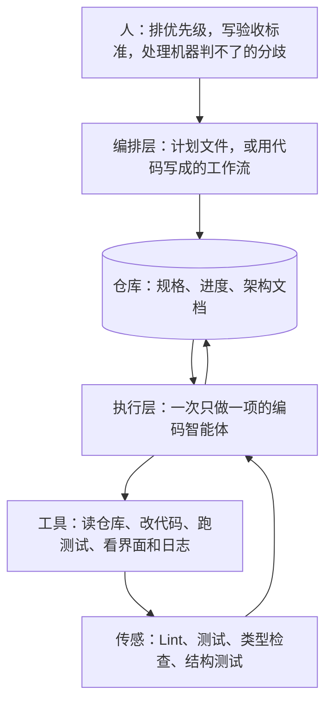
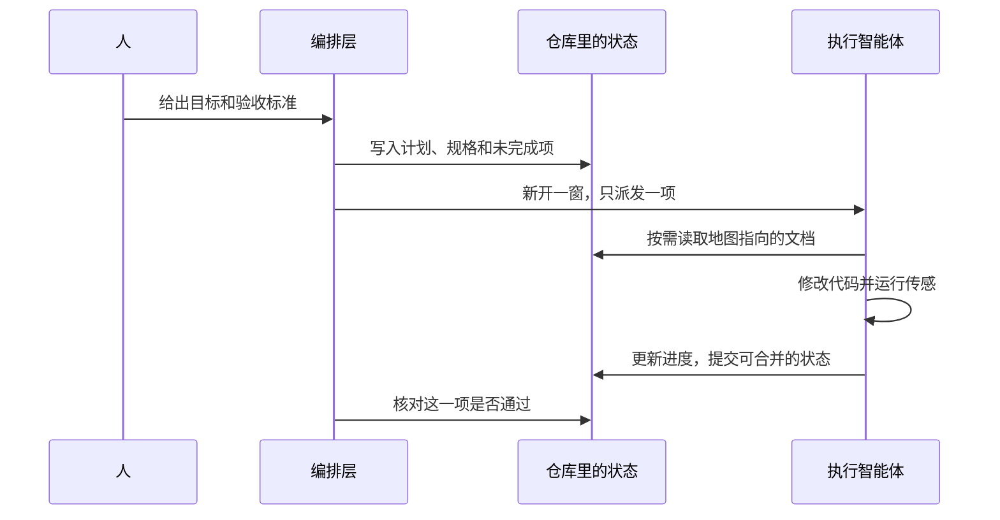

* Do not remove this line (it will not be displayed)
{:toc}

> 本文按一手材料交叉核对。[OpenAI 的 Codex 实践](https://openai.com/index/harness-engineering/)（Ryan Lopopolo，2026-02-11）、[Anthropic 的长程智能体 Harness](https://www.anthropic.com/engineering/effective-harnesses-for-long-running-agents)（2025-11-26）及其后续的 [Planner / Generator / Evaluator 设计](https://www.anthropic.com/engineering/harness-design-long-running-apps)、[Stripe Minions](https://stripe.dev/blog/minions-stripes-one-shot-end-to-end-coding-agents)、[LangChain 在 Terminal-Bench 2.0 上的实验](https://www.langchain.com/blog/improving-deep-agents-with-harness-engineering)、[Geoffrey Huntley 的 Ralph](https://ghuntley.com/ralph/)（2025-07-14），以及 Birgitta Böckeler 在 [Martin Fowler 站点](https://martinfowler.com/articles/harness-engineering.html) 上给出的概念框架（2026-04-02）。产品怎么接入，见 [Codex in Action]() 与 [Cursor in Action]()。
{: .prompt-info }

模型已经能改代码、跑命令、开 Pull Request。长任务仍会在半截停住、把过期规则当成现行约束，或者把团队堵在人工审查上。2025 年到 2026 年，上面这几路实践公开了各自的做法。交叉之后，结论落在同一处：可靠交付取决于模型外面的那套运行与控制系统。这套系统叫做 **Harness**。

# 原理与核心概念

## Harness 是模型外面的控制系统

Böckeler 给编码智能体用的定义很窄，也因此能落地：智能体等于模型加上 Harness。产品里已经带了一层内层 Harness，包括系统提示、代码检索和工具循环。仓库里还要再加一层外层 Harness，用来表达这个代码库的结构、验收标准和纠正方式。外层 Harness 做两件事。它提高智能体第一次就做对的概率。它也让尽可能多的错误在人看见之前就自我纠正。

{: width="640" }
*图：同一个词在不同边界里指不同的层。最外层是使用者为自己的系统加上的引导和传感。来源：[Harness engineering for coding agent users](https://martinfowler.com/articles/harness-engineering.html)。*

OpenAI 内部有一个更硬的实验边界。2025 年 8 月底，一个空仓库的第一笔提交由 Codex CLI 生成。大约五个月后，应用、测试、CI、文档、可观测性和内部工具加在一起，仓库达到百万行量级，约 1500 个 Pull Request 被合并。最初三名工程师驱动，人均每天约 3.5 个 PR；团队后来增至七人，吞吐仍在上升。这些代码都由 Codex 写成，人没有直接提交过其中任何一行。他们自己的估计是，这大约是手写同等软件所需时间的十分之一。产品有内部的每日用户，也有外部 alpha 测试者。早期变慢，是因为环境没写清楚：缺工具、缺抽象、缺可执行的内部结构。每次失败，他们补的都是智能体能够读懂、并且会被机器强制的能力。



从智能体的视角看，运行时读不到的东西等于不存在。Slack 里对齐过的架构决定、某人脑子里的惯例、打不开的日志，都不会进入下一次推理。所以 Harness 的第一份工作是把这些信息变成仓库里的版本化制品：代码、Markdown、schema、可执行的计划。

{: width="760" }
*图：Google 文档、Slack 和人脑子里的判断都在 Codex 的视野之外。要让它看见，就得编码成仓库里的 Markdown。来源：[Harness engineering](https://openai.com/index/harness-engineering/)（OpenAI）。*

## 提示词、上下文、Harness 各管一层

这三件事是包含关系，后一层把前一层收进来。

Anthropic 把 **提示词工程** 定义成怎么写指令，尤其是系统提示。**上下文工程** 则是每一次推理时，从系统指令、工具、MCP、外部数据和对话历史里，选出一组高信号 token 放进有限的注意力预算。他们的原话方向是：目标是最小的一组高信号 token，使期望结果的可能性最大。

**Harness Engineering** 比上下文再多管几件事：工具怎么调用、状态放在哪里、做完怎么验证、失败后重试还是重规划、整个循环何时停止。Böckeler 写得很明确：为编码智能体做外层 Harness，是上下文工程的一种具体形式。提示词和上下文都还在，只是它们不再单独构成交付系统。

{: width="760" }
*图：左边一次放进系统提示和用户消息。右边每次推理都从文档、工具、记忆和历史里挑选一小部分放进窗口，工具结果再回到候选集合里。来源：[Effective context engineering for AI agents](https://www.anthropic.com/engineering/effective-context-engineering-for-ai-agents)（Anthropic）。*

[Agent Skills]() 和 [OpenAI Skills 最佳实践]() 解决的是「需要时再加载一份操作手册」。[Superpowers]() 把需求澄清、计划、TDD 和审查收成技能工作流。这些都是 Harness 里的引导件。它们还没有覆盖传感、外置状态和熵回收。

## 引导在行动前，传感在行动后

Böckeler 把控制分成两个方向。

**引导（feedforward）** 发生在智能体行动之前，用来提高第一次做对的概率。短的仓库地图、技能、规格、项目脚手架都属于引导。

**传感（feedback）** 发生在行动之后，把可观察的偏差交回智能体，让它自己改。测试失败、Lint、类型错误、架构测试都属于传感。传感的报错如果直接写出修复步骤，下一次推理就会把它当成纠正指令。

只有传感、没有引导，智能体会重复同一类错误。只有引导、没有传感，规则写在文件里，却没有人知道它是否生效。两边要一起长。人的工作是同时调整这两边。

{: width="760" }
*图：引导在第一次生成之前进入上下文，传感把偏差交回自我纠正循环。粉色是推断型，青色是计算型。来源：[Harness engineering for coding agent users](https://martinfowler.com/articles/harness-engineering.html)。*

控制还有两种执行方式：

| 方向 | 计算型：确定、毫秒到秒级 | 推断型：语义判断，更慢也更贵 |
| :--- | :--- | :--- |
| 行动前的引导 | 脚手架、代码改写脚本、固定的目录结构 | 短指令、技能、规格说明 |
| 行动后的传感 | 测试、Lint、类型检查、结构测试 | 另一个模型做审查，或按标准打分 |

计算型传感便宜到可以跟在每一次改动后面跑。推断型传感适合补语义，例如「这是不是重复实现」「这是不是过度设计」，但不能指望它在每次提交上都稳定。Böckeler 把要调节的目标再分成三类。可维护性（重复代码、复杂度、风格）和架构适应度（依赖方向、性能预算、日志规范）已经有不少现成工具。行为是否符合产品意图仍然最难：规格加一组变绿的测试，还不足以让人减少手工验收。行为这条上，规格是引导，测试套件是传感，人的手工验收仍然站在旁边。

{: width="760" }
*图：同一套引导和传感，要分别对准可维护性、架构适应度和行为。行为一侧目前主要仍是规格、测试套件和人。来源：[Harness engineering for coding agent users](https://martinfowler.com/articles/harness-engineering.html)。*

# 六条业界落地准则

下面六条是把上述来源对齐之后的落地共识。表里的主张是共同结论；每条后面的数字和做法都标了出处，避免把一家的实验说成所有人的结果。

| # | 共识 | 核心主张 |
| :--- | :--- | :--- |
| 1 | **瓶颈在基础设施，不在模型本身** | OpenAI、Anthropic、LangChain、Stripe、Huntley 五路实践结论相同。Stencil 只改编辑工具的输出格式，就把 Grok Code Fast 1 的任务成功率从 6.7% 拉到 68.3% |
| 2 | **文档应当是活的反馈回路** | 静态长文会过期，过期规则仍会被智能体执行。后台智能体应定期对照代码清理陈旧文档，并提交 PR |
| 3 | **思考与执行必须分离** | 复杂任务进不了一个上下文窗口。编排层负责任务边界和停止条件，执行层一次做一项；状态写在独立存储里 |
| 4 | **上下文并非越多越好** | 上下文是稀缺资源。庞大的指令文件会把任务、代码和相关文档挤出窗口。入口保持短小，按需检索、动态注入 |
| 5 | **约束必须能被机器执行** | 人工审查是吞吐上的瓶颈。能写成不变量的护栏，要编码成 Linter、CI 和类型系统，由机器强制 |
| 6 | **工程师角色正在变化** | 工程师的主业从写代码，转到设计环境、反馈回路和控制系统，让智能体能可靠地完成目标 |

## 1. 瓶颈在基础设施，不在模型本身

五路实践改的都是模型外面的东西。

OpenAI 的记录是：Codex 一开始慢，是因为环境欠指定。人的工作变成给智能体补工具和可执行结构。他们让每个 git worktree 都能独立启动应用，把 Chrome DevTools Protocol 接进运行时，让智能体能复现界面缺陷、验证修复。日志、指标和 trace 也做成该 worktree 里临时的可观测栈，智能体用 LogQL 和 PromQL 查询。于是「启动要在 800ms 内完成」「四条关键路径上没有 span 超过两秒」这种提示才变得可执行。单次 Codex 运行经常在一项任务上持续六个小时。

{: width="640" }
*图：Codex 选定目标，在触发界面路径前后各做一次快照，读运行时事件，改完重启，再跑同一条验证，直到界面恢复正常。来源：[Harness engineering](https://openai.com/index/harness-engineering/)（OpenAI）。*

{: width="760" }
*图：应用把日志、指标和 trace 交给本机的 Vector，再分到 VictoriaLogs、VictoriaMetrics 和 trace 存储。Codex 用 LogQL、PromQL、TraceQL 查询，然后改代码、重启、重跑。来源：[Harness engineering](https://openai.com/index/harness-engineering/)（OpenAI）。*

LangChain 把模型标识固定为 GPT-5.2-Codex，只动 Harness，在 Terminal-Bench 2.0（89 个任务，Harbor 编排沙箱并评分）上把 deepagents-cli 从 52.8% 做到 66.5%，榜上位置从 30 名开外进到第 5。他们压缩了可调旋钮，只动系统提示、工具和中间件（包在模型和工具调用外面的钩子）。一版强调构建—验证循环、注入环境信息、并限制死循环和超时的提示，把分数做到 63.6%（推理档位为 high）。全程开到 xhigh 反而只有 53.9%，原因是超时。他们最后用的是规划和高强度验证用 xhigh、实现用 high 的组合，分数到 66.5%。这组数字说明推理预算也是 Harness 旋钮：模型名字没变，预算分配变了，分数就会变。

{: width="720" }
*图：基线 52.8%。加上构建—验证循环、环境上下文、死循环和超时保护后到 63.6%。再加上自适应推理到 66.5%。来源：[Improving Deep Agents with harness engineering](https://www.langchain.com/blog/improving-deep-agents-with-harness-engineering)（LangChain）。*

{: width="760" }
*图：时间预算的前 25% 和最后 25% 用 xhigh 做计划和最终验证，中间 50% 用 high 实现。全程 xhigh 会因超时掉到 53.9%。来源：[Improving Deep Agents with harness engineering](https://www.langchain.com/blog/improving-deep-agents-with-harness-engineering)（LangChain）。*

{: width="680" }
*图：退出前拦截一次，要求对照任务规格再跑测试，失败就带着错误回到实现。来源：[Improving Deep Agents with harness engineering](https://www.langchain.com/blog/improving-deep-agents-with-harness-engineering)（LangChain）。*

工具协议本身就能挡住模型。Stencil 用同一批模型和同一套任务，只更换编辑工具的输出格式。[他们的文章](https://stencil.so/blog/the-harness-problem)记录：Grok Code Fast 1 在 patch 格式下成功率 6.7%，换成 hashline（读到的每一行带内容哈希，编辑指向这个锚点）之后为 68.3%。patch 大量机械失败，模型的编码能力几乎没有机会表现出来。读同一张对比表时要一起看另一列：hashline 相对 Claude 风格的 `str_replace`，表中模型平均大约提升 3.4 个百分点；Grok Code Fast 1 相对替换式编辑大约多 4.6 个百分点。十倍跳跃出现在「这个模型几乎写不好 patch」的前提下。它证明格式会掩盖能力，不能读成任意改一处输出格式都有十倍收益。

Stripe 和 Huntley 没有公布同类排行榜，但他们的工程选择指向同一处。Stripe 的 Minions 是无人值守的一次性编码流程：每周超过 1000 个、后来超过 1300 个合并的 Pull Request 完全由 minion 产出，经人工审查，其中没有人手写的代码。运行环境是预热好的 devbox，大约 10 秒拉起，与生产资源和公网隔离，因此可以去掉面向人的确认提示。Huntley 在 Ralph 走偏时不去换模型，而是改规格和循环提示。他记录过一次教训：语言的词法规格里同一个关键字被定义了两次、语义相反，循环空转了大约一个月。错在规格，循环只是忠实执行了规格。

## 2. 文档应当是活的反馈回路

OpenAI 先试过一份巨大的 `AGENTS.md`。它以四种方式失败。上下文被说明书占满，任务和代码进不去。所有句子都标成重要之后，就没有重要了。文件立刻过期，智能体分不清哪条仍然为真，人也不再维护，这份文件变成会主动误导的陈旧规则。一整块散文也无法做覆盖率、新鲜度、所有权和交叉链接的机械检查。

他们的替代结构是：`AGENTS.md` 大约 100 行，作为目录注入上下文；知识库放在结构化的 `docs/` 里，当作系统记录。设计文档带验证状态，架构文档给出领域和包的分层，质量文档给每个领域和层次打分，执行计划（进行中、已完成、已知技术债）跟代码一起进版本库。专用 Linter 和 CI 检查知识库是否最新、是否交叉链接、结构是否正确。一个周期性的文档园丁智能体扫描与代码行为不符的文档，并开修复 PR。

Huntley 把 `AGENTS.md` 放在循环中心，允许 Ralph 在发现一条教训时把它写回去。这和 OpenAI 的短目录可以同时成立，条件是：新教训写进对应的专题文件，入口文件保持地图的长度，园丁负责删除过期句子。只追加、不删除的「活文档」会重新长成那份百科全书。

人的品味也从这里进入系统。OpenAI 把评审意见、重构 PR 和用户可见的缺陷收成文档更新；文档约束不住的规则，再提升成代码里的检查。团队最初每周五拿出大约 20% 的时间手工清理智能体留下的杂乱模式，这无法随吞吐扩展。后来他们把偏好写成仓库里的机械规则，用后台任务扫描偏差、更新质量分、开小的重构 PR。多数这类 PR 可以在一分钟内看完并自动合并。他们把这称作垃圾回收：技术债按小额、持续地还，避免攒成一次大爆炸。

## 3. 思考与执行必须分离

Anthropic 在 2025 年 11 月的实验里，用一句高层提示（例如「做一个 claude.ai 的克隆」）让 Opus 4.5 在 Claude Agent SDK 上跨多个上下文窗口循环。压缩（compaction）不够。失败有两种固定形状。智能体试图一次做完，上下文在实现中途耗尽，下一窗看到的是做了一半、又没有记录的功能，于是花大量时间猜测并抢救应用。项目后段，后一个会话看见已经有一些功能，就宣布整个任务完成。

他们的 Harness 把会话拆成两种提示。第一窗的初始化智能体写三样东西：能启动开发服务器的 `init.sh`、记录已经做了什么的进度文件、一份初始 git 提交。它还把用户的提示展开成结构化的功能清单。克隆示例里超过 200 条，例如「用户能打开新对话、输入查询、按下回车、看到回复」。每条一开始都标成未通过。后续每个编码会话只做一条，用描述性提交和进度摘要结束，留下可以合并到主分支的状态：没有明显缺陷，代码整齐，下一个人不必先收拾无关的烂摊子。功能清单用 JSON，因为模型改写或覆盖 JSON 的倾向低于 Markdown。提示里明确禁止删除或改写测试，只允许改通过状态。

每个编码会话开头按固定顺序恢复现场：看当前目录，读 git 日志和进度文件，读功能清单并挑选一条未完成项，跑 `init.sh`，先用浏览器把基本路径点一遍。基本路径是坏的，就先修，再做新功能。Web 应用还要求用浏览器自动化按用户路径做端到端验证。只跑单元测试或对开发服务器发 `curl`，智能体会把实际上没走通的功能标成完成。

后续的应用开发 Harness 把角色分成三个：Planner 把一两句提示展开成产品规格，规格停留在产品行为和高层设计，避免过早写错的实现细节向下传染；Generator 一次做一个切片；Evaluator 用 Playwright 像用户一样点击，按产品深度、功能、视觉和代码质量打分，任一项低于硬阈值，这个切片就失败，并把具体失败交回 Generator。动手之前，Generator 和 Evaluator 先在文件里就「怎样算做完」达成一份 sprint 契约。智能体之间用文件交接，不把整段对话留在同一个窗口里。

这里要保留 Anthropic 自己的限定。初始化智能体和编码智能体共用同一套系统提示、工具和 Harness，差别是第一段用户提示。Sonnet 4.5 有「上下文焦虑」：窗口变满时会提前收尾。针对这个失效模式，重置上下文、再用交接文件注入必要信息，比在越来越浑的历史里做摘要更有效。换到 Opus 4.5 之后，这种提前收尾基本消失，他们去掉了强制重置，改由 SDK 的自动压缩处理增长。重置是针对具体模型失效模式的部件。模型变了，这个部件就该拆掉。Planner、文件交接和「一次一项」仍然留着，因为它们解决的是任务边界，不是某一个模型的焦虑。

Huntley 对「一堆智能体互相通话」持保留态度。他把不确定的智能体比作不确定的微服务：每个服务自己就非确定，组合起来更难推理。Ralph 的纯形式是一个仓库里的一个进程，每次循环只做一件事。主上下文充当调度器，昂贵的检索交给子智能体；构建和测试限制为单个子智能体，避免并行改同一棵工作区。计划在 `fix_plan.md`，规格一人一份文件，都放在仓库里。每次循环重新注入计划和规格，做完就丢弃这扇窗口。他给出的可用窗口大约是 17 万 token；塞得越满，结果越差。规格、标准库、构建和测试是卡住生成结果的反向压力：生成可以很快，这四件事用来检查生成的是不是要的东西。

{: width="760" }
*图：需求阶段和待办阶段把规格与计划写成文件，增量循环每次只做一项，并用新的上下文读这些文件。来源：[Ralph Wiggum as a software engineer](https://ghuntley.com/ralph/)（Geoffrey Huntley）。*

{: width="640" }
*图：中间的问题是「怎么判断做对了」。规格、标准库、测试和构建一起把生成结果挡回来。来源：[Ralph Wiggum as a software engineer](https://ghuntley.com/ralph/)。*

Stripe 的编排不靠另一个模型临场发挥。Part 2 里的 blueprint 是用代码定义的工作流：一个节点要么跑确定的程序（git、Linter、测试），要么跑一段聚焦于单任务的智能体循环。停止条件、顺序和必做步骤写在工作流里。

{: width="420" }
*图：先由智能体实现任务，再跑自动选定的 Linter；Lint 失败就回到智能体修。通过后推分支并等待 CI，失败进入修复节点。来源：[Minions, Part 2](https://stripe.dev/blog/minions-stripes-one-shot-end-to-end-coding-agents-part-2)（Stripe）。*

三家的共同结构是：编排层决定边界和完成定义，执行层在干净的上下文里做一项，状态落在文件或工作流里。编排层可以是人、一份计划文件，或一段确定的代码。它不必是另一个长对话里的「经理模型」。



## 4. 上下文并非越多越好

OpenAI 把这条写成操作规则：给 Codex 一张地图，不要给一本 1000 页的手册。渐进式披露的做法是，稳定的短入口永远在上下文里，更深的材料等任务碰到对应领域再打开。太多指导等于没有指导，智能体退回到局部的模式匹配。

Anthropic 的上下文工程用注意力预算来解释同一件事。系统提示要落在一个可操作的高度：具体到能约束行为，又留出模型自己选择手段的空间。把复杂分支硬编码进提示，会又脆又难维护。只写空泛原则，模型会假设你们已经共享了它实际上没有的上下文。他们建议从手头最好的模型加一份最小提示开始测试，再按观察到的失败模式补充指令和例子。

{: width="760" }
*图：左边把每一种意图都写成硬编码分支，又脆又难维护。右边只给空泛原则，模型会假定并不存在的共享上下文。中间给出角色、工具和可操作的判断标准。来源：[Effective context engineering for AI agents](https://www.anthropic.com/engineering/effective-context-engineering-for-ai-agents)（Anthropic）。*

Huntley 把预算用到更硬。循环只做一件事。规格和计划每次重新注入，这看起来浪费，因为他每圈都在重新花费这些 token，但这样主窗口不会堆上失败的工具输出。他观察到，在当时的 Claude 3.7 上，标称 20 万的窗口到大约 14.7 万至 15.2 万 token 时输出质量就会掉下去。这是他的运行记录，不是厂商规格。它说明标称窗口和还能稳定工作的窗口不是同一个数。

技能文件是这条准则的一个现成机制。入口只放何时使用、以及指向详细步骤的链接；详细步骤留在智能体判定相关之后再读。站内的 Skills 实践文把这个加载过程写完整了。Harness 在此之上还要管另一件事：已经读进来、但和当前任务无关的历史，要能丢掉或重置。

## 5. 约束必须能被机器执行

文档单独守不住一个由智能体持续生成的仓库。OpenAI 的做法是约束不变量，不规定具体写法。例如数据在边界上必须解析成明确的形状，但并不指定用哪一个库。每个业务领域拆成固定层次，依赖只能向前：Types → Config → Repo，再进入 Service → Runtime → UI。认证、连接器、遥测、功能开关等横切能力从唯一的 Providers 接口进入。领域外的 Utils 只接到 Providers。Runtime 再汇入 App Wiring + UI。其他边被自定义 Linter 和结构测试禁止。

{: width="560" }
*图：Types、Config、Repo 在下层向前依赖；Providers 承接领域外的 Utils，并进入 Service 与 App Wiring。来源：[Harness engineering](https://openai.com/index/harness-engineering/)（OpenAI）。*

这些 Linter 由 Codex 自己生成。错误信息里写上修复步骤，智能体读到失败就能改，不必等人翻译。他们还静态强制结构化日志、schema 和类型的命名、文件大小、以及平台相关的可靠性要求。对人来说这像挑剔。对智能体来说，一条规则一旦编码，就会同时作用在所有生成结果上。边界之内，实现可以自由。生成的代码不必符合人的审美偏好；它需要正确、可维护，并且下一次智能体运行能读懂。

Stripe 把同一原则写进无人值守流程。minion 使用他们 fork 自 Block goose 的循环，但 git、Linter 和测试是工作流里的确定节点，不交给模型决定要不要跑。Böckeler 转述 Stripe 的文章时还提到：推送前的钩子按启发式跑相关 Linter，反馈尽量留在集成之前。隔离的 devbox 把爆炸半径限制在一台机器上，所以全权限运行是可接受的。人的审查仍然在，位置是看已经通过 CI 的 Pull Request，而不是逐行写 diff。

Anthropic 用功能清单的 JSON 和端到端点击补上「自己宣布完成」这个洞。计算型传感抓得住结构：重复、复杂度、覆盖率、依赖方向、风格。它抓不住误解了的需求。Böckeler 写过：人如果没把「要的是什么」说清楚，任何传感都越界了。行为正确性仍然要靠可执行的验收标准，外加人在标准本身上的判断。

人工审查成为瓶颈，指的是吞吐。OpenAI 在高吞吐下把大部分审查推到智能体对智能体，人可以看 PR，但不是合并的前提。他们同时放宽了阻塞式合并门禁，PR 短命，不稳定的测试常常用后续运行处理。他们明确写了：在低吞吐环境里这样做是不负责任的。等待昂贵、修正便宜，只在智能体吞吐远高于人的注意力时成立。

## 6. 工程师角色正在变化

OpenAI 用一句操作定义收束他们的五个月实验：人掌舵，智能体执行。工程师排优先级，把用户反馈翻译成验收标准，并验证结果。智能体卡住时，人要找出缺的是工具、护栏还是文档，然后仍由 Codex 把修复写回仓库。文章结尾的判断是，最难的问题已经落在环境、反馈回路和控制系统上，目标是构建并维护复杂、可靠的软件。

Böckeler 解释了为什么这份工作不能省。人把惯例、对复杂度的厌恶、团队正在追求什么、以及哪笔技术债是业务上容忍的，作为隐性 Harness 带进仓库。智能体没有这些。Harness 是把其中能说清楚的部分外化成引导和传感。外化有成本，所以目标是把人的判断用在传感覆盖不了的地方，而不是假装人可以离开。

Huntley 的调音方式更日常。Ralph 从滑梯上跳下来，就在滑梯旁边立一块牌子，写明要滑下去、先看周围。牌子立多了，主窗口又会被牌子占满，于是再换一版更干净的入口。智能体是操作者技能的镜子：规格含糊，循环就稳定地产生含糊的实现。

Stripe 把稀缺资源定义成人的注意力。工程师可以同时拉起多个 minion，自己留在审查和例外处理上。一个没有完全做对的运行，仍然可以是人接着做的起点。他们的北极星是 PR 里没有人手写代码，而不是取消审查。

# 使用方法

下面的顺序适合一个已经有编码智能体、希望它能跨多次会话改同一仓库的团队。每一步都对应上面的一条准则。内层产品（Codex、Claude Code、Cursor）继续负责工具循环；这里加的是仓库里的外层。

## 先放一张地图，再放知识库

在仓库根写一份短的 `AGENTS.md`，控制在大约 100 行以内。它只回答四件事：这个仓库是什么、目录怎么划分、要遵守的少数不变量、详细文档在哪。设计、架构、产品规格、执行计划和已知技术债放进 `docs/`，和代码一起评审。

人在聊天里达成的决定，如果下一次运行需要它，就写成这些文件中的一篇。否则它对智能体不可见。

## 把计划写成执行层能接着读的状态

复杂工作在 `docs/exec-plans/` 里留一份计划，至少包含：目标、验收标准、未完成项、已经做过的决定。小改动可以用一次性的短计划，做完就移到 completed。进行中的项保持一份，避免两个会话各写各的清单。

功能清单用结构化格式，并规定智能体只能改状态字段，不能删条目。删除条目会把「还没做」变成「看起来做完了」。

## 一次会话只派一项

派发时给一个新的上下文，并写明恢复现场的顺序：

1. 确认工作目录，只改这个目录里的文件。
2. 读进度文件和最近的提交说明。
3. 读清单，选择一个未完成项。
4. 用仓库里的启动脚本把应用跑起来，先验证基本路径仍然通过。
5. 只实现这一项。
6. 用与用户相同的路径验证，通过后再把状态改成完成。
7. 写进度摘要并提交，保证别人可以从这个提交接着做。

编排可以是人在看计划，也可以是一段 blueprint：确定的测试和 Lint 节点夹在智能体节点之间。构建和测试不要和搜索并行地写同一工作区。

## 把守得住的规则提升成检查

先列不变量，再决定每条放在哪一层。

能用类型、Lint 或架构测试表达的，写成计算型传感，并在失败信息里给出修复步骤和文档链接。只能用散文表达的，放进地图指向的专题文档，作为推断型引导。两者都守不住的行为标准，写成 Evaluator 或人使用的验收清单，不要假装单元测试已经覆盖了它。

评审里第二次出现的同类意见，就应变成上述三层中的一层。留在聊天记录里，下一次会话看不到。

## 用后台任务还技术债和文档债

给文档和代码各设一个周期性任务。文档任务对照实现查找过期描述、断链和没有归属的段落，开小 PR。代码任务对照已经写成检查的「黄金规则」扫描漂移，同样开小 PR。自动合并只授予那些检查本身能证明的改动，例如格式、断链、明确的层次违规。语义上的重构仍然要人看一眼。

这个循环要和生成吞吐一起上线。只增加智能体的产出、不增加回收，仓库会复制已有的坏模式，而且复制得很快。

# 使用示例

示例是一个虚构的计费服务仓库。它演示文件怎么分工，不依赖某一个产品的私有界面。

## 仓库布局

```text
AGENTS.md
docs/
├── design-docs/
│   ├── index.md
│   └── core-beliefs.md
├── architecture/
│   └── layering.md
├── exec-plans/
│   ├── active/
│   ├── completed/
│   └── tech-debt.md
├── product-specs/
│   └── invoice-retry.md
└── QUALITY.md
scripts/
└── dev-up.sh
internal/architecture/
└── layers_test.go
```
{: file="计费服务的知识库布局" }

`AGENTS.md` 是目录。`layering.md` 解释为什么依赖只能向前。`invoice-retry.md` 写清验收场景。`exec-plans/active/` 里放当前这一项的进度。`dev-up.sh` 让新会话不用猜测怎么把服务跑起来。`layers_test.go` 把层次写成测试。

## 入口只做地图

```markdown
# billing-api

计费 API。改代码前先读本文件，再按表打开对应文档。

## 不变量

- 依赖只能沿 Types → Config → Repo → Service → Runtime → UI 向前。
- 金额在服务边界解析成整数分，禁止用浮点穿过边界。
- 一次会话只完成 `docs/exec-plans/active/` 中的一项。

## 地图

| 要做的事 | 打开 |
| :--- | :--- |
| 分层和允许的依赖 | docs/architecture/layering.md |
| 当前任务和验收 | docs/exec-plans/active/ |
| 发票重试的产品行为 | docs/product-specs/invoice-retry.md |
| 启动与基本路径 | scripts/dev-up.sh |

发现文档与代码不符时，提一个只改文档的 PR，不要在本文件里追加长段说明。
```
{: file="AGENTS.md" }

这份入口故意没有 API 字段表，也没有历史事故长文。字段表会过期，事故长文会挤占当前任务。它们分别属于生成的 schema 文档和 `tech-debt.md`。

## 状态放在清单里

```json
{
  "id": "invoice-retry-backoff",
  "description": "支付失败后，发票按 1m、5m、30m 重试，第三次仍失败则标为 needs_review",
  "steps": [
    "创建一张支付失败的发票",
    "推进时钟到 1 分钟，确认发生第一次重试",
    "连续三次失败后，状态为 needs_review，且不再自动重试"
  ],
  "passes": false
}
```
{: file="docs/exec-plans/active/invoice-retry.json" }

会话结束时，智能体只把 `passes` 改成 `true`，并在同目录留下一段进度：做了什么、验证时看到了什么、还有什么没做。下一次会话读这个文件和 `git log`，不必重放上一扇窗口的对话。

## Lint 失败信息写成修复指令

层次测试失败时，输出应当像给下一个智能体的提示，而不只是一个规则编号。

```text
--- FAIL: TestLayerEdges (0.04s)
architecture: internal/billing/service 导入了 internal/billing/ui

修复：依赖只能沿 Types → Config → Repo → Service → Runtime → UI 向前。
把这段逻辑留在 service，或改经 Providers 访问跨域能力。
说明见 docs/architecture/layering.md
```
{: file="go test ./internal/architecture 的失败输出" }

人读到的是同一段话。差别是智能体可以把这段输出直接放进下一轮上下文，按步骤改，然后重新跑 `go test ./internal/architecture`。团队如果已经在用 golangci-lint，自定义规则可以走同一条 CI，配置方式见 [Golangci-lint 实战]()。

## 编排层用确定步骤夹住智能体

blueprint 不必是平台产品。一段把「必须发生」写死的流程就够用。下面的步骤表达 Stripe blueprint 的形状：智能体节点和确定节点交替，停止条件在流程里。

```text
1. agent  阅读 docs/exec-plans/active/ 中唯一的未完成项，只实现这一项
2. run    go test ./...
3. run    golangci-lint run
4. agent  若上一步失败，只修复失败项，不要开始下一个功能
5. run    再次执行测试与 Lint
6. run    更新该条目的 passes 与进度文件，并创建提交
7. stop   测试或 Lint 连续失败达到 3 次，则停止并写明阻塞原因
```
{: file="一次执行的 blueprint" }

第 7 步是预算。Huntley 的纯形式是一个不停的 shell 循环，适合他在旁边看日志并随时改牌子的工作方式。没有停止条件和费用上限的循环，会在错误规格上稳定地烧完预算。

# 最佳实践

下面几条直接写成仓库里的操作习惯。

**第二次相同的失败就编码。** 第一次可以改提示。同一类错误再出现，就把引导或传感补进仓库：要么是文档里的一条可定位规则，要么是一条带修复说明的检查。

**计算型传感放在提交之前，推断型传感放在它后面。** Lint、类型检查和快测试跟着每次编辑跑。跨模块的审查、变异测试、用模型给界面打分，放在集成之后或定时任务里。Böckeler 沿用的原则是把质量往左移：发现得越早，修正越便宜。

{: width="760" }
*图：便宜的检查放在提交之前，并在流水线里再跑一遍。更贵的架构审查和变异测试放在集成之后。来源：[Harness engineering for coding agent users](https://martinfowler.com/articles/harness-engineering.html)。*

{: width="720" }
*图：死代码、覆盖率质量和依赖更新可以定时扫仓库。延迟、错误率和日志异常则来自运行时，再交回编码智能体。来源：[Harness engineering for coding agent users](https://martinfowler.com/articles/harness-engineering.html)。*

**入口文件有长度预算。** 超过大约 100 行时，把专题挪进 `docs/`，入口只留链接。技能同样如此：先判断是否相关，再读取正文。

**验收标准先于实现写进文件。** Anthropic 的 sprint 契约和功能清单做的是同一件事。Generator 和评审者（人或 Evaluator）对「怎样算通过」达成书面一致，然后再改代码。

**隔离运行环境，让智能体能自己看见结果。** 每个任务使用独立 worktree 或独立 devbox，应用能启动，日志和界面能被任务自己查询。查不到的指标不会被遵守。

**垃圾回收和生成一起排期。** 后台 PR 保持小。能被现有检查证明的改动才自动合并。质量分或技术债清单要进仓库，让下一次扫描有比较基准。

**技术选型考虑可驾驭性。** 强类型、清楚的模块边界、稳定的 API，会免费多出几条计算型传感。Böckeler 把环境里这些让智能体容易导航的结构性质叫做 ambient affordances。新项目可以在第一天选进这些性质。遗留系统往往最需要 Harness，也最难建，因为边界和可重复的启动方式本身可能不存在。

# 注意事项

**6.7% 到 68.3% 有明确的比较条件。** 这是 Stencil 实验里 Grok Code Fast 1 从 patch 换成 hashline 的结果。相对替换式编辑，同一模型大约提高 4.6 个百分点，表中模型的平均差距大约 3.4 个百分点，也有模型在 hashline 上变差。LangChain 的 52.8% 到 66.5% 保持了 GPT-5.2-Codex 这个模型标识，但推理档位也变了；全程 xhigh 因超时低于 high。引用这两组数字时，要连同「改了哪一个旋钮」一起说。

**行为 Harness 仍然开着口。** 结构检查能阻止 service 去引用 UI，不能阻止团队做了一个用户并不需要的重试策略。规格含糊时，循环会稳定地实现那个含糊。人的时间应优先花在验收标准、失败样本和「什么故意不做」上。

**高吞吐下的合并策略不能原样搬到低吞吐团队。** OpenAI 减少阻塞门禁，是因为修正便宜、等待贵，而且他们有持续的垃圾回收。没有这两组条件时，放宽门禁会把漂移留给下一次人的审查。

**循环必须有预算、停止条件和一份人能读的完成定义。** 达到重试上限就停，把阻塞写进进度文件。不要让智能体为了让清单变绿而删掉未通过的条目。

**模型升级之后要拆 Harness。** Anthropic 为 Sonnet 4.5 的上下文焦虑加了强制重置，Opus 4.5 上这个行为消退后，他们去掉了重置。留下已经不起作用的提示、重置和双智能体交接，会占用上下文，也会让人误以为这些步骤仍在提供保证。

**智能体会复制仓库里已有的样子，包括差的样子。** 吞吐越高，坏模式扩散越快。回收任务要每日或每次合并周期运行，而不是等周五集中清理。

**文档园丁也会制造噪声。** 限制它的权限：只允许改文档、每次 PR 只处理一类过期、必须引用它认为过期的代码位置。没有这三条，园丁会和功能 PR 抢注意力。

**模板会和上游脱节。** Böckeler 指出，企业如果为几类标准服务准备 Harness 模板，会遇到和服务模板一样的版本问题。团队一复制，上游的检查和文档就不再自动到达。模板需要明确的升级路径。非确定的引导和传感比普通库更难做回归。

{: width="760" }
*图：数据看板、CRUD 服务、事件处理各自带一套结构、技术栈、引导和传感，团队按形态实例化。来源：[Harness engineering for coding agent users](https://martinfowler.com/articles/harness-engineering.html)。*

# 参考资源

一手材料：

* [Harness engineering: leveraging Codex in an agent-first world](https://openai.com/index/harness-engineering/)（OpenAI，Ryan Lopopolo，2026-02-11）。[中文页](https://openai.com/zh-Hans-CN/index/harness-engineering/)与英文内容对应。
* [Effective harnesses for long-running agents](https://www.anthropic.com/engineering/effective-harnesses-for-long-running-agents)（Anthropic，2025-11-26）。配套代码在 [claude-quickstarts 的 autonomous-coding](https://github.com/anthropics/claude-quickstarts/blob/main/autonomous-coding/README.md)。
* [Harness design for long-running application development](https://www.anthropic.com/engineering/harness-design-long-running-apps)（Planner、Generator、Evaluator）。
* [Effective context engineering for AI agents](https://www.anthropic.com/engineering/effective-context-engineering-for-ai-agents)（Anthropic，上下文工程）。
* [Minions: Stripe’s one-shot, end-to-end coding agents](https://stripe.dev/blog/minions-stripes-one-shot-end-to-end-coding-agents) 与 [Part 2](https://stripe.dev/blog/minions-stripes-one-shot-end-to-end-coding-agents-part-2)（blueprint 与无人值守循环）。
* [Improving Deep Agents with harness engineering](https://www.langchain.com/blog/improving-deep-agents-with-harness-engineering)（LangChain，Terminal-Bench 2.0）。
* [Ralph Wiggum as a software engineer](https://ghuntley.com/ralph/)（Geoffrey Huntley，2025-07-14）。
* [Harness engineering for coding agent users](https://martinfowler.com/articles/harness-engineering.html)（Birgitta Böckeler，2026-04-02）。

工具格式实验，以及对其数字的拆读：

* [We improved 15 LLMs at coding in one afternoon. Only the harness changed.](https://stencil.so/blog/the-harness-problem)（Stencil）。6.7% 与 68.3% 出自这里。
* [The harness is in the weights](https://future-seems-so-good.com/blog/the-harness-is-in-the-weights.md)。同一张表里，hashline 相对 `str_replace` 的幅度远小于相对 patch 的幅度。

综述与讨论：

* [提示词工程、上下文工程都过时了，现在是 Harness Engineering 的时代](https://www.huxiu.com/article/4841931.html)（虎嗅）。
* [The new term to watch for is Harness Engineering](https://www.reddit.com/r/ClaudeCode/comments/1pg7kxv/the_new_term_to_watch_for_is_harness_engineering/)（Reddit，r/ClaudeCode）。
* [deusyu/harness-engineering](https://github.com/deusyu/harness-engineering)（社区学习笔记仓库）。

站内延伸阅读：

* [Codex in Action]()：Codex 产品的接入方式。
* [OpenAI Skills 最佳实践]() 与 [Agent Skills in Action]()：按需加载的操作手册。
* [Superpowers]()：把工程流程编码成技能。
* [Golangci-lint 实战]()：把约束放进 CI 的一条具体路径。
* [Agentic Design Patterns 读书笔记]()：编排、路由等智能体结构的模式背景。
