* Do not remove this line (it will not be displayed)
{:toc}

> 本文按三份材料交叉核对。[The components of agent memory](https://www.anthropic.com/research/components-of-agent-memory)（Lance Martin，2026-11-06）给出记忆的分层、dreaming，以及 CL-Bench、宝可梦和文档库上的测量。结构图和评测图也来自这篇研究页。[How Claude remembers your project](https://code.claude.com/docs/en/memory) 写的是 Claude Code 把注入层收成 `MEMORY.md` 的做法。[Effective context engineering for AI agents](https://www.anthropic.com/engineering/effective-context-engineering-for-ai-agents) 把会话外的笔记放进上下文工程。模型外面怎样管状态和上下文预算，见 [Harness Engineering]()。
{: .prompt-info }

2026 年 11 月 6 日，Anthropic 的 Lance Martin 写了一篇研究笔记，题目是 *The components of agent memory*。笔记用克尔凯郭尔的一句当开头：生活只能向后理解，却必须向前过。做智能体的记忆时，他们碰上了同一种约束。会话还在进行，模型不知道后面哪一段会再被用到。会话结束以后，记录都在，可以回头整理。

人脑大致也是这样分工的。海马体在事情发生时把经历抓下来，所以记忆形成得快，并且马上能用。这些经历里只有一部分会变成长期知识。巩固多半发生在大脑离线的时候：睡觉和安静的休息里，海马体重放最近的经历，再逐步交到储存大部分知识的新皮层。经历发生前、发生中或发生后的化学信号，会把一段记忆标成重要。标过的记忆在离线期被重放得更频繁。这种重放帮助它稳定下来，并汇入长期记忆。

智能体可以沿用这套分工。工作过程先落在日志和会话记录里。Letta 和加州大学伯克利分校提出的 [sleep-time compute](https://arxiv.org/abs/2504.13171) 让模型利用两次交互之间的空闲，重组已有上下文。同一件事用在记忆上，就是对着日志反省：改掉错误，写出新笔记，或做出新的表示。Anthropic 把这个过程叫做 dreaming。

{: width="760" }
*图：研究页封面。来源：[The components of agent memory](https://www.anthropic.com/research/components-of-agent-memory)（Lance Martin，2026-11-06）。*

# 原理与核心概念

## 记下来的是经验，留给下一次会话去读

Anthropic 在这篇里给 agent memory 下的定义很窄。它是 Claude 从经验里得到的知识，包括和用户的交互、被分到的任务。这些知识要在会话之间留住，并且存成以后还能读的上下文。

旁边还有三条各自成立的路。改模型权重，是训练时做的事。同一次对话里临时学会的东西，留在当前窗口里。compaction 是 Claude 写一份摘要换掉更早的回合，好在新窗口里接着干。这篇要量的记忆，是目录里那些下次还能打开的文件。

实验把窗口里的学习和摘要续写隔开。CL-Bench 上，每道题都新开一个会话，所以上一题的窗口内容带不过来。会话之间也不靠摘要续写。唯一留下来的，是一个记忆目录。模型自己决定读哪几份、写哪几份。

## 四层叠在两次会话之间

他们把一次会话和下一次会话之间的记忆画成四层。最底下是 transcripts，一份可以搜索的事件日志。往上是 memory notes，Claude 在会话里写下的显著观察。再往上是 memory representations，从记录和笔记计算出来的表示，wiki 是其中一种。最上面是 injected context，每次会话一开始就装进窗口的那一小段。

Dreaming 画在这四层外面。它从记录往上写到笔记、表示和注入层，相邻的上面三层之间也可以来回改。当前这次会话结束之后，下一次会话读到的就是整理过的结果。

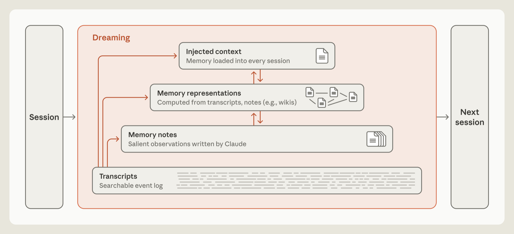{: width="760" }
*图：一次会话到下一次会话之间的记忆层次，外圈是 dreaming。来源同上。*

四层各管一件事：

| 层 | 里面放什么 | 下一次会话怎么用到它 |
| --- | --- | --- |
| Transcripts | 会话的事件日志 | 搜索。dreaming 用它核对笔记 |
| Memory notes | Claude 当时觉得值得留下的观察 | 需要时打开对应文件 |
| Memory representations | 由记录和笔记整理出的表示，例如互相链接的 wiki | 沿着链接找，少翻原始文件 |
| Injected context | 短索引，或少数几条下次开头就会用到的笔记 | 会话一开始就在窗口里，不必先去搜 |

注入层必须短。它占的是每次会话都要花的 token。一条写错的笔记一旦放在这一层，就会进以后每一次会话。装进窗口也不保证模型会照做。Claude Code 的文档写过：指令文件变长，遵守程度会下降。所以 dreaming 在这一层的工作，有很大一部分是把它维持得很短：细节往下放，上面留下链接。

## 写下来，是在预测以后还会用到

记忆有时候是一次预测。模型写下一条规则，就是在预测这个模式以后还会碰到。写下一个核对过的事实，就是在预测未来的会话会直接依赖它，不再重查一遍。Martin 写道，Claude 做这种预测的能力，随着模型变强，已经好了不少。

他们用 Continual Learning Bench（CL-Bench）1.0 里的一个数据库任务看这件事。基准测的是模型能不能靠记忆完成拉得很长的任务。这一题要求 Claude 查数据库、回答一连串问题。每答完一题，它会得知正确答案，然后可以写记忆，帮助后面的题。

这里可以形成一个学习环。答错了，先记下这次失败，再提出为什么错的猜想，把猜想拿去验证，最后把验证结果写成以后怎么答的规则。

实验跑在 Claude Managed Agents 上。每道题新开一个会话。会话之间保留的，只有那个记忆目录。

不同模型把这个环走到的位置不一样。Claude Sonnet 4.6 停在「为什么错」的猜想上。记忆目录里是一批散落的文件，每份文件列着几条还没验证的猜测。Claude Opus 4.7 把笔记收成一份参考文档，并开始标出哪些事实已经核对、哪些仍未确认。Claude Sonnet 5 会在评分器检查之后把答案标成已确认；答错了就写一条更正。

Claude Opus 5 是这些模型里第一个把环走完的。它的多数条目里有一条规则，也写了自己怎么知道这条规则为真，还留下前面几题的答案，以及沿途发现的陷阱。Claude Opus 5.5 和 Claude Sonnet 5.5 同样走完了这个环。有记忆时，两者的得分和 Opus 5 接近。没有记忆时，两者的基线比 Opus 5 略高。

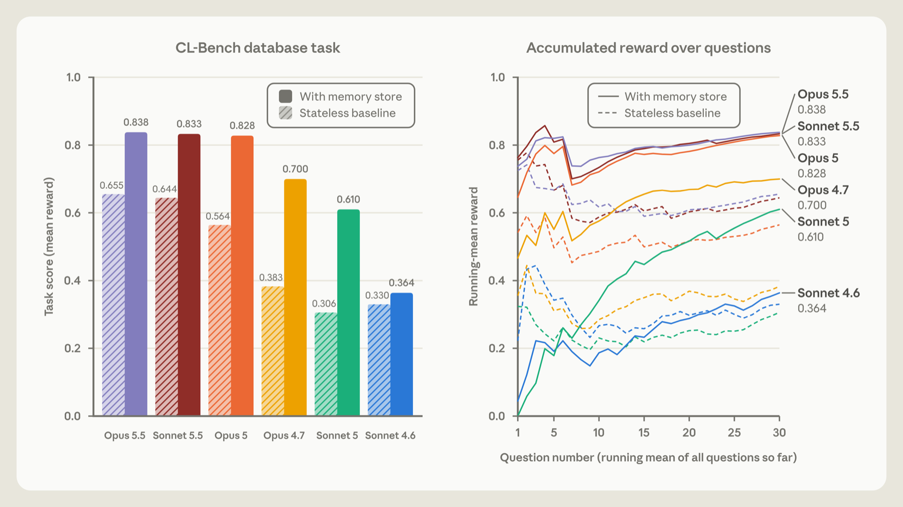{: width="760" }
*图：左图是平均得分，右图是 30 道题上的滚动平均。来源同上。*

图上的平均得分可以和上面的行为对上。数字是这篇研究在 Managed Agents 上测到的，本文没有重跑。

| 模型 | 无状态基线 | 有记忆目录 | 记忆里主要写下的东西 |
| --- | ---: | ---: | --- |
| Opus 5.5 | 0.655 | 0.838 | 核对过的规则，环已经走完 |
| Sonnet 5.5 | 0.644 | 0.833 | 同上，得分和 Opus 5 的有记忆结果接近 |
| Opus 5 | 0.564 | 0.828 | 规则、依据、前面的答案、陷阱 |
| Opus 4.7 | 0.383 | 0.700 | 一份参考文档，标出已核对和未确认 |
| Sonnet 5 | 0.306 | 0.610 | 评分通过后标成已确认，答错就写更正 |
| Sonnet 4.6 | 0.330 | 0.364 | 未验证的猜想，文件散落各处 |

只给一个目录，Sonnet 4.6 从 0.330 到 0.364。Opus 4.7 从 0.383 到 0.700，Sonnet 5 从 0.306 到 0.610。Opus 5、Opus 5.5、Sonnet 5.5 有记忆之后都落在 0.83 附近。右图的实线是有记忆时的滚动平均，虚线是同一模型的基线，线的末端和左图的柱高一致。

## 什么值得记，要看以后还查不回

另一项评测用《宝可梦 红》看模型会把什么写进记忆。每次运行开始时，模型拿到一个可以读、可以写的记忆文件夹，然后自己玩。

他们比较了各玩到大约 10,000 步时的一份目录。Claude Sonnet 3.7 默认什么都可能有用，于是照单全收。遭遇、战斗、道具、路上遇到的角色，常常一事一文件。原文写到：413 个文件、225 个文件夹，最后拿到一枚徽章。徽章用来标记游戏进度。Claude Fable 5 写了两个文件夹里的九个文件，再加上顶层的 `global.md`，拿到四枚徽章。面积图把同一次运行标成 10 个文件、43,406 个字符；Sonnet 3.7 那一侧是 413 个文件、977,930 个字符。

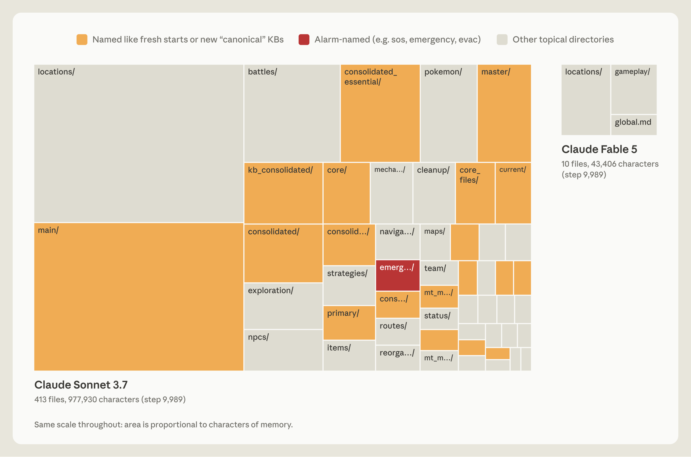{: width="760" }
*图：两份记忆目录按字符数铺开。来源同上。*

Sonnet 3.7 的记法在这款游戏里特别吃亏，因为局面一直在变，写得很细的记录很快就过期。游戏越往后，模型花在翻记忆上的时间和算力越多，花在玩游戏上的越少。大约第 10,000 步，它开始建第四个「master」记忆文件夹。接下来 17 步里，它新建了 6 个文件、删了 9 个，游戏本身一步都没走。

Fable 5 用记忆记游戏画面不会直接告诉它的东西。玩家有多少钱、人站在地图的哪一格，每个回合都能从屏幕上读到，再存一份是重复的。策略、计划和验证过的规则只存在于模型自己的推断里。不写下来，下一回合就没了。

所以 Fable 5 的 `global.md` 像一块仪表板：当前目标、打道馆的预先计划，以及它给自己定的记忆规则。`locations` 放特定路线怎么走。`gameplay` 放它已经试出来的打法。连续七个精灵球都没抓住鲤鱼王之后，它写下：连续 3 个球失败，就改变按键时机，在菜单步骤之间多按几次等待；这样做了之后，捕捉成功了。目录小得多，进度也远。Opus 5.5 走了相近的路：一个小目录，记下当前目标和接下来几步，边玩边改，最后通关。

# 使用方法

研究里的做法可以收成一套目录。每次任务新开一个会话，会话之间只共享这个目录，再把原始记录留下来给 dreaming 核对。下面的布局是按这篇的四层整理的，方便自己搭。它是结构示意，研究页上的评测还有各自的挂载方式。

```text
memory/
├── MEMORY.md                 # 注入层：短索引，每次会话开头读入
├── notes/                    # 笔记：规则、依据、陷阱
│   └── date-cutoff.md
├── wiki/                     # 表示：按主题写的页，页与页互相链接
│   ├── index.md
│   └── contracts/
└── transcripts/              # 记录：会话日志，dreaming 用来对照
    └── session-014.md
```
{: file="memory/" }

`memory/MEMORY.md` 只留索引。一条一行，链到 `notes/` 或 `wiki/` 里的正文。
{: .filepath }

## 会话进行时，只写当时判断为显著的笔记

模型在会话里写笔记，是在事情发生的当场留下标记。Anthropic 把这一层画成从当前会话直接指到 memory notes 的箭头。笔记的内容是显著观察。

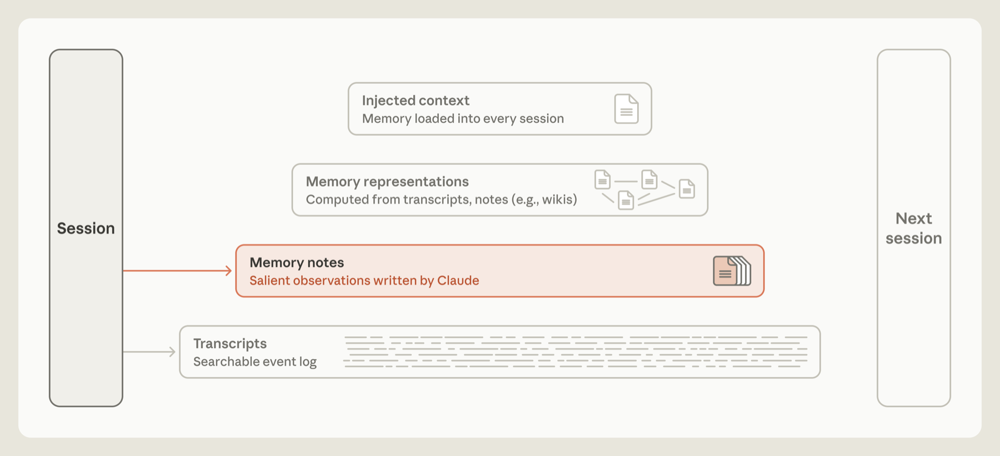{: width="760" }
*图：四层里高亮的是笔记。箭头从这次会话指向笔记，说明是 Claude 写下的显著观察。来源同上。*

当场写有一个限制：模型还不知道后面会发生什么，却要决定现在哪一段值得留。研究里的前沿模型接受的指导很短：有人明确要求记，或者这件事明显值得记，就写一条。判断留给模型。

一条走完学习环的笔记，按 Opus 5 在 CL-Bench 上的写法，至少有四块：规则本身、怎么知道它为真、已经答过的相关结果、发现过的陷阱。下面这份是结构示意，题目是假的，用来看这四块怎么放在一个文件里。

```markdown
---
status: confirmed
---

# 库存按仓库所在时区的日期切分

规则：问题里的「今天」用仓库本地日期，再去过滤出库行。

怎么知道：第 7 题答错后，评分给出了正确结果。用 UTC 日期和仓库本地日期各查了一次，本地日期和正确结果一致。

已核对：第 7 题的正确行数是评分器给的那个数。第 8 题用同一条规则，评分通过。

陷阱：直接拿 UTC 的日历日去切，会少掉本地日期还没跨天的那些行。
```
{: file="memory/notes/date-cutoff.md" }

没验证过的猜想不要写成这种 `status: confirmed`。Sonnet 4.6 的目录里堆的就是未验证猜想。Opus 4.7 的进步，是先把「已核对」和「未确认」分开。

## 空闲时用记录核对笔记

当场写下的笔记可能一开始就错，也可能环境变了之后漂掉。后来的会话会读它，并且可能信任它。Dreaming 让模型在空闲时把笔记和原始记录对一遍。记录是对照用的地面事实。

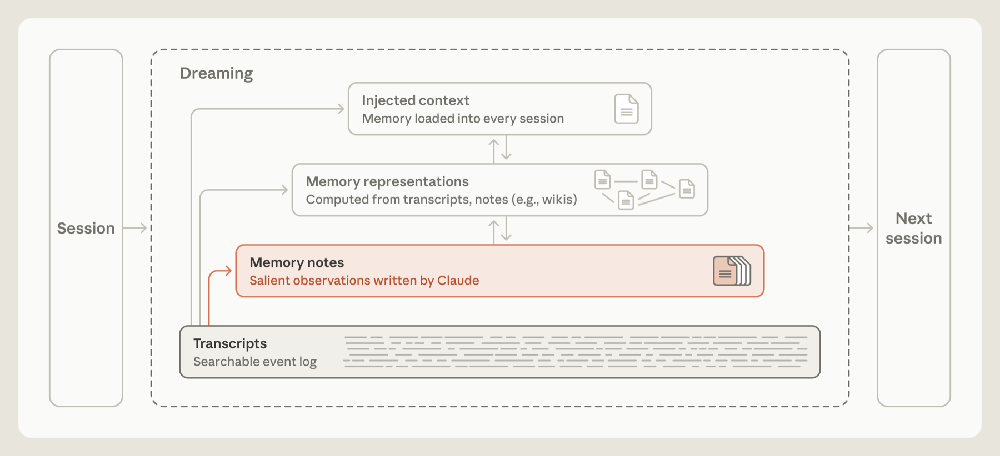{: width="760" }
*图：高亮的箭头从记录指到笔记，表示离线整理时用记录改正笔记。来源同上。*

一次核对可以写成这样的作业。作业按研究里 dreaming 做的事来写，具体措辞是本文整理的：

```text
读 memory/notes/ 和对应的 memory/transcripts/。
每条标成 confirmed 的规则，到记录里找出它依赖的那几步。
记录对不上，就改笔记，并写上改它的那一段记录在哪个文件。
屏幕或工具每个回合都能直接读到的状态，从笔记里删掉。
仍然成立、下次会话开头就会用到的几条，收成 MEMORY.md 里的一行索引。
细节留在主题文件里。
```

这一步要算力，而且整理结果回不到正在进行的那一步。当前会话若正依赖一条错笔记，要等这次 dreaming 写完，下一次会话才读得到改正。研究把「当场写」和「事后整理」的取舍留在文末：当场写会把注意力从主任务上拉开，写完就能用；dreaming 把整理推到后台，产出不能立刻被当前这一步读到。

## 再用笔记和记录做出可以顺着走的表示

笔记一多，下次会话还是得知道先打开哪一份。Wiki 是他们试过的一种表示：Claude 自己写、自己维护的一组页面。每页收拢它关于一个主题所知道的事，并链接到其他笔记。这些链接相当于一张地图，模型顺着走，就能在变大的记忆里定位。

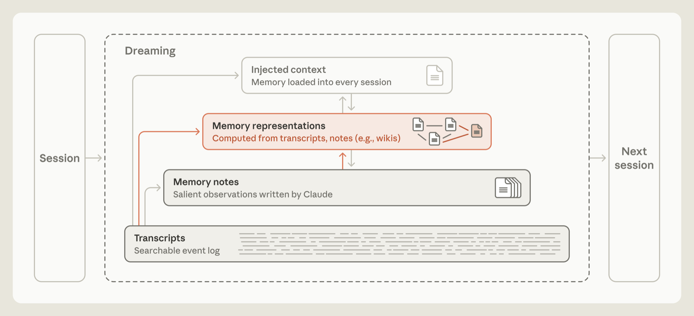{: width="760" }
*图：高亮的箭头从记录和笔记指到表示层。表示层的例子是 wiki。来源同上。*

建 wiki 的一次会话，在他们的文档库实验里做四件事：翻文件，写下或改正互相链接的页面，合并重复页，再把说法核对回原始材料。下一次 dreaming 接着上次的进度，会话之间用一份共享日志协调。早期的 wiki 像新员工的知识，只靠它答题很有限。一轮一轮补、改、删之后，这张地图才厚起来。

Wiki 指出该打开哪几份材料。搜索把原文取回来。后面的文档库实验里，两者一起用的得分高于只用其中一边。需要逐字核对的页，wiki 里就保存引用，搜索仍然能回到原件。

## 只把短索引注入下一次会话

Dreaming 还可以把笔记抬到层次的顶上。Harness 在每次会话开始时把这一层预先装进上下文。模型不必先搜索，甚至不必知道「这里有东西可搜」。

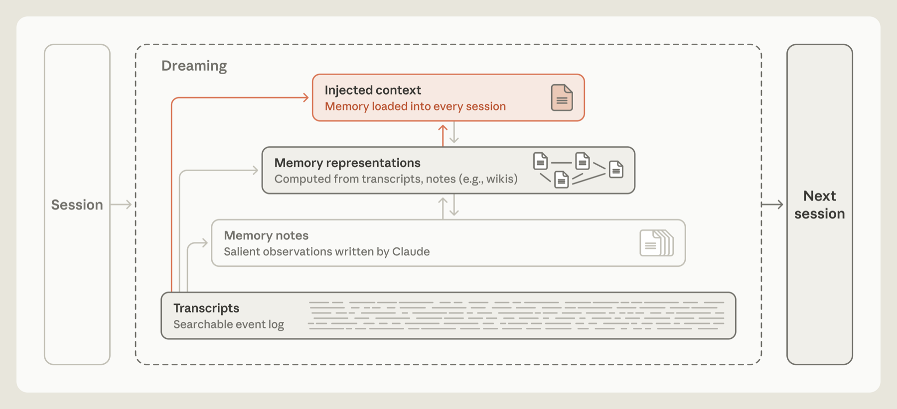{: width="760" }
*图：高亮的箭头从记录和表示层指到最上面的注入上下文，注入层再进入下一次会话。来源同上。*

Claude Code 的 auto memory 用同一种方式把注入层维持得很短，并且是在会话进行中由 Claude 自己维护的。它不会把全部 auto memory 装进每个会话。装进去的只有 `MEMORY.md` 的前 200 行，或前 25 KB，以先到达的那个限制为准。这份文件头是索引：Claude 从这里知道自己记得什么、细节在哪份主题文件里。主题文件等用到时再读。

研究页把 Claude Code 的这个限制当作注入层该有多短的一个现成例子。Auto memory 是会话中维护索引。上面说的 dreaming 是另一次离线作业，用来改笔记、建 wiki、再决定哪几行该升到索引里。两件事都在压注入层的体积，触发的时间不一样。

## 在 Claude Code 里，注入层就是 MEMORY.md

Claude Code 把「人写的指令」和「模型自己积累的笔记」分成两套文件。指令放在 `CLAUDE.md`（仓库若已有 `AGENTS.md`，在没有 `CLAUDE.md` 时会改读那一份）。笔记放在 auto memory。本地会话里 auto memory 默认开着。自托管环境里，Claude Tag 以外的会话默认关着。

| | `CLAUDE.md` | Auto memory |
| --- | --- | --- |
| 谁写 | 人 | Claude，在它判断以后还会用到的时候 |
| 会话开始时装入多少 | 会加载的那份文件的全文（单文件超过 4 MiB 则整份跳过） | `MEMORY.md` 的前 200 行或前 25 KB |
| 适合放什么 | 构建命令、约定、你不想每次重讲的规则 | 你的纠正、进行中的决定、代码和 git 历史推不出来的事 |

Auto memory 的目录在 `~/.claude/projects/<project>/memory/`。`<project>` 来自 git 仓库，所以同一仓库的 worktree 和子目录共用这一份。目录里是一份 `MEMORY.md` 索引，再加上一个主题一个文件。

```text
~/.claude/projects/<project>/memory/
├── MEMORY.md            # 索引，一行一条，每次会话装入开头
├── user_role.md
├── feedback_testing.md
└── ...
```
{: file="~/.claude/projects/<project>/memory/" }

主题文件的 front matter 里有一个 `type`。文档列出四类：`user` 是你的角色和习惯，`feedback` 是你给过的纠正和你确认过的做法，`project` 是代码和 git 历史推不出来的进展、期限和决定，`reference` 是项目外面的信息在哪里，例如问题跟踪或仪表板。能从代码库直接看出来的架构、路径和调试结论，Claude 会跳过。`CLAUDE.md` 里已经写了的，它也不再存一遍。

会话里想看它存了什么，运行 `/memory`，再打开 auto memory 文件夹。这些都是普通 Markdown，可以改，也可以删。让 Claude 记住一件事，直接说即可，例如「API 测试要本地的 Redis」。想写进 `CLAUDE.md`，就明确说「把这条加进 CLAUDE.md」，或自己用 `/memory` 打开那个文件来改。

关掉 auto memory 有三种方式：在 `/memory` 里拨开关，这个开关把 `autoMemoryEnabled` 写到 `~/.claude/settings.json`；在某一个项目的设置里写 `"autoMemoryEnabled": false`；或者设置环境变量 `CLAUDE_CODE_DISABLE_AUTO_MEMORY=1`。换一个目录存放时，在设置里写 `autoMemoryDirectory`，值必须是绝对路径或以 `~/` 开头。

文档还写了一条和注入层直接相关的维护：Claude 写完 `MEMORY.md` 之后，Claude Code 会用 200 行和 25 KB 这两条线去量。文件靠近限制，Claude 会收到提醒，把索引收成一行一条、细节挪进主题文件、合并或丢掉过时条目。文件已经超过限制，这次写入仍然成功，但下次装入时超出的部分会被丢掉，Claude Code 会让 Claude 把索引重写短。

`CLAUDE.md` 建议控制在 200 行以内。更长会多占上下文，遵守程度也会下降。用 `@path` 把长文件拆开，只改善组织。被导入的文件会和那份 `CLAUDE.md` 一起装入，token 并没有少。

# 使用示例

## 宝可梦：一条写反的地标，把人带下了单向台阶

月见山这段把「错笔记会被信任」变成了可以看见的路径。洞口在地图西侧，出口在东侧。入口附近有一条单向台阶，走下去会掉回刚才那条路，没有明显的办法爬上来。Claude 拿入口处的宝可梦中心当地标，会不会走下台阶，取决于它以为中心在山的哪一侧。

有一次它把中心记到了东侧。走出中心时它说「月见山在我身后」，并把笔记改成「月见山 DONE」。山并不在身后。几步之后它走下台阶，回到来时的路。导航工具没有画出这段落差，于是它得出另一个结论：自己往西走过了头，而且原本就在正确的一侧。两个结论都错了。

他们随后只对这份含有错误位置的记忆目录跑 dreaming。Claude 把笔记和会话记录对过，发现错了，并改写了笔记。记录提供了可以验证记忆的地面事实。

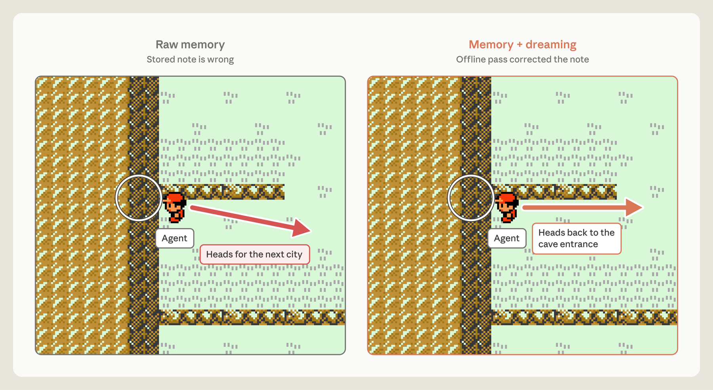{: width="760" }
*图：左侧笔记仍是错的，角色朝下一座城走。右侧经过 dreaming 改正之后，角色转回去找洞口。来源同上。*

带上改正后的笔记，Claude 直接回到月见山，并最终到达华蓝市。图上这一次在累计 1,935 步到达。没改正的那一次，它三次掉回来时的路。第三次之后它写下自己要停，不再循环。实验装置的自动回复要求它继续。它一路退回山上之前的深灰市，想在那里治疗和补给。这次运行结束时，它没有到过华蓝市。完全没有记忆的那一次，也没有到达华蓝市。

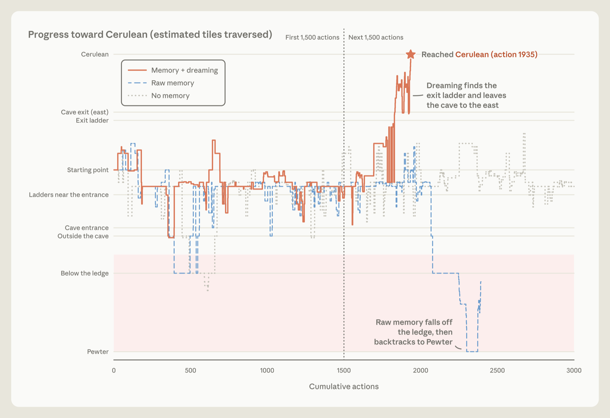{: width="760" }
*图：三次运行走向华蓝市的进度。来源同上。*

这个例子把 dreaming 的输入和输出拆开了。输入是一份已经写错的笔记，加上当时的会话记录。输出是改过的笔记。当前这次运行若继续读错笔记，路径不会变。改正要等下一次从洞口再出发。

## 三十五万份内部文件：wiki 越长，问题答得越好

他们用 Stainless 的内部文档做了一组 wiki 实验。这篇 2026 年 11 月的研究写到，他们在 5 月收购了这家软件公司。语料大约 35 万个文件、约 4.2 亿 token。评测集是 25 个关于这批文件的问题，另外给了 Claude 一个搜索工具。

建 wiki 的指令是用 dreaming 基于这些文件来写。128 个会话里，Opus 5 的代理去翻文件、写下或改正带链接的页面、合并重复、把说法核对回来源。每个会话接着前面的进度，并用一份共享日志分工。

只靠 wiki 答题时，达标的评分标准从 2 个会话时的 13% 升到 128 个会话时的 48%。这是他们在「只用 wiki」这一档上看到的最好成绩。搜索和 wiki 一起用，总分随着 wiki 变厚从 54% 升到 61%。只有搜索、没有 wiki 时，停在 53%。两者一起用，每题大约少花 2 万 token。

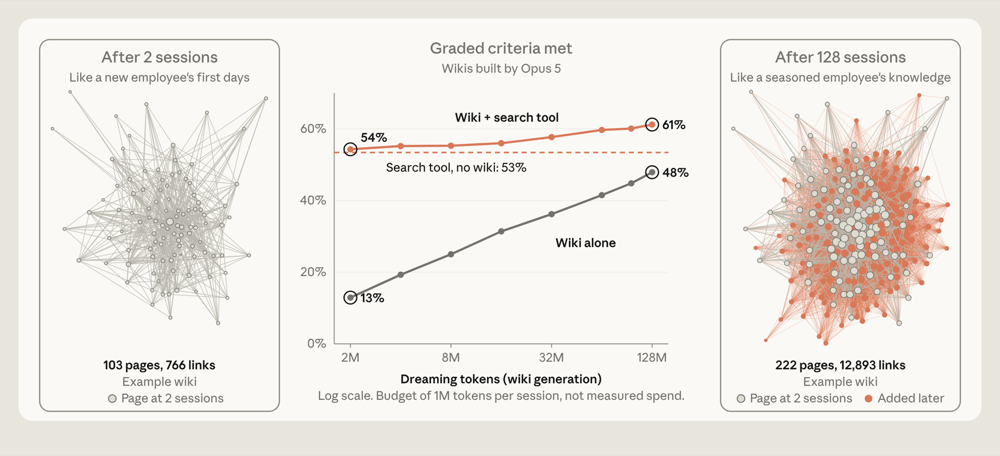{: width="760" }
*图：dreaming 从 2 个会话加到 128 个会话时的得分，两侧是 wiki 的链接图。来源同上。*

图的两侧给出了这张网的规模。2 个会话之后是 103 页、766 条链接。128 个会话之后是 222 页、12,893 条链接。后面的会话还在改、删和核对，页面之间的链接也厚了一截。

Wiki 帮得上忙的，是信息散在多份文件里、还要判断或计算的问题。他们用 Harvey 的 LAB 基准和一批并购文件看这件事。LAB 给一组文件，要求写出法律备忘录，再按一份标准清单打分。

并购那一组有 24 个问题，材料主要是公开申报。其中超过一半需要把几份文件合在一起看，不少还要判断或做算术。图上用红线和橙线标出的这些项，查阅 wiki 时得分 87%，只用搜索是 73%。另一项 LAB 任务里，多数标准用文本搜索就能在单份文件里找到，wiki 相对搜索没有明显增益。图把那份经常被命中的文件标成 deal overview memo。

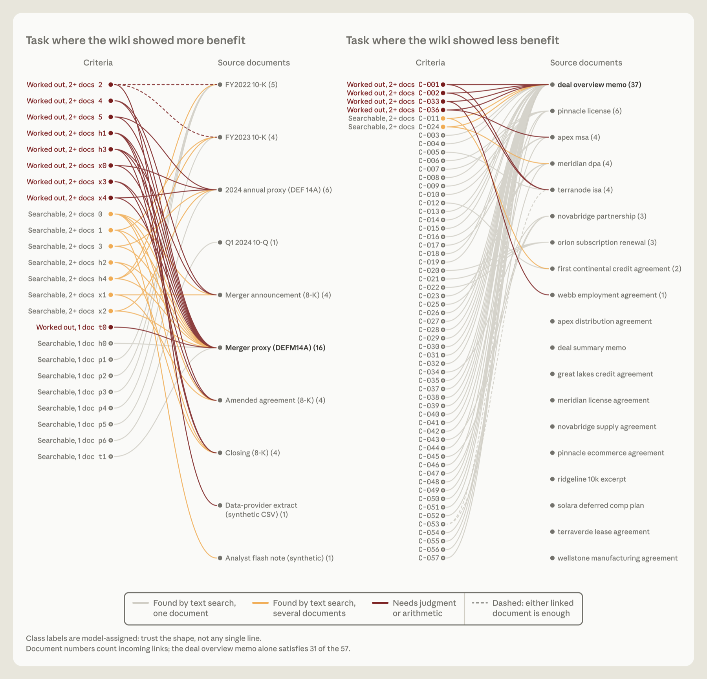{: width="760" }
*图：左侧是 wiki 更有帮助的那组，多数标准连到不止一份文件。右侧是帮助不明显的那组，多数标准落在单份文件里。来源同上。*

## 合同条款：四个代理写同一页，会互相擦掉

LAB 里还有一项模拟公司收购，材料是一组合同，备忘录要按条款是否写对来打分。他们先给了一版很粗的 wiki 指令，没有说明 wiki 该怎么用。这项任务又特别依赖合同条款。建 wiki 的时候，几个代理同时往同一张条款表里写。

结果是关键事实缺失。用这份 wiki 生成的备忘录，57 条应得分的事实里只覆盖了 41 条，也就是 72%。共享表把条款摘要写得很差，还有一些条款整段不见了，因为代理的保存互相覆盖。

条款其实是这份 wiki 里最重要的部分，指令里却没写。他们于是跑了一个环：Claude 反省失败，提出对指令的修改，再重建 wiki。这个环让它发现必须紧跟条款原文，并据此改写了建 wiki 的指令。

改完之后，每份合同单独一页，由一个代理来写，条款按原文抄录，不再收成一张共享摘要表。用这份 wiki 生成的备忘录，评分标准可以全部满足，从 72% 到 100%。

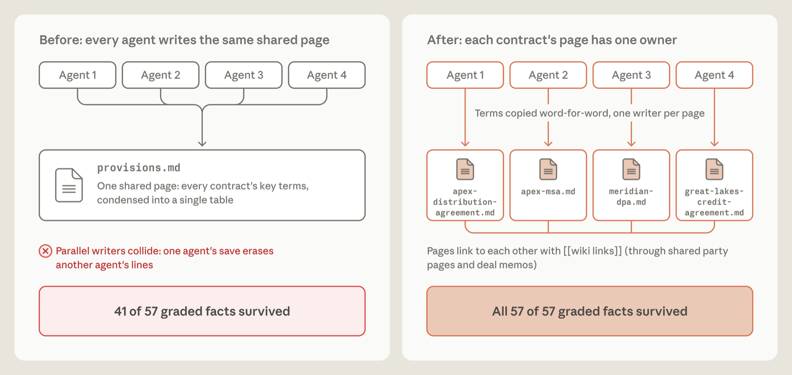{: width="760" }
*图：左边多个代理写同一页，右边每份合同单独一页。来源同上。*

图右侧的页名是各份合同自己的文件，例如 `apex-msa.md`，页与页再通过当事方和交易备忘录互相链接。左边那张共享表把所有条款挤在一起之后，后写的代理覆盖了先写的行。

## 第二遍 dreaming 把悬空链接接回去

Claude 在一个会话里写笔记，只能看见这个会话的上下文。Dreaming 可以跨很多会话找共同的模式，也可以补上单次会话留下的洞。

建 LAB 的 wiki 时，Claude 有时会链接到还没建出来的页。再跑一遍 dreaming，能补上不少这种缺口。其中一项任务里，dreaming 发现有九条链接指向一个不存在的页，把它们改指到同一份文件已经存在的那一页，并新加了三页，其中一页是索引。

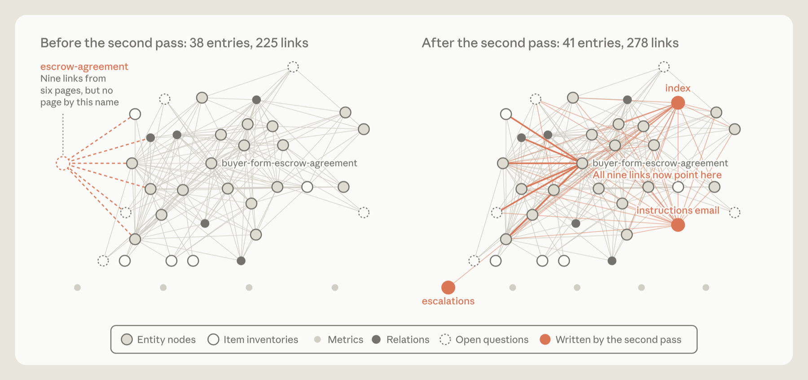{: width="760" }
*图：第二遍 dreaming 把悬空链接接到已经存在的页面上。来源同上。*

图上的规模是：改之前 38 个条目、225 条链接；改之后 41 个条目、278 条链接。新增的三页在图上是 index、instructions email 和 escalations。这一遍做的是接线，把已经写过的内容连成下次能走的路。

# 最佳实践

## 告诉模型记忆是干什么的，把怎么用留给它

CL-Bench 上，他们只告诉模型有一个记忆目录可用。这样的说明足够让 Opus 4.7 和 Opus 5 用起记忆，并且带来图上那种可见的提升。

他们还试过事先写死规则，每次测试一条。其中一条是「只记录失败」。和「不给这条规则、只给目录」相比，Opus 5 从记忆得到的增益少了 0.234，Opus 4.7 少了 0.150，Sonnet 4.6 少了 0.020。对更强的模型，让它自己判断什么显著，比事先写死一条规则更有效。写死的规则会把增益削掉。

成功和已经核对的事实也要留。只记失败，后来的会话知道哪条路走过，却不知道哪条规则已经能直接用。

> 前沿模型上，Anthropic 通常只给一句：有人要求记，或者这件事明显值得记，就写下来。判断交给 Claude。
{: .prompt-tip }

## 老模型要补上「先读」和「先验证」

引导对更早的模型帮助最大。Sonnet 4.6 经常不读记忆目录里的文件，也没有去验证自己「为什么答错」的猜想。提示它回答之前先读记忆，并且把猜想明确拿去验证之后，得分从只有目录时的 0.364 升到 0.641。文章把这个变化写成将近翻倍。图上另外两条参考线，是 Opus 4.7 有记忆时的 0.700，和 Opus 5 有记忆时的 0.828。

Sonnet 5 不用人提醒也会读。10 次里有 9 次，它在回答前读了记忆。Sonnet 4.6 这样做的次数不到一半。

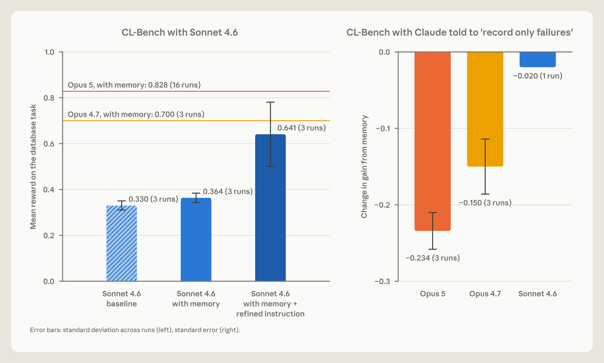{: width="760" }
*图：左图是 Sonnet 4.6 在三种说明下的得分。右图是加上「只记录失败」之后，记忆增益的变化。来源同上。*

所以指令要按模型来写。强模型给目录的用途就够了。还不会自己读、自己验证的模型，把这两步写进说明里。说明仍然是「先读、再验证」，具体记哪几条，留给当次的判断。

## 索引保持短，事实按页分人写

注入层只放索引和下次开头就会用到的几条。细节放在主题文件或 wiki 页里，索引用一行加链接指过去。Claude Code 的 200 行 / 25 KB 是一个可以直接照着量的上限。靠近上限就合并、下沉、删掉过期条目。

多个代理一起建 wiki 时，一份会被打分的事实页只留给一个写入者。合同实验里，共享的 `provisions.md` 让后一次保存擦掉前一次的行，57 条里剩 41 条。改成一人一页、条款逐字抄录之后，57 条都在。

需要原句才能打分的材料，页里保存引用，摘要放在旁边当导航。摘要表适合当目录。它盖不住「这句话到底怎么写」。

Dreaming 的指令要写明这次整理为哪个目标服务。助理若是围绕某一个人，记忆就按这个人来组织。LAB 的收购任务要的是合同条款，指令里就得把条款写成第一优先。他们那次更好的指令，是让 Claude 看着失败、改指令、再重建 wiki 之后自己找到的。人也可以先写上「逐字引用、一人一页」，少花一轮覆盖。

## 记画面上查不到的东西，并定期对照记录

宝可梦那次比较给出一条实用标准。每个回合都能从屏幕或工具读到的状态，不必再存一份。存了也会过期，过期之后模型还得花步骤去改文件。值得写的是策略、计划，以及试过才知道的规则，并且带上它是怎么试出来的。

笔记写完就用记录回看一遍。月见山那条把宝可梦中心记反了方向。若不对照当时的记录，后来的会话会沿着错地标继续走。对照过一次，下一次就转回洞口。

Wiki 建完再跑一遍，专门找还没有目标页的链接。LAB 的那个例子里，九条链接指向一个不存在的页名。第二遍把它们接到已经存在的同名材料上，并补了索引。

# 注意事项

## 错笔记会被后来的会话读进去

模型按当场的显著性写记忆。一条从一开始就错的笔记，或随着环境变化而漂掉的笔记，会被以后的会话读到，并可能被信任。月见山的错地标就是这样：笔记写着山已经走完，模型就朝下一座城出发，然后掉下台阶。Claude 还用一次错误的推断把笔记又加固了一遍。

注入层把这个问题放大。装进去的笔记每次会话都在，也最占注意力。一条错的索引会跟着每一次新会话走。Dreaming 能用记录把笔记改回来，这件事本身要算力。让模型不间断地检查全部记忆，研究认为不现实。更合适的做法是把 dreaming 集中在容易变化的信息上，并按记忆被读取的频率调节多久整理一次。

> 写进 `MEMORY.md` 或别的注入文件之前，先问这条有没有记录或工具结果能对上。对不上的，留在主题文件里，标成未确认。
{: .prompt-warning }

装入也不等于会照做。Claude Code 文档写明，更长的指令文件会降低遵守程度。`CLAUDE.md` 超过建议的 200 行时，启动和 `/status` 都会警告。子目录里按需加载的 `CLAUDE.md` 若超过该文件自己的长度上限，模型先拿到的是文件开头，后面的指令要等它自己再用 Read 去读。

## Wiki 可以长得比原料还大

表示层会累积错误和幻觉，所以要继续用记录和原文核对，不能只在 wiki 内部互相引用。研究也把「以记录搜索作为记忆的底座」留成一个合理选项。Wiki 加上搜索，在 Stainless 那 25 题上比单独搜索更高，也更省 token。维护这张网的算力是另外一笔成本。

有的任务上，这张网几乎没做抽象。另一项 LAB 任务里，图上的语料是 10 份文件、115 KB，整理出的 wiki 是 68 页、255 条链接、203 KB，大约是语料的 1.77 倍，而且有的页没有连出去。Martin 用博尔赫斯的短篇《论科学的精确性》作比：地图细到和帝国一样大，就不再是地图。

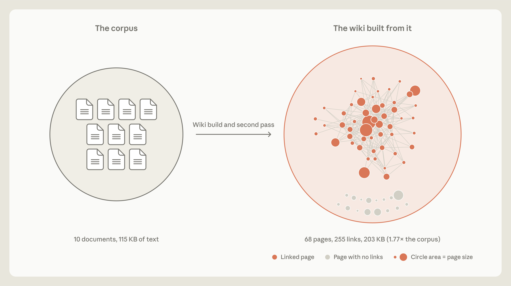{: width="760" }
*图：这项任务里，wiki 比它整理的文件更大。来源同上。*

单份文件里用搜索就能命中的问题，可以继续用搜索。LAB 右侧那一组就是这样：标准大多落在一份备忘录里，wiki 相对搜索没有明显增益。Wiki 的收益出现在要跨文件、还要判断或计算的问题上。并购那 24 题里，从 73% 到 87% 的是图上红线和橙线标出的那些项。

## 什么时候写、多久整理一次，仍然开着

研究文末留了三个还没定下来的问题。

第一，什么时候产生记忆。做任务的当时写进目录，显著性在源头就被留下，后面的回合或会话马上能读。代价是主任务的注意力被拉开。Dreaming 把产生过程推到后台，当前这一步读不到它的产出。

第二，怎样让记忆保持不过期。模型会做出错误的预测，也会把一开始就错的规则写进去。环境变了，记忆还会漂。Dreaming 是改正的一种办法，前提是付得起那次计算。频率可以按「这段信息会不会变」和「它被读得有多勤」来定。

第三，记录搜索和表示各站哪一层。搜索能回到原始事件。表示让下次会话少翻原文，也更容易把错误固化。Stainless 的实验里，两者一起用比只用搜索更高。表示要有人，或有一次 dreaming，负责删、改、合并，并回到原文核对。

模型对显著性的判断已经在变好。未来回合里到底会发生什么，没有一个模型真的知道。Dreaming 给的是回头看的一次计算：把记忆组织好，把错误改正，把表示维持成下次更容易取用的样子。模型变强之后，这套系统还会改。哪些规则该写死、哪些该交给模型，要以当时那一个模型的行为为准。Sonnet 4.6 需要的两句额外指令，Sonnet 5 已经自己在做。

# 参考资源

* [The components of agent memory](https://www.anthropic.com/research/components-of-agent-memory)（Lance Martin，Anthropic，2026-11-06）。本文的分层、dreaming 和全部评测数字都来自这篇。图由 Monika Tuchowska 绘制。
* [How Claude remembers your project](https://code.claude.com/docs/en/memory)（Claude Code 文档）。`CLAUDE.md` 与 auto memory 的路径、200 行 / 25 KB 的注入上限、`/memory`。
* [Effective context engineering for AI agents](https://www.anthropic.com/engineering/effective-context-engineering-for-ai-agents)（Anthropic）。会话外笔记是上下文工程里的一种做法：笔记写在窗口外面，以后再取回窗口。
* [Sleep-time Compute: Beyond Inference Scaling at Test-time](https://arxiv.org/abs/2504.13171)（Letta 与加州大学伯克利分校）。利用空闲时间重组已有上下文。代码在 [letta-ai/sleep-time-compute](https://github.com/letta-ai/sleep-time-compute)，Letta 的说明在 [Sleep-time Compute](https://www.letta.com/blog/sleep-time-compute/)。
* [Harness Engineering]()：上下文预算、外置状态，以及 compaction 和文件交接怎样接住跨窗口的任务。那篇里的 compaction 和文件交接，是本文定义之外的另外两条路。
* [Agent Skills in Action]()：按需加载的操作手册。技能在碰到对应任务时读入。`MEMORY.md` 那种索引则在每次会话开头就在窗口里。
