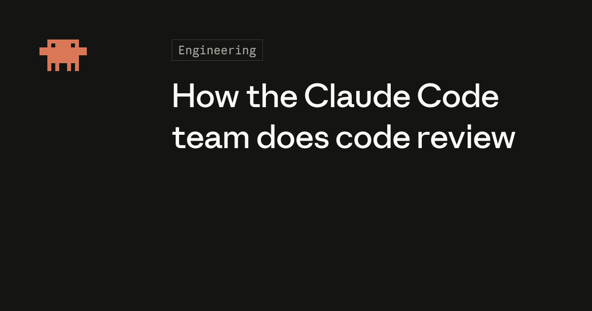
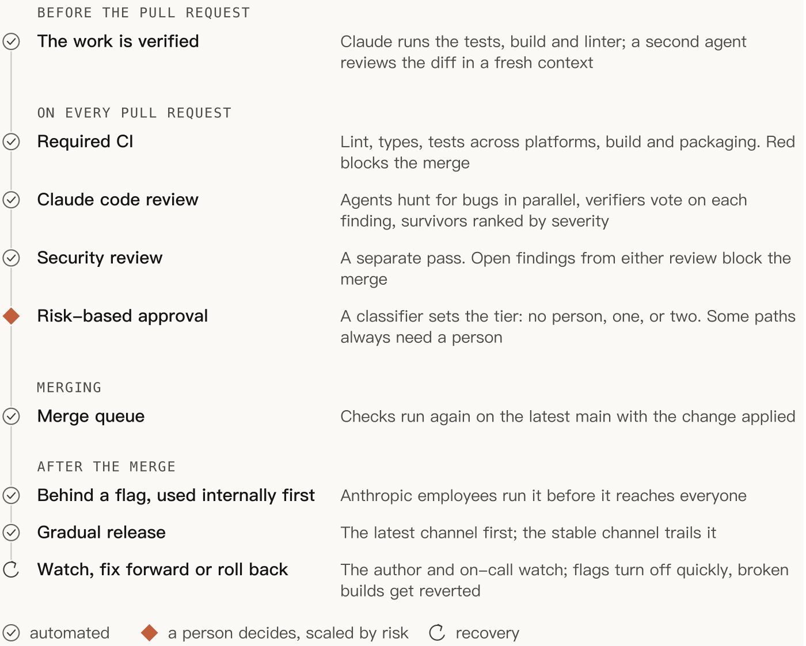
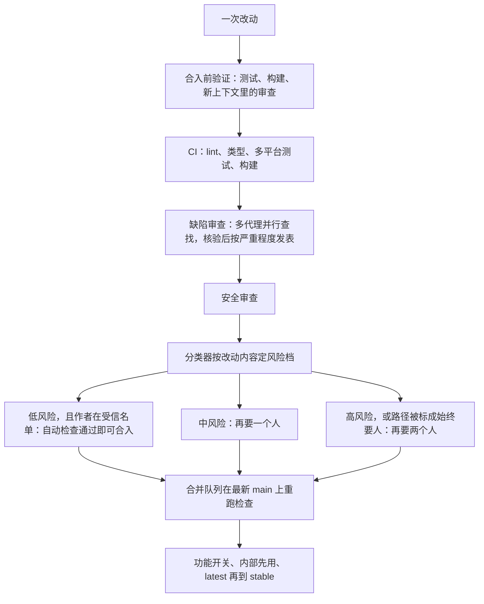
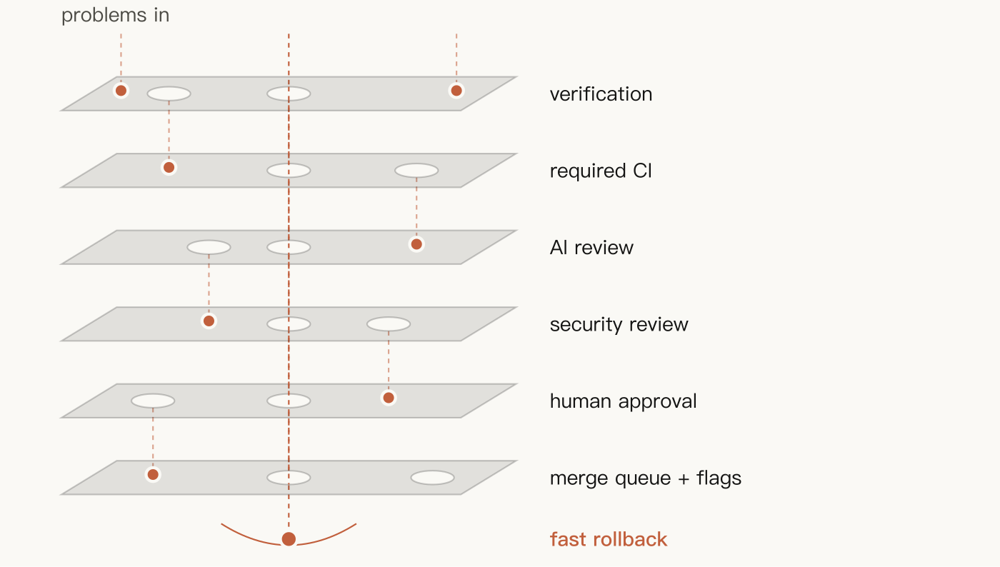
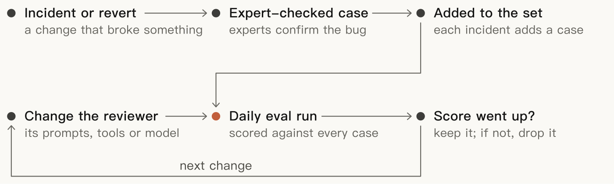
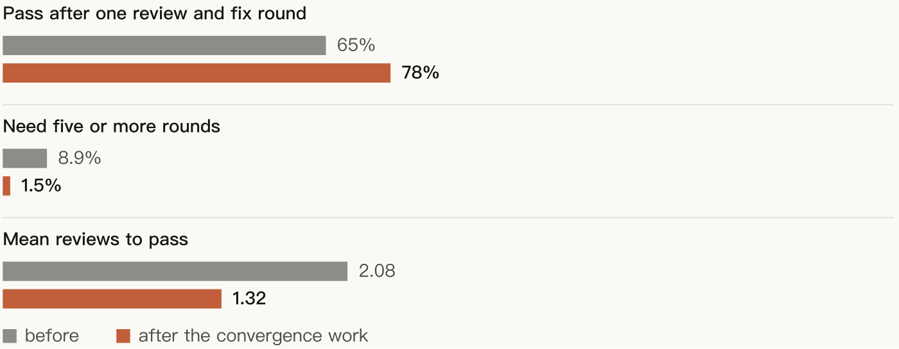

* Do not remove this line (it will not be displayed)
{:toc}

> 本文按三份第一手材料交叉核对。[How the Claude Code team does code review](https://claude.dev/blog/solving-code-review-at-anthropic/)（Addy Osmani、Morgan Westlee Lunt、Qing Wang，2026-10-15）写的是 Claude Code 团队自己的审查流程；[Code Review 文档](https://code.claude.com/docs/en/code-review)写的是同一套能力做成托管服务之后，GitHub 上实际会做什么、不会做什么；[Bringing Code Review to Claude Code](https://claude.com/resources/articles/code-review)给出研究预览阶段的内部统计。下文的四张流程图和柱状图取自那篇工程博客的原图。GitHub、IBM、Early、Collin Wilkins、Sourcegraph、DeepSource、CodeAnt、Matt Pocock 的 skill 说明，以及 r/devops 上的那条讨论，各自的判断写在后文「其余参考链接里的判断」，不只出现在文末链接表。模型侧怎样把一次任务跑完，见 [Harness Engineering]()。
{: .prompt-info }

Claude Code 团队在 2026 年 10 月的工程博客里写过一个前提：Claude 写出了 Claude Code 自己大约九成的代码。审查要回答的问题因此变了。改动从 5 月到 9 月在 Anthropic 单体仓库里涨了一个数量级，每天合入的变更从大约 2500 次涨到超过 30000 次。Claude Code 自己的仓库是分开的，压力同样在。6 月到 9 月，这个仓库合入的 pull request 数量翻了一倍多，其中不得不撤回的比例下降了四成以上。

仓库外面也量到了同一次位移。[CodeAnt 的工具文](https://codeant.ai/blogs/best-ai-code-review-tools)转述了几份 2025 到 2026 年的测量。Faros AI 跟踪一万多名开发者、1255 个团队：用了 AI 编程工具的团队，完成的任务多 21%，合并的 pull request 多 98%，审查时间增加 91%。GitClear 对 2.11 亿行改动的分析里，两周内又被改掉的代码从 3.1% 升到 5.7%，2020 到 2024 年复制粘贴增加 48%。同一篇文章还引用 GitHub Octoverse 2025：每月合并约 4320 万条 pull request，同比增加 23%，新代码里大约 41% 有 AI 参与；并转述 CodeRabbit 自己的分析，AI 生成的代码每条 pull request 的问题是人工代码的 1.7 倍，逻辑错误多 75%，安全问题是 1.5 到 2 倍。这些数字的原始报告本文没有再打开核对，这里记的是 CodeAnt 文中的转述。

他们没有取消审查。阅读大部分交给了机器，人的时间被留在风险上，同时把撤回做快。目标写得很具体：Claude Code 的 CLI、桌面端、网页和移动端仓库里，多数 pull request 在至多一个人类参与的情况下合入，这个人可以就是作者本人；撤回率和事故率不能因此上升。

{: width="760" }
*图：原文题图。栏目是 Engineering，标题是 How the Claude Code team does code review。来源：[claude.dev 工程博客](https://claude.dev/blog/solving-code-review-at-anthropic/)。*

# 原理与核心概念

## 审查要完成的两件事

代码审查一直同时做两件事。第一件是在合入之前找到并修掉问题。第二件是让团队对代码库形成共同理解：读同事的 diff，是在看清这块代码现在长什么样。

2026 年 10 月那篇文章主要讲第一件，并在后文回到第二件。作者们认为，「有没有一个人读过这段代码」是一个粗糙的代理指标。更可操作的问题是：这次改动可能坏在哪里，哪一层检查——自动的或人的——适合抓住它。

这个问法把审查从路尽头的门，挪到了书写过程里。以前的顺序是写完、开 pull request、等同事。现在多数改动在人被叫来看之前，已经至少被 Claude 审查并修过一轮。常规错误在这一轮里被处理掉，人的注意力留给更高一层的问题和需要盯紧的改动。Anthropic 把这个变化比作写字时的拼写检查。

## 稀缺的是人的时间和注意力

人的时间出现在审查成本的两边。一边是人花在读 diff 上的时间。另一边是坏代码漏出去之后，人花在修复上的时间。只砍掉第一边，时间会从事故和撤回里长回来。

所以他们同时记两类数。人的时间看每条 pull request 的人类批准次数（中位数和第 95 百分位）、人类评论数，以及一条 pull request 等人看了多久。护栏是撤回率和事故率。护栏上升，就说明省下来的阅读时间只是被挪走了。

[IBM 对 AI 代码审查的说明](https://www.ibm.com/think/insights/ai-code-review)（2024-10-15 发表，2026-10-28 更新）把同一件事说成效率：人用一小时找的缺陷，工具可能几分钟标出来，人随后把时间花在修改上。Anthropic 多加的那一条是，必须用漏到生产环境的缺陷来核对这个「省下的时间」是真的。

## 一次改动的路径

一条典型改动从工程师的笔记本出发，或者从 Slack 里的一次 Claude 会话出发，然后穿过好几层检查。下图是原文的 FIG A。圆点是自动步骤，菱形是按风险由人决定的那一步，圆弧箭头是合入之后的恢复。

{: width="760" }
*图：原文 FIG A，The life of a change。合入前先验证；每条 pull request 上有 CI、Claude 审查、安全审查和按风险分级的批准；合并队列会在最新的 main 上再跑一遍检查；合入后先给内部用，再从 latest 通道放到 stable 通道，并保留快速撤回。配色按原文浅色主题导出，文字是原图。来源同上。*

图里的顺序可以收成一张决策图。自动层先走完，分类器再按改动内容决定还要几个人。



# 一次改动要经过的层

原文的 FIG B 把这些层画成一叠筛子。问题从上面落下来，每一层接住一部分，也放走一部分。穿过所有层的那一小部分，交给最下面的快速撤回。

{: width="760" }
*图：原文 FIG B，Layers, not one gate。从上到下是验证、必需的 CI、AI 审查、安全审查、人工批准、合并队列和功能开关。橙点是这一层接住的问题，白点是漏过去的。虚线弧下面写着 fast rollback。来源同上。*

## 合入之前，先让改动能被检查

现在大部分审查发生在 pull request 出现之前。团队给 Claude 一件它能自己跑的东西：测试、构建，或者一张可以和设计稿对比的截图，并要求它拿出输出。Claude Code 的创建者 Boris Cherny 把「给 Claude 一种核对自己工作的办法」称作得到好结果最重要的一件事。他的估计是，这样做会让最终结果好两到三倍。验证的样子随领域变：一条 bash 命令、一套测试、浏览器或手机模拟器里把应用点一遍，都算。

然后一个带着新上下文的子代理再读一遍 diff。写代码的那个会话里堆着当时的假设，新上下文里的审查看不到那些假设。这个习惯写在他们的最佳实践里，也和后来公开的本地命令对得上：`/code-review` 在终端里会作为一个后台子代理运行，使用自己的上下文窗口。

开 pull request 之前，不少人还会跑几个内部 skill：一个专门找缺陷，一个把 diff 收短，一个把行为从头到尾走一遍。界面改动还要对照设计规范。公开产品里和这三件事最接近的入口是 `/code-review`、`/simplify` 和 `/verify`。`/code-review` 找正确性缺陷，`/simplify` 只做清理和抽象层级，`/verify` 把应用跑起来确认改动是工作的。三者的分工见[命令文档](https://code.claude.com/docs/en/commands)。

同一类意见如果被自动审查反复提起，他们就改源头：改 skill、加一条 lint，或者改 `CLAUDE.md`、`REVIEW.md` 这类说明文件。审查者每次都会读 `CLAUDE.md`。仓库大的时候这份文件保持短，并从这里指向其他文档。审查也会标出违反其中约定的代码，以及让其中某一行过时的改动。

`REVIEW.md` 由代码所有者来写，只告诉审查者这一块什么重要。好的文件很短。它写明这个仓库里的失败长什么样：文档仓库的失败是「它在撒谎」，配置仓库的失败是「它把流量送到了错的地方」。它限制吹毛求疵的条数，列出可以跳过的路径，并要求用文件和行号当证据。摘要要从一个计数写起，没有问题就直说没有。

## 每条 pull request 上的缺陷审查

人看之前，每条 pull request 都会先经过 Claude。它对照整个仓库和 pull request 里写明的意图读 diff，问三件事：这次改动有没有解决它要解决的问题，放进系统里合不合适，会不会弄坏别的东西。面对一个缺陷修复，它会去找根因。

公开版本就是 [Code Review](https://code.claude.com/docs/en/code-review)，现在对 Team 和 Enterprise 计划一般可用。本地的 `/code-review` 是更轻的一版，任何计划都能在自己的会话里跑。

研究预览上线时，内部 pull request 里收到实质性审查评论的比例从 16% 涨到 54%。这个数字同时出现在工程博客和产品文里。产品文补充了粒度：改动超过 1000 行的 pull request 里，84% 会有发现，平均 7.5 条；不到 50 行的里面，31% 会有发现，平均 0.5 条。工程师把发现标成不正确的比例不到 1%。产品文还写过一次内部案例：一行看起来很普通的生产服务改动，会被人快速批准，审查却标成严重，因为它会弄坏这个服务的认证。作者事后说，自己一个人看 diff 时不会抓住它。早期客户里，TrueNAS 开源中间件的一次 ZFS 加密重构中，审查指出了相邻代码里原有的类型不匹配：每次同步都会悄悄清掉加密密钥缓存。这种旧问题在后来的分级里对应 Pre-existing，好让它和这次作者新引入的缺陷分开。

托管服务在 Anthropic 的基础设施上分四步走，仓库访问是只读的，审查不会构建或运行代码：

1. 发现。几个代理并行阅读 diff 和周围代码。
2. 核验。另一步把候选发现拿回去对代码，滤掉误报。工程博客里的内部说法更具体：一组代理同时找缺陷，另一组对每条发现投票，同意的人够了才发表。只关乎风格、诊断或清理的发现会被丢掉。这些过滤器先在他们自己的 pull request 上做了对照试验。
3. 排序。留下的发现去重，并按严重程度排列。
4. 发表。行内评论、审查正文里的摘要，以及一条名为 Claude Code Review 的 check run。没有发现时，check run 的标题会写成 Code review found no issues。

每条发现带三个级别之一：

| 标记 | 级别 | 含义 |
| :--- | :--- | :--- |
| 红色 | Important | 合入前应该修的缺陷 |
| 黄色 | Nit | 值得修，但不该挡住合入 |
| 紫色 | Pre-existing | 代码库里原本就有，这条 pull request 没有引入 |

管理员按仓库选择 Quick、Standard 或 Deep。Standard 是默认。Deep 用在漏掉一个缺陷的代价高于多出来的审查时间的地方。产品文在研究预览阶段写过，当时一次审查大约 20 分钟。现行[费用文档](https://code.claude.com/docs/en/code-review-costs)按 token 用量计费，没有统一的单次标价；花费随审查级别、改动大小、周围代码的复杂程度，以及有多少候选问题需要核验而变化。

内部规则是每条发现都要有回应：修掉，或者写明理由并关掉讨论串。后面的提交如果修掉了问题，发现会自己清掉。公开产品把这件事放松了：讨论串可以不回应就合并，除非仓库自己的分支保护要求先解决对话。下一次审查会读你对旧发现的回复，并可以在它判断问题已经修好时关掉旧讨论串。同一类发现反复出现时，维护者应该把规则写进 `REVIEW.md`。

## 安全审查和必需的 CI

安全审查是单独的一遍。在 Claude Code 自己的仓库里，缺陷审查或安全审查还有未关闭的发现时，pull request 不能合并。误报的清法是写一句短理由并关掉讨论串。博客给出的对外做法是开源的 security review GitHub Action，或本地的 `/security-review`。后者比较当前分支和 `origin` 上默认分支的 diff，看注入、认证和数据暴露这一类风险，并且需要仓库已经配置 `origin`。

CI 是常规的那一层：lint、类型检查、每个平台上的测试，以及构建。一条 CLI 的 pull request 在人看之前可能已经跑了几十项检查。Pull request 模板要求写明怎么测的、怎么撤回。Claude 可以填这些栏，发起这次改动的人要签字认可。

> 托管服务的 Claude Code Review 检查保持中性，不会以失败结束，也不会代替一个人的批准。Claude Code 仓库里「发现不处理完不能合」，是他们自己的分支规则。想在自己的仓库里挡住 Important，需要另外加一条读取严重程度计数的检查。做法见下文的示例。
{: .prompt-warning }

## 按风险请来的人

文档修复和自动更新器的改动风险不同，审查人数也不同。一个分类器读改动并选出档位。第二个分类器再问：即使档位说不用加人，这一条具体的改动要不要再叫一个人。所有者标成敏感的路径，以及任何 CI 工作流文件，始终要人。

| 风险 | 例子 | 还要几个人批准 |
| :--- | :--- | :--- |
| 低 | 文档、文案、仅内部的功能、放在功能开关后面的纯新增 | 自动审查和安全检查通过之后，可以不要 |
| 中 | 普通的产品改动，以及缓存、自动更新器、系统提示词这类敏感区域 | 一个人 |
| 高 | 风险最高的代码，外加一小部分始终要两个人的路径 | 两个人 |

只有受信作者名单上的人走更轻的路径，名单上多半是这块代码的所有者。其他人始终还要第二个人。智能体的批准不能占掉一个人的名额。自动审查可以把一条低风险改动放行，不能填上一个要求人类的位子。

发起这次改动的人要负责。智能体写的 pull request 上，指挥智能体的那个人算一个必需的审查者，和他亲手打出这些代码时一样。一次批准只覆盖一个具体的提交。系统无法代为担保的新提交——例如智能体又推了一次，或有人手工解决了合并冲突——需要重新批准。

人仍然留在这几件事上：

- 决定要不要做。方向、口味和范围。有的团队即使认为审查瓶颈已经解开，外来改动也仍要人问一句「我们真的要做这个吗」。
- 阅读账单、自动更新器、CI 工作流这类高风险代码。
- 阅读会变成别人照抄的样板的架构。
- 阅读证据。测试输出、跑过的命令和它的返回、截图、审查者的发现。如果你说不出这些检查会漏掉什么，就该要一次真正的审查，而不是一次快速批准。
- 为结果负责。每一条合入的改动都有一个人对它负责，无论代码是谁打出来的。

## 合并队列、灰度和快速撤回

合并队列会把这条改动应用到最新的 main 上，再跑一遍全部检查。两条各自能通过的 pull request，因此不会在合到一起时弄坏主干。

新行为通常先放在功能开关后面给 Anthropic 员工用。公开版本先到 `latest` 通道，`stable` 通道跟在后面。功能开关可以不发版就关掉。Claude Code 有每周的值班。事故复盘要问的是哪一层本来应该抓住它。

发现一次坏的合并，目前仍依赖作者、值班的人，以及撤回和事故的仪表盘。他们还没有在这些数字变差时自动收紧批准的断路器。工程师希望在更多代码走向「零个人批准」之前先有这个机制。博客里引用了一位同事的判断：放慢确实会降低错误率，主要是因为你把所有事情都做得更少了。他们选择把发现问题和修问题做得更快。

合入之后还有一条团队惯例：小改动和中等改动如果仍然出了问题，通常由合入它的人来修。几件事让这条惯例不至于变成追责。改动小，所以好审查、好调试、好撤回。功能开关、撤回和分阶段发布能在几分钟里撤销大多数错误。爆炸半径决定门槛，贵的代码得到更多人和更多检查。回归靠遥测和内部使用很快浮出来。事故复盘看的是系统。拥有修复，是因为这个人当时上下文最多。

# 公开的 Code Review 怎么用

托管服务要由 Claude 组织的 Owner 打开，安装 Claude GitHub App，再选仓库。审查跑在 Anthropic 的基础设施上，仓库里不用提交工作流文件。适用面写在[设置文档](https://code.claude.com/docs/en/code-review-setup)里：Team 和 Enterprise；代码托管在 GitHub，包括 GitHub Enterprise Server 和带数据驻留的 GitHub Enterprise Cloud。开启了 Zero Data Retention 或 HIPAA 配置的组织不能用，这项服务也不在 Anthropic 的商业伙伴协议覆盖范围内。使用客户管理加密密钥的组织目前也不能用。开发者即使通过 Amazon Bedrock、Google Cloud 的 Agent Platform 或 Microsoft Foundry 使用 Claude Code，组织本身仍要有一份符合条件的 Claude 计划。

每个仓库单独选择审查何时运行。从管理页加入的仓库，起点是每次推送都审查，这是花费最高的一档。

| 设置 | 什么时候跑 |
| :--- | :--- |
| 创建后一次 | pull request 被打开、重新打开，或从草稿标成可审查时 |
| 每次推送 | 分支每次推送。新问题会被看见，修好的讨论串会被自动关掉 |
| 手动 | 打开和推送都不跑。有写权限的人评论 `@claude review` 才跑；`@claude review always` 会让这条 pull request 在之后的推送上也跑 |

草稿和来自 fork 的 pull request 会跳过自动审查。机器人的评论不能启动审查。2026 年 7 月的一次更新之后，单独的 `@claude review` 只跑一次；以前它会订阅后续推送。需要订阅时要写成 `@claude review always`。仓库如果已经设成每次推送都跑，评论停不掉，要把 pull request 转回草稿。

如果仓库里的 Claude Code GitHub Action 仍用默认的 `@claude` 触发词，一条 `@claude review` 会把 Action 也叫醒。两边要分开，就把 Action 的 `trigger_phrase` 改成别的短语。

## 五条入口，读到的文件不一样

官方文档把审查入口分成五条。本地命令任何计划都能用，托管服务要 Team 或 Enterprise。

| 入口 | 谁能用 | 在哪里跑 | 读哪些说明 |
| :--- | :--- | :--- | :--- |
| 托管 Code Review | Team / Enterprise，Owner 打开之后 | Anthropic 的基础设施 | 基线分支上的 `CLAUDE.md` 和 `REVIEW.md`，不读这条 pull request 自己改过的副本 |
| `/code-review` | 任何计划 | 你自己的 Claude Code 会话 | `CLAUDE.md`。它不读 `REVIEW.md` |
| `/code-review ultra` | 登录 claude.ai；有次数和用量限制 | 云端沙箱 | 更深的多智能体审查。Bedrock、Agent Platform、Foundry、Zero Data Retention 和 HIPAA 会改在本地跑；客户管理密钥不能跑这一档 |
| 自己的 CI，例如 GitHub Actions | 有 API 密钥或云厂商凭证的人 | 自己的 runner | 由你写进提示词和工作流的内容决定 |
| 自己的子代理或 skill | 会写 skill 的人 | 你运行 Claude Code 的地方 | 由这个 skill 决定 |

两边都要生效的项目约定，写进 `CLAUDE.md`。只在 pull request 审查里生效的规则，写进 `REVIEW.md`。托管服务从 pull request 的基线分支或默认分支读 `REVIEW.md`，从不读这条 pull request 里刚改的那一版。所以要先把 `REVIEW.md` 的修改合并进去，下一次审查才会按新规则工作。

降低严重程度、排除路径、限制 Nit 条数，这些指令要在受保护的默认分支上才会被遵守。默认分支没有保护时，审查可能只读到根目录那一份，甚至一份都不用。子目录里的 `REVIEW.md` 可以给该目录下的改动加规则，但 `test`、`tests`、`vendor`、`generated`、`examples` 这类目录名下的文件不会被采用。细节和 15 万字节的上限见[自定义文档](https://code.claude.com/docs/en/code-review-customize)。

## 一份能让审查收敛的 REVIEW.md

下面这份文件按官方文档要求的结构来写，内容对着后面的会话刷新示例。它重新定义 Important，把 Nit 限制在五条，把 CI 已经挡住的事和生成文件排除掉，并要求行为类结论带行号。

```markdown
# Review instructions

## What Important means here

Important is a bug that can ship a live session or a credential:
refresh racing with logout, a token accepted after it expires, or a
raw token written to a log. Naming and comments are Nit at most.

## Cap the nits

Report at most five Nits per review.

## Do not report

- Lint, formatting, and type errors that CI already fails
- Generated files under `src/gen/` and lockfiles

## Always check

- A change under `src/auth/` names the test that fails if the bug returns
- Logs do not contain raw tokens, email addresses, or refresh bodies

## Evidence

Cite a file and a line. A guess from a function name is not a finding.
```
{: file="REVIEW.md" }

`CLAUDE.md` 继续放项目是什么：技术栈、约定、目标和明确不做的事。审查说明变长之后，官方支持在根目录的 `REVIEW.md` 里用单独一行 `@review-security.md` 把旁边的文件包含进来。包含只在受保护分支上生效，最多八个文件。指向 `.claude/skills/.../SKILL.md` 时，审查只读那份 Markdown 的正文，不会执行 skill，也不会运行其中的命令。排除项和 Nit 上限仍要写在 `REVIEW.md` 里。

# 使用示例

## 开 pull request 之前在本地走一遍

假设你在 `auth-refresh` 分支上改了会话刷新。写代码的会话先把能复核的输出留在对话里，再开一个新会话做审查。新会话看不到前一个会话里「这里应该没问题」的推理。

```text
# 写代码的会话：把命令和输出留在对话里
npm test -- src/auth/session.test.ts

# 新会话，针对这次改动的目录做一次覆盖更广的审查
/code-review high src/auth

# 同一条分支上再跑一遍安全 diff
/security-review
```

`/code-review` 不带目标时，审查的是当前分支相对上游多出来的提交，加上尚未提交的改动。没有上游时，它和 `main` 比，或者和前一个提交比。`low` 只报告它最有把握的发现，误报更少。`medium` 到 `max` 把覆盖面拉宽。`/code-review high src/auth` 里的路径是审查目标。发现先读一遍，再决定要不要加 `--fix` 让它改工作区。`--fix` 的编辑走你的权限模式，后台审查改过的其他文件不能单靠 `/rewind` 收回，要用 git 还原。

社区 skill 如果也叫 `code-review`，会顶掉 Claude Code 自带的这一条。官方说明里，`/review` 这个别名仍会跑自带的审查。[Matt Pocock 的 code-review skill](https://www.aihero.dev/skills-code-review)就碰到了这个名字冲突。那份 skill 做的是另一件事：一个子代理看仓库规范，另一个子代理看需求规格，两份报告不合并成一个总分。装它之前要决定你要的是找缺陷，还是核对「写得符不符合约定」和「做的是不是需求要的那件事」。

## 一条看起来平凡的鉴权改动

下面这条走查按产品文里的「一行改动弄坏认证」和文档里的发现表格改写，用来看各层分别接住什么。它是示例，不是一份内部 diff。

作者让会话把令牌刷新的超时从固定值改成按时钟偏差计算，并跑过单元测试。测试是绿的。新会话里的 `/code-review high` 指出 `src/auth/session.ts` 第 142 行：刷新和登出抢同一份会话，登出先完成时，刷新仍会把旧会话写回去。这是 Important。同一份报告里还有一条 Nit：`parseExpiry` 在输入坏掉时静默返回 0。

作者修掉竞态，并在 Nit 的讨论串里写明「返回 0 会让上层把会话当成立即过期，这是故意的」，然后自己 resolve 这条线程。只回复、不关掉线程，发现仍然开着。托管审查再跑一遍时，竞态那条会在新 diff 上被核验；修好之后，下一次审查可以自己关掉旧讨论串。

这条路径被所有者标成认证相关，分类器把它放进至少要一个人的档。指挥这次会话的作者自己算一个审查者。他要看的是测试输出、审查发现，以及自己能不能说出检查会漏掉什么。批准只覆盖这个提交。如果会话随后又推了一次「顺手清理」，批准要重来。

合并队列在最新的 main 上重跑 CI。合入后，行为放在功能开关后面先给内部用。如果内部使用看到旧会话复活，开关关掉，不用等下一次发版。事故复盘要写的是哪一层本该抓住它：是测试没覆盖登出和刷新的交错，还是审查没把 Pre-existing 的会话锁问题标出来。

## 想让发现挡住合并时，自己加一道门

托管服务把严重程度计数写在 check run 详情的最后一行，形如：

```text
<!-- bughunter-severity: {"nit":1,"normal":2,"pre_existing":0} -->
```

`normal` 是 Important 的条数。自己的 CI 可以读这一行：标题是 Code review not repeated 且重要发现还开着，就让任务失败；`normal` 大于 0，也可以让任务失败。完整的 `gh` 取数步骤在[阅读 pull request 上的审查](https://code.claude.com/docs/en/code-review-pull-requests)。先在几十条 pull request 上看团队把多少 Important 修掉、多少条被标成错误，再把这道门接上。Collin Wilkins 在[把机器人放进 pull request 流程的文章](https://collinwilkins.com/articles/ai-code-review-best-practices-approaches-tools)里把同一顺序写成三级：先只发报告，再给高风险改动加标签，最后只对很窄、信号很稳的规则做硬门，例如密钥已经出现在 diff 里。

# 怎样把发现做准

审查者本身也在一条循环里改。事故和撤回被收成评测集。熟悉那段代码的工程师确认缺陷在哪里、修复或撤回落在哪一次提交。审查者每天对这整套用例跑一遍。提示词、工具或模型一改，就对全部历史用例重新打分。分数上升才留下这次改动。

{: width="760" }
*图：原文 FIG C，Our incidents are the eval。上面一行从事故或撤回到专家确认，再把用例加进集合。下面一行是改审查者的提示词、工具或模型，每天用全部用例打分，分数上升才保留。底部的箭头标着 next change。来源：[工程博客](https://claude.dev/blog/solving-code-review-at-anthropic/)。*

## 噪声要用作者的反应来量

多抓缺陷很容易，只要你同时容忍大量不是缺陷的评论。他们按 pull request 上的人怎么回应来给每条评论分类：修了、说它是错的、说这个行为是故意的、或者觉得无关紧要。他们也会把审查者跑在已知是干净的 pull request 上，数它有多少次会引诱人做出有害的修改。写下来的优先级是：先抓住真缺陷，再减少审查轮次。

[Early 的 2026 年实践文](https://www.startearly.ai/post/ai-code-review-how-to-make-it-work-for-you/)补充了一点：接受率本身是一个弱指标。开发者可能接受噪声，也可能用不同方式修掉一条真问题。他们建议同时看可行动发现的精确率、在预先埋入的缺陷上的召回、严重程度是否和真实风险对齐、多久能给出有用反馈，并把漏出去的缺陷单独记账。这和 Anthropic 按四种回应分类、外加在干净 pull request 上测有害修改，是同一类测量。

噪声在作者是智能体时更贵。人可以几秒钟挥掉一条 Nit。智能体会把它修掉，于是多一次提交、多一轮审查。[r/devops 上关于 AI 生成代码审查的讨论](https://www.reddit.com/r/devops/comments/1x1olt9/ai_generated_code_review/)把这个循环说成日常问题：审查模型往往比写代码的模型更强，线程会越开越多，而且审查者没有开发者当时拿到的全部上下文。发帖的人还写了另一头。不熟悉代码库的同事，包括并不做工程的人，可以用任意模型提交改动。有多年上下文的审查者还能看出安全和效率问题，换一个队友就看不出来。他想到的办法之一，是在组织里发一份统一的审查 skill 或规则，让每个人提交前先自查一遍。帖子最后问的是：以后是不是可以不再管代码怎么写出来，只看合并请求能不能工作、有没有达到目标。

## 审查必须收敛

写代码的智能体和审查的智能体可以永远互相找事做。一条 CLI 的 pull request 曾在夜里走过五十多轮审查和修复，直到作者叫停。他们对审查者反复标记的代码做了 `git blame`：大约 59% 在审查者第一遍时就已经在那里。后几轮很少是在找新缺陷，而是在每一轮里再多翻出几条旧的。

团队自己也把这件事做重了。他们习惯默认跑好几轮，因为每一遍都能再抓到一点东西。这在高风险改动上值得，不该是每条 pull request 的默认。他们开始把「几轮才通过」和召回一起看，并改了复审：

- 三轮之后，审查者要求作者退一步，重新想做法。
- 前几遍之后，复审只看新的 diff。
- 标出缺陷的类别，让作者修掉这一类的每一处，而不是一行。
- 已经发表过的发现不再重复发表。

公开产品把「复审只看新 diff」和「少重复旧发现」做成了默认行为。自动触发的后续审查聚焦上次以来的变化，并少发 Nit 和 Pre-existing。审查正文里会有一句话，说明有多少发现因为不在这次复审范围内而没有发表。想要完整的一遍，再评论 `@claude review`。

收敛改动之后，内部 pull request 的轮次分布是原文 FIG D。一轮审查加一轮修复就通过的比例从 65% 到 78%。需要五轮或更多的从 8.9% 降到 1.5%。平均通过前的审查次数从 2.08 降到 1.32。

{: width="760" }
*图：原文 FIG D，Review that converges。灰条是改动前，橙条是收敛工作之后。三项分别是一轮就通过、需要五轮及以上、平均审查次数。来源同上。*

审查代理也会在夜间扫已有代码，把旧缺陷在别的地方冒出来之前先找到。这和 pull request 上的 Pre-existing 标记是同一件事的两面：旧问题要被看见，同时不要伪装成这次作者新引入的。

Matt Pocock 的 skill 文档把「每次重跑都有新意见」写成一个已知现象。判断类的规范检查每次结果不同，修掉一条又制造新代码。那份说明建议把一次运行当成线索清单，先处理带有引用的那几条，然后停。不要为了等到一份干净报告而循环，因为它不会变干净。Anthropic 用三轮上限和只复查新 diff，给的是同一条刹车。

# 最佳实践

## 写代码的会话不充当独立审查

合入前的子代理、本地 `/code-review` 的后台子代理、托管服务上的另一组核验代理，三处都把「找问题的上下文」和「写代码的上下文」分开。Early 把话说得更紧：一个新会话是另一次审查，它仍不是独立证据。更强的独立来自一个合格的人、一套不同的工具链，或一个不同的模型，再加作者会话里留下的命令和测试输出。

Pocock 的 skill 把结论拆成两轴，避免一条轴的通过把另一条轴的失败盖住。代码符合仓库的每条约定，却做了需求没要的事，规范轴通过、规格轴失败。代码正好实现了工单，却破坏了仓库约定，则反过来。一份揉在一起的总分会让通过的那一轴藏住失败的那一轴。即使不用那份 skill，审查说明里也可以要求两段分开的结论：一段引用 `CLAUDE.md` 或 `REVIEW.md` 的条款，一段引用需求或 pull request 里写明的意图。

## 重复出现的意见写回规则

同一条意见出现第二次，就该离开对话。能写成确定性检查的，放进 lint、类型或测试，让 CI 挡住。只在审查里重要的，写进 `REVIEW.md`，并给 Important 一个这个仓库里的定义。文档仓库和计费仓库不该共用一个「严重」的含义。

[Sourcegraph 对 2026 年自动审查工具的比较](https://sourcegraph.com/blog/automated-code-review-tools)把工具分成两类。静态分析按规则匹配，输出在固定的分析器版本和规则下可以重复，因此适合做合规门。AI 审查读 diff 和周围上下文，能指出「这个函数悄悄吞掉了两个调用方依赖的超时错误」这一类语义问题，同时每次运行的结果会变，不适合单独充当硬门。DeepSource 的[工具页](https://deepsource.com/resources/ai-code-review-tools)用同一组公开漏洞样本给多家产品打分，并把自己的混合引擎排在前面。那是厂商页面上的测量。可以带走的判断是：确定性规则和语言模型审查回答的是不同的问题，分数差很大，选型时要用自己的 pull request 测召回和噪声。

[GitHub 的 AI code review 介绍](https://github.com/resources/articles/ai-code-reviews)把人留在架构、业务逻辑和需求上，把安全扫描当作第一遍，并要求它和人工审计一起用。IBM 列出三种常见失败：误报和漏报、缺少这个项目的上下文、人开始不再自己判断。三种的对策都已经出现在上面的流程里：用 `REVIEW.md` 收紧什么叫 Important，把项目约定放进每次审查都会读的 `CLAUDE.md`，以及让人的批准不能被机器人的批准替换。

## 人留在方向、风险和责任上

省下来的阅读时间要花在机器读不到的地方。

- 这条改动该不该存在。代理让开工变得便宜，所以有些工作不该合入。博客的建议是在讨论串里早一点提出另一条路。代码写得快，关掉 pull request 就不像损失。
- 高风险路径用 CODEOWNERS 和分支保护钉住人：认证、账单、CI 和发布工作流、安装器。
- 证据要能指到行。说不清检查会漏掉什么，就不要快速批准。
- 合入的人负责修小的和中等的回归。事故复盘问哪一层该抓住它，并把这个案例加进第二天的评测集。

代码审查的第二件事是让人理解代码库。团队的做法是：需要理解一块代码时，让 Claude 按这块的现状写一份说明，而不是要求每个人脑子里有一份完整模型。有人会再让它做一个小的可视化，按自己的方式把这块讲清楚。一行文案的 diff 几乎教不会你什么。你正要改的那个模块的说明，能教会很多。他们也默认在公开的 Slack 频道里工作，别人在做的东西当时就能看见。

测量时同时看人的时间和护栏。人的时间是批准次数、人类评论、等人的时长。护栏是撤回和事故。只看审查变快，会把漏报算成效率。

# 其余参考链接里的判断

上面几节用的是 Anthropic 自己的流程和公开产品。你列出的其余链接回答的是旁边的问题：工具分成哪几层、怎样知道评论有用、本地 skill 要怎样才会停、以及代码审查够不够。各家后半篇的价格、席位和「综合第一」不逐条抄进正文。那些数字按厂商页面更新，而且发文的厂商会把自己排在前面。

## 三层工具回答的不是同一个问题

[CodeAnt](https://codeant.ai/blogs/best-ai-code-review-tools)把市面上叫 AI code review 的产品分成三层，并提醒不要跨层比较：

| 层 | 做什么 | 抓得住 / 抓不住 |
| :--- | :--- | :--- |
| 规则型静态分析 | 用预先写好的规则匹配已知漏洞和坏模式。SonarQube 是这一层的典型 | 已知类上的误报可以压得很低。它不理解这次改动想做什么 |
| 外面套了一层 AI 的静态分析 | 检测仍是规则。AI 负责解释、给修改建议，或把问题分拣。文中把 GitHub Copilot Code Review 和 GitLab Duo 放在这里 | 界面更好。深度仍受规则覆盖面限制 |
| 为 pull request 原生做的 AI 审查 | 用代码图、仓库索引或多遍代理找规则写不出来的逻辑问题。文中举例有 CodeAnt、CodeRabbit、Qodo、Greptile、Cursor Bugbot | 能谈意图和跨文件影响。同一次 diff 再跑一遍，评论可以变 |

[Sourcegraph 的比较](https://sourcegraph.com/blog/automated-code-review-tools)把一次 AI 审查拆成三步，并认为模型不如这三步里的管道重要。第一步收下 diff，再向外找被调用的定义、相关测试和这些路径上最近的提交。审查者只能看见 diff 时，评论的上限就是 diff 的上限。第二步把 diff、这份背景和团队优先级一起交给模型。有的产品把安全、风格和逻辑分成几次专门的检查，每次带回带严重程度的发现。第三步才是评论，也是最难的工程：按置信度过滤、和历史审查去重、不在没被改到的行上说话。Greptile 把这个松紧做成档位，CodeRabbit 用跨次审查保留下来的 Learnings 压重复的误报。

[DeepSource 的工具页](https://deepsource.com/resources/ai-code-review-tools)把顺序写成先跑确定性规则，再让 AI 看上下文和数据流。他们用 OpenSSF 的 CVE 基准给多家产品打 F1，并把自家引擎写成最高的 84.51%，同页还列出 Cursor Bugbot 的 80.45%，以及更低的纯语言模型产品。这是厂商页面上的测量。他们据此主张：适合阻断合并的是可重复的静态分析那一层，纯语言模型两次运行的结果可以不同。这个主张和 Sourcegraph 的分层一致，名次本身不要当成独立审计。

[IBM 的说明](https://www.ibm.com/think/insights/ai-code-review)把一次审查写成五步：模型在大量代码上学会常见问题，再用注释、函数名和调用关系推断意图，在 CI 的 webhook 或 IDE 里读 diff 与周围代码，给出带理由的修改建议，然后按人的接受或拒绝调整。静态分析经常先跑一遍，给后面的模型一个基线。项目特有的 API、业务规则和架构图，模型自己没有。IBM 建议用检索或 MCP 把这些材料接进来。[GitHub 的介绍](https://github.com/resources/articles/ai-code-reviews)把安全扫描单列出来，关注输入校验、认证与授权、敏感数据暴露、错误的安全配置，以及带已知漏洞的依赖。它同时把实时提示放在 IDE 里，把人留在架构和需求上。这篇 2025 年 4 月的文章把 GitHub Copilot 写成多数人的默认选择，那是平台自己的介绍。

IBM 文里还有一个和「对照规格」有关的例子。IBM Bob 的审查面板有两种模式：一种把本地改动和任意分支比，一种检查本地改动有没有盖住某一条 GitHub issue。后一种他们写的是目前只支持 GitHub。

## 基准要看开发者有没有按评论改代码

CodeAnt 把这个品类的基准问题说得很直：头几年几乎每一份公开对比都是发文的厂商赢。Greptile 的基准里 Greptile 赢，CodeRabbit 的基准里 CodeRabbit 赢。他们把 2026 年 2 月 Martian 的 Code Review Bench 当作第一次由不卖审查产品的实验室来做的测量。Martian 的研究者来自 DeepMind、Anthropic 和 Meta。线上部分盯着开源 pull request 上的真实评论，问开发者在这条评论之后有没有改代码。线下部分由人类专家在一组受控的 pull request 上评评论质量。两边一起看精确率、召回和 F1。文中的结论是，多数工具只把其中一头做到了：精确率高的评论少、漏得多；召回高的抓得多、也把人淹没。他们同时写明，这份大约 30 万条 pull request 的基准当时没有纳入 CodeAnt 自己。同一篇文章仍按「审查、安全扫描和度量是不是捆在一个产品里」把自己放在综合第一。正文采用的是这个基准的问法，不采用这篇产品文的名次。

这也解释了 Anthropic 为什么不把「评论条数」当质量。他们看的是人修了、驳回了、说是故意的，还是觉得无关，并在已知干净的 pull request 上数有害修改。Early 再补一条：接受率本身很弱，因为人可能接受噪声，也可能换一种方式修掉真问题。

## 代码审查和回归审查是两件事

[Early 的七条实践](https://www.startearly.ai/post/ai-code-review-how-to-make-it-work-for-you/)可以收成一份审查合同，和 `REVIEW.md` 是同一类文件。合同要写明审查者负责什么、忽略什么、每条发现必须带上哪段代码、哪种失败方式和什么证据。格式和确定性风格留给专用工具。默认只读，不改代码，并写明跑了哪些检查、哪些相关检查没跑成。

他们把 2026 年的审查分成两种，限制也不同：

| 形态 | 做什么 | 主要限制 |
| :--- | :--- | :--- |
| 对着 diff 的审查 | 读改动和近处的上下文，返回评论或修改建议 | 检索范围外面的行为会漏 |
| 会自己翻仓库的代理审查 | 分多步找相关代码，可以调用被允许的工具去核实一条发现 | 多出工具权限、费用，以及提示词注入 |

上下文不要一次倒进窗口。Early 列的是一层一层给：全仓库的架构、安全和测试规则；某个路径自己的标准；issue、验收标准和 pull request 说明；这次任务的审查清单；被允许的工单、文档或测试工具。改动仍然要小。模型上下文变大，并没有让一条巨大的 pull request 变得容易判断。说明里要写目标、影响的系统、取舍和已经做过的验证。

他们把「代码审查」和「回归审查」分成两个问题。代码审查问：提议的改动对不对，材料是这条 pull request、验收标准和相关代码。回归审查问：哪些已经存在的行为可能被这次改动碰到，材料是候选发布、行为基线和系统之间的关系。一条审查可以通过，范围之外的行为仍然变了。验证 AI 生成的代码，和审查它，是两件工作。

什么样的问题该交给哪一层，Early 的边界是：

| 交给 AI 审查 | 要小心 | 换一种控制 |
| :--- | :--- | :--- |
| 改动逻辑里缺的边界、不一致的错误处理、不安全的输入或授权、写下来的团队规则被违反、相关文件都在时的跨文件不一致 | 宽泛的架构结论、没有测量的性能或并发判断、只从代码推断产品意图、上下文里看不到的跨系统影响、声称旧行为没变 | 格式和确定性风格、依赖漏洞库、规定必须由人批准的项、运行时监控、靠执行才能证明的回归 |

CI 工作流、基础设施即代码、部署清单、迁移、权限和功能开关，AI 可以找到局部缺陷，这些改动仍然要有策略检查、发布计划、撤回审查和专人批准。

## 审查放在本地、流水线，还是买现成的

[Collin Wilkins](https://collinwilkins.com/articles/ai-code-review-best-practices-approaches-tools)把入口分成三条，和前面的五条 Claude 入口是同一张地图的另一面。

| 放在哪里 | 什么时候用 | 他写的限制 |
| :--- | :--- | :--- |
| 本地 skill 或子代理 | 个人项目、提交前、想要一个没写过这段代码的第二意见 | 只在你调用时才跑。审查者应禁止写和改，只用读、搜索和命令。写代码的会话带着自己的假设，所以另开一个代理 |
| CI | 团队要每条 pull request 都有同一条基线 | 作者先处理机器的评论，人再看意图和设计。提示词、模型和是否阻断都由团队掌握 |
| 厂商产品 | 想少写基础设施 | 他比较了 CodeRabbit 的 `.coderabbit.yaml` 和学习接受/忽略、Greptile 的全仓库索引、GitHub 上把 Copilot 加进审查者、GitLab Duo、以及 Bitbucket 上仍在补齐的 Atlassian Intelligence。控制力随产品变 |

他建议提示词像生产代码一样版本化、被审查，并先在样本 diff 上试，再放到全量 pull request。一份有用的提示词把范围收窄到正确性、安全、可靠性、测试和可维护性，要求引用 diff 里的证据，没把握就标低置信，并限制条数。他用的上限是每条 pull request 八条发现。这和 Anthropic 把 Nit 压到少数几条是同一件事：人处理得了八条，处理不了三十条。

硬门他放在最后，而且只给很窄的规则。先只发报告。大约五十条 pull request 之后，如果开发者接受的发现超过八成，再考虑软门，例如打一个需要留意的标签。密钥已经出现在 diff 里、缺了规定必须有的文件，这一类才做成硬门。高误报的硬门很快会被人绕开。

他用来看效果的数是：从打开到合并的时间、每条 pull request 的审查来回次数、合入后的缺陷率、AI 发现的接受率、最常被驳回的发现类型。文中那笔「抓住四成表面评论、每周五十条 pull request 省下八十小时」是说明方向的算术，不是测量结果。

## 一份本地 skill 要能停下来

[Matt Pocock 的 code-review skill](https://www.aihero.dev/skills-code-review)比「规范轴和规格轴不要合并」多几条用法，否则它会一直跑。

调用时必须给出一个固定点：某次提交、某个分支、某个标签，或 `main`、`HEAD~5`。不给的话，skill 会问，而不是自己猜。它先确认这个引用存在，并且 diff 不是空的，然后才派子代理。

规格轴按这个顺序找需求：提交说明里的 issue 编号，你在参数里给的路径，`docs/`、`specs/` 或 `.scratch/` 下和分支同名的规格文件，最后才问你。完全没有规格时，它跳过规格轴，并写明「没有可用的规格」，不从代码里反推需求。

规范轴在仓库没有成文标准时，退回 Fowler《重构》第三章的十二种代码异味，例如神秘命名、重复代码、依恋情结、霰弹式修改。每一种都标成判断，附上改法，不算硬违规。两条轴都跳过 linter 已经强制的事。

它看的是 `...HEAD` 这种三点 diff，从合并基点算起，不包括暂存区和工作区里还没提交的改动。所以要先提交，再审查。每个工单审查一次，diff 小，规格也单一。整条分支结束时再对分支点跑一遍，才能看见工单之间的相互影响。

已知的失控是子代理又去调用 `/code-review`，再派更多代理。有人报到超过五十个代理。文档里人们在分叉上加的那一句是：不要调用 `/code-review`，也不要再派代理，直接完成这次审查。无人值守时要看着代理数量。发现仍是假设。每条都要带引用：一条仓库规则、一种异味加上对应的代码块，或规格里的一行。先处理有引用的，然后停。

# 注意事项

没有发现，只说明这次审查在它读到的代码里没有报告问题。托管服务的文档把这句话写在开头：一次没有发现的审查，不表示代码没有错误，也不表示它是安全的。这项服务不构建、不运行你的代码。测试是绿的这件事，要由 CI 和你在会话里留下的命令输出证明。Early 用 Anthropic 2026 年 4 月的一次 Claude Code 事后复盘举例：一个上下文管理缺陷通过了人工审查、自动审查、测试、验证和内部试用，后来换了更新的模型和更多仓库做回测才被找到。审查质量同时取决于模型和它眼前有什么。

托管审查读的是基线分支上的 `REVIEW.md`，这条 pull request 改不了审查自己的说明。这是一件值得保持的事。别的产品如果会读头部分支上的说明文件，pull request 就能影响审查自己的上下文。Early 把代码、工单、评论和说明文件都当成不可信输入，并要求审查默认只读。

费用会随「每次推送都跑」和 Deep 级别一起涨。新仓库的默认就是每次推送。先给少数仓库设每月花费上限，用「创建后一次」或手动模式跑一阵，在管理页上看每条审查的平均花费，再按每月 pull request 数量，以及每条 pull request 的典型推送次数估算。余额或上限不够时，审查会跳过，并在 pull request 上留一条说明原因的评论。跳过和「没有发现」是两件不同的事。

智能体作者会认真对待每一条 Nit。Nit 上限、三轮封顶、复审只看新 diff，都是为了让这条循环停下来。夜间五十轮的那条 pull request 说明，默认多跑几轮在作者是人的时候只是慢，在作者是智能体的时候会自己长出新的提交。

低风险、无人批准的路径只给受信作者，而且 Claude Code 团队自己也还想要「撤回率上升时自动收紧」的断路器。公开产品没有提供「按作者信任度自动免人」的开关。在自己的仓库里，更稳的起点是：自动审查先发评论，高风险路径始终要人，Important 的硬门等你量过误报再接。

来自组织外的改动、不熟悉代码库的人用任意模型提交的改动，仍然要人问意图。Reddit 上的那个问题——我们是不是可以不再关心代码怎么写出来，只看 pull request 能不能工作——在这套流程里的回答是：行为必须有可运行的证据，代码仍要有所有者，高风险路径仍要人读。机器读掉大部分 diff 之后，团队对代码的理解改由「按需生成的模块说明」和公开频道里的讨论来补，而不是靠每人读完每一行文案修改。

# 参考资源

官方文档优先。工程博客是内部流程，产品文档是你能打开的那一版，两者在「会不会阻断合并」上不一样，引用时要分开。

| 说明 | 链接 |
| :--- | :--- |
| Claude Code 团队的审查流程，含 FIG A–D | [How the Claude Code team does code review](https://claude.dev/blog/solving-code-review-at-anthropic/) |
| 同一主题的一场分享 | [How the Claude Code team does code review（webinar）](https://claude.com/resources/webinars/how-the-claude-code-team-does-code-review) |
| 研究预览的内部统计，文首已注明一般可用 | [Bringing Code Review to Claude Code](https://claude.com/resources/articles/code-review) |
| 托管服务做什么、不做什么 | [Code Review](https://code.claude.com/docs/en/code-review) |
| 打开服务、选择级别和触发时机 | [Set up Code Review](https://code.claude.com/docs/en/code-review-setup) |
| `REVIEW.md` 与 `CLAUDE.md` | [Customize Code Review](https://code.claude.com/docs/en/code-review-customize) |
| 严重程度、评论命令、用计数做门 | [Read and request reviews](https://code.claude.com/docs/en/code-review-pull-requests) |
| 用量计费和花费上限 | [Costs and usage](https://code.claude.com/docs/en/code-review-costs) |
| 本地 `/code-review` | [Review locally](https://code.claude.com/docs/en/code-review-local) |
| `/security-review`、`/simplify`、`/verify` | [Commands](https://code.claude.com/docs/en/commands) |
| 安全扫描和审查工具的分工 | [Scan your codebase for vulnerabilities](https://code.claude.com/docs/en/claude-security) |
| 在自己的 CI 里跑 | [Claude Code GitHub Actions](https://code.claude.com/docs/en/github-actions) |

下面几篇用来对照「审查该放在流程的哪一层」。它们的工具排名和单价会过时，结论里和 Anthropic 流程重合的部分已经写进上文。

| 说明 | 链接 |
| :--- | :--- |
| 规范轴和规格轴分开，以及不要循环到干净为止 | [Skills: code-review](https://www.aihero.dev/skills-code-review) |
| 审查合同、证据、人仍为合并负责 | [AI Code Review: 7 Best Practices for 2026](https://www.startearly.ai/post/ai-code-review-how-to-make-it-work-for-you/) |
| 本地 skill、CI、厂商工具三种放法 | [AI Code Review: Where to Put the Bot](https://collinwilkins.com/articles/ai-code-review-best-practices-approaches-tools) |
| 静态分析做门，AI 做语义反馈 | [13 Best Automated Code Review Tools in 2026](https://sourcegraph.com/blog/automated-code-review-tools) |
| 误报、上下文和过度依赖 | [What is AI code review?](https://www.ibm.com/think/insights/ai-code-review) |
| AI 作为第一遍，人看架构和需求 | [AI Code Reviews](https://github.com/resources/articles/ai-code-reviews) |
| 先静态分析再做 AI 审查；OpenSSF CVE 基准上的厂商自测分数 | [7 best AI code review tools for 2026](https://deepsource.com/resources/ai-code-review-tools) |
| 三层工具、Faros / GitClear 的产量与审查时间、Martian 的 30 万 PR 基准 | [10 Best AI Code Review Tools in 2026](https://codeant.ai/blogs/best-ai-code-review-tools) |
| 审查量上来之后的循环和上下文 | [AI generated code review](https://www.reddit.com/r/devops/comments/1x1olt9/ai_generated_code_review/) |
| 站内：给编码智能体可运行的约束 | [Harness Engineering]() |
| 站内：另一套智能体的审查入口 | [Codex in Action]() |
