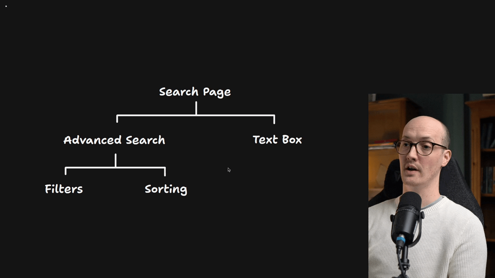
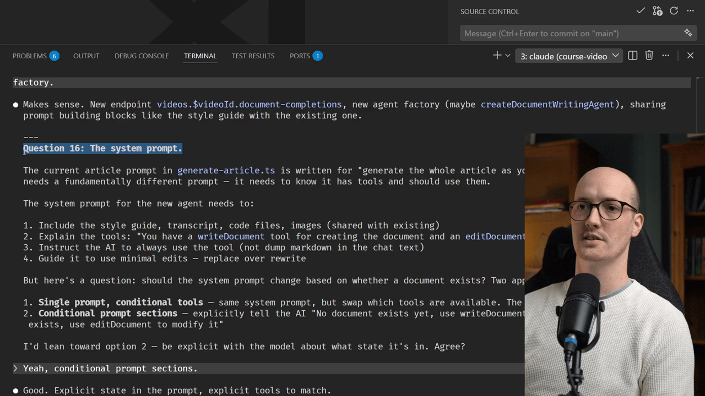
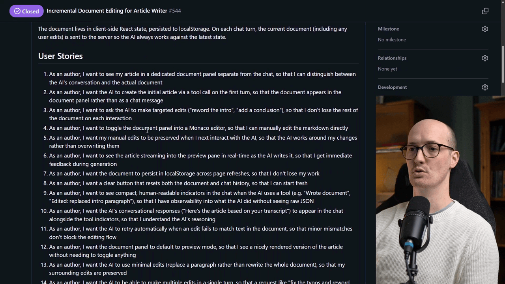
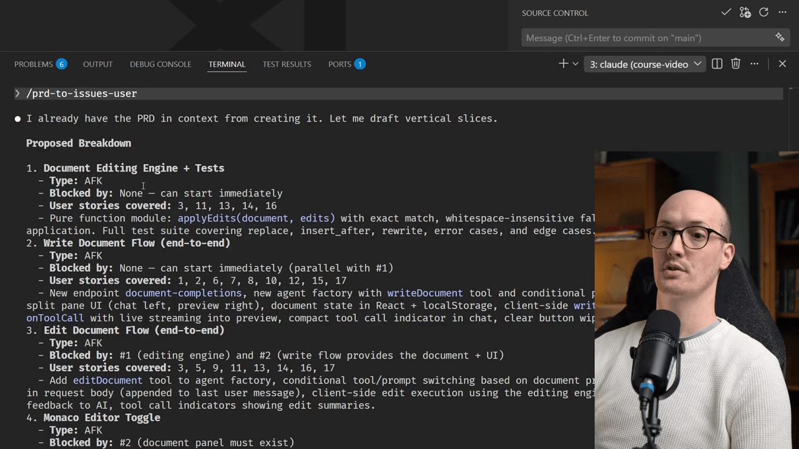
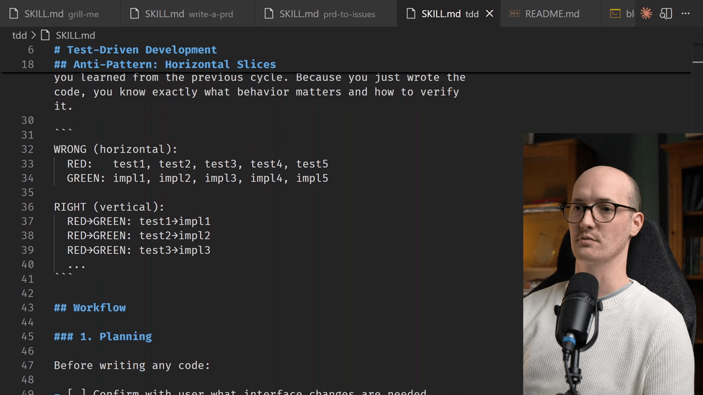
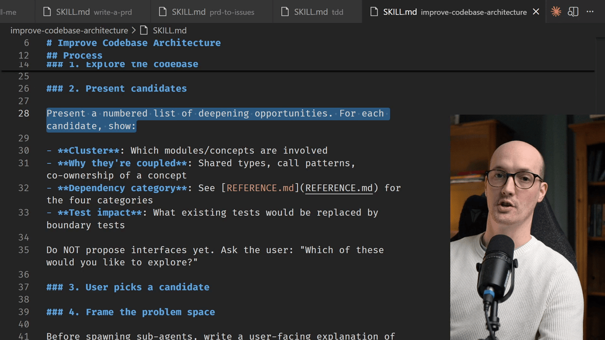

* Do not remove this line (it will not be displayed)
{:toc}

[mattpocock/skills](https://github.com/mattpocock/skills) 是 Matt Pocock 每天用来做真实工程的一组 Agent Skills。技能集的说明站在 [AI Skills for Real Engineers](https://www.aihero.dev/skills)。每一条技能都是一个可编辑的 `SKILL.md`：人在该停下来想清楚的地方输入斜杠命令，代理在该复用纪律的地方自己去读对应技能。流程仍然留在你手里。GSD、BMAD、Spec-Kit 这一类方案会把整条交付流程收走；这套技能把对齐、规格、工单、测试、审查拆成可以单独替换的小步骤。

{: width="760" }
*图：技能集的标识。来源：[mattpocock/skills](https://github.com/mattpocock/skills)。*

站内已经写过技能这种格式本身：[Agent Skills in Action]() 讲文件夹为什么适合装操作手册，[OpenAI Skills 最佳实践]() 讲渐进式披露和插件分发。[Superpowers]() 把一条工程流水线收成强制技能。Matt Pocock 这套技能保持很小，每一次走到哪一步，由你输入的命令决定。

# 资源链接

| 说明 | 链接 |
| :--- | :--- |
| 技能仓库 | [mattpocock/skills](https://github.com/mattpocock/skills) |
| 技能站 | [aihero.dev/skills](https://www.aihero.dev/skills) |
| 安装统计与安装器 | [skills.sh/mattpocock/skills](https://skills.sh/mattpocock/skills) |
| 每天在用的五条技能 | [5 Agent Skills I Use Every Day](https://www.aihero.dev/5-agent-skills-i-use-every-day) |
| 深模块原则 | [How To Make Codebases AI Agents Love](https://www.aihero.dev/how-to-make-codebases-ai-agents-love) |
| Cursor 的技能目录 | [Cursor Docs — Agent Skills](https://cursor.com/docs/skills) |

# 这套技能针对的四种失败

仓库 README 把日常失败收成四类。每一类都对应一条可以反复调用的做法。

## 代理做出来的不是你要的

需求和实现之间最常见的裂缝，是双方以为已经对齐。人这边还没把设计树上的分叉走完，代理已经开始改文件。修复方式是一场 grilling：代理连续追问，把每一条分叉上的依赖先定下来；能从代码里读到的答案，由它自己去读，不再拿来问你。

不在仓库里工作时用 `/grill-me`。已经在一个代码仓库里、而且这一次改动可以在一轮对话里谈完时，用 `/grill-with-docs`。后者用的是同一套追问，同时把定下来的词和少数难以撤回的决定写进仓库。

{: width="760" }
*图：设计树。搜索页先在高级搜索和文本框之间分叉，选定高级搜索之后还要决定过滤和排序。来源：[5 Agent Skills I Use Every Day](https://www.aihero.dev/5-agent-skills-i-use-every-day)。*

## 代理用二十个词说一件事

项目刚开始时，写软件的人和领域里的人往往各说各的词。代理被丢进仓库后也会现编术语，于是同一次改动在对话、变量名和文件名里各有一套说法。

修复方式是一份共享语言。`/grill-with-docs` 在词定下来的当下把它写进仓库根目录的 `GLOSSARY.md`。README 里给过一个对照，项目是 Matt 自己的 course-video-manager，当时文件还叫 `CONTEXT.md`：

- 写术语表之前：「一门课某一节里的一课被变成真实文件时出了问题。」
- 写术语表之后：「物化级联出了问题。」

后一种说法会在之后的每一次会话里重复使用。变量、函数和文件跟着同一套词命名，代理少花 token 去猜你指的是哪一个概念。

> 术语表只定义「这是什么」。实现细节、规格和草稿都不放进去。同义词写在 `_Avoid_` 下面，逼自己只留一个词。
{: .prompt-tip }

## 代码对不上运行结果

对齐了需求之后，代理仍然可能交出跑不通的代码。原因是它看不到自己改完之后系统实际做了什么。类型检查、浏览器和自动化测试是这条反馈。测试这一侧，`/tdd` 要求先写一条会失败的测试，再写刚好让它通过的实现，一次只走一条竖切。调试则用 `/diagnosing-bugs`：先做出一条能稳定复现的红灯，再缩小范围、提出假设、加观测、修复，最后补一条回归测试。

## 代码库长成一团泥

代理把写代码的速度抬高之后，结构变差的速度也一起抬高。这套技能把 John Ousterhout 的深模块放进每一步：很多行为藏在一个小接口后面，测试打在这个接口上。`/to-spec` 在写规格之前会问你这次碰到哪些模块。`/improve-codebase-architecture` 每隔几天扫一遍仓库，找出可以变深的浅模块，交出一份 HTML 报告，再和你把选中的那一处谈清楚。它只做勘察，不替你拆那团泥。

[How To Make Codebases AI Agents Love](https://www.aihero.dev/how-to-make-codebases-ai-agents-love) 用四张图说明代理实际看见的结构。你自己脑中的代码库是分过色的：缩略图、视频、认证、表单各是一块。

{: width="640" }
*图：人维护的心智地图。同一颜色的小块属于同一个概念。来源：[How To Make Codebases AI Agents Love](https://www.aihero.dev/how-to-make-codebases-ai-agents-love)。*

代理没有这张地图。它看到的是一排没有归属的小文件。

{: width="640" }
*图：同一份代码库在代理眼中没有分组。来源：[How To Make Codebases AI Agents Love](https://www.aihero.dev/how-to-make-codebases-ai-agents-love)。*

深模块把一大块行为收进一个小接口。图里每个方块顶部的细条是接口，下面的面积是实现。你设计接口和测试，实现可以交给代理。

{: width="640" }
*图：深模块。顶部细条是接口，下面的面积是实现。来源：[How To Make Codebases AI Agents Love](https://www.aihero.dev/how-to-make-codebases-ai-agents-love)。*

浅模块则是接口几乎和实现一样大，模块之间还要互相调用。改一个概念要穿过很多小文件，测试也只能打在这些内部接缝上。

{: width="640" }
*图：浅模块互相调用。一条行为要穿过多个颜色的小块。来源：[How To Make Codebases AI Agents Love](https://www.aihero.dev/how-to-make-codebases-ai-agents-love)。*

# 原理：谁来调用，以及技能怎样串起来

## 一条技能就是一个目录

最小形态是一个目录加一份 `SKILL.md`。仓库里的工程技能放在 `skills/engineering/`，与代码无关的工作流放在 `skills/productivity/`。每份技能旁边还有 `agents/openai.yaml`，给 Codex 的技能选择器提供显示名，并在需要时关掉隐式调用。

启动时，宿主只把技能的名字、描述和路径放进上下文。你输入斜杠命令，或者模型判断这条技能对得上当前任务时，才读完整的 `SKILL.md`。这和 [OpenAI Skills 最佳实践]() 里的渐进式披露是同一种机制。所以这套技能可以一次装很多条，平常的对话不会把所有说明都塞进窗口。

## 用户调用和模型调用

技能只按一个轴拆开：谁可以启动它。

| | 用户调用 | 模型调用 |
| :--- | :--- | :--- |
| 谁能启动 | 只有你输入名字 | 你输入，或者模型在任务匹配时自己去读 |
| Front matter | `disable-model-invocation: true` | 不写这一项 |
| Codex | `agents/openai.yaml` 里 `policy.allow_implicit_invocation: false` | 不写这条 policy |
| 描述写给谁 | 人，一行就够 | 模型，要写清触发场景 |
| 职责 | 编排一次流程 | 放可复用的纪律 |
| 能否调用别的技能 | 可以调用模型调用技能 | 可以再调用别的模型调用技能 |

用户调用技能不能再调用另一条用户调用技能。`/grill-with-docs` 的正文只有一句：分别调用模型调用技能 `grilling` 和 `domain-modeling`。追问的方法在 `grilling` 里，写术语表和 ADR 的方法在 `domain-modeling` 里。只装 `/grill-with-docs` 这一条，它没有可调用的两份纪律，会话做不完。

依赖写成明确的 Skill tool 调用，一次只点名一条技能。需要两条时写两次调用。仓库约定这样写，是因为各个宿主都把「加载技能」暴露成一个工具；在正文里写 `/另一个技能`，模型经常把它当成普通文字。

只读 `GLOSSARY.md` 来对齐用词，是一句话指针，不必启动 `domain-modeling`。要质疑术语、用边界场景加压、当场改术语表和 ADR 时，才启动它。

## 配置在仓库里，技能正文到处一样

工程技能不把「工单在 GitHub 还是本地文件」写死在 `SKILL.md` 里。每个仓库跑一次 `/setup-matt-pocock-skills`，把差异写到 `docs/agents/`。之后 `to-spec`、`to-tickets`、`triage` 都读这些文件。换追踪器时改这份配置，不必去改技能正文。

# 安装

插件会自己更新，装进去的文件是只读的。`npx skills` 会把可编辑的副本写进项目，更新要你自己跑。两种方式选一种。同一次装两种，每条技能会出现两份。

## Cursor

在项目根目录执行：

```bash
npx skills@latest add mattpocock/skills -a cursor
```

安装器会列出仓库里的技能让你挑。把 `setup-matt-pocock-skills` 选上。项目级安装的实体文件在 `.agents/skills/<技能名>/`。Cursor 会加载这个目录，也会加载 `.cursor/skills/`、`~/.cursor/skills/`，以及 Claude、Codex 的技能目录。加 `-g` 时，副本放到用户目录，Cursor 这边对应的全局位置是 `~/.cursor/skills/`。

更新已装的技能：

```bash
npx skills@latest update
```

仓库后来新增的技能不会靠 `update` 自动出现，要再跑一次 `add` 把新技能选进来。安装器会写 `skills-lock.json`，记录来源和内容哈希。团队要锁同一份副本时，把这个锁文件提交进仓库。

> 技能正文是给你改的。项目里的评审习惯、测试命令、禁止事项，写进对应 `SKILL.md` 的副本。下一回 `update` 可能覆盖你的修改，改之前先看锁文件和 diff。
{: .prompt-warning }

## 其他宿主

| 宿主 | 安装 | 更新 |
| :--- | :--- | :--- |
| Claude Code | `claude plugin install mattpocock-skills@claude-plugins-official` | 插件默认自己更新 |
| Codex | `codex plugin marketplace add mattpocock/skills`，然后 `codex plugin add mattpocock-skills@mattpocock` | 启动时更新 |
| GitHub Copilot CLI | `copilot plugin marketplace add mattpocock/skills`，然后 `copilot plugin install mattpocock-skills@mattpocock` | 在 `~/.copilot/settings.json` 里为该 marketplace 打开 `autoUpdate` |
| VS Code Copilot | 命令面板里 Chat: Install Plugin From Source，填仓库地址 | 每天更新 |
| Gemini CLI | 见下面两条命令 | 再执行这两条命令 |
| 技能站上的简写 | `npx skills@latest add mattpocock/skills` | `npx skills update` |

Gemini CLI 要分两个目录装，更新时把这两条再执行一遍：

```bash
gemini skills install https://github.com/mattpocock/skills.git --path skills/engineering
gemini skills install https://github.com/mattpocock/skills.git --path skills/productivity
```

GitHub Copilot 还要在 `~/.copilot/settings.json` 里允许这个 marketplace 自己更新：

```json
{
  "extraKnownMarketplaces": {
    "mattpocock": {
      "source": { "source": "github", "repo": "mattpocock/skills" },
      "autoUpdate": true
    }
  }
}
```
{: file="~/.copilot/settings.json" }

Claude Code 若走官方插件，装的是一整套只读技能。要改提示词时改用 `npx skills`，让副本落在项目里。

# 每个仓库先跑一次 setup

装完之后，在这个仓库的代理对话里运行：

```text
/setup-matt-pocock-skills
```

它是一条提示驱动的技能，会先看仓库再问你，确认之后才写文件。它查看 `git remote`、已有的 `CLAUDE.md` 或 `AGENTS.md`、是否已经有 `GLOSSARY.md`、`docs/adr/`、`docs/agents/`，以及 `triage` 有没有装上。

它按三段问，每段给出推荐答案：

1. **工单放在哪里。** 远程是 GitHub 就建议 GitHub Issues（通过 `gh`）。远程是 GitLab 就建议 GitLab Issues（通过 `glab`）。没有远程、或者你希望工单留在仓库里时，用 `.scratch/` 下的 Markdown。Jira、Linear 或其他系统，用一段话描述工作流，技能把这段话写进配置。
2. **分诊标签用不用默认名。** 只有装了 `triage` 才问。默认五个角色各用同名标签：`needs-triage`、`needs-info`、`ready-for-agent`、`ready-for-human`、`wontfix`。追踪器里已经有别的名字时，再逐个映射，避免再建一套重复标签。
3. **领域文档是一份还是多份。** 普通仓库用根目录一份 `GLOSSARY.md` 加 `docs/adr/`。只有探测到 monorepo 迹象时，才提议用根目录的 `GLOSSARY-MAP.md` 指向每个上下文自己的术语表。

写完之后，仓库里多出这些文件：

| 文件 | 作用 |
| :--- | :--- |
| `docs/agents/issue-tracker.md` | 工单住在哪里、用什么命令创建 |
| `docs/agents/domain.md` | 术语表和 ADR 的布局，以及别的技能该怎么读 |
| `docs/agents/triage-labels.md` | 五个角色到真实标签字符串的映射；没装 `triage` 则不写 |
| `CLAUDE.md` 或 `AGENTS.md` 里的 `## Agent skills` | 一段指针，指向这些文件 |

已有 `CLAUDE.md` 就改它，否则改已有的 `AGENTS.md`。两个都没有时，技能会问你要新建哪一个，不会自己挑。已有 `## Agent skills` 段落就原地更新，不追加第二份。

这些文件要提交。技能在任何一台机器上打开这个仓库，都读同一份追踪器和术语表布局。以后只换追踪器时，可以直接改 `docs/agents/*.md`，不必重跑 setup。

# 不知道该用哪条时，先问 `/ask-matt`

`/ask-matt` 是用户调用的路由器。你描述眼前的情况，它告诉你下一步该输入哪条命令，然后停住。它不追问、不写规格、不改文件，也不替你启动它刚推荐的那条技能。

它认的是这套技能内部的路径，不会把你仓库里的其他技能算进去。已经决定用某一条时，直接输入那条，不要再绕路由器。

它把路径分成五类：

- **主流程**：从想法到合入。追问、规格、工单、实现、审查、回顾。
- **入口**：别人报来的缺陷、眼前已经坏掉的行为、一次对话装不下的大块工作。这些入口产出工作之后，再汇入主流程。
- **代码库健康**：`/improve-codebase-architecture` 找出可以变深的地方，每一处再当作一个新想法进入主流程。
- **单独使用**：原型、问卷、文献调查。它们不接在主流程中间。
- **词汇层**：`domain-modeling` 和 `codebase-design`。别的技能在用词或模块边界上拿不准时来读它们。

# 主流程

一次跨会话的功能，主链是：

```text
/grill-with-docs → /to-spec → /to-tickets → /implement → /code-review → /retro
```

改动小到一次上下文放得下时，追问结束就 `/implement`，规格和工单这两步省掉。问题要先看到能跑的东西才能决定时，中途用 `prototype` 做一块丢掉的原型，再回到追问。工作大到一轮追问装不下时，先走 `/wayfinder`，地图清空之后从 `/to-spec` 接上。

下面几张过程图来自 [5 Agent Skills I Use Every Day](https://www.aihero.dev/5-agent-skills-i-use-every-day)。画面标签上的命令还是当时的名字：写规格是 `write-a-prd`，拆工单是 `prd-to-issues`。v1.1 起这两条分别叫 `/to-spec` 和 `/to-tickets`。术语表文件在 v1.3 从 `CONTEXT.md` 改名为 `GLOSSARY.md`。步骤的形状还在，输入时用现在的名字。

## `/grill-with-docs`：把设计树走完，并把词写进仓库

在仓库里、计划还模糊时输入它。代理一轮只问一批问题，等你回答，再走下一条分叉。能从代码里回答的，它去读代码。

一个词定下来，它立刻写入 `GLOSSARY.md`，不等到会话结束再批量补。一个决定要同时满足三件事才写成 ADR，放在 `docs/adr/`：难以撤回、没有上下文会让人吃惊、并且是一次真实取舍。三件里缺一件，决定就留在对话里。多数会话一份 ADR 都不会产生，这是这条技能的正常结果。

{: width="760" }
*图：追问进行到系统提示词这一支。代理给出两个做法，人选定其中一种，它再记下理由。来源：[5 Agent Skills I Use Every Day](https://www.aihero.dev/5-agent-skills-i-use-every-day)。*

术语表的形状由 `domain-modeling` 规定。一个上下文一份文件，每个词一两句，只写「它是什么」，并列出不要再用的同义词：

```markdown
# Ordering

接收并跟踪客户订单的上下文。

## Language

**Order**:
客户一次要购买的一组商品。
_Avoid_: Purchase, transaction

**Invoice**:
交付之后发给客户的付款请求。
_Avoid_: Bill, payment request
```
{: file="GLOSSARY.md" }

多个限界上下文的仓库用根目录的 `GLOSSARY-MAP.md` 列出每份术语表的路径，以及上下文之间谁发出事件、谁消费。setup 只有在仓库确实像 monorepo 时才会提议这种布局。

会话结束时，对话里还有大量没有进术语表、也不够格写 ADR 的决定。这些决定只活在当前窗口里。下一步是在同一窗口运行 `/to-spec`。先清空再写规格，规格就只能靠残缺的摘要。

和它相邻的选择：

| 眼前的情况 | 用这一条 |
| :--- | :--- |
| 没有工作目录，只是在谈一个想法 | `/grill-me` |
| 在仓库里，一轮对话能谈完 | `/grill-with-docs` |
| 从零做产品，或功能大到要跨很多会话 | `/wayfinder` |
| 仓库还没有任何领域文档，也还没定具体功能 | `/grill-with-docs`，对象是整个仓库 |
| 决定卡在另一个人的脑子里 | `/to-questionnaire` |

## `/to-spec`：把已经做过的决定记成一份规格

决定已经做完才运行它。它不开启新一轮追问。它从当前对话、代码、`GLOSSARY.md` 和 ADR 里合成一份规格，发到 `docs/agents/issue-tracker.md` 指定的追踪器，成为一条 issue。本地追踪器则写成 `.scratch/` 下的 Markdown。

规格记录的是你已经说过的话，用项目自己的词。规格里出现你没说过的行为，就是这份规格的缺陷。

写文件之前，它会先画出准备测试的接缝，并和你确认。接缝是你能从外面观察到行为的公共边界。它优先用仓库里已经存在的接缝，并尽量选高一些的那一层，让一条测试覆盖一条用户能感知的行为。模块该多深、接口该露出什么，拿不准时它会去读 `codebase-design`。

{: width="760" }
*图：一份已经关闭的规格 issue。用户故事按作者能观察到的行为来写。来源：[5 Agent Skills I Use Every Day](https://www.aihero.dev/5-agent-skills-i-use-every-day)。*

规格值得单独占一步的场合，是工作要跨好几个会话。工单会做完就关掉，规格留下来，作为这些工单背后的理由。一次会话就能做完的改动，多这一步只会让模型在复述时漂掉。那种情况从追问直接进 `/implement`。

> `/to-spec` 和 `/to-tickets` 放在同一个上下文窗口里跑，中间不要清空，也不要压缩对话。有的追踪器不会把一条很长的 issue 全文返回给下一次会话，本地又没有第二份副本时，后一条技能会读到被截断的规格。
{: .prompt-danger }

## `/to-tickets`：切成带阻塞边的示踪弹

它把规格、计划或当前对话切成一组工单。每张工单声明自己的阻塞边：哪些工单必须先完成。每张工单是一颗示踪弹，竖着穿过这次改动要碰的各层（数据、接口、界面、测试），落地后就能单独演示。工单的大小按一个全新上下文窗口来估，因为实现它的那次会话没有见过你的规格。

发布之前有两步。它先找要不要先做一次 prefactoring：先让改动变容易，再做那个容易的改动，这类工单排在前面。然后它把拆分列成编号清单，问你粒度对不对、阻塞边是不是真的、有没有该合并或该再拆的。你点头之后才写入追踪器。

{: width="760" }
*图：示踪弹清单。每张工单写明类型、被谁阻塞、覆盖哪些用户故事。来源：[5 Agent Skills I Use Every Day](https://www.aihero.dev/5-agent-skills-i-use-every-day)。*

这些工单在生成时就已经是给代理做的。不要再对它们跑 `/triage`。分诊是给别人报进来的工作用的。

## `/implement` 与 `/implement-spec`

`/implement` 实现一张规格或一张工单。测试打在追问和规格里已经说好的接缝上，由它去驱动 `/tdd`。做完之后跑 `/code-review`，通过了再提交。一张工单开一个新会话，避免上一张工单的推理留在窗口里。

`/implement-spec` 在一条集成分支上实现整份规格。它把工单的阻塞边读成任务图，对当前没有阻塞的那一层并发启动实现子代理，全部做完后同样以 `/code-review` 收尾。阻塞边写错时，并发会把还没准备好的工单提前做完。清单确认过再走这条。

## `/tdd`：一条竖切，红了再写实现

`/tdd` 是模型调用技能。你提到测试先行、red-green-refactor，或者在修一个要用测试钉住的缺陷时，代理可以自己去读它。`/implement` 也会在说好的接缝上调用它。

一条好的测试通过公共接口验证行为，读起来像规格。实现整个换掉，测试仍然成立。写任何测试之前，先把接缝列出来，每条用一句话说它能抓住什么、会漏掉什么，等你确认。没有确认过的接缝上不写测试。

它明确反对三种测试：

- **绑在实现上**：mock 内部协作者、测私有方法、绕过接口去查数据库。重构之后行为没变，测试却红了。
- **同义反复**：断言里用和实现相同的办法再算一遍期望值。这种测试在构造上就会通过。期望值要来自独立的例子：字面量、手算结果或规格里的句子。
- **横切**：先把所有测试写完，再写所有实现。测试会去验证想象出来的形状。正确的节奏是一条测试、一份刚好让它通过的实现，然后再下一条。

{: width="760" }
*图：横切是先写完所有测试再写所有实现。竖切是一条测试接着一份实现。来源：[5 Agent Skills I Use Every Day](https://www.aihero.dev/5-agent-skills-i-use-every-day)。*

当前版本把重构从这条循环里拿了出去。红灯变绿灯只做「一条失败的测试，加上刚好让它通过的代码」。重构留在 `/code-review` 那一步。循环里提前重构，容易把还没被下一条测试钉住的结构改掉。

探索代码时它会读 `GLOSSARY.md`，让测试名和接口用词跟术语表一致，并尊重这块代码上已有的 ADR。

## `/code-review`：规范和规格分开看

审查从某个固定点之后的 diff 出发，开两个子代理并行看，互不把结论写进对方的上下文：

- **Standards**：符不符合仓库的编码约定，再加上一套 Fowler 的坏味道基线。
- **Spec**：有没有忠实实现引出这次改动的那条 issue 或规格。

两个轴都过了，`/implement` 才提交。

Claude Code 自带的审查也叫 code review。社区技能如果同名，会盖住那条内置命令。两边查的东西不一样：内置审查在找缺陷，这条技能在核对「写得像不像这个仓库」和「做的是不是规格里的那件事」。取舍见站内 [Claude Code 团队如何做 Code Review]()。

## `/retro`：把这次会话的摩擦写回环境

功能做完之后运行 `/retro`。它不改产品代码。它按严重程度列出代理环境里可以改的地方：导航、自动检查、编码约定、引导文件、工具。下一次会话比这一次少踩同一种坑，靠的是这些改动，而不是把教训留在聊天记录里。

# 使用示例

下面用一个具体改动走一遍主流程。仓库是一个已有的课程站，要加「保存搜索条件」。工单在 GitHub，setup 已经跑过。这次改动要跨数据表、接口和界面，一轮会话做不完，所以走完整条链。

**1. 在仓库里打开代理，输入：**

```text
/grill-with-docs
我想给课程搜索加「保存搜索条件」。登录用户可以保存当前筛选，以后一键恢复。
```

代理会沿设计树往下问。你要准备好这些分叉的答案，而不是等它问完再临时编：

- 保存的是筛选字段，还是包含关键词的整次查询。
- 未登录用户点保存时，是要求登录，还是把条件留在本地。
- 一个用户可以保存多少条，重名时覆盖还是另存。
- 恢复时是替换当前筛选，还是合并。

谈的过程中，`SavedSearch` 这个词一旦定下来，就应出现在 `GLOSSARY.md`，并写上不要再用的说法，例如 `_Avoid_: bookmark, favorite query`。如果「条件存在用户账号下，而不是存在浏览器里」是一次难以撤回的选择，它会建议写成 ADR。其余决定留在对话里。

**2. 同一窗口里接着输入：**

```text
/to-spec
```

它应交出一份规格 issue，用 `SavedSearch` 这个词重述上面的决定，并列出准备测试的接缝。假设它提议两条：一条是应用服务「保存并按用户列出」，一条是 HTTP「恢复时返回筛选 JSON」。你确认或改掉这些接缝。它问你这次碰到的模块时，回答应落在搜索和账号这两块上，而不是「改一下前端组件」。

**3. 还是这个窗口：**

```text
/to-tickets
```

期望看到的清单类似：

1. 持久化一条 `SavedSearch` 并能按用户读回。无阻塞。竖切含表结构、仓库接口和这条行为的测试。
2. 搜索接口接受已保存条件的 id 并恢复筛选。阻塞于 1。
3. 搜索页上的保存和恢复。阻塞于 2。

你检查阻塞边：第 3 张如果被标成可以和第 1 张并行，就把它打回去，因为没有恢复接口时页面无法演示。确认之后它才 `gh issue create`。

**4. 每张工单开一个新会话：**

```text
/implement
做第一张没有阻塞的 SavedSearch 工单。测试只打在规格里确认过的接缝上。
```

第一张工单的会话里，`/tdd` 应先写一条失败的测试，例如「保存两条条件后再列出，顺序和字段与写入时一致」，看到红灯，再写刚好让它通过的实现。这一张做完就停。第二张、第三张各开新会话。

**5. 每个实现会话收尾时调用 `/code-review`。** Standards 看这一张 diff 的命名是不是用了 `SavedSearch`，以及 SQL 有没有漏到界面层。Spec 拿这一张工单对照规格：写保存按钮的那张要覆盖「未登录则要求登录」，只做持久化的那张不承担这条界面行为。

**6. 三张都合并之后：**

```text
/retro
```

如果这次代理花了很多回合才找到搜索模块的公共接口，回顾里应出现一条环境改进：在 `AGENTS.md` 里写上搜索模块的入口文件，而不是把「下次记得看某个目录」留在聊天里。

改动如果只是给保存按钮改一行文案，追问确认措辞之后直接 `/implement`。规格和工单对这种改动没有留下可复用的决定。

# 主流程以外的技能

## `/wayfinder`：一轮对话装不下的地图

从零做一块产品，或者功能大到 `/grill-with-docs` 谈不完时，用 `/wayfinder`。它在追踪器上建一张决策工单的地图，一次只解开一张，直到通往目的地的决定都清楚。这些工单记的是决定，地图清空时它们也关掉了。剩下的是一张连在一起的决定，还不是施工计划。接下来 `/to-spec #<地图 issue>` 把它们收成一份规格，再 `/to-tickets` 切成示踪弹。把决策工单直接丢给 `/implement`，会跳过这次收拢，链接里的细节进不了实现会话。

## `/triage`：处理别人报来的工作

五个角色是一个小状态机：

| 标签 | 含义 |
| :--- | :--- |
| `needs-triage` | 维护者还没评估 |
| `needs-info` | 在等报告人补充 |
| `ready-for-agent` | 已经说清，可以由代理在人不盯着的时候做 |
| `ready-for-human` | 要人来做 |
| `wontfix` | 不做 |

技能先对照仓库里的 `SCOPE.md` 判断这件事在不在范围内，拒绝的关掉并标成不做。标签字符串以 `docs/agents/triage-labels.md` 为准。你自己用 `/to-tickets` 生成的工单已经是代理可做的，不要再送进这个状态机。

## `/improve-codebase-architecture`：勘察，然后挑一处谈

它在代码库里找变深的机会：理解一个概念要在很多小文件之间跳，或者纯函数被抽出来只是为了好测、真正的缺陷藏在调用方式里。当前版本把候选写成一份自包含的 HTML 报告，放在系统的临时目录，然后对你选中的那一处做 grilling。它不改产品代码。重构放到另一次会话，走主流程。较早一版把同一类候选直接列在对话里，下面这张图是那一版的清单。

{: width="760" }
*图：架构勘察给出的候选清单。来源：[5 Agent Skills I Use Every Day](https://www.aihero.dev/5-agent-skills-i-use-every-day)。*

README 的建议是每隔几天跑一次。老代码库上它找得到真的候选，不会把那团泥拆开。

## 缺陷、原型、调查、只能由人做的步骤

| 技能 | 谁调用 | 做什么 |
| :--- | :--- | :--- |
| `diagnosing-bugs` | 模型 | 先得到一条稳定的红灯，再缩小、假设、观测、修复、补回归测试。阶段没过就停 |
| `prototype` | 模型 | 为了一个设计问题做丢掉的原型。状态和逻辑用单个 HTML；界面则在一条路由上放几套差别很大的变体 |
| `research` | 模型 | 对照高信任的一手来源做调查，把带引用的 Markdown 写进仓库，放在后台代理里跑 |
| `wizard` | 模型 | 生成一个交互式 bash，带人走过只有人能做的步骤：开通云资源、填写 CI 密钥、第一次登录第三方后台、一次性切换 |
| `pr` | 模型 | 规定 pull request 正文的形状：一张能看懂改动的最小说明、改前改后的证据、这次合并是单向门还是双向门以及影响面 |
| `/handoff` | 用户 | 把当前对话压成一份交接文档，给另一个代理续做 |
| `/wait-what` | 用户 | 上一句没听懂时立刻用。代理用 `GLOSSARY.md` 里的词，把缺少的上下文用白话重讲一遍 |
| `/to-questionnaire` | 用户 | 把一个你回答不了的决定写成给另一个人的问卷。它追问的是发给谁、要收回什么，不追问题目本身 |
| `/teach` | 用户 | 用当前目录当教学现场，分几次会话教一个概念 |

`writing-for-agents` 是模型调用的。它约束的是写给代理读的文档：技能、`AGENTS.md`、`CLAUDE.md`，以及代理只会顺着链接才打开的那些文件。人读的文章不用这条。

# 最佳实践

**每次改动都先对齐。** 小改动用 `/grill-me` 或几轮 `/grill-with-docs` 把分叉走完。大改动先确认它是一轮能谈完，还是要上 `/wayfinder`。这个判断错了，后面的规格会在一个还没定的设计上写得很完整。

**追问、规格、工单留在同一个窗口。** 工单发布之后，每张工单换一个新窗口做 `/implement`。前一个窗口装的是决定，后一个窗口装的是这一张工单的测试和 diff。

**接缝先于测试。** 在 `/to-spec` 或 `/implement` 开头把接缝写出来并确认。代理开始写测试之后再改接缝，已经写过的测试会绑在错误的边界上。

**术语表保持短，并且只增项目自己的词。** `timeout`、`error` 这种通用编程词不进 `GLOSSARY.md`。一个概念只留一个名字。代理开始发明同义词时，把那个词补进 `_Avoid_`，而不是在提示词里再解释一遍。

**规格和工单只在跨会话时使用。** 一次窗口能做完的改动，从追问到 `/implement`。多出来的合成步骤是模型改写你原话的机会。

**架构勘察和维护分开。** `/improve-codebase-architecture` 的 HTML 报告看完，挑一条，用主流程单独立项。不要在勘察的那个会话里让它直接改模块。

**插件和可编辑副本二选一。** 要跟上游自动更新，用 Claude Code、Codex 或 Copilot 的插件。要按仓库改技能正文，用 `npx skills`，并在 `update` 之前看 diff。

**让 `/retro` 改环境，不改记忆。** 导航困难、测试命令没写清、某条约定只存在于口头，这些写进 `AGENTS.md`、`CLAUDE.md` 或检查命令。下一次新会话读得到。

**不确定就 `/ask-matt`，然后自己输入它给的那条命令。** 路由器停下来是有意的。你确认这条路径适合现在的仓库之后再启动。

# 注意事项

**技能站首页的精选列表还是旧名字。** [aihero.dev/skills](https://www.aihero.dev/skills) 上仍能看到 `/domain-model`、`/to-prd`、`/to-issues`。仓库里对应的现用名是模型调用的 `domain-modeling`，以及用户调用的 `/to-spec`、`/to-tickets`。以仓库 README 和 `skills/*/SKILL.md` 为准。旧的斜杠名不会再启动技能，需要重装到新名字。

**`/grill-with-docs` 依赖两条模型调用技能。** 安装时把 `grilling` 和 `domain-modeling` 一起选上。只拷贝那一份只有一行的 `SKILL.md`，追问和写文档都不会发生。

**术语表不是规格，ADR 很少。** 会话结束如果只有一份更准的术语表、没有新的 ADR，技能是按设计工作的。把对话交给 `/to-spec` 之前关掉窗口，那些没写进文件的决定就没了。

**`/to-tickets` 的产物不要送去分诊。** 分诊标签表示「别人的请求还没被维护者看懂」。你自己拆出来的示踪弹已经带着阻塞边和验收行为，再标一次 `needs-triage` 会把两类工单混在同一个队列里。

**`/implement-spec` 的并发以阻塞边为准。** 边没确认就并行，后一张工单会在前一张的接口还不存在时开工。一个人做、想看清每一步时，用 `/implement` 一张一张来。

**`/code-review` 可能盖住宿主自带的审查。** 在 Claude Code 里决定你要的是找缺陷，还是核对规范和规格。两边都要时，给其中一条改名，避免斜杠命令只启动一份。

**setup 不会替你选不存在的文件。** `CLAUDE.md` 和 `AGENTS.md` 都没有时，它会停下来问。两个都有时，它只改 `CLAUDE.md`。不要期望它把同一段指针写进两个文件。

**`skills/in-progress/` 和 `skills/deprecated/` 不是日常技能。** 安装器如果把它们列出来，日常使用不要勾选。未完成技能的提示还在变，废弃技能的名字会和现用技能冲突。

**这是提示，不是确定的脚本。** setup、追问、拆工单都会先给你看草稿再写。代理跳过确认直接 `gh issue create` 或改 `GLOSSARY.md` 时，把那次调用停掉，让它先列出准备写的内容。

**大仓库上的架构技能只给候选。** 它找不到「把整个单体拆开」这种级别的方案。候选要你挑，重构走一次正常的规格和工单。

**画面和文档的版本差。** 上面几张过程图里的文件名和章节标题是早一版技能的样子。竖切、设计树、用户故事、阻塞边这些形状仍然成立；命令名、术语表文件名，以及「重构放在审查而不是红绿循环里」，以当前仓库里的 `SKILL.md` 为准。

# 参考资源

- [mattpocock/skills](https://github.com/mattpocock/skills)：技能正文、安装方式和用户调用 / 模型调用的划分。
- [AI Skills for Real Engineers](https://www.aihero.dev/skills)：按入口、主流程、成形、工程、生产力和参考层组织的技能站。
- [The /setup-matt-pocock-skills Skill](https://www.aihero.dev/skills-setup-matt-pocock-skills)、[The /grill-with-docs Skill](https://www.aihero.dev/skills-grill-with-docs)、[The /ask-matt Skill](https://www.aihero.dev/skills-ask-matt)、[The /to-spec Skill](https://www.aihero.dev/skills-to-spec)、[The /to-tickets Skill](https://www.aihero.dev/skills-to-tickets)：每条技能的触发条件、产物和常见接错。
- [5 Agent Skills I Use Every Day](https://www.aihero.dev/5-agent-skills-i-use-every-day)：设计树、追问、规格、工单和竖切的过程图。
- [How To Make Codebases AI Agents Love](https://www.aihero.dev/how-to-make-codebases-ai-agents-love)：深模块和灰盒测试的四张结构图。
- [Cursor Docs — Agent Skills](https://cursor.com/docs/skills)：Cursor 从哪些目录加载技能。
- [skills CLI 支持的代理目录](https://github.com/vercel-labs/skills/blob/main/docs/agents.md)：`npx skills add -a cursor` 写到哪里。
- [OpenAI Skills 最佳实践]()：技能格式、渐进式披露，以及何时升级成插件。
- [Agent Skills in Action]()：为什么用文件夹装可复用的操作手册。
- [Superpowers]()：另一套把工程流程收成强制流水线的技能包。
- [Claude Code 团队如何做 Code Review]()：和 Matt Pocock 的 `/code-review` 同名时怎么取舍。
- [Harness Engineering]()：技能在整个代理运行环境里处于哪一层。
