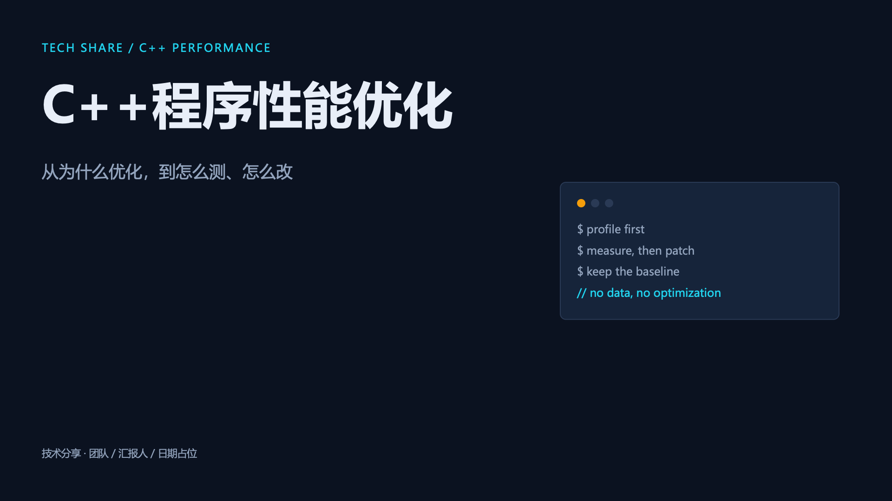
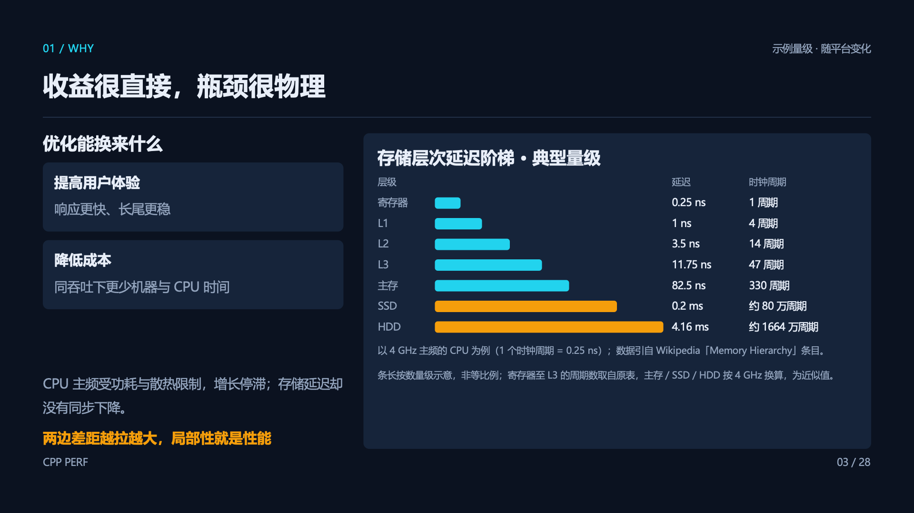
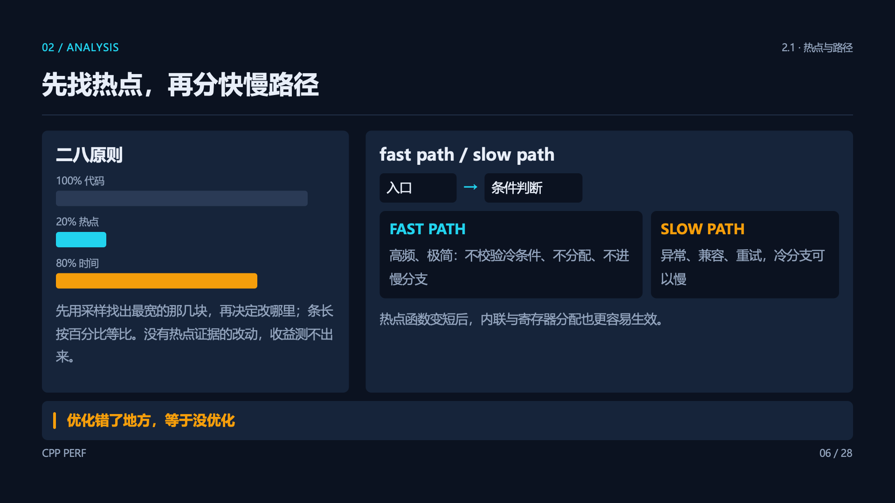
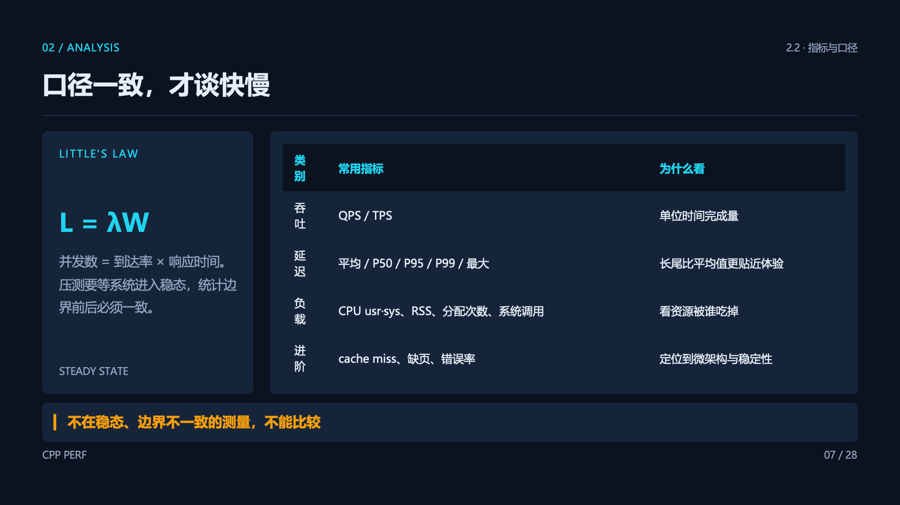
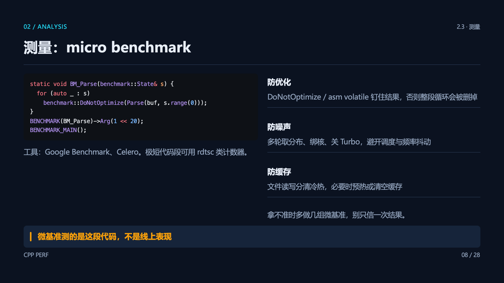
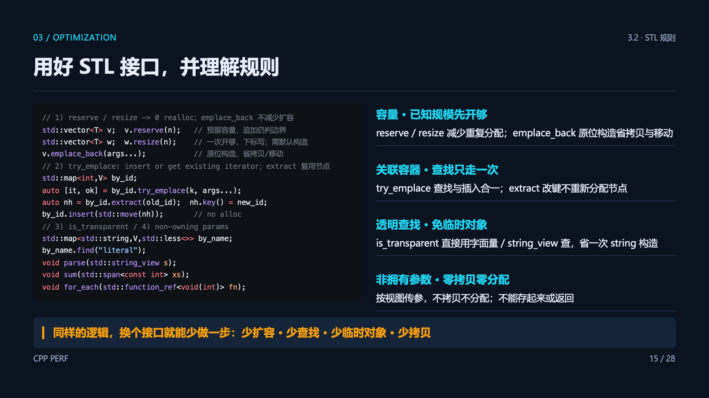
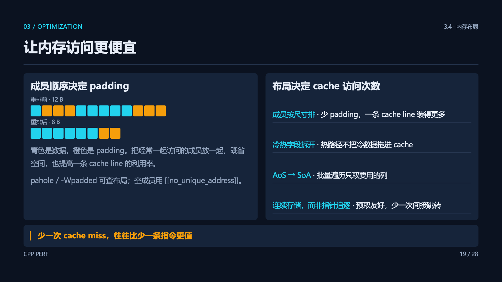

* Do not remove this line (it will not be displayed)
{:toc}

一次完整的 C++ 性能优化要回答三件事：为什么值得改，凭什么说这里慢，以及按什么顺序改。下面按这个顺序展开，一共四章。前两章把收益、瓶颈和测量口径立住。第三章按改动代价从低到高，覆盖工具链、标准库、语言规则、算法、数据结构、内存、并行，以及内核和指令级手段。第四章把这些手段收成一条能复跑的工程路径，并说明 AI 可以缩短探索、不能代替验证。

站内更早的清单见 [CPP Optimzing]()。分配器、内存池、`std::string` 的 SSO 与 COW、虚表、内存序和 Linux 性能工具，分别在后文链到对应文章。语言规则以 [cppreference](https://en.cppreference.com/w/cpp/compiler_support) 和各编译器的发行说明为准；幻灯片上的版本号是 libstdc++ 的实现路径，libc++ 和 MSVC 的细节不同。

{: width="860" }
*图：优化按「为什么、怎么测、怎么改」三步展开，每一步都要留下基线。*

目标很具体：同样的功能，程序跑得更快，或者用更少的 CPU、内存和机器。没有测量就没有优化。每次记录结果时，构建参数、机器型号、并发数和采样窗口要和数字放在一起，否则半年后无法复现，也无法把变化归因到某一次改动。

# 为什么要性能优化

{: width="860" }
*图：第一章只回答两件事：优化能换回什么，瓶颈卡在哪一层。*

后面每一种手段都围绕这两件事来选。收益对不上体验或成本，这次优化就不值得做。瓶颈不在 CPU 的算术，而在数据搬运、分配或锁，那么抠指令也不会动到那一部分时间。

## 收益很直接，瓶颈很物理

{: width="860" }
*图：优化要换回的体验和机器成本，以及从寄存器到磁盘的延迟阶梯。阶梯按 4 GHz 换算，原始量级来自 [Wikipedia: Memory hierarchy](https://en.wikipedia.org/wiki/Memory_hierarchy)。*

性能落到业务上，主要是两笔账。第一笔是用户体验：响应更短，长尾更稳。平均值下降而 P99 不动，用户感受到的往往还是慢请求。第二笔是成本：同样的吞吐，少用几台机器，少烧一点 CPU 时间。一次优化值不值得做，就从这两笔账估算，而不是从「这段代码看起来不优雅」估算。

瓶颈是物理的。CPU 主频被功耗和散热卡住，这些年不再按过去的斜率上涨。Herb Sutter 在 2005 年 3 月的 *Dr. Dobb's Journal* 里把这件事叫做免费午餐结束：主频和指令级并行不再自动把旧二进制变快，软件要自己写出并发。原文见 [The Free Lunch Is Over](https://www.cs.utexas.edu/~lin/cs380p/Free_Lunch.pdf)。存储延迟没有跟着主频一起降下来，寄存器和磁盘之间仍然差着数量级。

幻灯片按 4 GHz 换算，1 个时钟周期是 0.25 ns。寄存器大约 1 个周期，L1 大约 4 个周期，L2 大约 14 个周期，L3 大约 47 个周期。主存大约 82.5 ns，合 330 个周期。SSD 大约 0.2 ms，机械硬盘大约 4.16 ms，和寄存器差了七个数量级。主存往下的周期数是按 4 GHz 乘出来的近似值，条长只表示数量级，换一台机器数字会变。一次 L3 没命中、要去读主存，CPU 就要多等三百多个周期。这条等待期间，少做几条算术指令几乎看不出来。

所以局部性变成最值钱的性质。它有两层。时间局部性：刚用过的数据很快还会再用，缓存里留着就不用再去主存。空间局部性：挨着的数据往往一起用，一次缓存行装进来，后面的访问就命中了。缓存、硬件预取、结构体字段怎么排、数组是按结构体存还是按列存，都是在吃这两条红利。

> 主频涨不动，数据搬运仍然很贵。局部性就是性能。
{: .prompt-tip }

## 底层不会替我们做决定

{: width="860" }
*图：编译器受 as-if 规则约束，CPU 只在给定指令序列里找并行度。算法选择排在这两层前面。*

同一组数据上，快速排序的平均比较次数远少于冒泡排序。编译器的内联、常量传播、自动向量化都很强，它们改的是同一段源码的执行方式。源码写成平方级，优化之后仍然是平方级。

C++ 的 [as-if 规则](https://en.cppreference.com/w/cpp/language/as_if) 允许编译器换一种实现，条件是可观察行为不变。可观察行为包括对 volatile 对象的访问、I/O，以及对同步对象的操作。比较器如果有副作用，比较次数本身也是可观察的，冒泡排序和快排就不是同一个程序。即便比较器没有副作用，今天的编译器也不会把一段平方级循环改写成线性对数级的排序。

用比较次数可以把差距算清楚。元素个数 $$n = 10^5$$ 时，冒泡排序大约做 $$n(n-1)/2 \approx 5 \times 10^9$$ 次比较，也就是五十亿次；按 $$n^2$$ 估算则是一百亿次。分享里说的「百亿次量级」指的就是这笔比较次数。快排平均大约做 $$n \log_2 n \approx 1.7 \times 10^6$$ 次比较，是一百七十万次。这两个数都是比较次数，墙上时间要另外测。内联和 SIMD 改变不了这个次数上的差距。

CPU 也一样。流水线让多条指令重叠执行，乱序执行在已经取到的指令里找没有数据依赖的那些先做，分支预测猜下一条要去哪，猜对就不用等条件算完。这三件事都是在你给出的指令序列里面找并行度，上限由依赖链和分支决定。分支猜错时，流水线上已经按错误方向灌进去的指令要清空，代价常常比省下的那几条指令更大。把一个几乎总是真的判断写成容易误预测的形式，微基准上会先看到这个代价。

因此优化的顺序是固定的。**先确认算法和数据结构是否匹配访问模式，再看编译器能从这份源码里抠出多少，最后才去改指令级细节**。这个顺序后面会反复出现：换分配器之前，先问这次分配能不能一次都不做；上无锁之前，先问共享范围能不能缩小。

> 架构和算法的选择排在手写微优化和编译器优化的前面。
{: .prompt-tip }

# 性能分析

{: width="860" }
*图：第二章先量化，再动手。顺序是热点、口径、微基准，然后才是工具。*

这一章回答「凭什么说这里该改」。先找到热点，再把指标口径统一，然后把 micro benchmark 做准，最后才挑选采样、追踪或插桩。跳过其中一步，后面的优化就无法归因。

## 先找热点，再分快慢路径

{: width="860" }
*图：二八原则用来决定先改哪一块；热点内部再拆成 fast path 和 slow path。*

最常见的浪费，是花一周把一段只占运行时间千分之一的代码调快一倍。整体耗时的变化大约是千分之零点五，测量噪声里就看不见了。二八原则是经验规律：很多服务里，大约两成代码花掉八成时间。证据是火焰图上最宽的那几块。没有热点证据的改动，收益通常也测不出来。采样和火焰图的做法见 Brendan Gregg 的 [Flame Graphs](https://www.brendangregg.com/flamegraphs.html)，站内工具背景见 [Linux Performance in Action]()。

找到热点之后，把函数拆成 fast path 和 slow path。协议解析是典型例子。绝大多数包是常规格式，这条路径要短：不做冷门校验，不分配内存，不进入错误处理。异常格式、兼容旧版本、失败重试，全部放到 slow path。slow path 慢一点，对整体时间影响很小。

拆开还有一个编译器侧的收益。热点函数变短以后，内联更容易成功，寄存器分配的压力也更小，编译器可以把优化资源集中在真正高频的那段上。调用约定本身决定了参数和返回值占哪些寄存器，见 [CPP Calling Conventions]()。

fast path 上的那次判断本身必须便宜。如果为了跳过后面的工作，先做了一次比那段工作还贵的检查，省下的时间就付了检查的账。判断要用已经在寄存器里的字段，或者一次廉价的比较，不要在判断里格式化字符串、加锁或分配。

> 优化错了地方，等于没优化。
{: .prompt-tip }

## 口径一致，才谈快慢

{: width="860" }
*图：Little 定律把并发数、到达率和响应时间拴在一起。不在稳态、边界不一致的两次测量不能比较。*

常见指标要分开看，不要用一个平均数代替。

| 看什么 | 用什么量 | 它回答的问题 |
| --- | --- | --- |
| 吞吐 | QPS、TPS | 单位时间做完多少请求 |
| 延迟 | P50、P95、P99、最大值 | 典型请求和长尾各等多久 |
| 负载 | CPU 的 usr / sys、RSS、分配次数、系统调用次数 | 时间花在用户代码、内核，还是内存上 |
| 微架构 | cache miss、dTLB miss、分支误预测 | 慢是因为算得多，还是因为等数据 |
| 稳定性 | 错误率、超时 | 排队和超时往往先变成失败 |

延迟只报平均值时，长尾会被淹没。P50 接近中位数体验，P99 接近最差的那一小撮请求。超时和重试会先反映在错误率上，所以错误率也是性能信号，不只是功能信号。cache miss 和缺页把「慢」落到存储层次上，和第一章的延迟阶梯接得上。

再往下有一个把这三个量拴在一起的关系。[Little 定律](https://en.wikipedia.org/wiki/Little%27s_law) 写的是：系统里的平均并发数 $$L$$，等于平均到达率 $$\lambda$$ 乘以平均响应时间 $$W$$。

$$
L = \lambda W
$$

用一组只为看单位的数字代入。到达率是每秒 1000 个请求，平均响应时间是 10 ms，也就是 0.01 秒，同时停在系统里的请求大约是 $$1000 \times 0.01 = 10$$ 个。这组数字是公式的演算，压测读数要按下一节的口径另记。演算的用途是核对口径：并发、QPS 和延迟三个数要能互相解释。延迟上升时，到达率不变，并发会涨，线程池和连接池会被打满，错误率接着上升。

定律要求系统处于稳态。压测刚启动时队列还在爬升，这段时间的 QPS 和 P99 不能拿来和跑稳之后的数字比。统计边界也要一致：预热多长、采样窗口多长、并发模型是闭合的还是开放的，有一项变了，前后两次结果就不能直接比。

每次留下结果时，至少一起存这四样：构建参数（优化级别、`march`、是否 LTO）、机器型号和 CPU、并发数、采样窗口。半年后性能退步，能复现、能归因，靠的就是这四样和当时的数字。

> 不在稳态、边界不一致的测量，不能比较。
{: .prompt-warning }

## 把 micro benchmark 做准

{: width="860" }
*图：微基准用来比较一小段代码的几种写法。防优化、防噪声、防冷热缓存混在一起。*

Micro benchmark 把一小段代码单独拿出来测：一个函数、一次解析、一次查找。在受控环境里反复跑，统计每次调用的耗时分布。它的粒度比 QPS 和 P99 细，适合在大改之前筛掉明显更慢的写法，或者确认一次局部改动在这段代码上是否真的更快。常用工具是 [Google Benchmark](https://github.com/google/benchmark) 和 [Celero](https://github.com/DigitalInBlue/Celero)。

幻灯片上的骨架是 Google Benchmark 的典型写法。`DoNotOptimize` 把结果钉住，避免编译器发现返回值没人用、把整段循环删掉。

```cpp
#include <benchmark/benchmark.h>

static void BM_Parse(benchmark::State& s) {
  for (auto _ : s) {
    benchmark::DoNotOptimize(Parse(buf, s.range(0)));
  }
}
BENCHMARK(BM_Parse)->Arg(1 << 20);
BENCHMARK_MAIN();
```

要把比较做准，盯住三件事。

第一，结果别被优化掉。除了 `benchmark::DoNotOptimize`，需要挡住内存上的写入被删掉时，再用 `benchmark::ClobberMemory()`。手写计时可以用 `asm volatile` 把结果绑到一个寄存器上，让它参与计算。测出来接近零，先怀疑循环被删了，再怀疑实现真的是常数时间。

第二，控制环境噪声。调度、频率、别的进程都会让单次结果抖动。做法是多轮取分布，把进程绑到固定核，关掉 Turbo，避开频率来回跳。不要只留下最快的那一次。Google Benchmark 默认会跑多次并报告分布，读中位数和离散程度，不要只读最小值。

第三，分清冷热缓存。文件读写尤其明显：第一次把数据从磁盘拉进页缓存，第二次几乎全是内存访问。冷启动和热缓存要分开报。需要冷结果时，先把页缓存清掉再测；需要热结果时，先预热再开始采样窗口。两种数字回答的是两个问题，不能并成「这次改动让读文件快了多少」。

代码段特别短时，`clock_gettime` 的开销会盖过被测代码。这时可以用 `rdtsc` 一类的周期计数器。用之前先看 `/proc/cpuinfo` 里的 `constant_tsc` 和 `nonstop_tsc`：不变 TSC 不会跟着核心频率变，停机时也继续走，读数才能当时间用。还要在读计数器前后加串行指令（例如 `lfence`），否则乱序执行会把计数器读到循环外面。跨核比较 TSC 之前，先确认这台机器的 TSC 在核之间是对齐的。这些细节容易写错，区域稍长时优先用 Google Benchmark，而不是自己包一层 `rdtsc`。

> 微基准测的是这一段代码。线上的缓存状态、数据分布和并发压力都不同，它用来筛方案，不能直接当成整体收益。
{: .prompt-warning }

## 采样、追踪与插桩

{: width="860" }
*图：左边是采样、追踪、插桩的分工，右边是 Brendan Gregg《BPF Performance Tools》里的 Linux 观测工具全景。来源：[BPF Performance Tools](https://www.brendangregg.com/bpf-performance-tools-book.html)。*

真实负载下要回答的是：时间花在哪，为什么慢。Micro benchmark 在受控环境里比较几种写法谁更快。分析告诉你哪段代码值得拿去测，以及改完放回真实负载以后有没有生效。两件事互补。

三种手段的成本和看到的东西不同。

| 手段 | 它记录什么 | 开销 | 典型工具 |
| --- | --- | --- | --- |
| 采样 sampling | 周期性地抓调用栈，得到时间分布 | 低 | `perf`、eBPF、火焰图 |
| 追踪 tracing | 事件序列，能还原单次链路的时序 | 高 | `strace`、`perf trace`、bpftrace |
| 插桩 instrumentation | 在程序里加计数，结果精确到被插桩的点 | 重编译，或慢一个数量级以上 | `-pg` + gprof、Valgrind |

采样看不到单次请求的因果，它给的是统计。追踪能看清单次请求，数据量和开销都上去。插桩分两路。编译期插桩是给 GCC 或 Clang 加 `-pg`，再用 gprof 读函数级调用图，要重新编译。运行时插桩例如 Valgrind / Callgrind，不用改构建，但通常慢十倍到几十倍，只适合离线把一小段路径跑清楚。同一个工具往往两边都能做：`perf` 既能采样，也能做 tracepoint。

幻灯片右侧那张图来自 Brendan Gregg 2019 年的 *BPF Performance Tools*。它按层列工具：应用和库靠插桩，系统调用和内核有 `perf`、eBPF、bpftrace、`strace`，最底下是 CPU 的 PMU 计数器。火焰图是采样结果的画法，横轴是占用时间的比例，最宽的那一格就是热点。图里的工具名以那本书和 [Linux observability tools](https://www.brendangregg.com/linuxperf.html) 上的版本为准。

实际顺序是：先采样找方向，再用追踪或插桩查原因。CPU 热点可以这样收一版火焰图（脚本来自 [FlameGraph](https://github.com/brendangregg/FlameGraph)）：

```bash
perf record -F 99 -g -- ./app
perf script | stackcollapse-perf.pl | flamegraph.pl > cpu.svg
perf stat -d -- ./app
```

`perf stat -d` 会带上 cache 和 TLB 的计数，用来核对「慢是不是因为 miss」。系统调用过多时，用 `strace -c` 看次数和总耗时，窗口要短，因为它本身很贵。站内诊断步骤还可以对照 [Linux Performance 诊断]()。

> 先采样找方向，再用追踪或插桩查原因。
{: .prompt-tip }

# 性能优化

{: width="860" }
*图：第三章从最便宜的收益开始，越往下越难维护。*

七个小节按改动代价从低到高排。先是不用改业务代码的工具链和标准库，然后是语言规则、算法、数据结构和内存，接着是并行，最后才是内核特性和手写汇编这类跟平台绑在一起的手段。越往下越难维护，放到最后做。每改一步，都用自己的 workload 复测。别人基准上的排名不能直接搬过来。

## 升级工具链

{: width="860" }
*图：编译期、链接期、反馈式优化三层。业务代码可以先不动，开关和版本先对齐。*

工具链是第一个看的地方：业务代码常常一行都不用改，收益却随编译器版本继续变大。按优化发生的阶段来看更清楚。

**编译期，单个翻译单元内。** 内联消掉调用和参数搬运。返回值优化（RVO / NRVO）消掉临时对象，下一节会写清规则。[死代码消除](https://en.cppreference.com/w/cpp/language/as_if)和常量传播删掉根本走不到的分支，或者把编译期就能算出的表达式收成常数。自动向量化把循环变成 SIMD。`-march=native` 让编译器使用这台机器的指令集，例如较新的 AVX 系列；发给别的机器的二进制不要用 `native`，改成明确的基线，例如 `-march=x86-64-v3`，否则换一台 CPU 就会 SIGILL。

编译器内建函数也在这一层。GCC 和 Clang 的 `__builtin_memcpy`，在长度是编译期常数、拷贝量又不大时，会被展开成几条读写，省掉一次函数调用。手写一个定长小拷贝之前，先看编译器是不是已经会展开。

**链接期，跨翻译单元。** 打开 `-flto` 以后，内联和去虚化才看得到别的 `.cpp` 里的函数体。ICF（Identical Code Folding）把函数体完全相同的代码合并成一份，链接器提供，lld 用 `--icf=safe` 或 `--icf=all`。`safe` 不会合并取过地址的函数，指针身份还在；`all` 更激进，依赖「函数地址唯一」的代码会坏。`--gc-sections` 丢掉没被引用的段，前提是编译时加了 `-ffunction-sections -fdata-sections`，否则整个 `.text` 是一段，链不掉。`-fno-plt` 让调用直接走 GOT，省掉 PLT 里的那次间接跳转；和 `-Wl,-z,now` 一起用，动态符号在启动时绑定完，调用时不再走惰性解析。

**反馈式，按真实负载。** PGO 先插桩编译一版，用有代表性的负载跑出 profile，再按真实的分支频率重新编译。热路径排得更紧凑，内联和分支偏向高频，冷代码挪出去，指令缓存压力下降。GCC 的两步是：

```bash
g++ -O3 -fprofile-generate -o app_gen *.cpp
./app_gen   # 用接近线上的负载跑完
g++ -O3 -fprofile-use -o app *.cpp
```

Clang 对应 `-fprofile-instr-generate` 和 `-fprofile-instr-use`，中间要用 `llvm-profdata merge`。profile 和编译器版本绑在一起，两步要用同一套编译器。训练负载如果和线上差很远，编译器会把冷分支当成热分支，结果更慢。不想发插桩二进制时，可以用 [AutoFDO](https://gcc.gnu.org/wiki/AutoFDO)：用 `perf` 采样本，再喂给编译器。链接完成之后如果还要调指令缓存布局，LLVM 的 [BOLT](https://github.com/llvm/llvm-project/tree/main/bolt) 能按 profile 重排已经生成的二进制。

顺序是：先把 `-O2` 或 `-O3` 和 `-march` 调对，再上 LTO，最后才是 PGO。每一步都用自己的 workload 复测，确认收益还在，再加下一层开关。

> 升级工具链常常是性价比最高的一次优化。收益跟版本走，回归要跟着做。
{: .prompt-tip }

## 升级 libstdc++

{: width="860" }
*图：同一套标准接口，libstdc++ 在 GCC 11 到 15 之间换过一批实现。升级要跟完整回归一起做。*

标准库这一层更隐蔽：业务代码不改，升级之后已有接口就变快了。这些收益都绑实现版本。幻灯片列的是 libstdc++ 的路径，libc++ 和 MSVC STL 也会优化同样的接口，算法和版本对不上，不能把下表的版本号抄到另外两家。

| 接口 | libstdc++ 版本 | 实现上的变化 |
| --- | --- | --- |
| 浮点 `to_chars` | GCC 11.1 | 改用 [Ryu](https://github.com/ulfjack/ryu)，直接生成最短且能还原的十进制 |
| 浮点 `from_chars` | GCC 12 | 基于 [fast_float](https://github.com/fastfloat/fast_float) |
| `to_string` | GCC 14 | 用 C++23 的 `resize_and_overwrite`，少一次缓冲初始化 |
| `std::shared_ptr` 末次释放 | GCC 12 | 两个引用计数都是 1 时，跳过两次原子递减 |
| `std::gcd` | GCC 11 | 递归欧几里得换成迭代的 binary GCD |
| `std::visit` | GCC 12 | 选项不超过 11 个时，用 `switch` 代替函数指针表 |
| `std::find` / `ranges::find`，字节范围 | GCC 15 | 满足条件时一次 `memchr` |

浮点 `to_chars` 用 Ryu 直接算出最短且能往返还原的表示，不查 locale。和 `snprintf` 再拷进字符串相比，少一次分配，也少一次地区设置查询。`from_chars` 走 fast_float 以后，解析速度和 `strtod` 拉开差距，原因同样包括不碰 locale。fast_float 的算法说明见 Lemire 等人的论文 [Number Parsing at a Gigabyte per Second](https://arxiv.org/abs/2101.11408)。`to_string` 在 GCC 14 里用 [`basic_string::resize_and_overwrite`](https://en.cppreference.com/w/cpp/string/basic_string/resize_and_overwrite) 在字符串自己的缓冲里写结果，避免先造一块临时缓冲再拷贝，也避免把整段缓冲先填成零。

`shared_ptr` 的控制块里，强引用计数和弱引用计数挨着放。老路径在释放时对两个计数各做一次原子递减，然后分别决定要不要销毁对象和控制块。GCC 12 起，实现可以一次原子加载把两个计数一起读出来。两个都是 1 时，当前这个 `shared_ptr` 是最后一个，也没有 `weak_ptr` 还指着它，别的线程不可能再碰到这个控制块，于是直接销毁，省掉两次原子递减。这是最后一次释放的快路径。还有别的 `shared_ptr` 或 `weak_ptr` 活着时，仍然走原来的原子递减。站内背景见 [CPP Smart Pointers]()。

`gcd` 的 binary GCD（Stein 算法）用移位和减法代替除法，迭代实现也去掉了递归调用。`visit` 在变体选项不多时把分派收成 `switch`，访问函数就有机会被内联；函数指针表那条路径是一次间接调用，内联经常停在那里。`find` 的 `memchr` 只发生在一段连续的、值类型是单字节整数、并且要找的值转成这个字节后不变的情形。自定义 `operator==`、非连续迭代器、或者要找的整数超出这个字节能表示的范围，仍然是逐个元素比较。GCC 15 里还有一处修正：`ranges::find` 遇到 non-common range 时，结果要落在迭代器上，不能把哨兵当成返回值。升级到带这个优化的版本时，把「字节里查找」和「普通查找」都放进回归。

发行说明按版本列在 [GCC 11](https://gcc.gnu.org/gcc-11/changes.html)、[GCC 12](https://gcc.gnu.org/gcc-12/changes.html)、[GCC 14](https://gcc.gnu.org/gcc-14/changes.html) 和 [GCC 15](https://gcc.gnu.org/gcc-15/changes.html)。

> 这些收益绑版本，也绑 ABI。升级标准库要跟完整回归一起做，并在自己的 workload 上复测。
{: .prompt-warning }

## 写对语言规则

{: width="860" }
*图：RVO、noexcept、final 和 assume 把优化交给编译器。写错规则时，收益不会出现，assume 还会变成未定义行为。*

语言标准每升级一次，都会把更多优化交给编译器：返回对象可以不拷贝，容器扩容可以走移动，虚调用可以变成直接调用，已经证明的边界检查可以删掉。这些收益不用改算法。要拿到，得按规则写。

**返回局部对象。** C++17 起，返回纯右值（prvalue）保证做复制消除，不产生那份临时对象。返回有名字的局部变量时，编译器通常会做 NRVO，直接在调用方的内存里构造，拷贝和移动都省了。NRVO 仍然是可选优化。[复制消除](https://en.cppreference.com/w/cpp/language/copy_elision)的页面把「保证的」和「允许的」分开写了。写成 `return std::move(local)` 会把返回值变成一次显式移动，NRVO 用不上，还多一次移动。直接 `return local`。

```cpp
Widget make() {
  Widget local;
  return local;  // 有名字的局部变量：NRVO 可以发生
}

Widget make_prvalue() {
  return Widget{};  // C++17 起保证的复制消除
}
```

**`noexcept` 和扩容。** `std::vector` 扩容要搬旧元素。移动构造是 `noexcept` 时，库可以搬走旧元素，并仍然提供强异常保证：万一后面的元素构造失败，已经搬走的可以再搬回来，原容器不变。移动构造没有标 `noexcept` 时，库为了这份保证会退回拷贝。平凡可移动的类型还可以按字节整块搬。老 ABI 的 COW `std::string` 移动并不便宜，扩容时这个差别会被放大。类型自己的移动构造如果真的不会抛，就标上 `noexcept`。

```cpp
struct T {
  T(T&&) noexcept;  // vector 扩容可以走移动
};
```

**`final`。** 类或虚函数标了 `final`，编译器知道它不会再被覆盖。通过这个最终类型调用时，虚调用能变成直接调用，还有机会内联。通过 `Base*` 调用时，静态类型仍然是基类，`final` 单独不够，要靠 LTO 或 PGO 看见真实类型，或者靠去虚化分析。虚表的布局见 [CPP Virtual Method Table]()，对象模型见 [Inside the C++ Object Model]()。

**`[[assume]]` 和 `[[likely]]`。** C++23 的 [`assume`](https://en.cppreference.com/w/cpp/language/attributes/assume) 把编译器证明不了的前提告诉它，写法是 `[[assume]]`。下标已经检查过、不会越界，就是这种前提。编译器可以据此删掉检查，有时还能继续向量化。前提为假就是未定义行为。断言失败会停下来，`assume` 失败之后程序可以做任何事，所以它只能写在已经证明成立的地方。C++20 的 [`likely`](https://en.cppreference.com/w/cpp/language/attributes/likely) 写成 `[[likely]]` 和 `[[unlikely]]`，告诉编译器哪个分支更常走：常走的分支排成顺序执行，少一次跳转；少走的分支挪到冷代码区，热路径更紧凑，指令缓存也更省。标反了会更慢，要用 profile 核对。

```cpp
void store(int* a, int i, int n, int v) {
  if (i < 0 || i >= n) return;
  [[assume(i >= 0 && i < n)]];  // 上一行已经排除了越界
  a[i] = v;
}
```

> 新特性带来的优化是实打实的。写对规则，才能兑现成性能。`[[assume]]` 的条件为假即未定义行为。
{: .prompt-danger }

## 把决定提前到编译期

{: width="860" }
*图：CRTP、头文件里的 fast path、consteval 完美哈希，都是把运行期的决定挪到编译期。*

这三类技巧的共同点，是把原本运行期才做的决定提前做掉，热路径上的那部分开销就没有了。代价也提前到编译期：编译时间、代码体积、构建复杂度。

**CRTP，静态多态。** 基类把派生类作为模板参数，调用时 `static_cast` 成派生类型，直接调实现。虚函数的间接调用变成静态绑定，调用点可以内联。热路径上这是实收益。每种派生类型都会实例化一份基类代码，二进制变大，也没有了「基类指针指向哪种派生类」这种运行时多态。模板实例化的成本见 [CPP Template]()。

```cpp
template <class D>
struct Parser {
  void parse(std::span<const char> in) {
    static_cast<D*>(this)->parse_impl(in);
  }
};

struct HttpParser : Parser<HttpParser> {
  void parse_impl(std::span<const char> in);
};
```

**头文件里的 inline。** 现在 `inline` 主要是 ODR 和链接语义：同一个函数可以在多个翻译单元里出现，链接器收成一份。它不保证编译器真的会内联。真正带来收益的是函数体在调用点可见。常见拆法是 fast path 写在头文件里，slow path 只在头文件里声明，定义放进 `.cpp`。热路径能被内联，冷路径不会被复制进每个调用它的模块。头文件依赖会变重，改一处要重编的范围变大。

**编译期计算。** `constexpr`、`consteval`、`constinit` 把工作提前做掉。幻灯片上的例子是用 C++23 的 `consteval` 为一组固定键生成零冲突的完美哈希表：

```cpp
// 键在编译期就固定。运行时一次查找，没有表的构造。
constexpr auto methods = make_perfect_set<"GET", "POST", "PUT">();
int id = methods.lookup(token);
```

这是分享里的接口形状，用来说明「固定键集的分发」。落地时可以用 [frozen](https://github.com/serge-sans-paille/frozen) 这类已经做好的 constexpr 容器，用 [gperf](https://www.gnu.org/software/gperf/) 生成完美哈希，或者自己用 `consteval` 生成表。协议方法名、命令字这种编译期就知道全集的分发，适合这种做法。键集一大，编译会明显变慢，还要提高 constexpr 的步数上限，或者用预编译头把生成结果稳住。

判断标准就一条：这段成本确实在热路径上，而且键或类型在编译期就能确定，才把代价挪到编译期付。运行期才知道的类型，CRTP 替代不了虚函数。每次请求都不一样的键，完美哈希表也生成不出来。

## 换一个更合适的 STL 接口

{: width="860" }
*图：容量、关联容器、透明查找、非拥有参数。同样的逻辑，少扩容、少查找、少临时对象、少拷贝。*

不用追新接口。同样的逻辑换一个更贴切的写法，往往就能少做一步。

**容量。** 已知规模时，`reserve` 和 `resize` 都能减少反复分配，两件事不一样。`reserve(n)` 只把容量预留出来，元素个数不变，后面每次 `push_back` 仍然要判断有没有到容量边界。`resize(n)` 一次把存储开够，并默认构造出 `n` 个元素，之后按下标写，不再做容量判断。元素默认构造很便宜、数量又大，`resize` 加下标写更快。元素构造很贵，就 `reserve` 再 `emplace_back`，避免先默认构造再赋值。

`emplace_back` 省的是另一笔：它在已有存储上原位构造，省掉临时对象的拷贝或移动。容量不够时，它一样会重新分配。它不代替 `reserve`。

```cpp
std::vector<T> v;
v.reserve(n);              // 容量够了，size 仍是 0
v.emplace_back(args...);   // 原位构造；容量不够仍会 realloc

std::vector<T> w;
w.resize(n);               // 一次开够，已经默认构造
w[i] = value;              // 不再判断容量
```

**关联容器。** `try_emplace` 把查找和插入合成一次。键不存在就插入，存在就直接拿到已有元素的迭代器，不用先 `find` 再 `insert` 走两遍树或两遍哈希。没插入成功时，它不会把右值参数移走，调用方的键和值还在。`extract` 把节点摘下来，改完键再插回去，节点内存不释放也不重新分配。

```cpp
std::map<int, V> by_id;
auto [it, ok] = by_id.try_emplace(k, args...);

auto nh = by_id.extract(old_id);
nh.key() = new_id;
by_id.insert(std::move(nh));  // 复用原来的节点
```

**透明查找。** 比较器带 `is_transparent` 时，可以用和键不同类型、但能比较的对象去查。`std::map<std::string, V, std::less<>>` 可以直接 `find("literal")` 或 `find(std::string_view{...})`，省掉为了查找而构造的临时 `std::string`。热路径上那次构造常常就是一次堆分配。`std::unordered_map` 要透明查找，哈希和相等判断都得是透明的，只改比较器不够。

**非拥有参数。** `string_view`、`span`、C++26 的 [`function_ref`](https://en.cppreference.com/w/cpp/utility/functional/function_ref) 按视图传参，不拷贝也不分配。生命周期在调用方。这些参数不能存进长寿命对象，也不能当作返回值传出去，否则调用方的缓冲一结束，视图就悬空。需要保存时，在边界上拷成 `string`、`vector` 或 `std::function`。

```cpp
void parse(std::string_view s);
void sum(std::span<const int> xs);
void for_each(std::function_ref<void(int)> fn);  // C++26，不拥有可调用对象
```

> 同样的逻辑，换个接口就能少做一步：少扩容、少查找、少临时对象、少拷贝。视图参数不能存下来。
{: .prompt-warning }

## 先少算

{: width="860" }
*图：延迟计算、批量处理、缓存结果。少算一次，比把同一次计算写得更快更划算。*

上一节是在接口上少做一步。这一节在算法上把计算量降下来，先不换算法。三类手段是延迟、批量和缓存。

**延迟计算。** 不是每条路径都要结果，就推迟到真正用到的时候再算。日志是典型例子：先看级别，真要输出再格式化。大部分请求连格式化字符串都不会做。短路求值和提前返回是同一件事：把便宜、又最容易排除的条件放在前面，不满足就返回，后面昂贵的计算不做。

C++20 的 ranges 视图是惰性的。`filter` 和 `transform` 串起来不生成中间容器，遍历到哪个元素才算哪个。`std::optional` 可以表示「还没算」，第一次用到时再填上。副作用会跟着被推迟：本来在构造时写日志、改计数，改成惰性以后要到取值才发生。同一个结果会被访问好几次时，要配上缓存，否则每次访问都重算，延迟就变成了重复。

**批量处理。** 逐条处理时，取配置、加锁、一次 I/O 往返这些固定开销会重复 N 遍。合成一次以后，公共的准备和收尾提到循环外面，数据连续了也更容易被自动向量化。延迟和内存峰值会上去：要等凑够一批才发出去。失败边界也变了，要事先定好一条失败是回滚整批，还是把成功的留下、失败的单独重试。背压也要设计，生产速度超过消费时，批不能无限变大。

**缓存结果。** 算过一次就留下，把重复计算变成一次查表。实现上常用 `unordered_map`，配合前面的 `try_emplace`：查缓存和写入只走一次查找。能在编译期或启动时算好的常量，做成表。输入只变了一小部分时，用增量更新代替全量重算，例如排行榜只调整分数变了的那几项，而不是每次整体重排。冷数据用 LRU 淘汰，避免缓存把堆吃满。

缓存有自己的成本：失效策略、命中率、占用的内存、多线程下的同步。判断式很具体：命中率乘以省下的那次计算，要大于查表加上维护缓存的成本。命中率不够时，多出来的哈希可能比直接重算还贵。

> 少算一次，永远比把同一次计算写得更快更划算。
{: .prompt-tip }

## 关注新算法，复用成熟实现

{: width="860" }
*图：排序、哈希、浮点转十进制从左到右是算法演进。优先复用标准库、fmt 和测试套件验证过的实现。*

上一节讲少算，这一节讲算得更快。基础算法一直在变，新算法往往能带来明显加速。做法是两句：知道这个领域现在有哪些更快的算法，然后直接用已经测过的实现。

**排序。** 从冒泡、选择排序，到堆排序、归并排序，再到 introsort、Timsort。近几年公开实现里还有 [pdqsort](https://github.com/orlp/pdqsort)（pattern-defeating quicksort）、Rust 标准库采用过的 ipnsort，以及 branchless quicksort：分区时少做数据相关的分支，降低分支预测失败。这不是 `std::sort` 的版本史。libstdc++ 的 `std::sort` 至今仍是 introsort：快排为主，递归过深时退到堆排序，小区间用插入排序。升级 GCC 不会自动换成 pdqsort。libc++ 的 `std::sort` 是另一条实现，要以那个版本的源码为准。需要稳定性、需要最坏情况界、或者数据几乎有序时，平均跑分最快的那个算法不一定合适。站内算法笔记见 [CPP Algorithm]()。

**哈希。** 从 time33、MurmurHash，到 xxHash、CityHash，再到 rapidhash。选型先看分布、雪崩和碰撞，再比吞吐。专门的测试套件是 [SMHasher3](https://gitlab.com/fwojcik/smhasher3)。只在自己的键上测吞吐、不看碰撞，会把一个对这批键碰巧很快、但分布很差的函数留在生产里。实现可以看 [xxHash](https://github.com/Cyan4973/xxHash) 和 [rapidhash](https://github.com/Nicoshev/rapidhash)。

**浮点和十进制。** 这里指 `double` 转成最短且能往返还原的十进制。从 `sprintf` / `ostringstream`，到 Grisu3、double-conversion，再到 Ryu、Dragonbox、Schubfach，然后被收进 [fmt](https://github.com/fmtlib/fmt) 和 `std::to_chars`。算法对比在 [dtoa-benchmark](https://github.com/fmtlib/dtoa-benchmark)。反过来把字符串解析成浮点数，用的是前面写过的 fast_float。这些基准和平台、标准库版本绑在一起，别人的排名要在自己的数据分布上重跑。

> 别默认接受库里当前那个实现就是终点。先确认有没有已经测过的更快算法，再用自己的负载选。
{: .prompt-tip }

## 按访问模式选容器

{: width="860" }
*图：标准里的新容器和已经能用的外部库，各自对应一种访问模式。*

数据结构要让存放方式匹配访问方式。先看规模和读写比，再选容器。不要把所有问题都放进哈希表。

C++23 的 [`flat_map` / `flat_set`](https://en.cppreference.com/w/cpp/container/flat_map) 用排序数组加二分查找代替节点树。遍历和查找都在连续内存上，缓存更友好，适合读多写少。插入和删除是线性的，写多了会输给 `std::map`。

C++26 的 [`inplace_vector`](https://en.cppreference.com/w/cpp/container/inplace_vector) 在编译期固定容量，元素放在对象内部，全程不碰堆。适合数量有硬上限的小数组。超过容量是错误，不是静默扩容。

C++26 的 [`hive`](https://en.cppreference.com/w/cpp/container/hive)（由 colony 演进，论文是 [P0447](https://www.open-std.org/jtc1/sc22/wg21/docs/papers/2024/p0447r28.html)）用多个内存块，删除留下的空位可以复用。插入和删除是均摊常数时间，而且增删别的元素时，已有元素的引用和迭代器保持有效。游戏实体、连接池这种「频繁增删、又长期拿着引用」的场景适合它。它不保证元素在内存里连续，按块扫描的缓存行为和 `vector` 不同。

外部库解决的是同一类问题，现在就能用。

| 容器 | 它匹配的访问 | 要注意的规则 |
| --- | --- | --- |
| [`boost::circular_buffer`](https://www.boost.org/doc/libs/release/doc/html/circular_buffer.html) | 固定容量，头尾都是常数时间，满了覆盖最旧 | 容量在构造时定下 |
| [`boost::small_vector`](https://www.boost.org/doc/libs/release/libs/container/doc/html/boost_container_header_reference.html#small_vector) | 少量元素放在对象内部，超过阈值才上堆 | 阈值是模板参数，搬家时迭代器会失效 |
| [`folly::F14FastMap`](https://github.com/facebook/folly/blob/main/folly/container/F14.md) | SIMD 一次过滤一批 tag，值放在连续内存里 | 扩容会搬动元素；迭代器失效规则和 `unordered_map` 不同 |

F14 用 SSE2 一次看一批 tag。幻灯片写的是一次过滤 14 个 tag，这是 F14 这个名字的来历：chunk 里放 14 个槽。命中时值就在这块连续内存里，比 `std::unordered_map` 少一次「节点指针再跳到值」的间接访问。

`inplace_vector`、`small_vector`、`circular_buffer` 还有一个附带收益：元素内联，或者一次分配到位，分配次数一起下来了。这和下一节「少分配」是同一件事。

替换之前先搜代码里有没有长期持有的迭代器或引用。排序数组插入是线性的，平坦哈希表扩容会搬元素。规则和 `std::unordered_map` 不完全一样。然后在自己的 workload 上比吞吐、P99 和内存峰值。编译器是否已经提供这些 C++26 容器，查 [C++26 编译器支持表](https://en.cppreference.com/w/cpp/compiler_support/26)。

## 让内存访问更便宜

{: width="860" }
*图：成员顺序决定 padding；热字段放一起、按列存、连续存放，决定一条缓存行里有多少有用的字节。*

容器选好以后，看数据在内存里怎么摆。CPU 算得再快，数据取不上来也只能干等。

对齐和 padding 是最容易拿到的一块。一个 `char` 夹在两个 `int` 中间，编译器要补上字节，让 `int` 落在对齐的地址上。同样大小的成员排在一起，对象变小，一条缓存行里的有效数据变多。下面这个例子就是幻灯片上 12 字节收到 8 字节的那种重排：

```cpp
struct Before {
  char a;  // 1 字节，后面补 3 字节
  int b;   // 4 字节
  char c;  // 1 字节，后面再补 3 字节，凑齐对齐
};         // sizeof == 12

struct After {
  int b;
  char a;
  char c;  // 末尾补 2 字节
};         // sizeof == 8
```

用 `pahole -C Before ./a.out` 看布局（二进制要带调试信息），或者编译时加 `-Wpadded`，让编译器报告为了补齐而插入的填充。空的成员类型可以用 C++20 的 [`no_unique_address`](https://en.cppreference.com/w/cpp/language/attributes/no_unique_address)，写法是 `[[no_unique_address]]`，让它和别的成员共用地址，空基类优化那种收益在成员上也能拿到。

再往前一步是访问模式。经常一起读的字段放在一起。不常用的冷字段拆到另一个结构，热路径就不会把冷数据一起拖进缓存行。批量遍历某一列时，把结构体数组（AoS）改成按列存储（SoA），循环只碰要用的那一列，硬件预取能顺着列往前读。随机访问一整条记录时，AoS 更合适，因为这条记录的字段本来就该在一起。连续存储比指针追逐友好：指针每跳一次，预取就断一次，还多一次间接加载。

多线程还有伪共享。两个线程各写一个相邻但不同的对象，如果它们落在同一条缓存行上，一个核写入会使另一个核上的那一行失效，两个核来回传递这一行。必要时按缓存行隔开，见下一节原子操作里的 `alignas`。x86-64 上这条线通常是 64 字节。

> 少一次 cache miss，往往比少一条指令更值。数据怎么摆，决定 CPU 要跑几趟内存。
{: .prompt-tip }

## 先少分配，再把剩下的分配变便宜

{: width="860" }
*图：先减少分配次数，再把剩下的分配换成带线程缓存的分配器。换分配器代替不了「一次都不分配」。*

布局解决的是访问成本。这一页是另一块开销：堆分配。一次分配要走分配器，可能还要加锁，分出来的对象也容易散落，后面的访问又不连续。热路径上少分配一次，省下的常常比少几条指令更多。顺序不能反：先把次数压下来，剩下的分配再变便宜。

**少一次分配，按代价从低到高。**

1. 优先用栈变量。小对象就地声明，分配器不会被调用。太大的对象、或者要活过当前作用域的对象，不要硬放在栈上，栈是有限的，溢出是直接的故障。
2. 对象内部存储。`std::string` 的 SSO、`std::function` / `std::any` 的小对象缓冲，把小数据放在对象里面。前面的 `inplace_vector` 和 `small_vector` 是同一种思路。这是实现红利，标准没有规定阈值。现在常见的短字符串容量大致是：libstdc++ 的 cxx11 ABI 15 个字符，libc++ 22 个，folly 的 fbstring 23 个。升级或换标准库就会变，业务代码里不能写死「小于 15 就一定不分配」。`std::string` 的两种历史实现见 [CPP std::string Implentation]()。
3. 对象池和内存池。复用已经分配好的块。标准库里的入口是 [`std::pmr`](https://en.cppreference.com/w/cpp/memory)：`monotonic_buffer_resource` 在一块缓冲上只增不减，适合一次请求的生命周期；`unsynchronized_pool_resource` / `synchronized_pool_resource` 按尺寸分桶复用。站内展开见 [CPP Memory Pool]()。
4. 写时复制。复制时先共享，真要写再拷贝。C++11 起标准禁止 `std::string` 用 COW：非 const 的 `operator[]` / `data()` 如果还要去碰引用计数，多线程下就是数据竞争。libstdc++ 从 GCC 5 的新 ABI 改成 SSO。老 ABI 还在 `_GLIBCXX_USE_CXX11_ABI=0` 里。folly 的 [`fbstring`](https://github.com/facebook/folly/blob/main/folly/docs/FBString.md) 把长度分成三档：23 字符及以下内联，24 到 255 字符直接拷贝，超过 255 字符才用原子引用计数共享。中等长度一次 `memcpy` 比一次原子计数更便宜，所以不共享。多线程下 COW 的引用计数必须是原子的，`unshare` 和别的线程拿到引用之间还有竞态要处理。

请求作用域里用 monotonic 缓冲，可以把这一轮的小分配从全局堆上拿开：

```cpp
std::byte storage[4096];
std::pmr::monotonic_buffer_resource arena{storage, sizeof(storage)};
std::pmr::vector<int> v{&arena};
v.reserve(128);
```

缓冲用尽以后，`monotonic_buffer_resource` 会向上游分配器再要一块。请求结束、arena 析构，这一轮的块一起还掉。它不适合要在中途逐个释放的长寿命对象。

**剩下的分配变便宜。** [tcmalloc](https://github.com/google/tcmalloc)、[jemalloc](https://jemalloc.net/)、[mimalloc](https://github.com/microsoft/mimalloc) 的共同思路是：每个线程或每个 CPU 有本地缓存，再按 size class 分桶，快路径不拿全局锁。接入可以是链接时替换 `operator new`，或者 `LD_PRELOAD`。单线程、分配本来就很少的程序，可能看不出差别。不同负载下三家的排名会变。上线前至少比三样：吞吐、P99、峰值 RSS。jemalloc 的线程缓存和 decay 见 [Jemalloc in Action]()。泄漏和峰值要分开看，见 [CPP Memory Leak]()。

> 换分配器代替不了第一层。一次都不分配，比分配得更快更值。
{: .prompt-tip }

## 并行的上限和代价

{: width="860" }
*图：阿姆达尔定律给出加速比上界。并行之后剩下的是同步、缓存和正确性。*

单线程优化做到一定程度，下一块收益是多核：把能并行的工作分出去，整体耗时成倍下降。能快多少有上界。[阿姆达尔定律](https://en.wikipedia.org/wiki/Amdahl%27s_law) 里，$$P$$ 是可并行比例，$$N$$ 是核数：

$$
S(N) = \frac{1}{(1 - P) + \frac{P}{N}}
$$

核数趋于无穷时，上界是 $$1/(1-P)$$。可并行部分占 90%，上界是 10 倍；占 95%，上界是 20 倍；占 99%，上界是 100 倍。这是核数无限时的上界，有限核数更低。例如 $$P = 0.9$$、$$N = 8$$ 时，$$S = 1 / (0.1 + 0.9/8) \approx 4.7$$，离 10 倍还远。串行部分包括单线程代码、锁里的串行、启动和收尾、没法并行的 I/O 等待。先把这些压下去，往往比再加一倍线程更有效。

Sutter 在 2005 年那篇文章里的判断，到现在已经是前提：软件要主动写并发，不能再等主频。难的是并行得对、扩得动。代价可以归成三类。

同步与调度：锁竞争、上下文切换、线程迁到别的核之后缓存失效。内存与缓存：缓存行在核之间来回传递，伪共享，内存带宽打满。多路服务器上还有 NUMA，访问远端节点的内存要经过互连，延迟更高。常见做法是按节点分片，让线程处理本地内存里的数据，可以用 `numactl --hardware` 先看节点和距离。正确性：数据竞争是未定义行为。内存序用错了，在 x86 上可能很久不出现，换到弱序的 ARM 才暴露。ThreadSanitizer 只能发现它插桩覆盖到的那部分。并发的站内笔记见 [Concurrency in CPP]() 和 [How to Achieve Concurrency]()。

> 并行是默认前提。收益由串行部分封顶，代价由共享范围决定。线程数不是拧大就会变快的旋钮。
{: .prompt-tip }

## 先把共享范围压到最小

{: width="860" }
*图：减小临界区、分片、选同步原语、复用线程。先缩小共享，再谈用哪一种锁。*

按代价从低到高做四步。

**减小临界区。** 锁里只放真正共享、而且会被修改的状态。I/O、序列化、日志，还有可能触发分配器锁的内存分配，都挪到锁外面。锁外读到的快照可能已经过期，过期能不能接受要在协议里定。临界区拆得太碎，加锁解锁的次数变多，可能更慢，还可能因为锁的顺序不一致死锁。

**分片，把争用消掉。** 热点结构按 key 分片，一把大锁变成多把小锁。计数器让每个线程各记一份，结束时再汇总。读多写少的数据用双缓冲：后台造好新副本，前台用一次原子指针交换切过去，读路径不加锁。汇总点可能变成新的同步点。分片计数器如果没按缓存行对齐，相邻计数器会伪共享，分片的收益被缓存行传递吃掉。

**选同步原语。** 看两个量：临界区有多长，读者和写者的比例。读多写少、临界区又比较长，`pthread_rwlock` 才划算。临界区很短、读者也不多时，读写锁自己的原子计数就是额外开销，普通 `mutex` 更合适。自旋锁只用于极短、而且不会睡眠、不会分配、不会调用未知代码的临界区。自旋着等一把可能被换出的锁，会把核空转掉。

读优先还是写优先，要在 `pthread_rwlockattr_t` 上设置，例如 glibc 的 `PTHREAD_RWLOCK_PREFER_WRITER_NONRECURSIVE_NP`。这是 glibc 的扩展。C++ 标准没有规定 `std::shared_mutex` 的读者优先或写者优先，换标准库策略会变。

**复用线程。** 线程池省掉反复创建和销毁。CPU 密集任务的并发度接近核数，多出来的线程主要在互相抢核。阻塞在 I/O 上的任务可以多于核数，多出来的线程用来盖住等待。任务太碎，调度开销会盖过任务本身；任务太大，负载不均，尾延迟变差。粒度要落在这两者中间，并用微基准和压测一起看。

> 先把共享范围压到最小，再谈用哪种原语。
{: .prompt-tip }

## 原子操作与无锁

{: width="860" }
*图：原子 RMW、无锁队列、安全回收，以及内存序、屏障、ABA 和伪共享。先证明锁是瓶颈，再走到这一层。*

无锁去掉的是锁等待：一个线程被挂起，不会把别的线程堵在同一把锁上。在锁竞争已经是热点的地方，这能减少等待。概念上，lock-free 保证系统里总有某个线程能往前推进；wait-free 才保证每个线程都能在有限步内完成。很多人说的「无锁」指的是前者。

常用手段从易到难。最基础的是 `std::atomic` 的 RMW：`fetch_add`、`exchange`、`compare_exchange_weak` / `strong`。再往上是 SPSC、MPSC、MPMC 队列，有界的环形缓冲或无界的链表。再往上是安全回收：hazard pointer、epoch、RCU 解决的是「这个节点还不能释放，因为别的线程可能还在读」。工程上优先用现成库：[Boost.Lockfree](https://www.boost.org/doc/libs/release/doc/html/lockfree.html)、[folly::MPMCQueue](https://github.com/facebook/folly/blob/main/folly/MPMCQueue.h)、[libcds](https://github.com/khizmax/libcds)。自己写一个 MPMC 队列，大部分时间会花在下面四个问题上，而不是花在把指针接起来。

**内存序。** 够用就不要用 `memory_order_seq_cst`。发布数据的那次写入用 `release`，读取并依赖这份数据的那次读取用 `acquire`，两者配对就建立了同步关系。只要求原子性、不发布别的内存的计数器，可以用 `relaxed`。x86 是 TSO，很多过弱的内存序在 x86 上碰巧看不出来；ARM 是弱序，同样的代码会暴露。站内说明见 [CPP Memory Order]()，标准定义见 [memory_order](https://en.cppreference.com/w/cpp/atomic/memory_order)。

**内存屏障。** 编译器重排和 CPU 上别的核什么时候看得见，是两件事。`atomic_thread_fence` 同时约束这两边。带内存序的 RMW 自己就带了所需的顺序，不必再套一层多余的栅栏。`volatile` 只阻止编译器把这次访问删掉或跟相邻的 volatile 访问重排，它不是线程之间的同步。

**ABA。** `compare_exchange` 看见值还是原来的 A，就以为中间没有人动过。实际上值可能从 A 变成 B，又变回 A，中间的状态已经换了一轮。解法是给指针加上版本号（tagged pointer，或者双字宽的 CAS），或者把内存回收管住，让旧节点在读者还可能看见它时不会被放回分配器再变成一个新的 A。

**伪共享。** 两个无关的原子计数器挤在同一条缓存行上，吞吐可以掉一个数量级。标准给出的名字是 [`std::hardware_destructive_interference_size`](https://en.cppreference.com/w/cpp/thread/hardware_destructive_interference_size)。x86-64 上这个值通常是 64。libstdc++ 为了 ABI 稳定，这个常量在一些版本里不能直接拿去 `alignas`。工程里常写成 `alignas(64)`，换平台时重新确认缓存行大小。另一个办法是前面说的每线程一份，最后再汇总，让两个核根本不写同一行。

```cpp
struct Counters {
  alignas(64) std::atomic<uint64_t> a{0};
  alignas(64) std::atomic<uint64_t> b{0};
};
```

什么时候用无锁：先用分片、线程池、减小临界区把共享压到最小，压测确认锁竞争仍然是瓶颈，再考虑。争用特别激烈时，CAS 反复失败重试，可能比 `mutex` 排队更慢。无锁把成本从运行时的等待，转到了正确性上。

> 无锁能消掉锁等待。先证明锁确实是瓶颈。内存序、ABA 和伪共享都要在这一步回答。
{: .prompt-warning }

## 内核特性与更底层的手段

{: width="860" }
*图：io_uring、零拷贝、大页、绑核，以及指令级手段。越往下越绑平台，也越难维护。*

前面都在用户态的代码和数据上做文章。再往下，收益主要来自少拷贝、少切换、少迁移。这些手段受内核版本和部署环境约束，写之前先确认目标机器上有没有。

**异步 I/O。** [`io_uring`](https://man7.org/linux/man-pages/man7/io_uring.7.html) 把提交和完成收成队列，一次系统调用可以提交一批操作，系统调用次数下去。它不保证业务逻辑变少，它减少的是进出内核的次数。

**少一次拷贝。** `sendfile` 在内核里把文件内容发给 socket，一次调用代替 `read` 加 `write`，数据不绕到用户态。`MSG_ZEROCOPY`（Zero Copy TCP）把用户态缓冲的页直接交给内核发送，一般要到大约 10 KB 以上的写入才划算，小包的记账开销比省下的那次拷贝还大。发送缓冲要等内核通知完成以后才能复用，否则会把还在发送的页改掉。io_uring 的发送零拷贝是 `IORING_OP_SEND_ZC`。接收方向的 zero-copy RX 让网卡把数据直接写进用户态预先注册的内存，需要较新的内核和网卡。

**少一次地址翻译和换页。** 大页降低 TLB miss：同样的 TLB 项覆盖更大的虚拟地址范围。`mlockall` 把进程的页锁在内存里，避免热数据被换出。代价是这台机器上被锁住的内存不能再给别人，锁得太多会让别的进程分配失败。

**少迁移。** 把线程绑到固定核，减少调度器把它迁走之后的缓存失效。绑核要和中断、网卡队列一起看：线程跑在核 0，中断打到核 7，数据还是要跨核走一遍。

再往下是指令级手段，维护成本最高。

重排代码、手写汇编，用来配合流水线把热点循环压紧。只在采样已经证明这个循环是热点、并且编译器输出（Godbolt 或 `-S`）已经不够时才做。

SIMD 是一条指令处理多个数据。内存比较、字符串查找、解析和哈希这类批量操作，自动向量化覆盖不到时，手写 intrinsics 常常能快几倍。代价是按指令集分文件，再在运行时按 CPUID 选择，测试矩阵变大。

动态代码生成按运行时的数据形态现场生成代码，例如按一份 JSON Schema 生成校验函数。这种模式在带 JIT 的运行时里更常见。C++ 里如果要做，通常借助 LLVM ORC 这一类 JIT，而不是在业务进程里拼机器码。生成代码和手写代码一样要过正确性测试。

x86-64 上还可以借 `fs` 段寄存器读线程局部存储里缓存的线程号，避免一次 `gettid` 系统调用。glibc 把 tid 放在 TCB 的哪个偏移，随版本变化。这是非可移植技巧，要在目标 libc 上核对，不能抄一份死的偏移进代码。

> 越往下，收益越难拿，代码也越难维护。放到最后，并且把平台前提写进部署说明。
{: .prompt-warning }

# 总结

{: width="860" }
*图：第四章不再加新技术。把路径走完，把「不要过早优化」的分寸说清，再划出 AI 的边界。*

这一章做三件事：把七步路径完整走一遍，说明「不要过早优化」到底留了什么、禁止了什么，以及 AI 能帮忙到哪一步。

## 七步路径，以及不要过早优化的分寸

{: width="860" }
*图：明确目标、建立基线、定位成本、提出假设、实现、对照验证、检查代价。每一步都留下可复跑的证据。*

前面的手段串成一条可以照着走的路径。

1. **明确目标。** 写下要动的指标：P99、单核吞吐、峰值 RSS，或者某条错误率。同时写下可以变差的上限。
2. **建立基线。** 同一套构建参数、同一台机器、同一个并发和采样窗口，先跑出现在的数字。
3. **定位成本。** 用采样找到热点，必要时再用追踪看为什么。
4. **提出假设。** 假设要能被验证，例如「P99 里三成花在这把锁上，按 key 分片以后这三成会下降」。
5. **实现。** 做最小的改动。优先用前面代价更低的那一层。
6. **对照验证。** 用和基线相同的口径再跑。快了多少、是不是这次改动带来的，都从这两次的差里读。
7. **检查代价。** 代码复杂度、二进制体积、编译时间、内存峰值、可移植性。收益盖不住代价，就撤回。

跳过基线或者跳过验证，这次优化就无法归因：快了多少、是不是这次改动带来的，都对不上。证据要能复跑，包括构建参数、机器型号、并发数、采样窗口和基准结果。

把 benchmark 和性能门槛接进 CI，回归在合入之前被拦下来，而不是等线上报警。门槛要宽到能放过测量噪声，紧到能抓住真实的退步。微基准进 CI 时，固定 CPU 频率和绑核，否则 CI 机器自己的抖动会变成红灯。

「不要过早优化」指的是：不要为一个想象出来的瓶颈提前付出复杂度。它不表示基础设施可以等。团队已经有基准和监控时，就把低成本的习惯用起来：热点路径上的 `reserve`、视图参数、短的临界区、打开 `-O2`。等性能严重劣化再返工，代价更高。分寸是：不为想象中的瓶颈加抽象，也不要把已经测到的浪费留着。

这套顺序不绑在 C++ 上。写 Go 同样要懂运行时在做什么：GC 什么时候扫描和标记，调度器的 GMP（goroutine、操作系统线程、逻辑处理器 P）怎么把 goroutine 放到线程上，CGO 跨语言调用要固定线程、开销不是一次普通函数调用，以及标准库里 HTTP、JSON 到底分配了几次。不看这些，微优化会落在运行时已经决定的那部分时间之外。

> 先正确，再可测量，最后才优化。优化不是一次提交，是一条能复跑的基准线。
{: .prompt-tip }

## AI 能帮忙，人要兜底

{: width="860" }
*图：AI 缩短的是提出假设的时间。回归、基准和评审仍然要人来守。*

这两年变化最明显的一步，是性能分析里的探索变便宜了。把火焰图交给模型，让它先圈出可疑路径、给出几种改法；把分析步骤写成团队自己的 skill，换一条热点时按同一套清单走。再往后，编译器按真实负载选择优化策略，也不必只靠人手写的几档开关。这些都是探索。

AI 缩短的是探索时间，不是验证责任。建议可能改变语义，可能漏掉边界，也可能把只在某个输入分布上成立的结论当成通用结论。更隐蔽的是看起来更快的改动：少了几次拷贝，却在并发下引入数据竞争，或者把对象的生命周期搞错。微基准测的是速度，数据竞争和悬空引用在那次计时里往往不出现。要靠回归测试、ThreadSanitizer / AddressSanitizer，以及代码评审拦住。

涉及内存、并发、`[[assume]]`、无锁和手写汇编的改动，评审不能只看「基准变快了」。功能测试要覆盖被改的那条路径，包括 slow path。基准要和改动前的基线同一口径。人要保证：这次优化没有改变原有功能。

> 工具越强，口径和验证越不能省。AI 可以更快地提出假设。「先正确、再可测量」这个顺序仍然由人守住。
{: .prompt-warning }

## 先正确，再可测量，最后才快

{: width="860" }
*图：整场分享收成三句话。顺序不能反。*

不正确，再快也没有意义：结果错了，延迟数字没有解释对象。不可测量，快了也证明不了，下一次改动也守不住。工具链、标准库、算法、数据结构、内存布局、并发和无锁，都是在这个顺序下面才有价值的手段。

如果只做一件事：给手上最热的那条路径建一条能复跑的基准。先有基线和口径，后面每一次优化才有地方归因。基准接进 CI 以后，收益不会在后续提交里悄悄退掉。

# 落到一次改动上

把上面的路径收成改之前要回答的五个问题。答不上来，就先补测量，不先改代码。

1. 火焰图上，这段代码占了多少时间。占千分之一，就换一个热点。
2. 基线的构建参数、机器、并发数、采样窗口有没有和数字写在一起。
3. 这一步是少算、少分配、少共享，还是已经到了换算法、换布局。能停在更便宜的那一层，就不要往下走。
4. 改完是否用同一套口径复测。微基准变快而线上 P99 不变，说明测的不是那条路径。
5. 有没有引入数据竞争、悬空视图、ABI 变化，或者只在某台 CPU 上才能跑的指令。

使用时的习惯可以很具体。已知长度就 `reserve`。只读参数用 `string_view` 和 `span`，不把它们存进成员。返回局部对象直接 `return local`。移动构造不抛就标 `noexcept`。锁里不打日志、不分配。计数器按缓存行分开，或者每线程一份。新容器和第三方哈希先在自己的数据分布上跑微基准，再放进压测。

# 参考资源

标准、编译器和库的行为会随版本变。下面按主题列可以核对的原文。幻灯片上的 libstdc++ 版本号，用对应的 GCC 发行说明和源码再确认一次，再写进自己的构建。

**语言规则**

- [as-if 规则](https://en.cppreference.com/w/cpp/language/as_if)
- [复制消除](https://en.cppreference.com/w/cpp/language/copy_elision)
- [`assume`](https://en.cppreference.com/w/cpp/language/attributes/assume)、[`likely`](https://en.cppreference.com/w/cpp/language/attributes/likely)、[`no_unique_address`](https://en.cppreference.com/w/cpp/language/attributes/no_unique_address)
- [`memory_order`](https://en.cppreference.com/w/cpp/atomic/memory_order)、[`hardware_destructive_interference_size`](https://en.cppreference.com/w/cpp/thread/hardware_destructive_interference_size)
- [C++ Core Guidelines：性能](https://isocpp.github.io/CppCoreGuidelines/CppCoreGuidelines#S-performance)
- [编译器支持表](https://en.cppreference.com/w/cpp/compiler_support)，C++26 见 [26](https://en.cppreference.com/w/cpp/compiler_support/26)

**编译器与标准库**

- [GCC 11](https://gcc.gnu.org/gcc-11/changes.html)、[GCC 12](https://gcc.gnu.org/gcc-12/changes.html)、[GCC 14](https://gcc.gnu.org/gcc-14/changes.html)、[GCC 15](https://gcc.gnu.org/gcc-15/changes.html) 发行说明
- [Ryu](https://github.com/ulfjack/ryu)、[fast_float](https://github.com/fastfloat/fast_float)、论文 [Number Parsing at a Gigabyte per Second](https://arxiv.org/abs/2101.11408)
- [AutoFDO](https://gcc.gnu.org/wiki/AutoFDO)、[BOLT](https://github.com/llvm/llvm-project/tree/main/bolt)
- [Compiler Explorer](https://godbolt.org/)：确认 NRVO、向量化和内联是否真的发生

**测量**

- [Google Benchmark](https://github.com/google/benchmark)、[Celero](https://github.com/DigitalInBlue/Celero)
- [Flame Graphs](https://www.brendangregg.com/flamegraphs.html)、[FlameGraph 脚本](https://github.com/brendangregg/FlameGraph)
- [BPF Performance Tools](https://www.brendangregg.com/bpf-performance-tools-book.html)、[Linux observability tools](https://www.brendangregg.com/linuxperf.html)
- [Linux Performance in Action]()、[Linux Performance 诊断]()

**算法与容器**

- [pdqsort](https://github.com/orlp/pdqsort)、[SMHasher3](https://gitlab.com/fwojcik/smhasher3)、[xxHash](https://github.com/Cyan4973/xxHash)、[rapidhash](https://github.com/Nicoshev/rapidhash)
- [dtoa-benchmark](https://github.com/fmtlib/dtoa-benchmark)、[fmt](https://github.com/fmtlib/fmt)、[Dragonbox](https://github.com/jk-jeon/dragonbox)
- [`flat_map`](https://en.cppreference.com/w/cpp/container/flat_map)、[`inplace_vector`](https://en.cppreference.com/w/cpp/container/inplace_vector)、[`hive`](https://en.cppreference.com/w/cpp/container/hive)、[P0447](https://www.open-std.org/jtc1/sc22/wg21/docs/papers/2024/p0447r28.html)
- [folly F14](https://github.com/facebook/folly/blob/main/folly/container/F14.md)、[frozen](https://github.com/serge-sans-paille/frozen)
- [CPP Algorithm]()、[CPP Data Structure]()

**内存、并发与内核**

- [Wikipedia: Memory hierarchy](https://en.wikipedia.org/wiki/Memory_hierarchy)、[Little's law](https://en.wikipedia.org/wiki/Little%27s_law)、[Amdahl's law](https://en.wikipedia.org/wiki/Amdahl%27s_law)
- [The Free Lunch Is Over](https://www.cs.utexas.edu/~lin/cs380p/Free_Lunch.pdf)（Herb Sutter，*Dr. Dobb's Journal*，2005 年 3 月）
- [fbstring](https://github.com/facebook/folly/blob/main/folly/docs/FBString.md)、[tcmalloc](https://github.com/google/tcmalloc)、[jemalloc](https://jemalloc.net/)、[mimalloc](https://github.com/microsoft/mimalloc)
- [io_uring(7)](https://man7.org/linux/man-pages/man7/io_uring.7.html)
- [CPP Memory Pool]()、[Jemalloc in Action]()、[CPP std::string]()、[CPP Memory Order]()、[Concurrency in CPP]()、[CPP Optimzing]()
