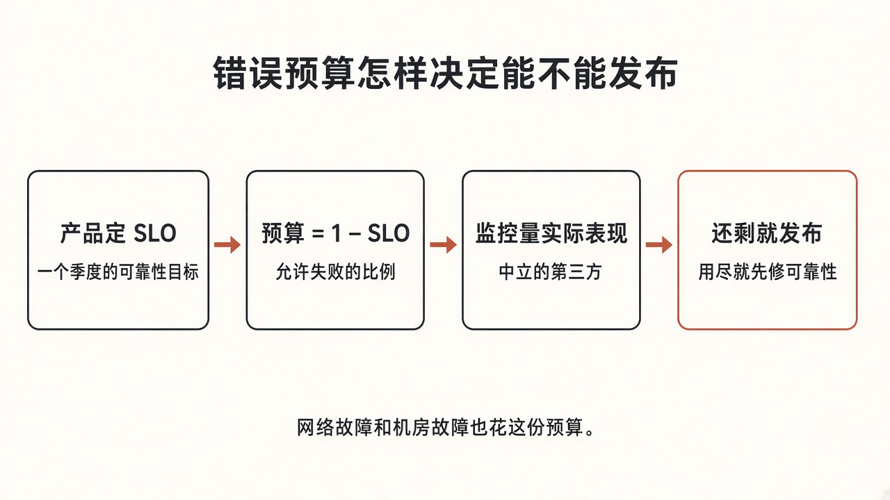
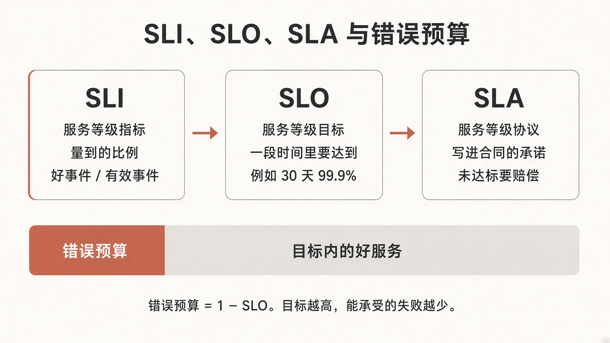
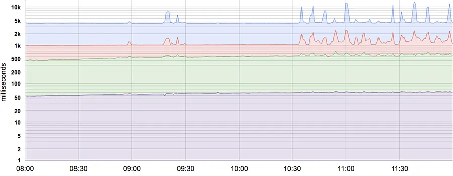
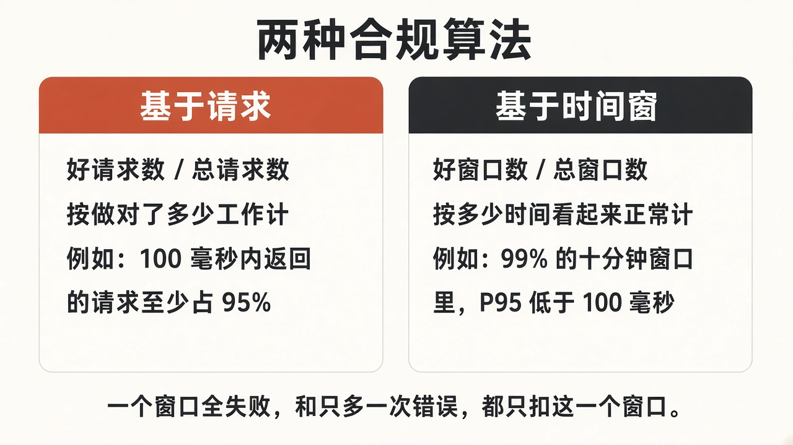
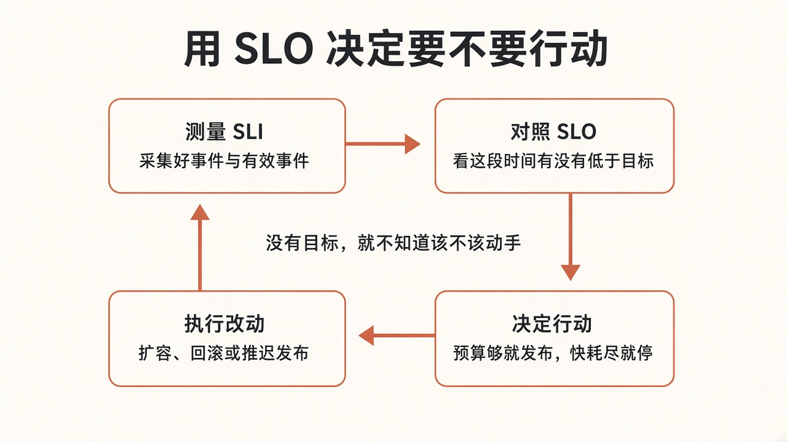

* Do not remove this line (it will not be displayed)
{:toc}

> 定义和例子来自这几份材料。[SRE 书第 1 章](https://sre.google/sre-book/introduction/)（Benjamin Treynor Sloss）说明 SRE 怎样从 2003 年的生产团队长出来；[第 3 章](https://sre.google/sre-book/embracing-risk/)（Marc Alvidrez；错误预算一节由 Mark Roth 撰写）说明可靠性目标怎样变成可以花的预算；[第 4 章](https://sre.google/sre-book/service-level-objectives/)（Chris Jones、John Wilkes、Niall Murphy、Cody Smith）给出指标、目标和协议怎么分开，以及 Chubby 的受控下线。[Wikipedia: Service-level objective](https://en.wikipedia.org/wiki/Service-level_objective) 给出百科定义和一组非 HTTP 的目标写法；[SRE fundamentals: SLI vs SLO vs SLA](https://cloud.google.com/blog/products/devops-sre/sre-fundamentals-sli-vs-slo-vs-sla)（Adrian Hilton，2021-05-07）把 2018 年的 [同题文章](https://cloud.google.com/blog/products/devops-sre/sre-fundamentals-slis-slas-and-slos) 收成对外更松、对内更紧的一组数字；[Cloud Monitoring 的 SLO 文档](https://docs.cloud.google.com/stackdriver/docs/solutions/slo-monitoring?hl=zh-cn) 给出请求制、时间窗、日历周期和滚动窗口的算法；[IBM：什么是服务级别目标](https://www.ibm.com/cn-zh/think/topics/service-level-objective) 给出「几个九」的停机时间和告警对着症状的理由。指标从哪采，见 [Prometheus in Action]() 和 [OpenTelemetry in Action]()。
{: .prompt-info }

服务等级目标（Service Level Objective，SLO）是一段时间里，某项服务等级指标要达到的目标值或区间。指标告诉团队现在做到了多少，目标告诉团队做到多少就够，协议把其中一部分写成带后果的承诺。目标没有占满的那一截失败额度可以拿来发布：额度还在，就可以发版；额度快完了，就先保住用户已经在用的功能。这份额度是 SRE 用来安放「想快点发」和「怕发了会坏」这组张力的办法。

# 背景

## SRE 从 2003 年的一支生产团队长出来

Benjamin Treynor Sloss 在 [SRE 书第 1 章](https://sre.google/sre-book/introduction/) 里写下这套做法的来历。他 2003 年加入 Google，接手一支七人的 Production Team。在此之前他做的是软件工程，于是按自己希望被管理的方式来设计这支队伍。这支队伍后来成为 Google 的 SRE。他给的定义很短：SRE 就是请一位软件工程师来设计一支运维团队时，所得到的结果。书的脚注称他为 Google Engineering 副总裁、Google SRE 的创始人。

在这之前，业界运行复杂系统的常见办法是系统管理员。管理员把现成组件装到一起，再处理随后发生的事件和变更。系统和流量变大，事件变多，管理员团队也跟着变大。开发负责做功能，运维负责让服务在自己值班时保持可用。两边的词汇、对风险的假设、对稳定性的预期都不一样。争执最常出现在发布速度上。大多数故障来自某种变更：新配置、新功能，或一种新的用户流量。开发想把功能交到用户手里。运维想守住正在跑的系统。于是运维加上发布审查，审查项可以堆进过去每一次故障。开发则减少名为「发布」的变更，改用开关切换、增量更新和拣选提交，少走这道审查。

SRE 把运行服务的工作交给会写软件的人。Google 的 SRE 里，大约 50% 到 60% 按软件工程师的标准招聘，其余 40% 到 50% 接近这条标准，并带有多数软件工程师较少具备的技能，最常见的是 UNIX 系统内部和网络一到三层。共同的要求是愿意用软件解决复杂问题。这样招进来的人会厌烦反复的手工操作，也有能力把这些操作写成系统。运维负荷如果只靠加人来接，团队规模会跟着服务线性增长。Google 因此给全部 SRE 的运维工作设了 50% 的上限，工单、值班和手工操作都算在里面。另一半时间用来做开发。书里要的是系统自己运行、自己修复。把手工步骤写成脚本，只是走向这个状态的中途。这顶帽子是上限。规模和新功能会把运维负荷带回来，所以要持续量时间花在哪里。长期把开发时间压到一半以下的团队，要把一部分运维退回产品开发，或加人而不给这个团队加运维责任。

行业里的 DevOps 一词出现在 2008 年末。SRE 书写于 2016 年初，当时这个词仍在变化。书把 DevOps 的核心写成三件事：让负责运行的人进入系统设计和开发的每个阶段，用自动化代替人工，把工程方法和工具用到运维任务上。这些原则和 SRE 重合。书给出的两种读法可以同时成立。DevOps 是若干 SRE 原则向更多组织、管理结构和人员构成的推广。SRE 是 DevOps 的一种具体实现，并带有自己的附加做法。

SRE 团队对所支持的服务负责可用性、延迟、性能、效率、变更管理、监控、应急响应和容量规划。SLO 是这些职责里用来决定变更可以有多快的那一条。

## SLO 把发布速度和稳定性放进同一份预算

开发和 SRE 的目标冲突是结构性的：一边要创新速度，一边要产品稳定。第 1 章把冲突摆到台面上，再用错误预算化解。错误预算来自一个观察：对绝大多数软件服务，100% 的可靠性目标不合适。起搏器和防抱死刹车是书里点名的例外。用户和服务器之间还有笔记本、家用无线网、运营商和电网，这些环节加在一起远达不到 99.999%。从 99.999% 再往上补的那 0.001%，会沉进其他环节的不可用里。用户得不到好处，团队却要付出很大代价。

合适的目标因此是产品问题，由业务或产品来定。要看的是三件事：用户按自己的用法，对多高的可用性会满意；不满意的用户有什么替代品；可用性落在不同水平时，使用量会怎样变化。目标一旦定下，以比例计的错误预算就是 1 减去这个目标。服务做到 99.99% 可用，就有 0.01% 的不可用可以花。这份比例可以花在任何事情上，只要不超支。开发希望把它花在带风险的发布上，把功能更快交出去。分阶段发布和 1% 实验，是在把预算省下来，好让后面的发布更快。

$$
\text{错误预算（比例）} = 1 - \text{可用性目标}
$$

换成请求数或分钟数时，再乘上合规周期里的有效事件。那种折算放在后面的「错误预算是目标留下的失败额度」。

[第 3 章](https://sre.google/sre-book/embracing-risk/)（Marc Alvidrez）把同一件事写成风险管理。可靠性高过某个程度之后，继续提高会限制新功能的速度，推高成本，用户还分辨不出差别。书里的例子是：用户自己的手机只有 99% 可靠时，他分辨不了服务是 99.99% 还是 99.999%。可靠性每提高一截，代价可以是上一截的 100 倍。成本有两笔。一笔是冗余的机器和算力，用来腾出维护窗口，或存放保证持久性的校验数据。另一笔是机会成本：做这些冗余的工程师，这段时间没有做用户看得到的功能。因此可用性目标既是下限，也是上限。做到目标之上一点点可以。明显超出，就是把本可以做功能、还技术债或降低运行成本的机会花掉了。

不同服务的目标不一样，因为业务愿意承担的风险不一样。书里用 Google Apps for Work 设想一类企业服务：员工靠 Gmail、日历、云端硬盘和文档干活，服务中断也是这些企业的中断。这类服务对外可以写成一个季度 99.9%，对内再收紧，并在合同里写上未达到时的罚则。YouTube 在 2006 年被 Google 收购时面向消费者，产品还在快速变化。书里把当时的可用性目标定得低于企业产品，因为那个阶段更快地改功能更重要。Apps for Work 这个例子说的是对外松、对内紧，并带合同罚则。YouTube 这个例子说的是消费者产品可以比企业产品更低。Hilton 在 2021 年文章里另有一组按月的数字：对外 99.9%，对内 99.95%。三组材料问的都是「可靠性做到哪一档」，周期、服务和具体百分比各不相同。

广告系统还能把请求成败直接换成收入。第 3 章有一笔示意账，假设每个请求价值相同、服务收入为 100 万美元。可用性从 99.9% 提到 99.99%，多出来的可用比例是 0.0009，对应收入 900 美元。多这一个九的成本若高于 900 美元，这笔投入就超过了预计增加的收入。这 100 万美元是书里的假设，用来看这笔比较怎么做。

基础设施同时服务几种需求。Bigtable 上，在线请求希望队列几乎是空的，离线分析希望队列保持有货，以便吃满吞吐。把所有集群都做成超高可靠，以这种系统的资源规模来看通常贵得不划算。书里的做法是分成低延迟集群和高吞吐集群。低延迟集群留出较多空闲容量和冗余。高吞吐集群跑得更满、冗余更少，成本可以降到低延迟集群的 10% 到 50%。调用方自己选付得起、又满足需要的那一档。例如把隐私所依赖的数据放进全球一致的存储，把可有可无的体验数据放进更便宜、一致性更弱的存储。

Mark Roth 在同一章写的「错误预算的动机」，把季度预算收成一套可以重复的做法。产品管理定义 SLO，写明一个季度里服务应有多少正常运行时间。监控系统作为中立的第三方量出实际表现。两者之差，就是这个季度还剩多少不可用。测量结果高于 SLO、预算还有剩余时，新版本可以继续发布。违反 SLO 的次数把预算花完之后，发布先停，人力转去测试、加固和性能。做法可以比「开或关」更细：预算接近用完时放慢发布，或回滚。产品开发如果想少做测试、加快推送，而 SRE 持保留意见，就看预算还剩多少。预算宽，产品侧可以多承担风险。预算快完时，产品侧自己也会要求更多测试或更慢的推送，因为他们要把剩下的预算留给还没发出去的功能。这个结果依赖一条授权：SLO 被打破时，SRE 真的能够停掉发布。第 1 章也提到，错误预算用尽后在当季剩余时间停止发布，需要管理层把这条规则立住，否则产品团队未必接受。

{: width="760" }
*图：季度错误预算从目标走到发布决定。来源：[SRE 书第 3 章](https://sre.google/sre-book/embracing-risk/) 中 Mark Roth 的做法。*

Roth 给出的例子是：季度 SLO 为成功服务 99.999% 的查询，允许的失败率是 0.001%。一次问题失败了该季度预期查询的 0.0002%。0.0002% 是 0.001% 的五分之一，花掉的是当季预算的 20%。网络中断和机房故障同样计入这份预算，接下来一个季度里的新发布也会因此减少。整支团队接受这种减少，因为正常运行时间是共同责任。目标定得过高、功能发不出去时，团队也可以放宽 SLO，从而加大错误预算，换回创新速度。

SRE 和产品开发的共同目标，于是变成把错误预算花在尽可能高的功能速度上。故障是创新过程里预期会出现、并且由两边一起管理的开支。书里的非正式格言是：希望不是策略。发布快慢、测试做多少、金丝雀放多大、放多久，都按这份双方同意的指标来定。

第 1 章还有一个相关的观察：大约 70% 的故障来自线上系统的变更。对应的做法是渐进发布、尽快发现有问题的变更、安全回滚。这三步尽量交给自动化，缩小一次坏变更影响到的用户和操作。人留在重复操作里时，疲劳、熟练之后的轻视和走神会把同一种失误放大。

指标怎么定义、目标句子怎么写、请求制和时间窗怎么算，从「原理与核心概念」开始。预算按请求数折成可以告警的燃烧速率，在使用示例里。

# 原理与核心概念

## SLI、SLO、SLA 各管一件事

SRE 书把三个经常被混叫成 SLA 的词拆开。

服务等级指标（Service Level Indicator，SLI）是对服务质量某一方面的定量测量。延迟、错误比例、吞吐量、可用性、持久性都是常见的方面。原始数据先在一个时间窗里收集，再收成比率、平均值或分位数。理想的指标直接量用户在意的那件事。量不到时，用代理指标，并写明代理和用户体验差在哪里。客户端看到的延迟更接近用户，很多系统只能拿到服务端到最后一个字节的时间，这个服务端时间就是代理。

服务等级目标是这条指标的目标值或区间。自然的写法是「SLI ≤ 目标」，或「下界 ≤ SLI ≤ 上界」。SRE 书里的莎士比亚搜索服务把「很快」写成：平均搜索延迟低于 100 毫秒。用户的请求速率由用户决定，服务方写不出一个「每秒查询数必须等于多少」的目标；服务方写得出的是自己要守住的延迟和成功率。

服务等级协议（Service Level Agreement，SLA）是和用户之间明示或默示的合同，里面包含未达到其中 SLO 时的后果。后果最容易辨认的形式是退款、罚金或赠送服务时间。SRE 书给了一个辨别方法：问「目标没达到会怎样」。没有写明后果，手里的就是 SLO。有人说的 “SLA violation”，多半是一次没达到的 SLO；真正的 SLA 违约可以走到合同争议。SRE 通常不负责起草 SLA，因为赔偿和售卖范围是业务与法务的决定。SRE 要做的是让团队看清守住这些目标有多难，并尽量在后果发生前把服务拉回来。

维基百科把 SLO 放回这层关系里：它是 SLA 里可测量的那一部分，用来减少双方对「服务到底该怎样」的误解。公司内部互相调用的服务也可以有 SLO，尤其是已经按 SRE 方式运作的公司。Alex Hidalgo 在 *Implementing Service Level Objectives* 里把目标收成一句：在用户还不会因此明显不满的前提下，服务允许多少次没有正常工作。

{: width="760" }
*图：SLI 给出比例，SLO 规定一段时间里的目标，SLA 把承诺和赔偿写进合同。下面那条表示目标没有占满的部分就是错误预算。*

> 问一句「没达到会怎样」。没有写明后果，手里的是 SLO。后果写进了合同，才是 SLA。Google 搜索对公众没有 SLA；搜索不可用时，损失发生在声誉和广告收入上。Google for Work 这类服务则把 SLA 写给了用户。两种服务都值得先写 SLI 和 SLO。
{: .prompt-tip }

## 可用性用「几个九」来说话

可用性在 SRE 书里是服务能够履行其功能的时间比例，工程上经常写成格式正确的请求里有多少成功，也叫产出率（yield）。存储系统还要单独看持久性：数据在很长一段时间之后是否还在。

成功率写成：

$$
\text{可用性 SLI} = \frac{\text{成功的有效请求}}{\text{全部有效请求}}
$$

百分之百做不到。行业用百分比里「9」的个数来称呼高可用：99% 是两个九，99.999% 是五个九。SRE 书提到，书出版时 Compute Engine 公布的可用性目标是 99.95%，也就是三个半九。

一年按 365 天、一个窗口按 30 天计，99.9% 在 30 天里留下的失败时间是：

$$
(1 - 0.999) \times 30 \times 24 \times 60 = 43.2
$$

分钟。下表用同一套口径列出几个常见目标。IBM 的说明里有一张按年、季度和 30 天折算的表，数量级与这里一致；下表不单列季度，一年固定按 365 天。

| 目标 | 365 天可失败 | 30 天可失败 |
| --- | --- | --- |
| 99% | 3.65 天 | 7.2 小时 |
| 99.9% | 8.76 小时 | 43.2 分钟 |
| 99.95% | 4.38 小时 | 21.6 分钟 |
| 99.99% | 52.6 分钟 | 4.32 分钟 |
| 99.999% | 5.26 分钟 | 25.9 秒 |

每多一个九，成本和复杂度都上去一截。用户在某个程度之后分辨不出差别。SLO 要落在「做得到」和「再差用户就不接受」之间。高出用户感知的那几个九，先变成运行成本。

## 错误预算是目标留下的失败额度

Cloud Monitoring 把错误预算定义成合规周期里还可以失败、同时仍然达到 SLO 的额度：

$$
\text{错误预算} = (1 - \text{SLO}) \times \text{合规周期内的有效事件数}
$$

文档里的一笔账是：滚动 7 天内 85% 的请求要是好的，过去一周收到 60,480 个请求。允许变坏的比例是 15%，错误预算是 $$0.15 \times 60480 = 9072$$ 个请求。坏请求超过 9,072 个，这个 7 天窗口就落在 SLO 外面。

SRE 书把错误预算定义成 SLO 可以被错过的速率，并把它看成另一条 SLO：这条 SLO 管的是其他 SLO 有没有被守住。预算按天或按周跟踪，管理层通常还要一个月或一个季度的评估。发布能不能做，看的是当前消耗离这份预算还有多远。

预算会随目标变紧而迅速变小。30 天、1,000 万次有效请求、99.9% 的可用性，允许失败的请求数是：

$$
(1 - 0.999) \times 10^{7} = 10^{4}
$$

也就是 10,000 次。同样的流量改成 99.99%，预算只剩 1,000 次。这 1,000 万次是用来看公式的示意流量，是计算假设。

> 可用性目标写成 100%，错误预算就是 0。任何一次失败都落在目标外，发布和试验都没有余地。Cloud Monitoring 的这篇文档把单个 SLO 的目标上限写成 99.9%；SRE 书讨论的目标可以更高，例如上面的 99.95%。产品界面的上限以当前文档为准，原则是同一条：目标要留下预算。
{: .prompt-warning }

## 长期好于目标，用户会把现状当成承诺

发布 SLO 是在设定预期。没有公开目标时，用户会自己形成一套预期，这套预期和服务的设计者可能对不上。预期过高，用户会把服务嵌进自己无法降级的路径里。预期过低，本来适用的用户会走开。

Chubby 是 Google 用于松耦合分布式系统的锁服务。全球实例的每个副本放在不同地域。Marc Alvidrez 在 SRE 书这一章的旁白里记录了后续：真正的全球故障少到依赖方开始假设 Chubby 不会宕，一旦宕机，这些服务自己也无法降级。SRE 的做法是让全球 Chubby 达到目标，同时明显不超过目标。一个季度里，如果真实故障没有把可用性压到目标以下，就合成一次受控下线。刚加上的不合理依赖会在下一次这种演练里露出来。

Hilton 在 2021 年的文章里把同一条原则写成操作建议：可靠性只要做到用户能接受的最低水平，并把它写成 SLO。服务如果长期远好于目标，这个水平就会变成新的预期。Google 会对一部分服务安排周期性下线，避免它「好得过分」。对前端服务器做有计划的停机演练，还可以找出本不该依赖这组服务器的调用方。

> Chubby 的全球实例很少真正宕机，依赖它的服务开始假设它不会宕。一个季度里如果真实故障没有把可用性压到目标以下，SRE 就安排一次受控下线，把刚加上的不合理依赖逼出来。
{: .prompt-danger }

# 使用方法

## 先写用户在意的行为，再决定量什么

SRE 书建议从用户在意的结果往回推指标。从「监控系统里已经有的曲线」出发，最后得到的 SLO 往往和用户无关。指标太多，注意力会被摊薄；指标太少，系统的一块行为会完全没人看。一把有代表性的指标通常够用。

不同系统在意的方面不一样：

| 系统 | 要回答的问题 |
| --- | --- |
| 面向用户的在线服务 | 请求有没有得到响应，花了多久，能承受多少流量 |
| 存储 | 读写要多久，需要时能不能读到，久了以后数据还在不在 |
| 数据处理流水线 | 处理了多少数据，从进入到完成要多久 |
| 所有系统 | 返回的答案、读到的数据、做出的分析是否正确 |

正确性要跟踪，因为它说明系统是否健康。它常常是数据的性质，满足它的责任通常在 SRE 之外。

采集侧默认在服务端：用监控系统统计 HTTP 500 占全部请求的比例，或周期性地分析日志。只看服务端会漏掉用户已经遇到、服务端指标仍然正常的故障。SRE 书举的例子是莎士比亚搜索的后端延迟正常，页面上的 JavaScript 已经让浏览器迟迟不能使用。这时更接近用户的代理是「页面变得可用花了多久」。服务端指标用 [Prometheus]() 这类系统采集；浏览器或客户端上的这段时间，用 [OpenTelemetry]() 的客户端 span 更合适。

聚合方式要写进指标定义。每秒 200 个请求、隔秒 0 个请求的系统，一分钟平均和每秒恒定 100 个请求的系统一样，瞬时负载却是两倍。延迟也一样：大多数请求很快、少数请求极慢时，平均值仍然好看。SRE 书的 Figure 4-1 用对数坐标画出了这种形状。书中的说明是：典型请求大约 50 毫秒，但有 5% 的请求慢了 20 倍。最上面那条线在下午明显抬高。只看平均延迟，这一天会像没有变化。

{: width="760" }
*图：同一天里的多条分位延迟，纵轴是对数刻度。来源：[Google SRE Book, Figure 4-1](https://sre.google/sre-book/service-level-objectives/)。*

分位数把分布的形状留了下来。99 分位或 99.9 分位给出一个说得通的坏情况，50 分位（中位数）给出典型情况。响应时间的方差越大，长尾越影响典型用户；负载高时排队会把这个效应放大。用户研究里，人们通常更愿意要一个略慢、但波动小的系统。有的 SRE 团队因此只盯高分位：99.9 分位已经好，典型体验只会更好。

统计上还有一条限制。计算机系统里的耗时常常是偏的：成功请求不会小于 0 毫秒，超时设在 1,000 毫秒时，成功请求也不会大于这个超时。均值和中位数可以离得很远。没有先核实分布，就按「出现离群点就重启机器」去动作，会动作得太勤，或该动的时候不动。

指标定义里重复的部分收成模板，单条 SLI 就不必每次重写。SRE 书列出的默认项包括：按 1 分钟平均、集群内全部任务、每 10 秒测一次、只算黑盒监控的 HTTP GET、在服务端用监控系统采集、延迟量到最后一个字节。

## 把一条 SLO 写成可以核对的句子

Keller 和 Ludwig 把一条 SLO 拆成三块：负责交付的一方、有效期、描述目标的表达式。维基百科上的例子是：「一个月内，服务台 90% 的来电要在 20 秒内被接起，由 ACD 系统报告。」句子里同时有达成值、测量对象、测量周期和测量位置。

SRE 书要求把测量方式和有效条件写进目标。同一条 `Get` RPC 可以写成两句等价的话，第二句用的是前面列出的默认项：

- 全部后端上，按 1 分钟平均，99% 的 `Get` RPC 在 100 毫秒内完成。
- 99% 的 `Get` RPC 在 100 毫秒内完成。

分布的形状重要时，一条 RPC 写多档目标：

- 90% 的 `Get` RPC 在 1 毫秒内完成。
- 99% 的 `Get` RPC 在 10 毫秒内完成。
- 99.9% 的 `Get` RPC 在 100 毫秒内完成。

吞吐型客户端和延迟敏感的客户端共用一个接口时，目标跟着负载分开。书里的例子是：吞吐型客户端 95% 的 `Set` RPC 在 1 秒内完成；载荷小于 1 KB 的延迟敏感客户端，99% 的 `Set` RPC 在 10 毫秒内完成。

维基百科收录的一组目标说明，SLO 可以离开 HTTP。下表是该页列出的写法，测量周期各不相同。

| 测量类型 | 目标 | 周期 |
| --- | --- | --- |
| 可用性 | 应用 99.95% 的时间可用 | 一年 |
| 服务台响应 | 75% 的来电在 1 分钟内接起，85% 在 2 分钟内接起，100% 在 3 分钟内接起 | 一个月 |
| 事故处理 | 99% 的一级单 3 小时内解决，98% 的二级单 8 小时内解决 | 一个季度 |
| 响应时间 | 85% 的 TCP 应答在 1.5 秒内，99.5% 在 4 秒内 | 一个月 |

服务台那一行里的 100% 是最慢一档：全部来电都在 3 分钟内被接起。前两档仍然允许一部分电话晚于 1 分钟或 2 分钟。可用性 SLO 写成 100% 时，错误预算变成 0，那是另一条规则。

## 合规窗口用日历，或用滚动的最近 N 天

Cloud Monitoring 有两种合规周期。

日历周期按周、按月这类边界计算，周期结束时预算重置。一个自然月有多少天并不固定。周期结束才有一次「这个月是否合规」的评分，评分容易和账单周期对齐。周期进行中可以看见表现，正式的合规结论每个周期给出一次。

滚动窗口始终看最近 $$n$$ 天，$$n$$ 在这篇文档里是 1 到 30。旧数据点滑出窗口，新数据点补进来。最近 30 天的合规每天都在重新计算，服务可以在合规和不合规之间来回切换。

## 按请求计，或按时间窗计

合规是合规周期内「好事件 / 全部事件」。事件是什么，由 SLO 的类型决定。目标是 99.9% 时，这个比值至少达到 99.9% 才算达到。

基于请求的 SLO，事件是一次请求。好请求数除以总请求数，在整个周期上达到目标就算达到。文档里的例子是：「至少 95% 的请求延迟低于 100 毫秒。」它回答的是：这段时间里的工作，有多大比例做对了。流量在周期内怎么分布，不改变这个比例的算法。

基于时间窗的 SLO，事件是一个测量区间。好区间数除以总区间数。文档里的例子是：「至少 99% 的 10 分钟窗口里，95 分位延迟低于 100 毫秒。」一个好窗口是这 10 分钟里 95% 的请求都低于 100 毫秒。它回答的是：有多大比例的时间，用户觉得服务是正常的。手头的原始指标如果只是一个延迟分位数，文档要求使用时间窗 SLO。

另一笔文档里的账：滚动 30 天、测量区间 1 分钟、目标 99%。30 天有 $$30 \times 24 \times 60 = 43200$$ 个一分钟区间，99% 意味着至少 $$0.99 \times 43200 = 42768$$ 个区间是好的。

{: width="760" }
*图：左边按请求计工作做对了多少，右边按时间窗计有多少时间看起来正常。*

时间窗会抹平突发。一个窗口里全部调用失败，和只比门槛多一次错误，都只扣掉这一个窗口。请求很少的窗口和流量很大的窗口，权重也一样。请求制保留了「这一小时打进来多少、坏了多少」。选哪一种，取决于用户生气的方式是「这次请求失败了」，还是「这一阵子服务一直不正常」。

## 用对照结果闭上控制回路

SRE 书把 SLI 和 SLO 放进一个控制回路：

1. 测量系统的 SLI。
2. 把 SLI 和 SLO 比较，决定要不要行动。
3. 需要行动时，找出为了回到目标该做什么。
4. 做那件事。

书中的例子是：第 2 步看出请求延迟在上升，几小时后会错过 SLO。第 3 步检验服务器是否被 CPU 打满，决定加机器把负载摊开。SLO 告诉团队该不该加机器，以及要在哪一刻加。

{: width="760" }
*图：先测量，再对照目标，然后才决定扩容、回滚或继续发布。*

## 对内的目标紧于对外的承诺

Hilton 给出的一组数字是：对外可用性是一个月 99.9%，对内是 99.95%。SLA 几乎总是松于内部 SLO，这样内部先破目标，团队还有时间处理，用户侧的合同还没有破。另一做法是 SLA 只覆盖内部指标的一个子集。

按 30 天把这组百分比折成时间，对外大约 43.2 分钟，对内大约 21.6 分钟。这组数字里，对内允许的失败时间正好是对外的一半。换一组目标时要重算，缓冲的长度取决于两个百分比的差。

付费用户的请求要单独计入 SLA。这同时给出了流量优先级：合同覆盖的请求和其余请求分开统计。哪些请求算「有效」要在合同里写死。用户因为自己发出了有缺陷的客户端而打满配额时，Hilton 的建议是考虑把「超出配额」的响应码排除在 SLA 核算之外。

# 使用示例

下面用一个搜索接口把上面的句子做成可以计算的对象。接口名是 `search`，指标是 Prometheus 的 `http_requests_total`，标签 `code` 是 HTTP 状态码。这是一套示意定义。

有效请求是配额之内、格式正确的请求。状态码 400 和 429 不进入分子，也不进入分母：400 是调用方的参数错误，429 是超出配额。2xx 算成功。404 和 5xx 留在分母里，算失败。延迟在服务端量到最后一个字节。用户浏览器里的耗时不在这组指标里。

两条 SLO，都看滚动 30 天：

- 99.9% 的有效请求返回 2xx。
- 99% 的有效请求在 100 毫秒内返回。

## 五分钟可用性和三十天剩余预算

五分钟可用性用于看眼前的变化。30 天的比值才用来判断有没有落在 SLO 里。计数器在进程重启后从零开始，`increase` 跨过重启会少算一段，这个台阶在 [etcd 监控]() 里同样会出现。

```yaml
groups:
  - name: search-slo
    interval: 30s
    rules:
      - record: search:http_availability:ratio_rate5m
        expr: |
          sum(rate(http_requests_total{job="search",code=~"2.."}[5m]))
          /
          sum(rate(http_requests_total{job="search",code!~"400|429"}[5m]))
      - record: search:http_availability:ratio_30d
        expr: |
          sum(increase(http_requests_total{job="search",code=~"2.."}[30d]))
          /
          sum(increase(http_requests_total{job="search",code!~"400|429"}[30d]))
      - record: search:http_availability:budget_remaining_30d
        expr: |
          1 - (
            (1 - search:http_availability:ratio_30d)
            / (1 - 0.999)
          )
```
{: file="prometheus/rules/search-slo.yml" }

`budget_remaining_30d` 的读法可以代一个数。30 天可用性是 0.9995 时，失败比例是 $$1 - 0.9995 = 0.0005$$。允许的失败比例是 $$1 - 0.999 = 0.001$$。已经用掉的预算比例是 $$0.0005 / 0.001 = 0.5$$，剩下的比例是 $$1 - 0.5 = 0.5$$。可用性掉到 0.998 时，失败比例是 0.002，用掉的比例是 2，剩余是 $$-1$$：预算已经透支了一整份，这个滚动窗口落在 SLO 外面。

分母为零时，`rate` 的比值没有定义。搜索接口长时间没有有效请求时，这条规则会留下空序列，告警规则要允许这种空窗，避免把「没有流量」算成「可用性为零」。

## 一小时烧掉预算的 2% 时，燃烧速率是 14.4 倍

Cloud Monitoring 建议对「错误预算消耗得比期望快」告警。燃烧速率把窗口里的失败比例，除以刚好在整个合规周期用完预算的失败比例：

$$
\text{燃烧速率} = \frac{\text{窗口内的失败比例}}{1 - \text{SLO}}
$$

30 天、99.9% 的可用性，整段允许的失败比例是 0.001。要看「这一小时烧掉全部预算的 2%」对应多高的小时失败比例，按流量均匀分四步：

1. 这一小时要烧掉的预算，占 30 天全部有效请求的比例是 $$0.02 \times 0.001 = 0.00002$$。
2. 一小时是 30 天的 $$1/720$$。流量均匀时，小时内的失败比例是 $$0.00002 \div (1/720) = 0.0144$$，也就是 1.44%。
3. 这个小时失败比例是允许失败比例的 $$0.0144 / 0.001 = 14.4$$ 倍。
4. 按这个速度，预算会在 $$30 \times 24 / 14.4 = 50$$ 小时里烧完。

对应的告警直接实现第 3 步。一小时失败比例超过允许比例的 14.4 倍，就分页：

```yaml
groups:
  - name: search-slo-burn
    rules:
      - alert: SearchAvailabilityBudgetBurn
        expr: |
          (
            1 - (
              sum(rate(http_requests_total{job="search",code=~"2.."}[1h]))
              /
              sum(rate(http_requests_total{job="search",code!~"400|429"}[1h]))
            )
          )
          / (1 - 0.999)
          > 14.4
        for: 2m
        labels:
          severity: page
        annotations:
          summary: 搜索可用性按最近一小时的速度，大约 50 小时会烧完 30 天预算
```
{: file="prometheus/rules/search-slo-burn.yml" }

`for: 2m` 只去掉采集抖动。这一条仍然会把「整整一小时都在以 14.4 倍燃烧」报出来，其中包括一次已经结束的尖峰。短窗口和长窗口同时烧得过快才分页，写在 [SRE Workbook 的 Alerting on SLOs](https://sre.google/workbook/alerting-on-slos/)。上面这条是单窗口的计算线。

延迟 SLO 用同样的结构，把「2xx」换成「2xx 且耗时低于 0.1 秒」。直方图要在采集时就把 100 毫秒设成一个桶边界，否则 `histogram_quantile` 只能在相邻桶之间估计，估计值和 SLO 门槛会差一截。

## 日历周期里，流量变大时剩余预算会回升

燃烧速率看的是最近一小时的失败比例。剩余预算还会因为窗口算法变多，失败次数却没有减少。滚动窗口里，旧的差数据滑出窗口时，剩余预算回升。日历周期还有另一种回升。Cloud Monitoring 事先不知道这个周期一共会有多少请求，于是用到目前为止的请求数，除以已经过去的时间，再乘以周期长度，得到预计总量，然后乘以 $$1 - \text{SLO}$$ 得到预算。预计总量变大，预算的绝对数量也变大。

按这个外推做一笔示意账，SLO 仍是 99.9%，周期是 30 天的日历月。第 10 天结束时有 100 万次请求、500 次失败：

$$
\frac{10^{6}}{10} \times 30 = 3 \times 10^{6}
$$

预计全月 300 万次，预算 $$0.001 \times 3 \times 10^{6} = 3000$$ 次，剩余 $$3000 - 500 = 2500$$ 次。

第 11 天又来了 20 万次请求，失败仍是 500 次。累计 120 万次，已过 11 天：

$$
\frac{1.2 \times 10^{6}}{11} \times 30 \approx 3.273 \times 10^{6}
$$

预计全月约 327.3 万次，预算约 3,273 次，剩余约 2,773 次。失败次数没变，剩余预算变多了。读日历周期的剩余预算时，要同时看预计总量有没有变，否则会把「流量预估变大」读成「服务变好了」。

滚动窗口没有这层外推。窗口始终覆盖完整的最近 30 天，预算大于或等于 0 表示当前窗口合规，小于 0 表示不合规。

# 最佳实践

## 目标从用户还能接受的下限起

SRE 书把选目标时反复出现的教训写成五条。

现状可以直接量到，把它原样写成 SLO，会把一套需要拼命才守得住、不重做就无法改进的系统锁死。先看用户在哪一档开始抱怨，再看团队能以什么成本守住它。

聚合保持简单。层层套起来的指标会把性能变化盖住，讨论时也说不清一个数到底代表哪一次请求。

目标留下失败的余地。「无限扩展且延迟不升、永远可用」设计周期长，运行也贵，而且常常好过用户愿意为之付费的程度。

SLO 尽量少。一条 SLO 如果从来不能在优先级争论里帮上忙，它就可以删掉。书里的注脚更进一步：如果没有任何 SLO 能帮团队赢得优先级争论，这个产品也许不需要一支 SRE 团队。用户是否高兴，很难写成一条 SLO。

目标可以后紧。先用一个宽松、守得住的目标上线，弄清系统的行为之后再收紧。一开始就写一个达不到的目标，后面只能公开把目标放松。

IBM 引用 Rick Sturm 和 Wayne Morris 的清单，用来检查一条 SLO 是否立得住：做得到、重复得了、量得到、读得懂、有意义、控制得住、付得起、双方都接受。清单的第一项是做得到。目标高过用户能感知的差别，多出来的九只增加成本。

## 告警对着会烧预算的症状

IBM 把可靠性写成手段：SLO 用来发现并满足客户预期，让人愿意继续用。高出客户感知的可用性，先变成运行成本。SLO 从 5 条增加到 20 条时，多出来的 15 条通常先增加值班负荷，对优先级判断的帮助有限。

告警的门槛放在「照这个趋势，SLO 会在周期内失守」。IBM 的例子是：过去一小时的响应延迟如果持续下去，一周的延迟 SLO 会不合规。这是症状告警。磁盘、CPU 的每条曲线都做分页，会把人叫去处理还没有影响到用户的波动。无关告警堆高运营成本，也把工程师的时间耗在没有后果的事项上。

SLO 一旦算得出来，评估就可以交给监控系统。自动扩容这类动作放在预算策略之后：预算还宽、负载上升，扩容是在保护目标；预算已经透支，继续自动扩容可能只是在掩盖一个该回滚的版本。

内部讨论 SLO 的人包括产品、开发和运维、事故管理、基础设施。外部预期来自投诉、研究、焦点小组和公开反馈。IBM 强调先写清关键用户旅程：用户为了做成一件事要经过的那一串交互。旅程外的接口可以有指标，旅程上的接口才配 SLO。

# 注意事项

## 均值盖住长尾，服务端盖住客户端

延迟 SLO 写平均值时，图里那种「5% 的请求慢 20 倍」仍然可以让平均值停在目标以内。目标句子里写分位数和门槛，例如「99% 的有效请求低于 100 毫秒」。

服务端 2xx 的比例正常，只说明服务器发出了成功响应。用户侧的 DNS、中间代理、页面脚本仍然可以让这次访问失败。面向用户的 SLO 至少要有一条从客户端或探测点发出的可用性，和服务器日志互相核对。

## 时间窗把一次大故障收成一个格子

基于时间窗的 99%，在 30 天、1 分钟格子的算法里，允许 $$43200 - 42768 = 432$$ 个坏分钟，也就是 7.2 小时。这 7.2 小时里每个格子可以只错一次，也可以全部失败，对 SLO 的记账相同。请求制下，全部失败的那一分钟会按这一分钟的请求数扣预算。流量大的接口如果用户在意的是「我这次请求失败了」，用请求制。只有分位数、没有请求计数时，按 Cloud Monitoring 的约束使用时间窗，并在目标句子里写明格子有多长。

## 两种窗口的预算都会在服务没有变好时回升

滚动窗口里，一段很差的时间滑出最近 30 天，新进来的时间是好的，剩余预算上升。日历窗口里，失败次数不变、预计总量因为流量变大而上升，剩余请求预算也上升。前面那笔日历示意账里，失败保持 500 次，剩余从 2,500 次变成约 2,773 次。剩余预算的斜率里混着这两种回升。失败比例本身下降，才说明服务在变好。

## 配额、灰度用户和合同用户要分开计

SLA 的核算排除 429 之后，内部 SLO 是否排除，要单独写。内部 SLO 把 429 排除，配额服务本身坏了也不会出现在搜索的可用性里。配额服务需要自己的 SLO。

Hilton 要求付费用户单独统计。`job="search"` 把免费流量和合同流量合成一个比值时，两件事叠在同一个数上。免费流量的失败会计入这份共享预算，合同用户还没出问题，预算就已经下降。合同用户的失败摊进全部流量之后，比值又会被免费流量拉高。合同覆盖的请求用单独的标签或单独的指标，这两件事才分开。

## 目标长期超额完成会制造隐藏依赖

对内 99.95%、对外 99.9% 的缓冲，只在真实表现靠近对内目标时存在。服务如果连续几个季度做到 99.99%，用户依赖的是 99.99%。等某一次只守住 99.95%，对外合同还在，用户侧的系统已经坏了。Chubby 的受控下线、有计划的前端停机，都是把表现拉回到写下的目标附近。演练的幅度和频率写进运行手册，避免一次演练本身把对外 SLA 打穿。

# 参考资源

官方文档：

- [Wikipedia: Service-level objective](https://en.wikipedia.org/wiki/Service-level_objective)
- [Google SRE Book: Introduction](https://sre.google/sre-book/introduction/)
- [Google SRE Book: Embracing Risk](https://sre.google/sre-book/embracing-risk/)
- [Google SRE Book: Service Level Objectives](https://sre.google/sre-book/service-level-objectives/)
- [SRE fundamentals: SLI vs SLO vs SLA](https://cloud.google.com/blog/products/devops-sre/sre-fundamentals-sli-vs-slo-vs-sla)（Adrian Hilton，2021；文中指向的 2017 CRE 文章是这组定义的更早来源）
- [SRE fundamentals: SLIs, SLAs, and SLOs](https://cloud.google.com/blog/products/devops-sre/sre-fundamentals-slis-slas-and-slos)（Jay Judkowitz、Mark Carter，2018）
- [Cloud Monitoring：SLO 监控](https://docs.cloud.google.com/stackdriver/docs/solutions/slo-monitoring?hl=zh-cn)
- [IBM：什么是服务级别目标（SLO）](https://www.ibm.com/cn-zh/think/topics/service-level-objective)

延伸阅读：

- [SRE Workbook: Implementing SLOs](https://sre.google/workbook/implementing-slos/)
- [SRE Workbook: Alerting on SLOs](https://sre.google/workbook/alerting-on-slos/)
- [Prometheus in Action]()
- [OpenTelemetry in Action]()
- [生产环境 etcd 监控]()
