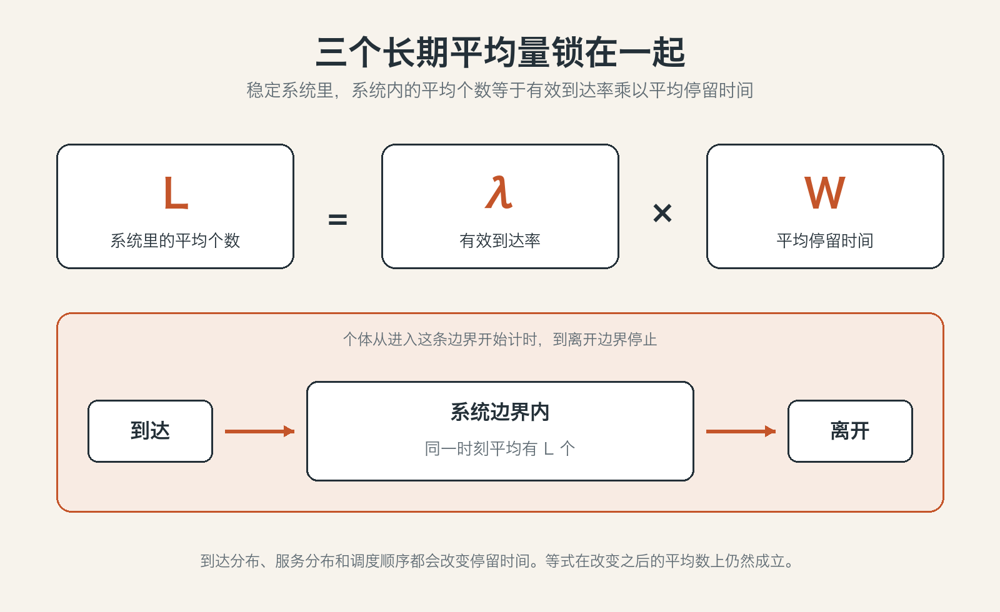
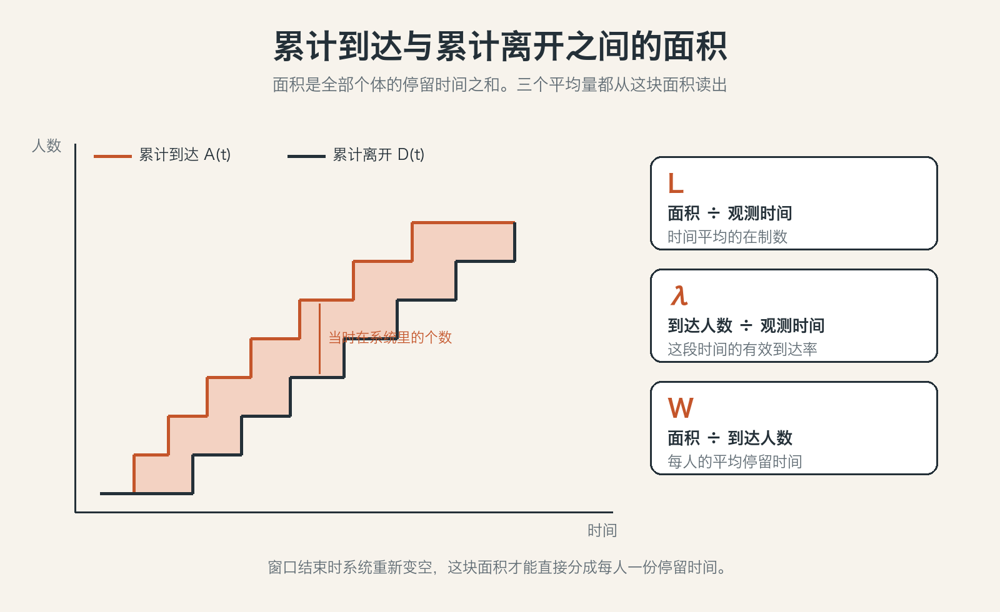
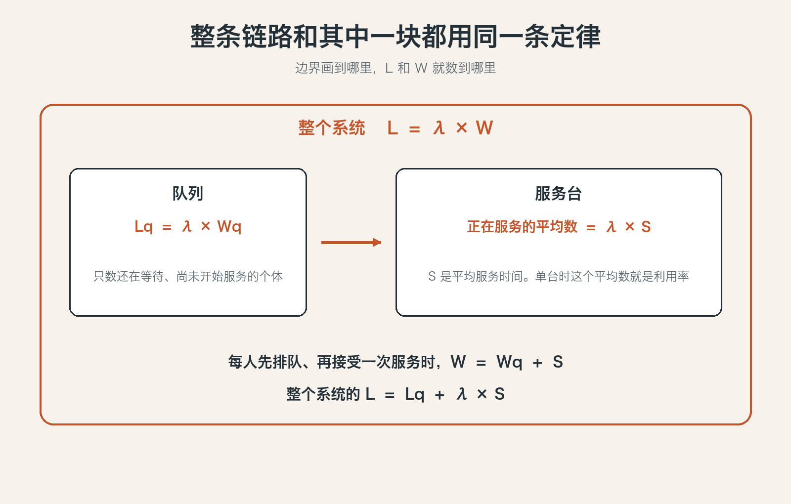

* Do not remove this line (it will not be displayed)
{:toc}

> 定义和例子来自这几份材料。[Wikipedia: Little's law](https://en.wikipedia.org/wiki/Little%27s_law) 给出定理陈述、商店例子和适用条件。John D. C. Little 1961 年的 [A Proof for the Queuing Formula: L = λW](https://doi.org/10.1287/opre.9.3.383) 给出证明。Little 与 Graves 2008 年的 [Little's Law](https://doi.org/10.1007/978-0-387-73699-0_5) 用样本路径把面积和三个平均数连起来。Little 2011 年的 [五十周年回顾](https://doi.org/10.1287/opre.1110.0940) 把同一关系用到产线和医院。Kim 与 Whitt 2013 年的 [Statistical Analysis with Little's Law](https://doi.org/10.1287/opre.2013.1193) 说明有限时间窗上三个估计量怎样才算同一笔账。计算机系统里的利用率和带思考时间的封闭系统，沿用 Harchol-Balter《Performance Modeling and Design of Computer Systems》第 6 章的操作定律。延迟分位见 [服务等级目标]()。
{: .prompt-info }

Little's law（利特尔法则）把一个稳定系统里的三件长期平均数锁在一起：边界里的平均个数 $$L$$，等于有效到达率 $$\lambda$$ 乘以每个个体的平均停留时间 $$W$$。知道其中两个，第三个就被定下来。接口上，它把并发、吞吐和平均延迟收成同一笔账。产线上，它把在制品、产出速率和提前期收成同一笔账。

# 背景

1954 年，Alan Cobham 讨论带优先级的排队时，已经把人数、到达率和等待时间的这层关系当作已知来用。1958 年，Philip M. Morse 在 *Queues, Inventories and Maintenance* 里写下 $$L = \lambda W$$，并请读者找一个它不成立的情形。1961 年，John D. C. Little 在 *Operations Research* 上证明：在他给出的稳态条件下，这样的情形不存在。Jewell（1967）和 Eilon（1969）随后写出更短的证明。Stidham 在 1974 年把条件放到一条样本路径上：只要到达率、停留时间和系统内人数的长期平均都存在，并且长期来看离开率等于到达率，等式就成立。到达间隔服从哪种分布、服务时间服从哪种分布，都不必事先假定。

调度、到达是否成团、服务时间是否波动，都会改变一个人要待多久，也会改变系统里通常有多少人。短作业优先把平均停留时间缩短之后，同样的到达率下，系统里的平均个数会一起变小。等式管的是变完之后的三个平均数仍然彼此一致。

# 原理与核心概念

## 三个平均数各数什么

$$
L = \lambda W
$$

$$L$$ 是对时间取平均之后，系统边界里的个数。顾客、请求、在制品、正在就诊的人，都是这个个数的一种。一条并发曲线在一小时里围起来的面积，除以这一小时，得到的就是这段时间的 $$L$$。

$$\lambda$$ 是长期平均的有效到达率，单位是个数除以时间。有效，指真正进入这条边界、因而会被 $$L$$ 和 $$W$$ 数到的那些个体。门口来了但被拒绝的人、商店满了转身离开的人、接口直接返回 429 的请求，都没有进入边界，就不算进这个 $$\lambda$$。

$$W$$ 是进入边界的个体从进入到离开的平均时间。队列里的等待和服务台上的处理，只要都在边界里面，就都算在 $$W$$ 里。

三个量共用同一条边界、同一段稳定观测、同一群个体。单位要能乘出个数。每小时 10 人乘 0.5 小时，得到 5 人。每秒 800 个请求乘 0.3 秒，得到 240 个在途请求。到达率用「每秒」、停留时间用「毫秒」时，相乘之前先把时间单位换成同一个。

{: width="760" }
*图：三个长期平均量共用的系统边界。*

## 等式成立需要系统稳定下来

Wikipedia 把适用条件写成系统是遍历的：时间上的平均能够代表系统的稳态。落到一次观测上，可以先检查 Stidham 的样本路径条件。到达率的长期平均存在：

$$
\lambda = \lim_{T \to \infty} \frac{A(T)}{T}
$$

$$A(T)$$ 是时间 $$T$$ 内进入边界的个数。离开率的长期平均等于这个 $$\lambda$$。进去的人最终出去，边界里的个数不会随时间无限增加。每个进入的人最终离开，于是停留时间的平均 $$W$$ 存在，人数的时间平均 $$L$$ 也存在。

到达长期快于离开时，人数大约按两边速率之差乘以时间往上走，有限的长期平均人数不存在。有限容量的系统会改走另一条路：满了之后拒绝新人。拒绝开始之后，进得去的速率会降到和离开速率相当，系统可以重新稳定。定律里的 $$\lambda$$ 用降下来的进入速率。用门口的人流去除店里的人数，得到的时间会短于客人实际停留的时间。

同一条定律可以套在系统内部的一块上。银行里，等候区和每个柜员窗口可以各算一次，整家分行再算一次。每一次都重新画边界。某个窗口的 $$\lambda$$ 是走到这个窗口的人。只有稳定时每个进门的人都会走到这个窗口，它才等于大门的进入速率。

## 面积把三个平均数连在一起

从空系统开始观察，画出累计到达 $$A(t)$$ 和累计离开 $$D(t)$$。两条台阶线的垂直距离是该时刻边界里的人数。两条线围起来的面积，是所有人停留时间加在一起。

{: width="760" }
*图：从累计到达和累计离开读出三个平均量。窗口两端都为空。*

窗口从空开始、到空结束时，这块面积等于窗口内每一个人的停留时间之和。记窗口长度为 $$T$$：

$$
\bar{L} = \frac{1}{T} \int_0^T L(t)\,dt
$$

$$
\hat{\lambda} = \frac{A(T)}{T}
$$

$$
\bar{W} = \frac{1}{A(T)} \int_0^T L(t)\,dt
$$

三式联立就是 $$\bar{L} = \hat{\lambda}\,\bar{W}$$。观测拉长、离开率又等于到达率时，窗口两头那些还没离开的人，其停留占整段观测的比例趋于零，时间平均收敛到 $$L = \lambda W$$。

窗口结束时还有人没离开，面积里就夹着被截断的停留。延迟直方图若只统计窗口内已经完成的请求，这些请求偏向停留较短的那一部分，直方图平均值会低于用并发除以到达率得到的时间。Kim 与 Whitt 讨论的就是这种有限窗口：三个估计量要覆盖同一群个体。核对的步骤放在使用方法里。

## 利特尔法则和排队公式各管一段

$$L = \lambda W$$ 负责三个平均数彼此一致。停留时间随利用率怎样变化，由服务模型给出。单服务台、到达是泊松、服务时间是指数（M/M/1）时，服务率记为 $$\mu$$，平均服务时间 $$S = 1/\mu$$，利用率 $$\rho = \lambda / \mu$$。平均停留时间是

$$
W = \frac{1}{\mu - \lambda} = \frac{S}{1 - \rho}
$$

代进利特尔法则：

$$
L = \lambda W = \frac{\rho}{1 - \rho}
$$

取 $$\mu = 100$$ 个/秒，$$\lambda = 80$$ 个/秒，则 $$\rho = 0.8$$，$$S = 0.01$$ 秒。

$$
W = \frac{1}{100 - 80} = 0.05 \text{ 秒}, \qquad L = 80 \times 0.05 = 4
$$

$$\rho / (1 - \rho) = 0.8 / 0.2 = 4$$，和乘法得到的人数相同。到达率升到每秒 95、服务率仍是 100 时，这个模型给出 $$W = 0.2$$ 秒、$$L = 19$$。人数变大，是因为模型里的停留时间变长了。

服务时间更不均匀时，同样的利用率下队列更长。单服务台的 Kingman 近似把平均排队时间写成

$$
W_q \approx \frac{c_a^2 + c_s^2}{2} \cdot \frac{\rho}{1 - \rho} \cdot S
$$

$$c_a$$ 和 $$c_s$$ 分别是到达间隔和服务时间的变异系数。到达和服务都是指数时，两个变异系数都是 1，近似退回 M/M/1 的排队时间 $$\rho S / (1-\rho)$$。这是近似，而且只描述排队那一段。算完之后，排队人数仍由利特尔法则接上：

$$
L_q = \lambda W_q
$$

波动通过 $$W_q$$ 进入等式。

服务台自己也是一个系统。稳定时，单台里正在接受服务的平均人数等于利用率：

$$
\rho = \lambda S
$$

多台相同的服务台，正在服务的平均人数仍是 $$\lambda S$$，每台利用率是 $$\lambda S / c$$，$$c$$ 是台数。$$\lambda S$$ 可以大于 1，上限是台数。

每个人都先排队、再接受恰好一次服务、中途不放弃时，整段停留和整个系统里的人数可以拆开：

$$
W = W_q + S, \qquad L = L_q + \lambda S
$$

第二项是正在服务的平均人数。有放弃、有重试、有人没进队列就被拒绝时，加法按新的边界重写。

{: width="760" }
*图：整个系统、队列和服务台三块边界。*

# 使用方法

测量按这四步做。

1. 画出边界。从进入网关算起，和从拿到一条数据库连接算起，是两条边界，各有自己的 $$W$$。边界里有什么，$$L$$ 就数什么。
2. 先看这段时间稳不稳。累计进入和累计完成大致同步，系统里的个数没有沿着一条斜线持续上升。个数还在爬升时，先处理堆积，再谈长期平均。
3. 三个量里测两个最不容易测错的，算出第三个。在线服务上，并发仪表的时间平均适合当作 $$L$$，完成速率适合当作稳定时的 $$\lambda$$，相除得到平均延迟，再和延迟直方图的平均值对照。
4. 两个平均值拉开时，按这三处口径重算。进入速率里混进了被拒绝的请求。$$L$$ 只含队列，$$W$$ 已经含了服务时间。直方图丢掉了超时请求，并发仪表仍数着这些请求。

三个求解方向：

| 已知 | 求出 | 式子 |
| --- | --- | --- |
| 系统内平均数、有效到达率 | 平均停留时间 | $$W = L / \lambda$$ |
| 有效到达率、平均停留时间 | 系统内平均数 | $$L = \lambda W$$ |
| 系统内平均数、平均停留时间 | 有效到达率 | $$\lambda = L / W$$ |

表里的第三行是产线上常用的方向。在制品和提前期能量出来时，产出速率被它们除出来。实际产出明显低于这个商时，有一部分在制品没有在这条边界里流动。

> 容量规划先用乘法求出平均在途，再按到达和服务的波动留余量。余量写在池大小和排队上限上。平均数再代进一次 $$L = \lambda W$$，得到的仍是平均数。
{: .prompt-tip }

封闭系统另写一式。虚拟用户数 $$N$$ 固定，每个人要么在等响应（时间 $$R$$），要么在想下一次请求（思考时间 $$Z$$）。把用户看成在这个循环里的个体，人数是 $$N$$，循环一周的平均时间是 $$R + Z$$，完成速率是 $$X$$：

$$
N = X (R + Z)
$$

性能建模里这叫交互响应时间定律，是利特尔法则用在「等待加上思考」这一整圈上的结果。压测脚本不思考、响应一回来就发下一个请求时，$$Z = 0$$，平均响应时间就是 $$R = N / X$$。开放压测按外部速率发请求、不等待上一个响应，用的仍是 $$L = \lambda W$$，$$\lambda$$ 由发压工具控制。封闭压测里的 $$N$$ 是用户数。开放压测里的 $$L$$ 是被测系统中的在途请求数。

# 使用示例

## 商店：进店速率、停留和店内人数

Wikipedia 上的商店有一个柜台、一块可以浏览的区域，每人最终都会购买。路径是进门、浏览、柜台、离开。每小时 10 人进店，平均停留 0.5 小时。店里的平均人数是

$$
L = 10 \times 0.5 = 5
$$

广告若把进店速率提高到每小时 20 人，而每人仍停留 0.5 小时，店里平均要有 10 人。店若仍然只适合同时有 5 人，停留时间就要降到 0.25 小时，办法是结账更快，或增加柜台。算之前先定下哪一个量保持不变。停留时间不变，人数随到达率上升。人数不变，停留时间随到达率上升而下降。

柜台和它前面的队伍可以单独看成一个系统。这里平均有 2 人，进店速率仍是每小时 10 人。稳定时进店的人都会走到柜台，所以这一段的到达率也是每小时 10 人。结账这一段的平均时间是

$$
W = \frac{2}{10} = 0.2 \text{ 小时}
$$

也就是 12 分钟。柜台本身同时只能站 1 人。这一小块里的平均人数落在 0 和 1 之间，这个平均数就是柜台利用率。

店的面积有限。到达远高于离开并持续下去时，店最终会满，新来的人进不去。进不去的人不进入 $$L$$ 和 $$W$$。此后定律里的到达率是进店速率，门口的人流比它高。

## 在线接口：用并发和吞吐核对平均延迟

一个 HTTP 接口在 5 分钟里，并发仪表的时间平均是 240，完成速率是每秒 800。按定律，平均停留时间是

$$
W = \frac{240}{800} = 0.3 \text{ 秒}
$$

这 300 毫秒是这段窗口的平均停留时间。99 分位从延迟直方图读取，目标怎样写成句子见 [服务等级目标]()。直方图的平均值若是 80 毫秒，它和 $$L / \lambda$$ 各自覆盖的请求集合不同。常见的错位有三种。直方图只保留了成功请求，并发里还有等超时的请求。速率用的是入口 QPS，其中大量请求被 429 挡在应用之外。并发按 5 分钟平均，延迟却取自负载正在爬升的那一分钟。

Prometheus 里可以把两个输入写成同一段窗口上的查询。指标名按各自服务的埋点替换：

```promql
# 时间平均并发，当作 L
avg_over_time(http_requests_in_flight[5m])

# 完成速率；系统稳定时当作 λ
rate(http_requests_total[5m])
```

`rate` 给出每秒增加量。`avg_over_time` 给出仪表在窗口内的时间平均。两个函数的窗口要一样长。完成计数器若按状态码拆开，先把属于这条边界的状态码加总，再去除并发。采集方式见 [Prometheus in Action]()。客户端看到的时间比服务端直方图更接近用户时，用 [OpenTelemetry in Action]() 的客户端 span 做 $$W$$，并发和速率仍要数那些真正进入服务的请求。

上面这个接口的工作点是每秒 800 个完成、平均 300 毫秒、并发 240。希望完成速率到每秒 1600、平均延迟仍是 300 毫秒时，定律要求平均并发变成

$$
L = 1600 \times 0.3 = 480
$$

新的工作点上，平均要有 480 个请求同时在系统里。把同时在系统里的请求限制在现在的 240，这个工作点达不到。执行线程可以仍是 240，只要线程前面允许排队，系统里的人数可以到 480；多出来的请求是在排队。服务时间不变、同时执行的线程数也不变时，更高的到达率会把利用率推高，排队时间变长，平均停留就守不住 300 毫秒。停留时间要守住，单次服务就得变短，或者同时执行的容量得增加，直到新的 $$L$$、$$\lambda$$、$$W$$ 再次满足乘法。

## 连接池：平均数是占用，池要大于这个占用

每个请求占用一条数据库连接的时间是 $$S = 20$$ 毫秒，希望每秒 1000 个请求都拿到连接并完成。正在使用的连接的平均数是

$$
\lambda S = 1000 \times 0.02 = 20
$$

池子做成 20 时，每条连接的利用率是 $$\lambda S / c = 1$$。到达稍有起伏，连接前面的队列就没有有限的长期平均长度。池子要大于 20，利用率才低于 1，排队时间才有一个稳态平均。大多少，由到达间隔和服务时间的变异决定，Kingman 近似里的 $$c_a$$、$$c_s$$ 就是这份输入。余量定完之后，再用 $$L = \lambda W$$ 核对排队加上服务之后的平均在途。前一步定池的大小，后一步核对整个边界里的人数。

## 产线：提前期是在制品除以产出

制造里用同一关系从在制品和产出速率得到提前期。示意的一条线每天完成 50 件，线上平均有 200 件在制品。提前期是

$$
W = \frac{200}{50} = 4 \text{ 天}
$$

产出保持每天 50 件，又希望提前期变成 2 天，在制品就要降到 100 件。瓶颈已经吃满时，各工序的加工时间不缩短，线上的件数也不减少，提前期就下不来：$$\lambda$$ 没有上升的余地，$$L$$ 不变则 $$W$$ 不变。在制品降到瓶颈吃不饱时，产出会先下降。那时变小的是 $$\lambda$$。提前期是否变短，要拿新的在制品除以新的产出再看。

## 急诊室：排班要覆盖同时在场的人

Wikipedia 把急诊室人力列为这条定律的应用，并指向 Little 2011 年的回顾。到达率乘平均停留，得到科室里的平均在册人数。床位和当班人手要覆盖的是这个在册人数。示意的数字是每小时 20 人到达、每人停留 3 小时：

$$
L = 20 \times 3 = 60
$$

班表若只按每小时 20 人准备，覆盖的是到达速率。同时在场的平均 60 人还要另有床位和人手。

## 压测：三个读数要能互相除尽

200 个虚拟用户，脚本里没有思考时间，测得每秒完成 400 个请求。封闭系统在 $$Z = 0$$ 时要求

$$
R = \frac{200}{400} = 0.5 \text{ 秒}
$$

工具报出的平均响应时间若是 50 毫秒，这组读数互相除不尽。响应时间可能只记了服务端处理，请求在测试机队列里等待的时间还在用户线程上。失败和超时可能没有进入 $$R$$，用户线程仍被它们占着。脚本里也可能有思考时间，计算时仍按 $$Z = 0$$ 去除。Wikipedia 归纳性能测试中的用法时写到：先用这条关系确认并发、吞吐和响应时间属于同一个系统，再把它们解释成被测系统的能力。Gunther 的 *Benchmarking Blunders and Things That Go Bump in the Night* 用这道核对识别测试装置带来的限制。三个读数先过这道核对，再拿去解释被测系统。

开放压测里，$$\lambda$$ 用工具发出的速率，$$L$$ 用被测系统里的在途个数。虚拟用户数 $$N$$ 只出现在封闭系统的 $$N = X(R + Z)$$ 里。

## 磁盘：队列长度、IOPS 和 await 是同一笔账

[Linux Performance 诊断]() 里，`iostat` 的 `aqu-sz` 是发给设备的请求的平均队列长度，`r/s` 与 `w/s` 是合并后的每秒读、写请求数，`r_await` 与 `w_await` 是包含排队的平均处理时间，单位是毫秒。读和写共用一个 `aqu-sz`，等待时间分成两列。核对时先按速率把两列等待合成一个平均值。记 $$r$$ 为 `r/s`，$$w$$ 为 `w/s`，$$a_r$$ 与 $$a_w$$ 为两列等待（毫秒）：

$$
a = \frac{r \, a_r + w \, a_w}{r + w}
$$

换成秒之后乘上每秒请求数，应接近 `aqu-sz`：

$$
\text{aqu-sz} \approx (r + w) \times \frac{a}{1000}
$$

差出一个数量级时，先核对时间单位已经换成秒，读和写已经合成同一列，再查磁盘。

# 最佳实践

先画边界，再代数字。总延迟高、服务台利用率低时，等待在别的边界里，例如锁、下游或池外的队列。把定律分别用到这些边界上，人数大的那一块就是时间花掉的地方。

稳定系统用完成速率当作 $$\lambda$$，并看它是否接近进入速率。两者拉开、系统里的个数还在上升，说明系统在堆积。两者拉开、个数已经平稳，差额多半是被拒绝的请求，$$\lambda$$ 改用真正进入的速率。

仪表上把 $$L / \lambda$$ 和延迟直方图的平均值放在同一窗口。两条线分离，说明口径不一致，先当测量信号查。业务目标是否被打破，仍看分位延迟、错误率和可用性，见 [服务等级目标]()。

预测到达翻倍之后的工作点时，写明另外两个量里哪一个保持不变，以及凭什么能不变。加人、加柜台、缩短单次处理，稳住的是不同的量。什么都不改时，到达率上升会把利用率推高。排队模型里，停留时间会变长，人数增加的幅度会超过到达率的幅度。乘法负责核对变完之后的三个数。

制造和软件可以共用一个顺序。先确认瓶颈的产出 $$\lambda$$，再决定线上允许有多少在制品或在途请求，提前期和平均延迟由除法得到。用限额把 $$L$$ 卡住，是为了让 $$W$$ 停在可接受的范围，同时避免在制品多到把瓶颈前面堆满。

# 注意事项

到达率长期高于离开率时，人数随时间增加。观测窗口越长，算出来的平均人数越大，这个平均取决于窗口截在哪里。这种窗口上算不出一个可以外推的稳态 $$L$$。

有限窗口的两头会把三个估计量拉开。窗口要长于典型停留时间，并且窗口内的到达和离开大致相抵。延迟只统计已完成个体、并发却统计全部在制时，短请求会在平均值里占优。Kim 与 Whitt 给出了有限区间上把这种偏差控制住的条件。落地时至少让 $$L$$、$$\lambda$$、$$W$$ 使用同一窗口、同一组状态码、同一条边界。

重试是一次新的进入。并发若含正在重试的请求，到达率也要含这些进入。只用成功完成的速率去除全部在途，得到的时间会比成功请求自己的延迟更长。超时从直方图里删掉、线程仍被占着时，会出现同样的裂缝。

定律约束的是平均。先来先服务和后来先服务可以有接近的平均停留，分位却差得很远。Keilson 与 Servi（1988）以及 Bertsimas 与 Nakazato（1995）在先来先服务等条件下，把系统内人数的分布和停留时间的分布连接起来。那是更强的结论。$$L = \lambda W$$ 只约束一阶矩。延迟目标写在 99 分位上时，分位直接测量。

人口学里有一条同构的式子。Cohen（2008）说明：稳定、同质、没有迁移的人口中，人口数等于年出生数乘以出生时的期望寿命。人口数量通常在变。要用这层乘法，先单独检查稳态假设是否成立。

> 调度和波动改变的是停留时间本身。测量口径不一致、系统还在堆积，或用门口的人流代替进门的人流，算出来的第三个量会和仪表矛盾。矛盾先当测量问题查。离开率已经等于到达率、三个量又覆盖同一群个体时，等式是恒等关系。
{: .prompt-warning }

# 参考资源

- [Wikipedia: Little's law](https://en.wikipedia.org/wiki/Little%27s_law)：定理陈述、历史、商店例子、产线与医院应用，以及分布形式的入口。
- John D. C. Little，[A Proof for the Queuing Formula: L = λW](https://doi.org/10.1287/opre.9.3.383)，*Operations Research* 9(3)，1961。
- Little 与 Graves，[Little's Law](https://doi.org/10.1007/978-0-387-73699-0_5)，*Building Intuition*，2008。样本路径和面积论证。
- Shaler Stidham Jr.，[A Last Word on L = λW](https://doi.org/10.1287/opre.22.2.417)，*Operations Research* 22(2)，1974。
- John D. C. Little，[Little's Law as Viewed on Its 50th Anniversary](https://doi.org/10.1287/opre.1110.0940)，*Operations Research* 59(3)，2011。
- Kim 与 Whitt，[Statistical Analysis with Little's Law](https://doi.org/10.1287/opre.2013.1193)，*Operations Research* 61(4)，2013。
- Mor Harchol-Balter，*Performance Modeling and Design of Computer Systems*，[第 6 章](https://www.cs.cmu.edu/~harchol/PerformanceModeling/book.html)。利用率与封闭系统。
- Keilson 与 Servi，[A distributional form of Little's Law](https://doi.org/10.1016/0167-6377(88)90035-1)，*Operations Research Letters* 7(5)，1988。
- 站内：[服务等级目标]()、[Prometheus in Action]()、[OpenTelemetry in Action]()、[Linux Performance 诊断]()。
