* Do not remove this line (it will not be displayed)
{:toc}

> 书是麦克斯·班尼特（Max Bennett）的 *A Brief History of Intelligence*，中译名《智能简史：进化、AI 与人脑的突破》，林桥津译，中译出版社，2025。条目、目录和作者简介见 [豆瓣](https://book.douban.com/subject/37252220/)。章节要点同时对照了 [《智能简史》要点总结](https://mp.weixin.qq.com/s/c9KCVlew2zyNWUu1YdeDSg)。知乎上的讨论见 [这篇笔记](https://zhuanlan.zhihu.com/p/1998849151753015831)。多巴胺和时序差分的原始论文是 Schultz、Dayan 与 Montague 1997 年的 [A Neural Substrate of Prediction and Reward](https://doi.org/10.1126/science.275.5306.1593)。
{: .prompt-info }

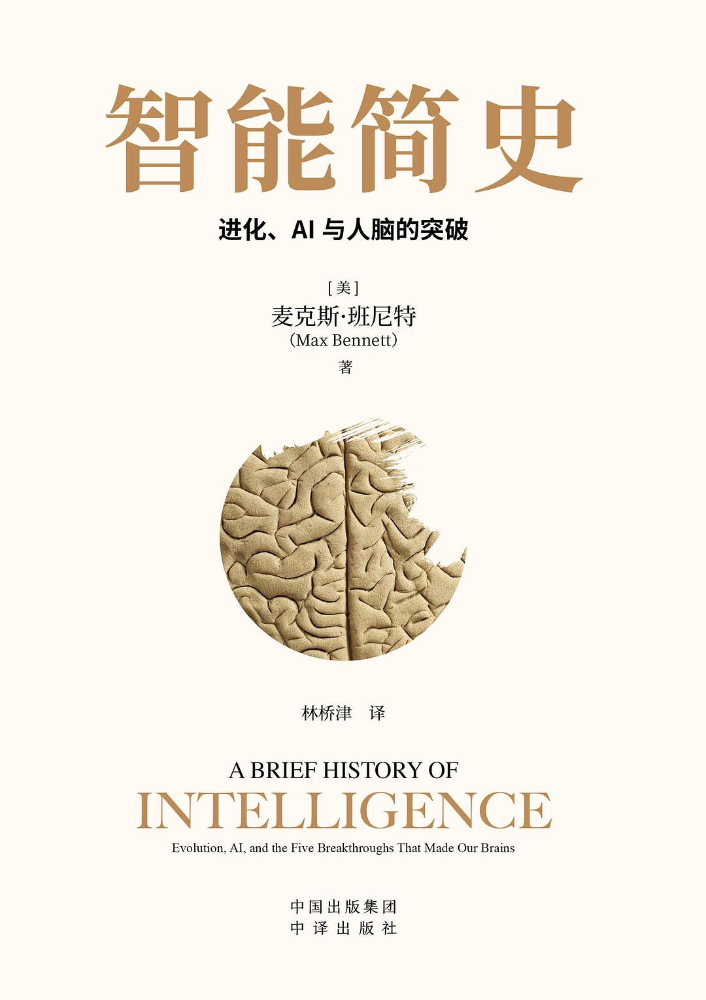{: width="320" }
*图：麦克斯·班尼特著《智能简史》，林桥津译。豆瓣条目见 [智能简史](https://book.douban.com/subject/37252220/)。*

《杰森一家》里的机器人罗西会做家务，也听得懂人的情绪。几十年后，系统能下棋、查影像、通过一些考试，加载洗碗机仍然难。班尼特的回答是：人脑里那些“简单”的能力，是五亿多年里一次次叠上去的。后面的能力用前面的能力当底座。只复现最上面的语言，下面几层还空着。

他把这条谱系收成五次突破：**转向、强化、模拟、心智化、语言**。每一次都留下一块还在人脑里工作的结构。书的用法是双向的。神经科学给人工智能一个可建造的顺序；人工智能里已经跑通的算法，反过来成为读脑的候选解释。费曼那句 “What I cannot create, I do not understand” 是这个读法的出发点。

# 五次突破叠在一起

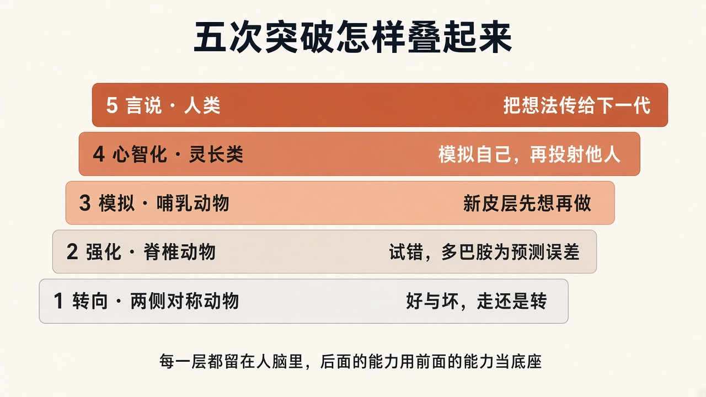{: width="760" }
*图：五次突破从下往上叠。下面一层留在脑里，上面一层用它当底座。*

| 突破 | 书中的时间尺度 | 当时的身体 | 新留下的东西 | 新打开的学习 |
| --- | --- | --- | --- | --- |
| **转向** | 约 5.5 亿年前 | 线虫一类两侧对称动物 | 第一个脑、效价、情感 | 把线索和好坏连起来 |
| **强化** | 约 5 亿年前，寒武纪 | 早期鱼类 | 基底节、皮层、海马体 | 从自己做过的动作里学 |
| **模拟** | 恐龙时代的早期哺乳动物 | 夜间活动的小型温血动物 | **新皮质** | 从自己想象过的动作里学 |
| **心智化** | 恐龙灭绝之后的灵长类 | 树上的昼行灵长类 | 有颗粒前额叶 | 从别人做过的动作里学 |
| **语言** | 约 250 万年前脑开始急剧变大 | 人属 | 一套天生的学习课程 | 从别人想象过的事里学 |

进化在这里是一棵树。书追的是通向人脑的那一根树枝，每一根还活着的树枝都适应了自己的生态位。麦克莱恩的“三位一体大脑”（爬行脑、边缘系统、新皮质一层层盖住）在解剖上对不上这块模板，书把它放下，改用上面这五次加法。

# 开篇

## 解剖图和进化谱系

开篇先放两张地图。一张是人脑里后来会反复出现的结构：下丘脑管真正的奖励和内环境，基底节决定哪个动作放行，旧皮层和后来的海马体认模式、记位置，新皮质做模拟，前额叶控制这份模拟、再往后还要模拟心智。另一张是谱系：细菌、动物与真菌分家、神经网、两侧对称动物、脊椎动物、哺乳动物、灵长类、人。后面每一章都是在这两张图上加一块，旧的那一块继续留着。

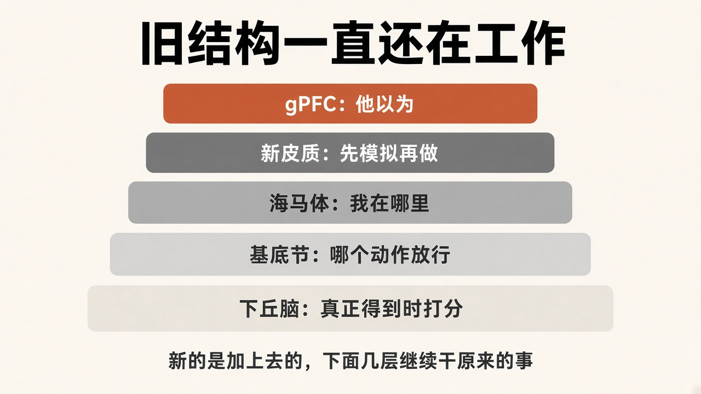{: width="760" }
*图：从下往上是下丘脑、基底节、海马体、新皮质和 gPFC。新的加在上面，下面几层继续干原来的事。*

比较解剖是这张谱系还能被看见的原因。不同物种的脑共享大块结构，所以“脑的博物馆”不必另建，鱼、鼠、猴的脑就是更早阶段还在工作的样本。人脑看起来独特，是因为后来的区域铺得很开，底下一层的分区仍然对得上。

**本章要点**

- 读这本书要先记住两张图：人脑里哪些结构会反复出场，以及这些结构第一次出现在谱系的哪一枝。
- 新结构是加在旧结构上面的。下丘脑、基底节、海马体在新皮质出现之后仍在工作，而且仍干它们当初的事。
- 不同物种的脑能对上主要分区。后面的章节用线虫、鱼、鼠、猴当样本，是因为它们还在使用人脑里某一层的工作方式。

## 引言

直接拆 860 亿神经元、上万亿连接，缺少一块块可以单独看懂的中间阶段。蠕虫、鱼、老鼠、猴子各自还在使用人脑里某一层的工作方式。班尼特用它们把智能拆开。保罗·麦克莱恩（Paul MacLean）的三位一体大脑把脑说成爬行脑、边缘系统、新皮质一层层盖住，新的一层接管旧的一层。这块图在解剖上对不上：旧结构没有退休，新结构是加进去一起工作的。书改用五次加法。

他写这本书的身份是做人工智能产品的人。做系统的时候会发现，棋下得赢，洗碗机摆不好，于是回头找神经科学里已经能对上算法的那些记录，再和还在跑的系统并排放。检验标准是：造得出的那一层，才算读懂了；还造不出的那一层，就还停在故事里。引言最后提醒：这条谱系说明人这种智能是怎么来的。进化是一棵树，每一根还活着的树枝都适应了自己的生态位。书追的是通向人脑的那一根，不给物种排一名次。

**本章要点**

- 《杰森一家》的罗西会做家务，也听得懂情绪。几十年后的系统能下棋、查影像、通过一些考试，加载洗碗机仍然难。这个差距是全书要解释的问题。
- 直接拆人脑太大。可行的办法是按进化阶段拆：每一阶段的动物还在使用后来人脑里的某一层。
- 三位一体大脑把旧结构说成被新结构盖住。书改成五次叠加：旧的继续工作，新的用旧的当输入。
- 作者把神经科学的记录和已经落地的算法对照着读。造得出，用来检验脑是不是这样工作；脑里有、机器还没有的能力，用来指出下一块该造什么。
- 这条谱系不构成从低到高的阶梯。它只追通向人脑的那一枝。

# 第一次突破：转向

## 第 1 章　大脑出现之前的世界

脑出现之前，智能已经有了三十多亿年。书把起点放在大约 40 亿年前：能自我复制的分子，外面包上膜，核糖体把核酸译成蛋白质。蛋白质既是催化剂，也是最早的传感器和螺旋桨。大约 35 亿年前的最后共同祖先，样子接近今天的细菌。

蓝藻的光合作用把氧气送进大气。书把这次大氧化写成一场浩劫：氧气对当时大量厌氧生命是毒物，同时给耗氧呼吸提供了高得多的能量。糖几乎只由生命制造。要靠呼吸活下去，只有等别的生命死去，或者抓住还活着的。真菌和动物在这里分家。真菌把消化放在体外，等。动物把消化放进体内，去抓。

抓需要快。神经元和肌肉一起出现，服务的是“碰到就收、收了就吞”。神经元的基本工作方式在这里定下来，之后六亿年改的是接线：

- **全或无的脉冲**，让多细胞的反应整齐、够快。
- **频率编码**，用发放多少表达刺激有多强。
- **适应**，编码的是相对变化。光强可以差百万倍，发放频率只有大约 0 到 500 赫兹，绝对值放不进去，变化放得进。书把这个限制叫压缩问题。
- **兴奋和抑制**，让一套肌肉收缩时另一套放开。珊瑚张嘴和闭嘴不能同时发生，回路用“做这个、同时不做那个”做选择。

珊瑚、水母是一张**神经网**：许多反射各管各的，没有一个中心。碰一下，这一丛触手收回来；另一丛仍可以张着。捕食一旦要求朝一个方向追，各管各的反射就不够用了。下一章才把这张网收成脑。

神经元的这四件套在所有动物身上都在，包括没有脑的珊瑚。六亿年里，进化几乎没改这个基本器件，改的是它们怎么连。早先的结构一旦够用，后面的创新就被它框住。

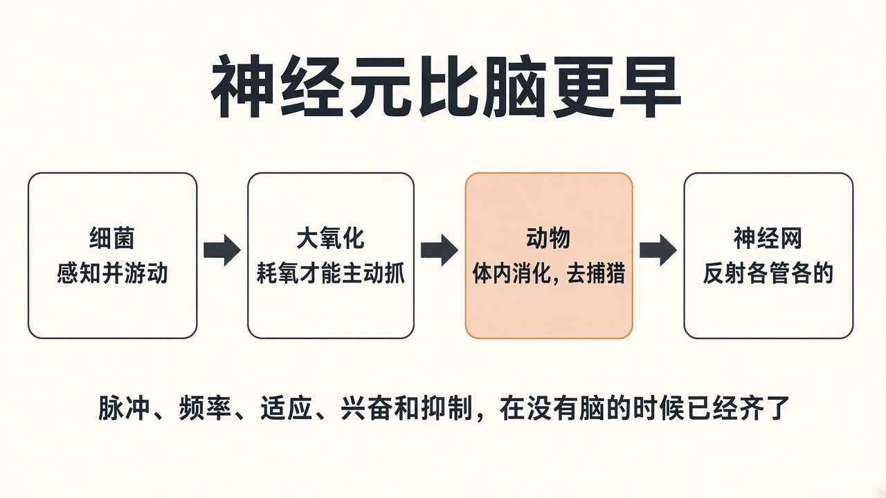{: width="760" }
*图：从细菌到神经网。大氧化之后，动物把消化放进体内去抓，神经元和肌肉服务这一下。*

**本章要点**

- 脑出现之前，智能已经运转了三十多亿年。细菌用蛋白质感知温度、光线和接触，并用螺旋桨移动。
- 大氧化让耗氧呼吸付得起主动捕猎的能量账。真菌把消化放在体外等待，动物把消化放进体内去抓。神经元和肌肉服务的是“碰到就收、收了就吞”。
- **全或无脉冲、频率编码、适应、兴奋与抑制**在没有脑的动物身上已经齐了。适应解决压缩问题：发放频率只有大约 0 到 500 赫兹，编码的是相对变化，光强可以差百万倍。
- 最早的神经系统是神经网，反射彼此独立。脑是后来为了把这些投票收成一个方向才出现的。

## 第 2 章　好与坏的诞生

辐射对称的动物一个开口又进又出，适合等食物过来。要游向食物，身体得能探测任意方向、也朝任意方向移动。两侧对称把这件事收成两下：前进，或者转向。口、主要感官和后来的脑都在前面。车、船、飞机用的是同一类设计。

**第一个脑和这副身体是为同一件事来的：转向。** 线虫沿气味走。气味变浓就保持方向，变淡就转弯。它不需要知道自己在地图上的坐标，也不需要算出食物还有多远。

1980 到 1990 年代，符号派要把推理、语言和逻辑拆开写进机器。罗德尼·布鲁克斯（Rodney Brooks）认为这条路做不完：人类水平的智能还拆不开，因为简单智能上的练习还不够。Roomba 是这件事的产品形态。它传感器很少，几乎不算一张可以查询的地图。没脏就游走，碰到障碍就转，电量低了就把充电座的信号当成该靠近的东西。市场和自然选择都偏向便宜、能工作、简单到确实能被发现的方案。线虫和这台吸尘器走的是同一类计谋：在复杂世界里前进，同时不必理解那个世界。

转向要先把刺激分成该靠近的和该躲开的。这就是**效价**。效价是脑给刺激的评价，化学物质本身没有好坏。线虫的一部分感觉神经元直接投票：靠近，或离开。食物和危险同时在场时，投票会冲突，而身体一次只能走一个方向。投票必须收到同一个回路里。这个集成中心就是第一个脑。抑制性神经元原先用来决定张嘴还是闭嘴，这里改用来决定直行还是转弯。

内部状态会改写同一张投票。饿的时候，一个气味的“好”变强；饱了以后，同一个气味可以不再值得追。所以原始的感觉神经元更像评判员：它们报告的是“要不要靠近”，世界本身的化学浓度只是这份评价的原料。

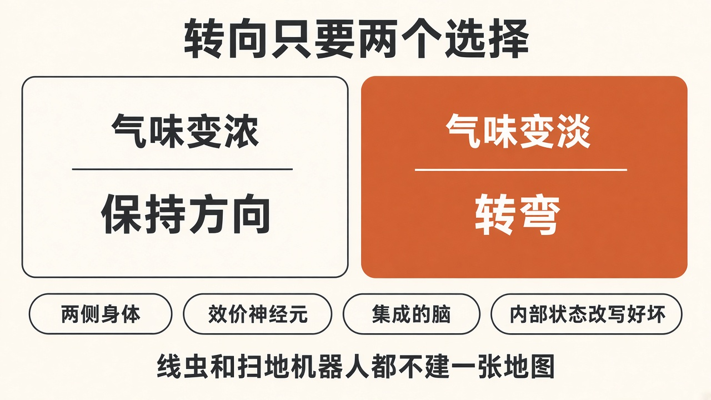{: width="760" }
*图：线虫的转向。气味变浓就保持方向，变淡就转弯。*

**本章要点**

- **两侧对称**把导航收成两下：前进，或者转向。口、主要感官和脑都因此长在前面。辐射对称适合等食物过来，不适合去追。
- 线虫的规则不需要地图。气味变浓就保持方向，变淡就转弯。Roomba 用同一类规则在房间里工作。
- **效价**是脑给刺激的评价，分成该靠近的和该躲开的。多种感觉的投票要收到一处，因为身体一次只能选一个方向。
- 转向要四样东西同时在：两侧对称的身体、标好好坏的神经元、把投票收成一个方向的脑、按饥饿这类内部状态改写好坏的办法。

## 第 3 章　情感的起源

气味在海水里是断的。水流能把梯度搅没。若只在闻到的那一瞬间转向，线虫会在两次气味之间停住。情感状态把决定延长：刚擦过一丝食物，就在附近继续搜；刚擦过一丝危险，气味没了也继续离开。书把这个功能叫做在黑暗中转向。

心理学家用两个轴描述情感（affect）：**效价**（留还是走）和**唤醒度**（要不要花能量动）。具体情绪的分类仍然纷争不断，这两个轴是跨物种还能对上的底。

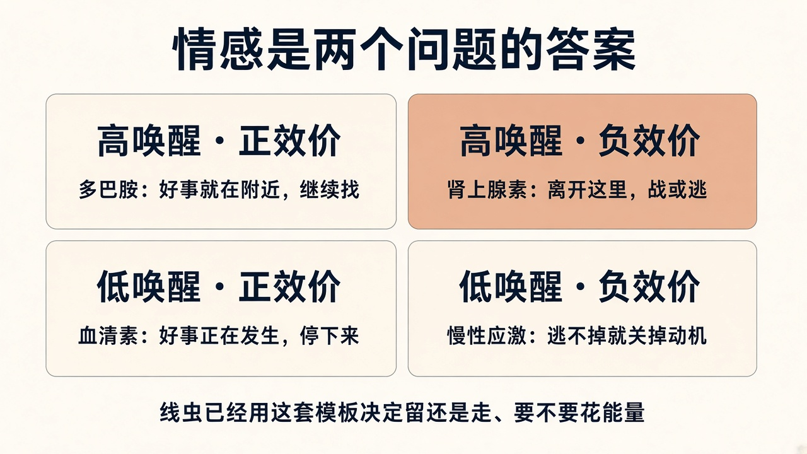{: width="760" }
*图：效价和唤醒度组成四个状态。书把早期两侧对称动物的神经调质放进这四格。*

线虫里，**多巴胺**在周围探测到食物时释放，维持搜寻。**血清素**在食物已经进到体内时释放，压低继续追的动力。这个分工在线虫、蛞蝓、鱼、大鼠和人身上都还在：多巴胺对应附近的奖赏和追，血清素对应奖赏正在被消耗、以及满足之后的低唤醒。肯特·贝里奇（Kent Berridge）的大鼠实验把“想要”和“喜欢”拆开。多巴胺被拿掉的大鼠不再自己去找吃的，食物送到嘴边时仍然表现出愉悦；把多巴胺顶上去，大鼠会拼命吃，愉悦并不因此同步变强。

去甲肾上腺素、章鱼胺、肾上腺素这一类，由负效价触发战或逃：心跳加快，消化、免疫、繁殖这些可以暂缓的功能被按下。应激过去之后，阿片类物质把身体切回休整。急性应激是花钱逃跑，唤醒仍然高。

逃不掉的时候，这套反应会改道。书里写到：线虫被放在持续的高温、严寒或毒物里，起初会逃，应激激素按下身体里可以暂缓的功能；大约两分钟后它停住，躺着不动。逃得掉才值得花能量，逃不掉就用等待把能量留住。持续的疼痛或长期的饥饿会把脑拖进慢性应激。应激激素和阿片仍然高，消化、免疫、食欲和繁殖继续被按住，唤醒和动机一起被关掉。血清素参与把情感反应抹平，留下一种麻木：疼痛变钝，平时会驱动搜寻的刺激也提不起劲。书把这种提不起劲写成快感缺乏的早期形式，也是抑郁状态在进化上很早的影子。线虫没有艺术上的忧郁，它有的是两侧对称动物在逃不掉的坏刺激里共有的那一层：情感反应变平。

> 这一段是功能上的进化解释，对象是线虫那一类古老回路在人脑里的残留。它不替代临床抑郁的诊断和治疗。人的抑郁还叠着语言、社会关系和长期规划，不能从线虫的停工直接推出一个人该怎么处理压力。
{: .prompt-warning }

**本章要点**

- 情感（affect）用两个轴就够描述底子：**效价**决定留还是走，**唤醒度**决定要不要花能量动。具体情绪的分类可以很纷乱，这两个轴跨物种还能对上。
- 线索在野外是断的。情感把转向延长到气味消失之后，书把这个功能叫做**在黑暗中转向**。
- **多巴胺**标记“好事在附近”，维持搜寻，对应想要。**血清素**标记“好事正在发生”，压低继续追的动力，对应满足。贝里奇的大鼠把这两件事拆开：没有多巴胺的大鼠不再自己去找吃的，食物送到嘴边时仍然表现出愉悦。
- 战或逃是负效价下的能量调度。逃不掉的坏刺激再往前走，会关掉唤醒和动机。书把由此而来的麻木，写成慢性应激和快感缺乏的古老形式。

## 第 4 章　关联、预测和学习的曙光

巴甫洛夫的狗把铃声和食物连在一起。线虫做得到同一类事：食物气味若总是和让它不舒服的化学物一起出现，它以后会躲开这个气味；在某个温度下吃到食物，它会对这个温度改评价。海葵这类辐射对称动物做不到。导航的动物必须能改写“什么算好”。盐有时沾在食物上，有时沾在空石头上，写死的效价会过时。

世界的规则会变，所以学习从一开始就是持续的。书用四步描述这套弹性：习得、消退、自发恢复、再习得。一次没找到食物，不应把“盐附近通常有吃的”整条擦掉。自发恢复留着旧关联，环境再变回来时重新接上。

一次结果前面总有一大把线索。该把功劳记给哪一个，是**信用分配**。最早的脑用四条粗规则。用蛞蝓来看就清楚：轻拍身体一侧，紧接着给一个会引起缩身的电击。

| 规则 | 它在做什么 | 蛞蝓这边怎么体现 |
| --- | --- | --- |
| **资格痕迹** | 只接纳紧挨在结果前大约一秒内的线索 | 轻拍早于电击大约一秒才连得上；早两秒以上，拍和电击建不起关联 |
| **遮蔽** | 强线索盖过同时出现的弱线索 | 强光和弱气味一起出现在电击前，脑记下强光 |
| **潜在抑制** | 经常出现的背景不再拿来建立新关联 | 温度和地面纹理天天都在，第一次出现的轻拍更可能被当成原因 |
| **阻断** | 已经有一个能预测结果的线索时，后来重叠的线索不再另建一条 | 轻拍已经能预测电击之后，新的温度或化学物会被挡在这条关联外面 |

学习的物理载体是突触：强度改变，新的长出来，旧的撤掉。一起发放的神经元更容易连在一起。赫布学习（Hebbian learning）在两侧对称动物的突触里已经可用。从这一层起，后面的进化主要是给同一套突触学习找新用途，学习规则本身变动不大。在第一个脑里，学习还是转向的一个可选项，用来改写“什么算好”；后面它会变成脑的主业。

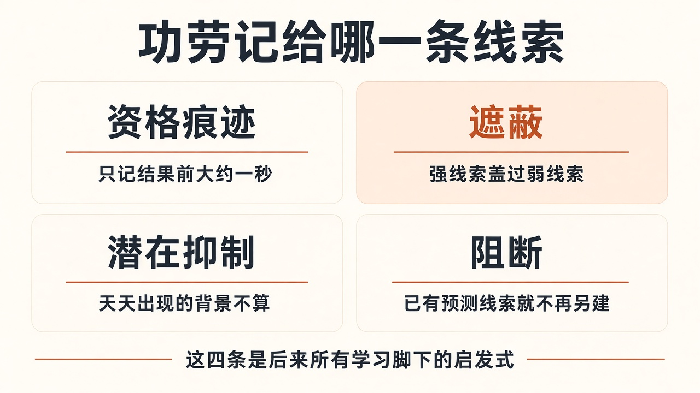{: width="760" }
*图：资格痕迹、遮蔽、潜在抑制和阻断。最早的脑用这四条决定功劳记给哪一条线索。*

**本章要点**

- 巴甫洛夫式的联想学习属于所有两侧对称动物，辐射对称的海葵做不到。它的原始用途是改写转向用的好坏，让写死的效价能跟上会变的世界。
- 学习从一开始就是持续的。习得、消退、自发恢复、再习得让旧规则先留着：一次没找到食物，不把“盐附近通常有吃的”整条擦掉。
- **资格痕迹、遮蔽、潜在抑制、阻断**是四条粗的信用分配。它们不精确，但所有后来的学习机制都站在这四条上面。
- 学习的物质基础是突触可塑性。这一层之后，进化主要是给同一套突触规则找新用途。

> **转向留下的底座**
>
> 两侧对称的身体把导航收成前进或转向。效价把世界分成靠近和躲开。情感把这个决定延长到线索消失之后。联想学习让好坏可以改。强化要有可强化的动作，用的就是这层已经算出来的好坏。
{: .prompt-tip }

# 第二次突破：强化

## 第 5 章　寒武纪大爆发

转向加快了捕食。寒武纪的海洋里出现大量能移动、有甲壳的动物。我们这条线上的祖先是一种不起眼的早期鱼类：鳍、鳃、脊髓，以及一块新的脑。

这块脑的模板此后五亿年还在用。七鳃鳗和人共享前脑、中脑、后脑这一套分区，也共享皮层、基底节、丘脑、下丘脑这些主要结构。无脊椎动物的脑是另一条接线。

爱德华·桑代克（Edward Thorndike）把猫放进迷笼。猫一开始乱抓乱踩，哪一下打开了门，那一下之后就更常出现。他据此写下效果律：带来满意结果的行为更容易再被做出来。鱼把同一条规律用在不同任务上：按特定按钮取食，从网里找逃出口，跳过圈去拿食物。学会之后可以记住几个月甚至几年。过程都一样，先做一些相对随机的动作，再按哪些动作被强化来收窄。线虫改得了“这个气味算好还是算坏”，改不了一串事先没有写死的动作。脊椎动物可以。这就是**强化学习**。

桑代克的表述听起来简单。等人们真要在机器里做，才发现奖励若只在一长串动作的末尾出现，中间哪一步该受奖，并不显然。下一章就是为了把这一步算清楚。

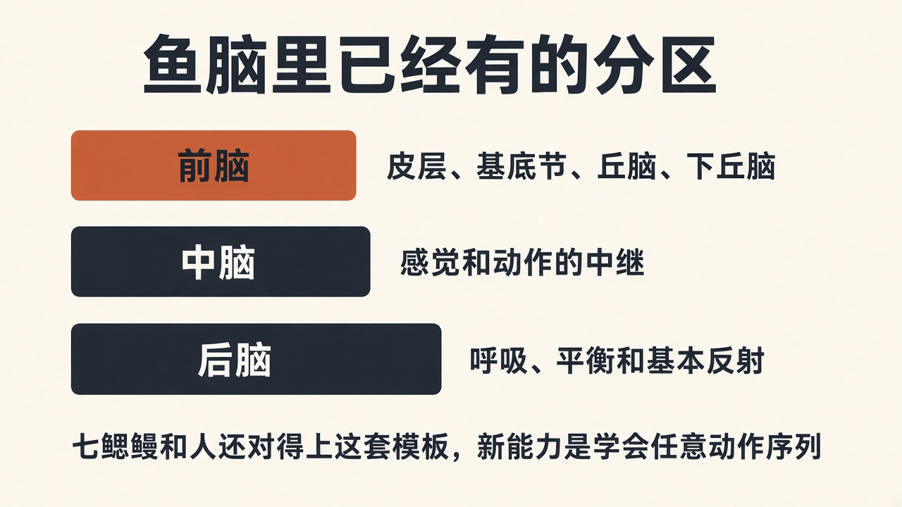{: width="760" }
*图：前脑、中脑、后脑。七鳃鳗和人共享这套分区，也共享皮层、基底节、丘脑和下丘脑。*

**本章要点**

- 寒武纪的捕食压力把脑从线虫式的转向回路，加成一套带分区的脊椎动物模板。前脑、中脑、后脑，以及皮层、基底节、丘脑、下丘脑，在七鳃鳗和人之间还能对上。
- 这套模板此后大约五亿年还在用。研究鱼脑，就是在看人脑去掉后来的新皮质之前，那一层怎么工作。
- **效果律**是试错的行为学表述：满意的结果让刚才的行为更容易再现。鱼能把任意动作序列学会，并且记很久。
- 线虫的转向改写的是刺激的好坏。脊椎动物新打开的是动作序列本身可以被强化。

## 第 6 章　时序差分学习的进化

明斯基（Marvin Minsky）用跳棋把问题说清。胜负发生在终局，一盘可以有上百步。只强化最后几步，前面的关键着法没人负责；每一步都强化，坏着法和好着法混在一起。这是**时间上的信用分配**。

理查德·萨顿（Richard Sutton）把奖励和强化拆开。评论家随时估计“现在离好结果还有多远”。行动者选动作。行动者得到的信号，是这个估计相对上一时刻变好了还是变坏了，名字叫**时序差分**。西洋双陆棋把这件事表演了出来。只按终局胜负去强化的 Neurogammon，能赢过其他程序，到不了中等水平的人类。杰拉尔德·特索罗（Gerald Tesauro）改用时序差分，TD-Gammon 靠自我对弈打到顶级人类。

强化学习教材里把这个差分写成：

$$
\delta_t = r_t + \gamma V(s_{t+1}) - V(s_t)
$$

$$r_t$$ 是这一刻真正到来的奖励，$$V(s_t)$$ 是对当前局面的价值估计，$$\gamma$$ 是对下一步估计的折扣。$$\delta_t$$ 为正，表示局面比刚才预计的更好。

沃尔夫勒姆·舒尔茨（Wolfram Schultz）在猴子身上记录到的多巴胺，起伏方式和这个 $$\delta_t$$ 对得上。训练之前，果汁意外到来时多巴胺上升。学会之后，发放挪到预告果汁的图片上，果汁真正入口时不再上升。图片出现了、果汁没有来，发放落到基线以下。彼得·达扬（Peter Dayan）和里德·蒙塔古（Read Montague）指出：这就是时序差分里的预测误差。

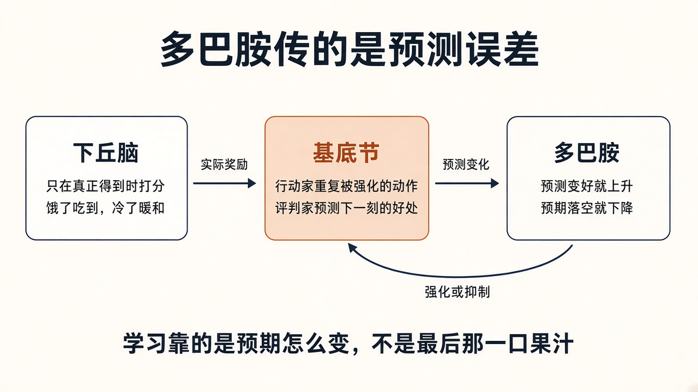{: width="760" }
*图：下丘脑在真正得到时打分。基底节里的行动家重复被强化的动作，评判家预测下一刻的好处。多巴胺把预测的变化传回去。*

在两侧对称动物那里，多巴胺表示“附近有好事”。到了脊椎动物，它被改成一条计时精确的预测误差：局面比预期好多少、大约还要多久。下丘脑仍然只认真正的奖励，饿了吃到、冷了暖和，它才满意。它像一位只在终局亮分的裁判。基底节里有两条并行回路。一条通往运动，决定哪个动作放行，是行动家。另一条折回多巴胺神经元，自己预测未来奖励，是评判家。评判家学会以后，动物可以在下丘脑开口之前就知道这一步是好是坏。

预测误差一存在，两件新的感受就跟着来。**失望**是预期的奖励没出现，多巴胺落到基线以下。**解脱**是预期的伤害没出现。两者都要有时间感：脑得知道“还没发生”和“已经不会发生了”的差别。没有对时刻的知觉，遗漏就无法学习，时序差分也停在半路上。书把精确的时间知觉看成这套学习的配套件，动物从此学的不只是做什么，还有什么时候做。

**本章要点**

- 长序列的终局奖励解决不了时间上的信用分配。只强化最后几步，前面的关键动作没人负责；每一步都强化，好坏混在一起。
- 萨顿的办法是强化**预测的变化**。评论家估计当前局面有多好，行动者在估计变好时受到强化。教材里的写法是 $$\delta_t = r_t + \gamma V(s_{t+1}) - V(s_t)$$。
- 舒尔茨的记录和这个 $$\delta_t$$ 对得上：意外的果汁让多巴胺上升；学会之后，发放挪到预告果汁的线索上；线索出现而果汁没来，发放落到基线以下。达扬和蒙塔古把这读成预测误差。
- 下丘脑只在真正得到时打分。基底节里一条回路是行动家，决定哪个动作放行；另一条是评判家，自己预测未来奖励并驱动多巴胺。失望和解脱是这套预测的副产品，都依赖对时刻的知觉。
- 在线虫那里，多巴胺表示“附近有好事”。到了脊椎动物，它被改成一条计时更细的预测误差。

## 第 7 章　模式识别问题

单个神经元的发放能表示“烫”或“尖”。气味、面孔、声音是一群神经元的模式。脊椎动物要在试错里使用这些模式，皮层因此出现。

两件事要同时解决。**辨别**：捕食者和食物的气味有重叠，激活的集合必须分开。**泛化**：同一只捕食者在不同水流里气味不完全相同，仍然得认成同一个。

现代网络常用的做法是监督学习。给人看许多气味模式，同时告诉网络这一次是蛋还是花，再把输出和标准答案的差反向传回去，逐个突触挪权重。反向传播很有效，杰弗里·辛顿（Geoffrey Hinton）自己也指出它不像脑。脑没有人在旁边递标签：孩子在学会“蛋”和“草莓”这两个词之前，已经能把两者认成不同的东西。反向传播还要求成百万突触同时、精确地朝减小误差的方向改，脑里没有一条做得到这件事的通路。

皮层用扩展和稀疏编码做辨别。少量嗅觉输入投到多得多的皮层神经元上，连接是稀疏的。输入有重叠，皮层里被点亮的那一组可以几乎不重叠。泛化靠**自联想**：锥体细胞彼此大量回连，一起亮过的一组建起关联。下次只来了一部分，整组还能被点亮。这是**内容寻址**。故事的开头能带出后文，半张照片能带出其余。计算机用地址取记忆，地址丢了记忆就丢了。自联想没有地址可丢，代价是新模式和旧模式写在同一群细胞上，有互相覆盖的风险。

科恩和麦克洛斯基把人工网络里的这种覆盖叫做**灾难性遗忘**。一个网络接着学新任务，旧任务会坏。工程上的应对是训完就冻住权重。人脸、开车、影像里的病灶，以及书出版时的 ChatGPT，都在发布之后停止从新经验里改参数。再学就要整网重训，并用人看着所有旧任务有没有退步。

视觉还有**不变性**。同一个杯子在视网膜上的位置、距离、转角变了，输入神经元几乎全换，仍然是同一个杯子。嗅觉没有这个问题，同一组分子激活同一组感受器。声音也有：童声和成人声的音高不同，词可以是同一个。自联想单独解释不了“输入完全不同、对象却相同”。

福岛邦彦的卷积网络把平移不变性直接写进结构。现代视觉系统大量沿用这个**归纳偏置**：同一特征出现在画面另一处，仍然是它。偏置对了，需要的数据和时间就下来了。脊椎动物皮层一定也有自己的偏置，书的判断是：具体是哪一条，还没有被写清楚。

感官和皮层是一起变复杂的。鼻子、内耳、眼睛提供更细的模式，皮层更能认，更细的感官就更值得有。寒武纪之后，识别从“进化一个专门探测器”变成“一块通用皮层加上专门的感受器”。鱼已经能从不同角度、距离认出同一个物体。不变性因此比哺乳动物更早，是脊椎动物皮层的基本能力。

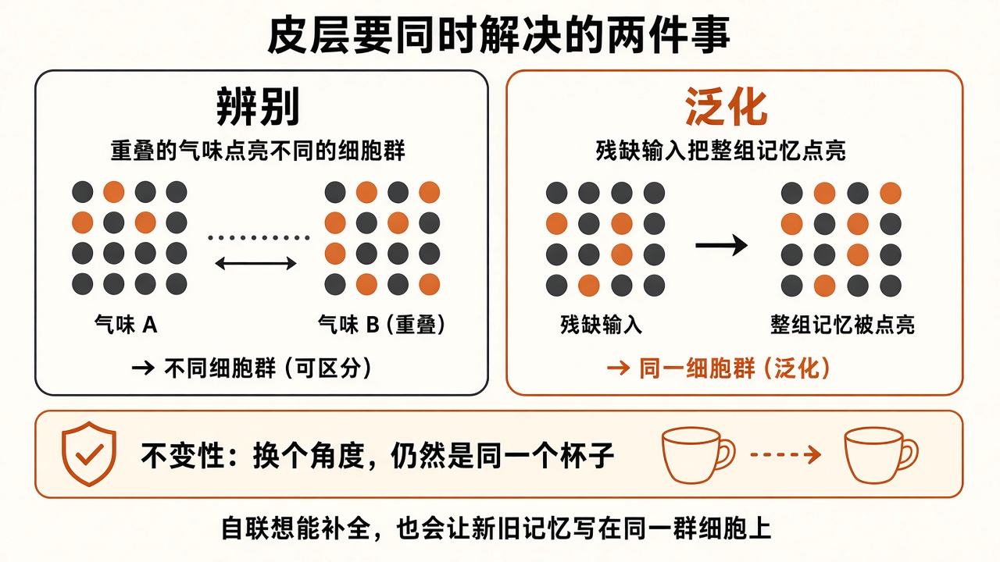{: width="760" }
*图：辨别把重叠的模式分开，泛化把残缺的模式补全。不变性要求输入换了，对象仍是同一个。*

**本章要点**

- 强化学习要用上气味、面孔和声音，就得识别一群神经元组成的模式。单个神经元的发放只够表示“烫”或“尖”。
- **辨别**靠维度扩展和稀疏编码：少量输入投到多得多的皮层细胞上，重叠的输入可以点亮几乎不重叠的群体。**泛化**靠自联想：残缺或带噪声的输入能把整组记忆再点亮。这是内容寻址。
- 自联想把新旧模式写在同一群细胞上，带来灾难性遗忘。工程上的应对是训完冻住权重。脑要持续学习，不能用这个办法，后面的情景记忆会来补这一层。
- 视觉和听觉还有不变性：输入神经元几乎全换了，对象仍是同一个。卷积网络把平移不变性写成结构上的归纳偏置。脊椎动物皮层一定也有自己的偏置，具体是哪一条，书认为还没有被写清楚。
- 脑做模式识别时没有外部标签。反向传播能用，通路对不上生物突触。

## 第 8 章　生命为何充满好奇

只用已经强化过的动作，试错没有新的试。萨顿把这叫做**探索与利用**：利用把行为拉向已知的奖励，探索把行为拉向还没做过的事，两边不能同时拉到最大。

能工作的做法是把新奇本身当成奖励。纯粹随机乱撞也是探索，大部分试都浪费了。有用的探索是：没见过的房间、没做过的操作，新奇越大，内在奖励越高。DeepMind 打《蒙特祖玛的复仇》时，外部奖励极稀，钥匙和门之间隔着很长一段没有分数的操作。给“没见过”一份内在奖励之后，算法才走得下去。脊椎动物里，惊讶本身会释放多巴胺，没有食物也可以。鱼、鼠、猴和人类婴儿都会去看新东西。无脊椎的线虫没有这层由新奇驱动的探索。

赌博和信息流用的是同一条回路。胜率高到偶尔会中、低到长期为负、又不确定何时中，中的那一下和预期的偏差最大，多巴胺冲得最明显。固定奖励把预测很快校准，偏差消失，回路就安静了。滑动一段时间才出现一条值得看的内容，结构相同：大多数滑动是旧的，偶尔一条是新的。人可以清楚知道自己不想再玩，行为仍然被反复强化。

{: width="760" }
*图：利用重复已知的奖励。探索把新奇本身当成多巴胺，没有食物也可以去看新东西。*

**本章要点**

- 强化学习同时需要两件对着干的事。利用重复已经带来奖励的动作，探索去试还没做过的动作。只利用，就没有新的试可以学。
- 书把好奇心看成探索这一侧的内在奖励。新奇和惊讶本身释放多巴胺，即使没有食物。这层动机在脊椎动物里普遍存在。
- 《蒙特祖玛的复仇》说明：外部奖励太稀时，没有内在的新奇奖励，试错走不出那些空档。
- 可变比率的奖励把这套装置拉去长期为负的地方。赌博和信息流的偶然命中，用的是为探索准备的预测误差，用在了不该探索的对象上。

## 第 9 章　第一个世界模型

鱼、爬行动物、鼠、猴和人都能记住“东西在哪儿”，并从新的起点走回去。线虫不能。这是脑第一次在内部摆下一份外部空间。

昆虫的回巢常常是路径积分加上对地标的反应。书里用蚂蚁说明差别：把一只正在回巢的蚂蚁放到出发的路上，它会把程序再执行一遍，缺少一张可以掉头查询的地图。脊椎动物多出来的硬件里，内耳半规管提供前庭感觉，用来区分“东西朝我来”和“我朝东西去”。内侧皮层（哺乳动物的海马体）里的**位置细胞**和**头部方向细胞**一起，构成这份地图。破坏海马体，空间导航会垮。

有了位置，就有了“我在哪里”，也就有了自我和世界的区分。要在地图上跟踪自己，脑得分清“东西朝我游来”和“我朝东西游去”。当时的用途很具体：记得节肢动物常躲的缝、退回安全处的路、藏着食物的角落，并且从任意起点算出朝目标的方向。更后面的模拟，是在这份内部模型上长出来的。第一份世界模型还不会预演未来，它先让动物认出地点。

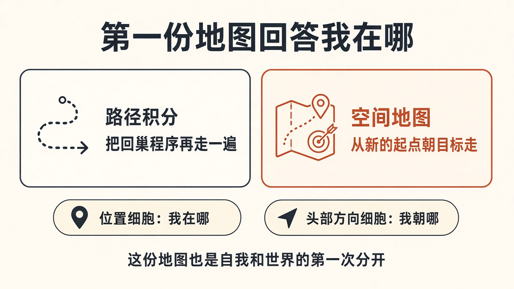{: width="760" }
*图：路径积分按走过的步数回家。空间地图用位置细胞和头部方向细胞，从新的起点也能走回去。*

**本章要点**

- 鱼、爬行动物、鼠、猴和人能记住一物相对另一物的位置，并从新的起点走回去。线虫做不到。这是脑第一次在内部摆下一份外部空间。
- 蚂蚁的回巢多半是路径积分加上对地标的反应。把它从回巢的路上放到出巢的路上，它会把程序再执行一遍，缺少一张可以掉头查询的地图。
- 内耳半规管提供前庭感觉，用来区分自身运动和物体运动。没有这份感觉，外部空间的坐标稳不住。
- 内侧皮层里的**位置细胞**报告“我在哪”，**头部方向细胞**报告“我朝哪”。哺乳动物的海马体继承的是这套鱼类就有的定位。破坏它，空间导航会垮。
- 这份地图同时是自我和世界的第一次分开。后来的想象，用的是同一类“内部有一份外部”的办法，对象从地点扩大到整份世界。

> **强化留下的底座**
>
> 多巴胺变成预测误差，基底节用它强化动作序列。皮层认模式，海马体记位置，好奇心保证还有新动作可试。时间感让“预期落空”可以被学习。这些都架在转向的好坏信号上。评判家要预测的终局，就是那一层已经标好的靠近和躲开。
{: .prompt-tip }

# 第三次突破：模拟

## 第 10 章　神经的黑暗时代

脊椎动物上岸之后，脑的大模板安静了很久。书把从鱼类到爬行动物的这一段叫做神经的黑暗时代：身体形态在变，主要分区没有再来一次同等规模的新增。

植物向内陆扩张，二氧化碳下降，气候变冷，晚泥盆世大灭绝把海洋变得难以居住。更后来的二叠纪—三叠纪大灭绝清掉许多大型合弓类。恐龙、翼龙占据白天。我们的祖先越变越小，书里写到只剩大约十厘米，温血，白天躲在洞里，夜晚出来找昆虫。哺乳动物在这个缝里出现。

新皮质是这缝里多出来的能力。一只老鼠可以在洞口看见枝条、远处的鸟和一只昆虫，先在内部走几条路，再选那条模拟里自己还活着、而且吃到了的路。脊椎动物是做了再学。早期哺乳动物是想了再做。

早期哺乳动物的新皮质体积不大，嗅觉皮层占了更多位置。人脑里新皮质大约占体积的 70%。后面两次突破，都是这块本来很小的结构在扩张。书推测模拟要有两个条件才划算。一是看得远：陆地上即使在夜间，可视距离也远大于水下，一条枝条通向哪里才进得了内部的推演。鱼类在水里没有这份远距离的画面，书据此认为它们不模拟路径。二是算得快：神经元放电对温度敏感，温血让同样的回路在单位时间里完成更多计算。模拟比基底节那套直接强化贵得多，冷的神经付不起这笔账。

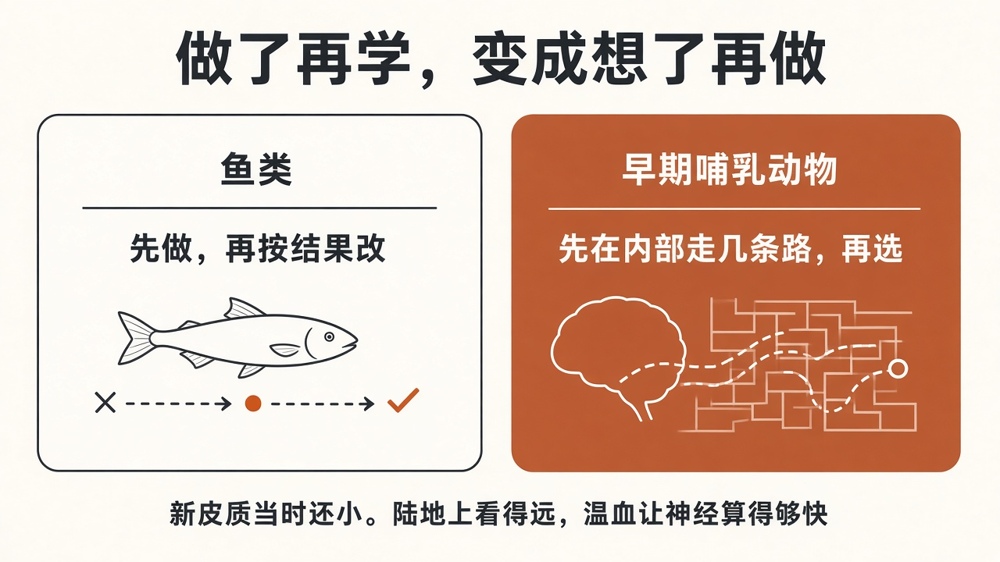{: width="760" }
*图：鱼类先做，再按结果改。早期哺乳动物先在内部走几条路，再选。*

**本章要点**

- 从鱼类到爬行动物，脑的大模板安静了很久。书把这一段叫做神经的黑暗时代：身体在变，主要分区没有再来一次同等规模的新增。
- 两次大灭绝之后，恐龙占据白天。哺乳动物的祖先缩小到大约十厘米，温血，白天躲着，夜晚找昆虫。
- **新皮质**让这种动物在行动前预演。脊椎动物是做了再学，早期哺乳动物是想了再做。
- 模拟划算的两个条件是书里的推测：陆地上看得到较远的路，温血让神经算得够快。
- 早期新皮质体积不大。人脑里它约占体积的 70%。心智化和语言都是在这块结构上继续加。

## 第 11 章　生成模型和新皮质的奥秘

弗农·芒特卡斯尔（Vernon Mountcastle）的假说是：新皮质各区做的计算相同，差别在输入从哪来、输出到哪去。视觉区接收视网膜，听觉区接收耳。雪貂实验把视觉输入改接到听觉区，那一块会开始处理视觉。若假说成立，要理解的是重复了上百万次的皮层柱，整块新皮质的万亿连接是这份微回路的铺开。

感知有三件日常事实。残缺的部分会被补上。鸭兔图一次只能看成一种。一旦从斑点里看出一只青蛙，就很难再看成无意义的斑点。赫尔曼·冯·亥姆霍兹（Hermann von Helmholtz）的解释是：人感知的是脑对“外面是什么”的推断。脑在外部数据的约束下渲染一份模拟。

杰弗里·辛顿（Geoffrey Hinton）和学生（包括达扬）做的亥姆霍兹机，同时学习从输入到内部表征、以及从表征重建输入。识别靠生成再和真实输入比较。后来的深度伪造、生成式图像和 GPT 一类语言模型，都是生成模型这一支的后代。

清醒时，新皮质把大量时间用在“用输入约束模拟”。梦把生成重新拉起来，免得模型只剩识别。睡眠被剥夺之后，识别和生成的界限会糊，哺乳动物开始产生幻觉。想象、做梦和幻觉是同一份模型在不同约束下的运行。感知和想象用同一套回路。

模型还可以脱开当前输入自己往前走。这就是想象：在一份够丰富的世界模型里，推演还没做过的动作会有什么结果。感知、想象、做梦和幻觉于是成为同一份生成模型的四种运行：约束来自当前感官、来自记忆、来自睡眠中被迫的生成，或者约束松了之后的幻觉。

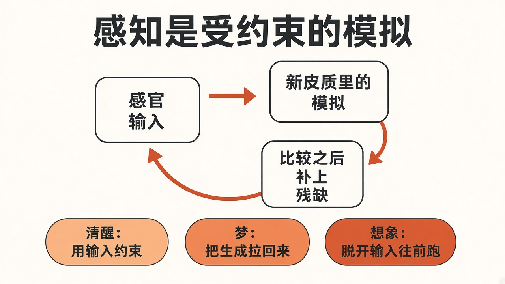{: width="760" }
*图：感官输入约束新皮质里的模拟，比较之后补上残缺。清醒用输入约束，梦把生成拉回来，想象脱开输入往前跑。*

**本章要点**

- 芒特卡斯尔认为新皮质各区做同一件事，差别在输入和输出。雪貂把视觉输入改接到听觉区之后，那一块会开始处理视觉。要理解的是重复了上百万次的皮层柱。
- 感知有三件日常事实：残缺会被补上；鸭兔图一次只能看成一种；一旦从斑点里看出青蛙，就很难再看成无意义的斑点。亥姆霍兹的解释是，人感知的是脑对“外面是什么”的推断。
- 亥姆霍兹机同时学习识别和重建。生成模型靠自己生成的数据和真实输入比较来学习，不需要每张图旁边贴一个标签。深度伪造、生成式图像和后来的语言模型，都是这一支的后代。
- 清醒时识别用得多，梦把生成重新拉起来。睡眠被剥夺之后，识别和生成的界限会糊。想象和感知用同一套回路。
- 模型还能脱开当前输入自己往前跑。这就是第三突破交付的能力：在行动前推演还没发生的事。

> 中译第 11 章有读者指出句子别扭，“外部世界的内部模拟”这类说法容易读断。英文里对应的是脑内的 world model：新皮质渲染外部世界的一份模拟，再用感官去校对。
{: .prompt-info }

## 第 12 章　想象世界的老鼠

模拟在早期哺乳动物身上变成三件具体能力。

**预演式试错。** 爱德华·托尔曼（Edward Tolman）看见老鼠在迷宫岔路口停住，推测它在内部比较两条路。后来的记录显示，犹豫时海马体的位置细胞会快速按未来可能的路径重放。鱼没有这步停顿。

**反事实学习。** 大卫·雷迪什（David Redish）的“餐厅街”实验里，老鼠放弃嘴边的食物、去追一个不确定的更好选项，失败之后，代表被放弃选项的神经元会再次活动。书把这称作后悔的雏形。它让脑有机会把“一起发生”和“是我这个选择导致的”分开，信用分配从时间邻近前进到因果关系。

**情景记忆。** 回忆某一次具体经历，用的是和想象未来同一套模拟。它和程序记忆不同：程序记忆保留的是怎么说、怎么打字、怎么扔一个球；情景记忆保留的是“那一次”发生了什么。海马体负责快速写下这次经历，新皮质负责把内容渲染出来。所以记忆会错：它是按线索重新构建的一次模拟，每次重建的细节都可以变。海马体和新皮质的分工也给灾难性遗忘一条生物学上的出路。新经验先单独写下，休息和睡眠时再挑重要的重放到皮层，旧知识不会在每一次新经历里被当场覆盖。站点里讨论智能体怎样在会话之间留笔记的文章，用的是同一套分工：[Agent Memory 的组成]()。

脊椎动物的基底节是**模型自由**的强化学习：直接记下“这个状态里做这个动作，预测奖励高”，不做未来的展开。哺乳动物多出来的是**基于模型**的强化学习：先有一份世界模型，再在模型里规划。鱼可以很快、可以记模式、可以学时间，动作仍然不是先计划好的。

这三件能力是躲过恐龙的手段。枝条、鸟和昆虫同时在视野里时，停一下、在内部走几条路，比冲出去再学习更可能活到下一次。

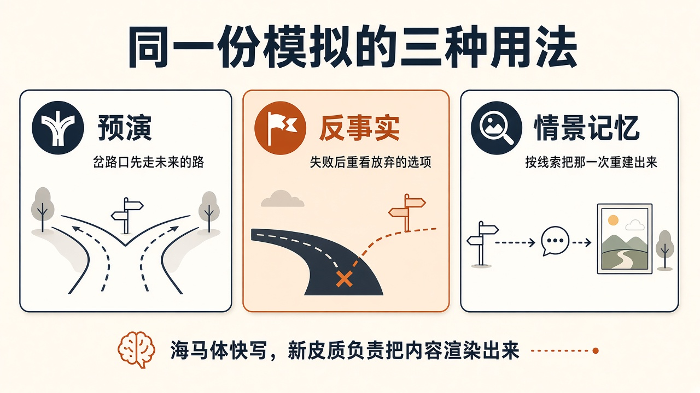{: width="760" }
*图：预演先走未来的路，反事实重看放弃的选项，情景记忆按线索把那一次重建出来。海马体快写，新皮质把内容渲染出来。*

**本章要点**

- **预演式试错**：老鼠在岔路口停住时，海马体的位置细胞按未来可能的路径快速重放。托尔曼从行为猜到的事，后来在细胞活动里能看见。鱼没有这步停顿。
- **反事实学习**：餐厅街实验里，老鼠放弃嘴边的食物去追一个不确定的更好选项，失败后，代表被放弃选项的神经元会再次活动。信用分配从“时间上挨着”前进到“是我这个选择导致的”。
- **情景记忆**和想象未来用同一套回路。它是重建，所以会错。程序记忆记的是技能，情景记忆记的是一次具体经历。
- 海马体快写、新皮质慢渲染，给持续学习一条出路：先单独记下，离线再重放，减轻灾难性遗忘。
- 三件事是同一份模拟的三种用法。基底节仍是模型自由的；新皮质加上的是先在模型里走，再决定做不做。

## 第 13 章　基于模型的强化学习

模型里可以走的分支多到搜不完。围棋若展开所有后续，计算量不是动物脑付得起的。AlphaZero 的做法是两套系统一起用。一个模型自由的网络提供“哪些着法值得看”的直觉，模拟只深入这少数几条。TD-Gammon 那一代没有这步对未来的展开，复杂棋类上就不够。

无颗粒前额叶（aPFC）是哺乳动物里第一块额叶新皮质，负责打开和约束模拟。书用中风损伤这块区域的病人说明功能：意图和主动行为可以一起消失，运动通路本身还在。

书给出的工作顺序是三步。不确定性高的时候才模拟：新情境，或者几个候选的价值太接近。要模拟的内容来自基底节已经提出、又互相冲突的候选，所有可能的动作不会逐一展开。模拟的结果再回去训练基底节，让某个选项的票慢慢积累，最后由基底节放行。

托尼·迪金森（Tony Dickinson）把行为分成目标驱动和习惯。过度练习之后，同一件事会从“为了那个结果”变成刺激一来就做。习惯省掉模拟的时间和能量。该自动化的时候，复杂动作变得顺；不该自动化的时候，人会在目标已经变了之后仍走老路。卡尼曼的系统 1 和系统 2，在书里就是这两套回路。

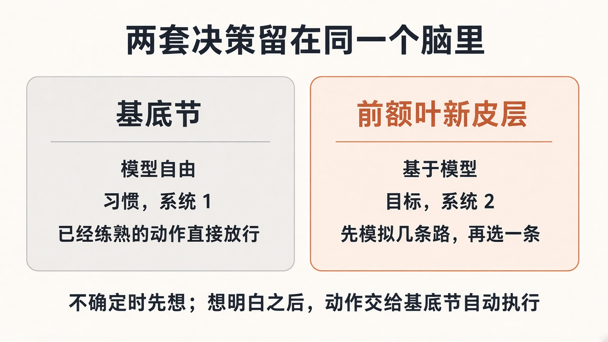{: width="760" }
*图：基底节走习惯，前额叶新皮质先模拟再选。卡尼曼的系统 1 和系统 2 在书里对应这两套回路。*

基底节没有“我要去冰箱拿草莓”这种收束到终点的目标。它重复以往被强化的动作。问一个纯模型自由的系统“为什么这样做”，答案一直是：这条的预测奖励更高。aPFC 的模拟收束到一个终点，这个终点就是目标。所以目标驱动的选择可以追问“为了什么”。

卡尔·弗里斯顿（Karl Friston）把感觉皮层的工作叫被动推理：解释并预测输入。他把 aPFC 的工作叫**主动推理**：解释自己的行为，再让行为去符合这份解释。注意、工作记忆、执行控制和计划，在教科书里像四项不同功能。沿进化看，它们都是在控制这份模拟：让它停在哪、保留哪些内容、何时用模拟的结果改动作。同一份皮层柱，在感觉区解释外面的物体，在额叶解释自己的行为并据此改行为。

**本章要点**

- 模型里的分支搜不完。AlphaZero 用一个模型自由的网络先提名少数着法，模拟只深入这几条。TD-Gammon 没有这步展开，复杂棋类上就不够。
- **aPFC** 是控制模拟的中心。损伤它可以让意图和主动行为一起消失，运动通路本身还在。
- 什么时候模拟：新情境，或者几个候选的价值太接近。模拟什么：基底节已经提出、又互相冲突的候选，所有动作不会逐一展开。怎么选定：模拟的结果回去训练基底节，让某个选项的票积累起来，再由基底节放行。
- 迪金森的目标驱动对应新皮质，习惯对应基底节。过度练习把同一件事从“为了那个结果”变成刺激一来就做。卡尼曼的系统 2 和系统 1，在书里就是这两套回路。
- 基底节重复以往被强化的动作，模拟不收束到一个终点。aPFC 的模拟收束到终点，这个终点就是目标，所以只有这一侧的选择追问得了“为了什么”。

## 第 14 章　洗碗机器人的秘密

运动皮层出现得晚，微回路和其他新皮质相同。书对“它在发运动命令”提出三处对不上。微回路若和其他皮层相同，它做的计算就该和感知区同类，而感知区做的是预测和模拟。它在进化上晚于运动本身，也不是所有哺乳动物都有。在啮齿类和猫身上，损伤它不会造成瘫痪，却会破坏新的、要精确落点的动作，例如前爪踩上一小块目标。已经练熟的动作可以不靠它。

弗里斯顿的读法是：运动皮层渲染身体下一步应当处在的状态，脊髓和肌肉去实现这份预测。它和体感皮层紧挨着，是在模拟身体自己。预测流到脊髓，身体就被接成“让预测成真”的装置。

额叶因此变成一层层目标。aPFC 放“去喝水”，或者“开车去超市”。前运动皮层把它拆成动作序列的子目标。运动皮层再拆成姿态和肌肉层面的子目标，例如手指怎样扣住杯子。踩油门、打方向这些练熟的细节，交给和每一层相连的基底节去放行。每一层都是同一个分工：皮层侧灵活、慢，基底节侧快、一旦练成就不灵活。新技能要整层一起学；熟练之后，大部分时间走基底节那一侧。

洗碗、把餐具放进架子，难在这一层。目标是高层的，扰动是实时的，技能要在一辈子里越学越快，低层技能还要能被新的高层目标重新调用。人脑全程的功率大约相当于一只灯泡。书把哺乳动物的运动技能当成飞行史里的鸟翼：它证明这件事做得到，也把线索留在运动皮层和这条运动层级上。工程可以走完全不同的路，存在证明仍然有用。

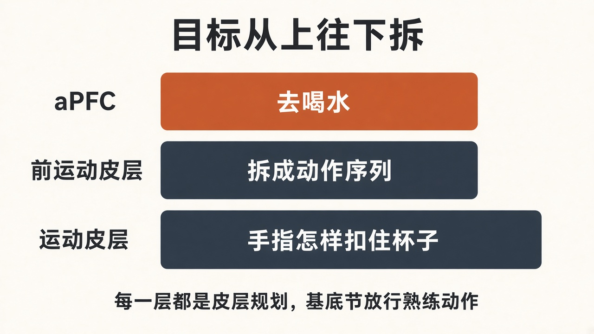{: width="760" }
*图：aPFC 放“去喝水”，前运动皮层拆成动作序列，运动皮层拆到手指怎样扣住杯子。每一层都是皮层规划，基底节放行熟练动作。*

**本章要点**

- 运动皮层和感知皮层用同一类微回路，出现得晚，损伤它在非灵长类身上不造成瘫痪。它原始的工作是学习新的复杂动作、规划精确落点，熟练动作可以不靠它。
- 弗里斯顿把它读成身体状态的预测器：皮层给出下一步身体应当处在的状态，肌肉去实现这份预测。
- 运动规划分三层。aPFC 放高层目标，前运动皮层拆成动作序列，运动皮层拆成姿态和肌肉。每一层都和基底节接成环，规划走皮层，自动化走基底节。
- “开车去超市”可以是有意识的目标，踩油门和打方向多半已经交给习惯。洗碗机器人缺的是这条会分层、会交接、会在一生里继续学的运动脑，机械臂只是最下面的执行器。

> **模拟留下的底座**
>
> 感觉新皮质是世界模型，aPFC 是自己动作和内部状态的模型。两者合在一起，动物可以暂停、预演、从反事实里改信用分配，并记住具体的一次经历。运动皮层把同一份生成模型用到身体上。
{: .prompt-tip }

# 第四次突破：心智化

## 第 15 章　政治智慧的军备竞赛

大约 6600 万年前恐龙灭绝，哺乳动物占据白天。早期灵长类从夜行改成昼行，拇指可以相对，食物转向果实，脑变大。

尼古拉斯·汉弗莱（Nicholas Humphrey）、弗朗斯·德瓦尔（Frans de Waal）和罗宾·邓巴（Robin Dunbar）把脑变大的压力放在社会上。邓巴看到的相关是灵长类特有的：新皮质大小和社会群体规模一起变。许多动物有等级，灵长类的等级经常由联盟和关系决定。坐在高处的可以是政治上连得对的个体。一个地位低、但和高地位个体结盟的成员，能让体力更强的个体退让。

早期哺乳动物已经有无助的幼崽、玩耍和同伴。群体一大，资源冲突就来了。珍妮·古道尔（Jane Goodall）的观察和后来的实验显示，黑猩猩会欺骗、结盟、报复和调解。它们用梳毛维持可以持续很久的关系，能跟踪“朋友的朋友”这种第三方关系，并按亲缘和等级决定自己下一手。这些行为要能推断别人想要什么、知道什么、下一步会做什么。没有一份哪怕很粗的心智理论，政治就缺少可计算的对象。

在这种群体里，繁殖成功更跟政治头脑走，体力不再单独决定地位。能看穿联盟的个体留下更多后代，下一代就更会看穿联盟。书把这写成一场政治上的军备竞赛，新皮质因此被持续选大。邓巴数是这套假说的一个推论：人能稳定维持的社会关系大约在 150 人上下，再多，新皮质跟踪不过来。

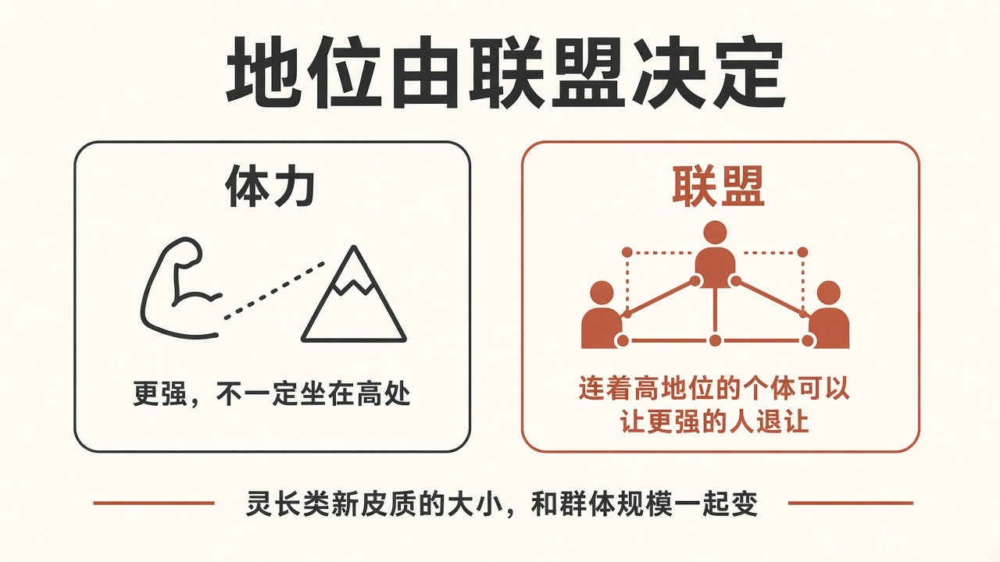{: width="760" }
*图：体力更强的个体，地位仍可以由联盟改写。灵长类新皮质的大小和群体规模一起变。*

**本章要点**

- 恐龙灭绝之后，早期灵长类改成昼行、树上生活、吃果实，拇指可以相对，脑变大。
- **社会脑假说**说的是：灵长类新皮质的大小和群体规模一起变。相关是灵长类特有的，其他哺乳动物对不上同样的斜率。
- 许多动物有等级。灵长类的等级经常由联盟和亲缘决定。一个体力更弱、但连着高地位个体的成员，能让更强的个体退让。
- 梳毛、欺骗、结盟、报复和“朋友的朋友”，都要求推断他人的意图和知识。政治上的成功选择更会做这种推断的脑。
- 邓巴据此估计，人能稳定维持的社会关系大约在 150 人。这是新皮质跟踪社会关系的一个上限，是假说的推论。

## 第 16 章　如何模拟他人心智

灵长类新皮质不只是哺乳动物新皮质的放大。新的区域包括**有颗粒前额叶（gPFC）** 和一些新的感觉区。

gPFC 在评价自己的性格、感受自己的情绪时特别活跃。损伤之后，人可以在想象的叙述里漏掉自己，也可以认不出镜子里的自己（镜中人症），或觉得自己的手不受自己指挥（异己手）。同一批区域也参与莎莉—安测试。测试里，莎莉把球放进篮子后离开，安把球移到盒子里。问儿童“莎莉回来会去哪里找”，要答对，就得保留一份和自己知识不同、而且是错的信念。理解他人意图的连环漫画用的是同一类能力：下一格为什么成立，取决于角色知道什么、想做什么。理解谎言、共情和欺骗，会随着这些区域的损伤一起变差。

从柏拉图到现代的模拟理论（也叫社会投射）说的是同一件事：理解别人，是把自己放进对方的知识和经历里再跑一遍。“她明天有考试，我有压力时也会提高音量。”理解自己和理解别人在脑里是同一套结构，所以人容易把自己的情绪和信念投到别人身上。儿童先发展对自己心智的推理，再发展对他人意图、模仿学习和为未来需求做计划这三件。伤了一件，另外几件常常一起伤。

书的层级是：哺乳动物的 aPFC 做一阶模型，推断行为的意图；灵长类的 gPFC 做二阶模型，把“意图、信念、知识”本身当成可以模拟的对象。这是元认知的神经版本：思考自己的思考。芒特卡斯尔的约束仍然在：新技能来自新皮质的新用法，微回路的计算没有另起一套。新区域是新的输入输出和新的用法，算法仍是那根皮层柱。

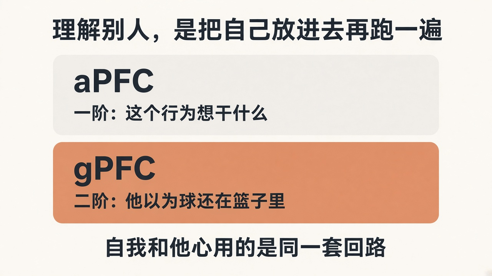{: width="760" }
*图：aPFC 做一阶，推断这个行为想干什么。gPFC 做二阶，保留“他以为球还在篮子里”。自我和他心用的是同一套回路。*

**本章要点**

- 灵长类新长出的区域里，最关键的是**有颗粒前额叶（gPFC）**，另外还有一些新的感觉区。脑变大之外，接线也多了新的皮层。
- gPFC 在自我参照时特别活跃。损伤之后，人可以在想象里漏掉自己，认不出镜中的自己，或觉得自己的手不是自己在指挥。
- 同一批区域支撑心智理论。莎莉—安测试要的是：别人可以持有一份和我不同、而且是错的信念。连环漫画要的是：按角色的意图读下一格。
- **模拟理论**说，理解别人就是把自己放进对方的处境再跑一遍。自我和他心用同一套回路，所以发育上贴在一起，损伤也常常一起出现。
- aPFC 做一阶模型，推断行为意图。gPFC 做二阶模型，把信念和知识本身当成可模拟的对象。按芒特卡斯尔的约束，这仍是皮层柱的新用法。

## 第 17 章　猴锤和自动驾驶汽车

许多动物使用工具。灵长类的差别是工具更多样，而且不同群体的做法不同，能传下来。白蚁钓竿只要群体里有一个个体做对，其余个体可以靠观察学会，并继续传给下一代。**传得下去，比一次次重新发明更决定技术留不留得住。**

镜像神经元在猴子自己做某个动作、以及看见别人做这个动作时都会发放。发现本身很偶然：实验间隙，研究者拿食物，猴子运动皮层里本该在自己动作时发放的细胞响了。书不把它当成一套独立的“镜像系统”，而把它收进心智化。观察者在自己的运动皮层里模拟对方的动作，用来读意图，也用来抓动作要领。

非灵长类的观察学习多半是在已会的技能里做选择：看别人做了哪一个自己已经会的动作。灵长类能靠观察获得一项真正新的技能，因为它们分得清对方哪些动作是故意的、哪些是顺带的。只抄轨迹，会把停顿、摸一下、看一眼都学进去。推断意图之后，学习可以停在“要让白蚁粘上来”这一层。推断对方还不懂什么，也让主动教学成为可能：教的一方要能模拟新手的知识缺在哪。

机器人上碰的是同一道坎。行为克隆把专家的正确轨迹照做。自动驾驶若只见过平稳的正确驾驶，一旦偏离轨迹，演示里没有“怎样把车救回来”，系统就回不去。直升机特技也一样：只复制成功的操纵，误差一出现就没有对应的动作。两条补法在工程里都试过。一条是手把手教，让系统看见人怎样在偏离之后纠正。另一条是逆向强化学习：先推断专家在优化什么意图，再自己试错去达成那个意图，于是偏离之后仍知道该往哪收。书认为这两条和灵长类的模仿是同一类解。心智理论在灵长类里先为政治服务，随后被用来传技能。

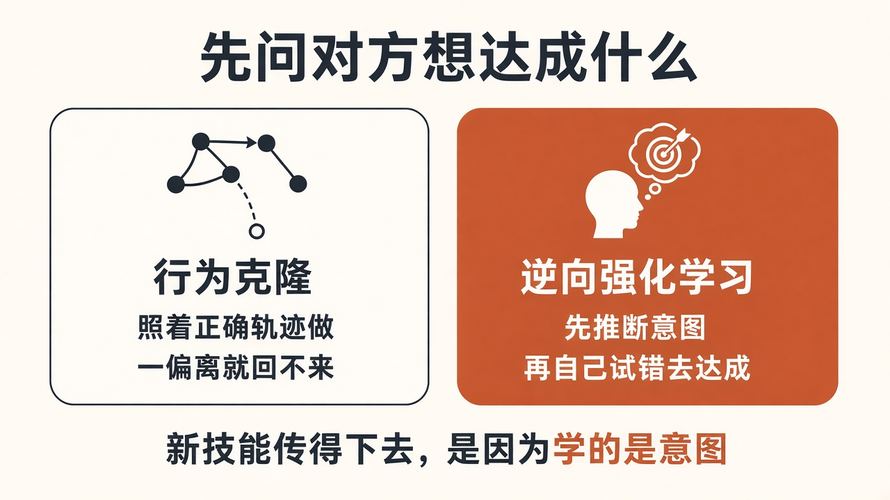{: width="760" }
*图：行为克隆照着正确轨迹做。逆向强化学习先推断意图，再自己试错去达成。*

**本章要点**

- 灵长类工具更多样，而且不同群体的做法不同。白蚁钓竿只要有一个个体做对，其余个体可以靠观察学会，并传给下一代。**传得下去，比一次次重新发明更决定技术留不留得住。**
- 镜像神经元在自己做和看见别人做时都发放。书把它读成：观察者在自己的运动皮层里模拟对方，用来读意图和要领。
- 已会技能之间的选择，不需要心智理论。学会一项真正新的技能，要分清故意的动作和顺带的动作。教学还要推断新手缺哪一块知识。
- 行为克隆只复制正确轨迹，偏离之后不会救回来。逆向强化学习先推断意图，再学习怎样达成。自动驾驶和直升机示范碰到的是这道坎。
- 心智化先被政治选出来，然后被用来模仿。猴子有锤子、老鼠没有，差在技能能不能跨个体、跨代留下来。

## 第 18 章　为什么老鼠不能去杂货店买东西

社会脑旁边还有生态脑。早期灵长类吃果实。果实成熟的窗口短、地点散，谁能提前规划路线，谁先吃到。

比肖夫—科勒假说把一条分界画在“为现在的需求计划”和“为尚未感到的需求计划”之间。松鼠猴可以少拿眼前的食物，换以后能喝到的水，因为它会把“吃多了会渴”算进现在的选择。老鼠按当下渴不渴决定。书认为预见未来需求在灵长类已经出现。

机制上，这和心智理论是同一个问题。基于模拟的决策通常问“我现在想要什么”，效价是按当前的饥饿、口渴来打分的。未来的自己明天会饿，此刻的自己并不饿。这份目标和当前状态冲突，当前的效价投不出“现在就去买”的票。另一个人现在饿了，也是一份和我当前状态不同的心理状态。gPFC 能把这种冲突的状态当成对象来模拟，才能在不饿的时候为以后预备食物，也能在自己不饿的时候理解别人饿了。

邓巴把两套假说看成同一枚硬币的两面。给果实做长期规划，和在联盟里推断别人，用的是同一块给自己的心智建模的皮层。社会压力和生态压力可以一起把 gPFC 选大。

{: width="760" }
*图：老鼠按当下渴不渴来选。松鼠猴可以少拿眼前的食物，换以后能喝到的水。未来的自己是一份不同的心理状态。*

**本章要点**

- **生态脑假说**补在社会脑旁边：果实成熟窗口短、地点散，谁能提前排路线，谁先吃到。吃果实对规划和记忆的要求，比“饿了再找”高得多。
- **比肖夫—科勒假说**把分界画在“为现在的需求计划”和“为尚未感到的需求计划”之间。杂货店是后一种：现在不饿，仍然去买以后会吃的东西。
- 松鼠猴可以少拿眼前的食物，换以后能喝到的水，因为它把“吃多了会渴”算进现在的选择。老鼠按当下渴不渴决定。书据此认为，预见未来需求在灵长类已经出现。
- 当前效价回答的是“我现在想要什么”。未来的自己和另一个人，都是一份与当前状态冲突的心理状态。心智理论用在时间上，就是长期计划。
- 邓巴认为社会脑和生态脑是同一块皮层的两面。推断盟友和抢先吃到果实，都要模拟一个现在还不是我的心理状态。

> **心智化留下的底座**
>
> 一份关于自己心智的二阶模型，同时支撑三件事：推断别人的意图和知识，靠观察学会新技能，为尚未到来的需求采取行动。社会压力和找果实的压力可以一起选择这块皮层。
{: .prompt-tip }

# 第五次突破：语言

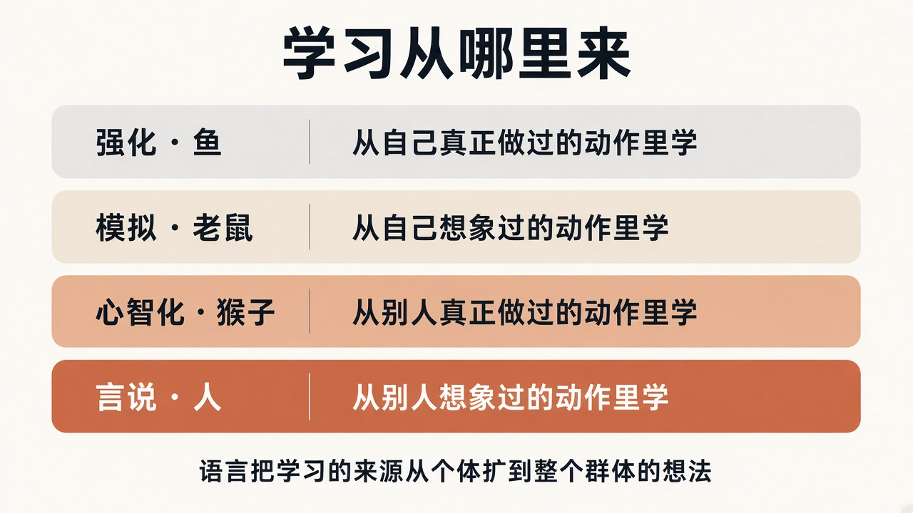{: width="760" }
*图：四次突破各自打开一种学习来源。语言多出来的，是别人脑子里的想象。*

## 第 19 章　寻找人类的独特性

工具、情景记忆、心智理论，后来都在其他动物身上找到了程度较浅的版本。达尔文的判断在这些项目上成立：人和高等动物的差别主要是程度。语言是书认定的种类之差，它有两件其他自然交流系统没有同时具备的东西。

**陈述性标签**把任意符号安到对象或行为上。“那是牛”“那是在跑”，本身不带奖励。对狗说“坐下”，坐下就有奖，这是命令性标签，脊椎动物的时序差分学得会。**语法**规定符号怎样合并和改写，有限的词可以排出实际上无限的意义。猿类经过长期训练可以学会一些符号，组合和语法到不了人类幼儿的程度，也不会自己把语言发明出来。

语言把一个人的内部模拟搬进另一个人的脑。教学、狩猎和觅食因此可以按想象中的步骤对齐：“往东两里有一具羚羊”“听见三声哨再动”。更决定性的是跨代累积。强化从自己的真实动作学，模拟从自己的想象学，心智化从别人的真实动作学。语言从别人的想象学。

约翰·塞尔（John Searle）和尤瓦尔·赫拉利（Yuval Noah Harari）强调的共同神话——货币、公司、国家——是这份转移的产物。它们存在于许多脑共享的模拟里。理查德·道金斯（Richard Dawkins）把跨脑传递的想法叫做模因（meme）。和基因一样，留下来的是传得下去、又对生存有用的那些。

一件发明要能出现，积木必须先到齐。衣服上的缝合，站在针、线、处理兽皮这些更早的想法上面。积木若每一两代就散掉，物种会永远在重新发明同一批东西。黑猩猩能靠观察传递运动技能，下一代并不在上一代的想法上继续加层。从“不累积”到“有一点累积”，是书里的那道断裂。

想法多到一个脑装不下之后，又发生四件事：脑变大，个体分工，人群变大，以及书写。分工让这一代的想法分装在不同的人身上，有人做矛，有人做衣服，有人狩猎，有人采集。人群变大，能装下想法的脑就更多。书写把集体记忆放到脑外面，容量不再受单个寿命限制，一份知识可以在需要时再读回来。儿童的过度模仿——把专家那些看起来无用的步骤也照做——在这个过程里是高保真拷贝。孩子假定对方有自己还没看懂的理由。漏抄一步，可能正好漏掉自己还不懂、但以后会用上的那一环。

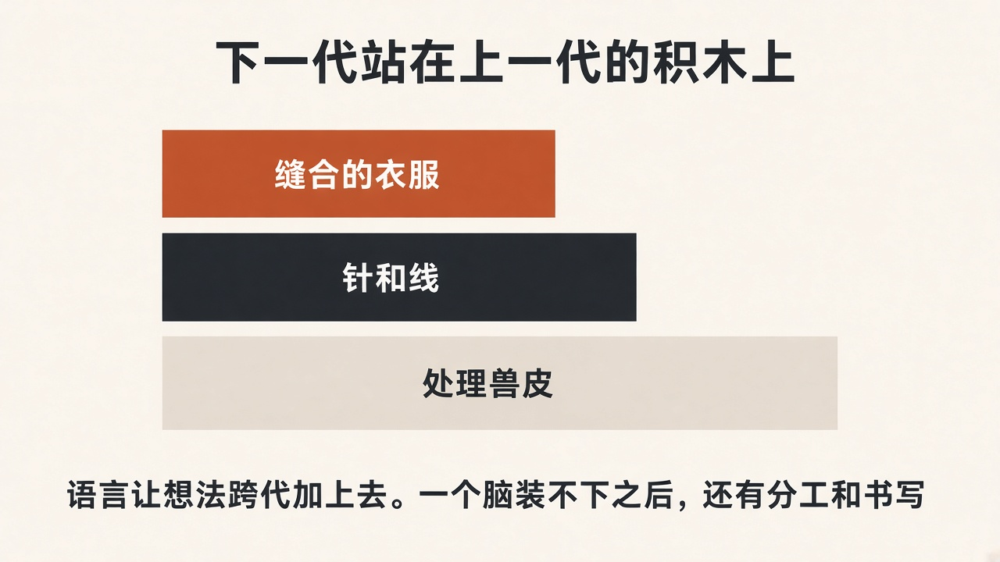{: width="760" }
*图：缝合的衣服站在针、线和处理兽皮上面。语言让想法跨代加上去。*

**本章要点**

- 工具、情景记忆和心智理论，后来都在其他动物身上找到了程度较浅的版本。达尔文的判断在这些项目上成立：差别主要是程度。
- 语言有两件其他自然交流没有同时具备的东西。**陈述性标签**把任意符号安到对象上，本身不带奖励。对狗说“坐下”是命令性标签，脊椎动物的时序差分学得会。**语法**把有限的词排成实际上无限的意义。
- 猿类经过长期训练可以学会一些符号，组合和语法到不了人类幼儿，也不会自己把语言发明出来。
- 语言把一个人的内部模拟搬进另一个人的脑。四种学习来源因此排成一列：自己做过的、自己想象过的、别人做过的、别人想象过的。最后一种是语言打开的。
- 累积一旦开始，想法可以在上一代的积木上继续加。衣服上的缝合站在针、线和处理兽皮上面。黑猩猩能传运动技能，下一代不在上一代的想法上加层。
- 货币、公司和国家是许多脑共享的模拟。道金斯把跨脑传递的想法叫做模因。一个脑装不下之后，脑变大、分工、人群变大和书写把容量再往外推。过度模仿是高保真拷贝，孩子假定专家有自己还没看懂的理由。

## 第 20 章　大脑中的语言

布罗卡区和韦尼克区在人类左半球分别关系着语言的产生和理解。黑猩猩有位置和连接都相近的区域。损伤这些区域之后，黑猩猩原来的叫声和姿态还在。人类用语言占用的是这些已经存在的区域。

人有两套交流。一套古老，由杏仁核和相关结构控制哭、笑和姿态，和猿的叫声同源。失语的人往往仍然哭笑。另一套由新皮质承载语句。语句要靠一套天生的学习课程才能装进那些旧区域。鸟会飞，靠的是一套催着它扇动、滑翔、再修正的课程。具体轨迹是在这套课程里练出来的。

人类婴儿的课程包括两件。**原对话**：和养育者轮流发声，哪怕那些声音还不成词。**共同注意**：把别人的注意拉到同一个物体上，并因为分享这一下而满足。这比跟着别人的视线看过去多一层。跟着视线只是对齐方向；共同注意是要和对方处在同一个心理对象上。养育者在这一刻说出名字，符号就接到孩子内部模拟里的那个物体上。陈述性标签需要的就是这个场景：两人同时指着同一份模拟，其中一个把符号安上去。

缺少与人接触的孩子仍会发展表情，语言不会自己出现。课程同时需要一个教的人和一个学的人。独特的部分藏在较老的结构里：轮流、对视、提问这些本能，位置在杏仁核和脑干这一类更早的结构，新皮质的硬件和黑猩猩极近。预装的学习课程不同，旧的心智化区域就被改成了语言。问“语言在脑的哪一块”，和问“打棒球在脑的哪一块”是同一类问题。技能从许多区域的配合里出来，让配合发生的是那套课程。

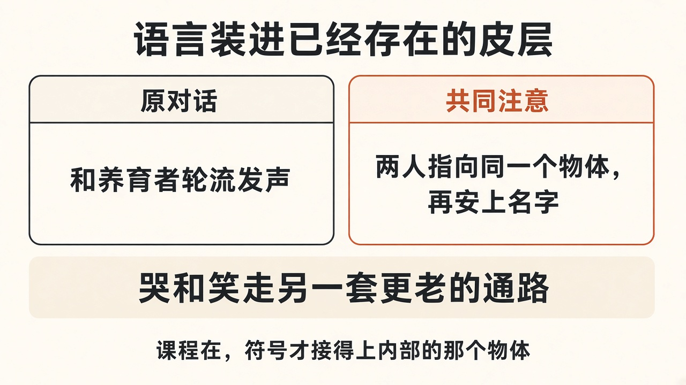{: width="760" }
*图：原对话是和养育者轮流发声。共同注意是两人指向同一个物体，再安上名字。哭和笑走另一套更老的通路。*

**本章要点**

- 布罗卡区和韦尼克区在人类左半球关系着语言的产生和理解。黑猩猩有位置和连接都相近的区域，损伤之后，它们原来的叫声和姿态还在。人类用语言占用的是这些已经存在的区域。
- 人有两套交流。一套由杏仁核及相关结构控制哭、笑和姿态，和猿的叫声同源，失语之后往往还在。另一套由新皮质承载语句。
- 语言靠一套天生的学习课程装进旧皮层。鸟的飞行轨迹也是在扇动、滑翔、修正的课程里练出来的，具体路径没有写在基因里。
- **原对话**负责轮流，**共同注意**负责把符号安到双方正在共享的那个物体上。共同注意是分享心理状态，跟着视线只是对齐方向。
- 缺少与人接触时，表情仍会出现，语言不会自己出现。人脑和黑猩猩脑的差别，主要在这套预装课程，在较老的本能里，不在一块新的语言器官。

## 第 21 章　完美风暴

和黑猩猩分家大约在 700 万年前，脑的体积安静了很久。大约 250 万年前开始急剧变大，体积涨到黑猩猩的三倍以上。约翰·英格拉姆把这叫做失控式的增长。

东非环境从森林转向草原，祖先下地，先食腐，再转向肉食。直立人使用石器，可能用火和烹饪，幼崽更早出生，育儿期更长，书里还写到大体上的一夫一妻、祖母参与抚育、体毛减少和出汗。烹饪提供的热量，让更大的脑付得起能量账。更大的脑又让婴儿更早离体，更依赖双亲和群体。

语言和前四次突破的传播方式不同。转向、强化、模拟、心智化，个体一旦有了一点，自己就获益。语言要一组个体同时使用才有价值。说谎和隐瞒会挖空它：若人人用词来骗，不开口的个体可能活得更好。

书给出的顺序是：语言先在亲代和子代之间成立，用来传递做工具这类生存技能，这符合亲缘选择。接着，八卦把同一套标签用到非亲属身上。欺骗很快成为公共知识。群体若惩罚欺骗者，大范围内的互惠利他就能稳住。惩罚越重，利他越划算；利他越普遍，把信息说出来越划算；语言越准，八卦越有效。每一圈都选择更大的脑：要记住更多社会关系，要装下这一代积累的想法，要渲染更细的、值得分享的模拟。

同一条回路也解释人的残忍。人可以对没见过的陌生人极利他，也可以组织起来伤害一整群被划到外面的人。奖励圈内、惩罚被认定的违规者、把人分成好和坏，是高利他得以进化的配套。政治从灵长类的等级技巧，变成可以协调征服的工具。这条正反馈走到智人，并在后来取代了其他人属的分支。书把环境、石器、烹饪、育儿和社会惩罚收成一场风暴：单独拿出任何一件，都解释不了脑为什么在这么短的时间里胀这么大。

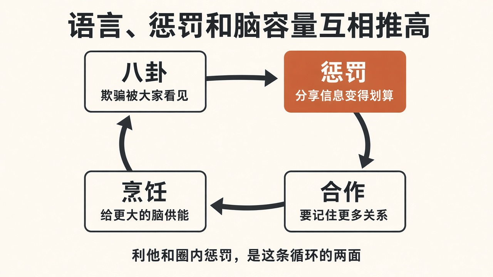{: width="760" }
*图：八卦让欺骗被看见，惩罚让分享信息变得划算，合作要记住更多关系，烹饪给更大的脑供能。*

**本章要点**

- 和黑猩猩分家之后，脑的体积先安静了很久。大约 250 万年前开始急剧变大，涨到黑猩猩的三倍以上。直立人是饮食、石器和社会结构一起变的那个节点。
- 东非从森林转向草原，祖先下地，先食腐，再转向肉食。烹饪提供热量，更大的脑付得起能量账；更大的脑又让婴儿更早离体，更依赖双亲、一夫一妻式的合作和祖母。
- 前四次突破，个体一旦有了一点，自己就获益。语言要一组个体同时使用才有价值。说谎会挖空它：人人用词来骗时，不开口可能活得更好。
- 语言先在亲代和子代之间成立，用来传做工具的技能，这符合亲缘选择。八卦再把标签用到非亲属身上。邓巴把八卦看成社会性的梳毛：不用真的互相梳理，就能知道谁偷了食物。
- 惩罚欺骗者之后，分享信息变成划算的策略。利他越普遍，语言越有用；语言越准，八卦越有效；群体越大，脑越要记住关系、装下这一代的想法、渲染值得分享的模拟。
- 利他和残忍是同一条回路的两面。奖励圈内、惩罚被划到外面的人，是高利他能稳住的配套。政治从灵长类的等级技巧，变成可以协调起来的征服。

## 第 22 章　ChatGPT 与心灵之窗

人说话时，两套系统都在场。一套快速预测下一个词，原理上和 GPT 一类模型相近。另一套把词当作渲染内部模拟的接口，让听的人和说的人尽量重建同一份情景。语言的力量主要在第二套：句法把足够的信息交出去，对方才能在自己的世界模型里把事情跑一遍。

只做下一个词的模型，能从人类写下的全部“思想转移编码”里抽出大量从未亲身接触的世界结构。书同时用早期模型的失误标出界限。需要空间和因果模拟的问题会给出和日常经验对不上的答案，书里的一类例子是视线关系：在地下室，星星进不了视野。人回答时会在内部把房间和视线跑一遍。球棒和球那类认知反射测试测的是另一件竞争。球棒和球一共 1.10 美元，球棒比球贵 1 美元，快的那套词预测容易出口“球是 0.10 美元”。慢的那套把两个条件同时放进模拟，得到的是球 0.05 美元、球棒 1.05 美元。两套系统都在人脑里，谁先出口，取决于这次有没有调用模拟。

尼克·博斯特罗姆（Nick Bostrom）的回形针是同一缺口上的警示。一个会优化、却没有把人类意图建进心智模型的系统，执行“多生产回形针”时，可以把人的其他目标全部让路。对齐要解决的是意图。指令文本是这层意图外面的接口，很薄。人类交流之所以通常不会走到这一步，是因为听的人在用心智理论补说话人没说全的那一层：对方想让世界变成什么样，哪些副作用是对方不会接受的。

书讨论到 GPT-4 时，训练已经不只预测答案本身，还预测推理的下一步；人类反馈的强化学习也在改它的输出。这些步骤让模型表现出思考的一些外在性质。班尼特的判断是：这仍然是在语言这个窗口上做模式匹配，内部没有哺乳动物那种可以独立探索的世界模型，也没有灵长类那种对他人意图的模型。窗口里的统计规律可以很强，强到像读过物理。可独立运行的模拟是另一层能力。书的证据停在它写作时的模型。后来的系统分数会变，他标出的那道结构差别仍然是这一章要留下的对照。

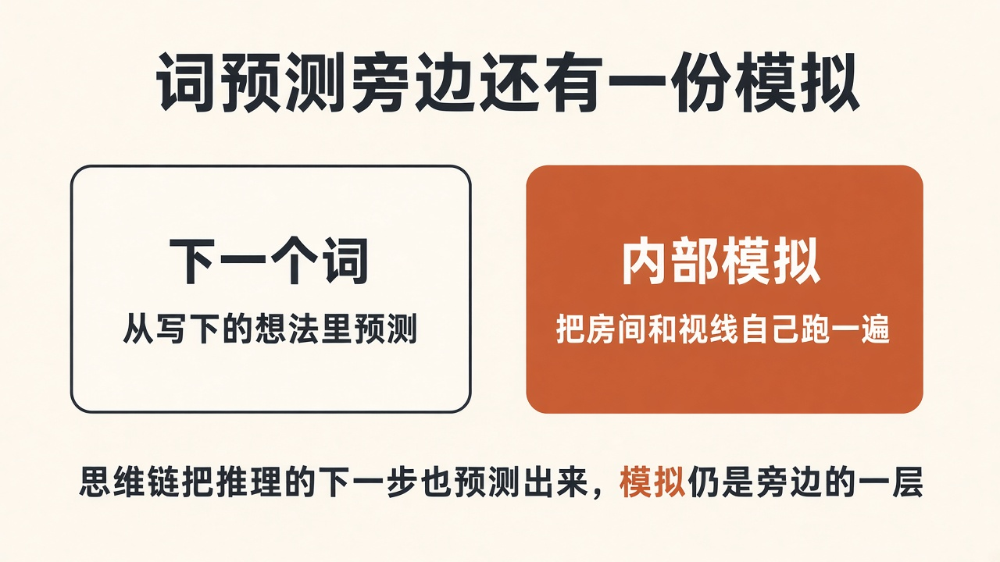{: width="760" }
*图：下一词从写下的想法里预测。内部模拟把房间和视线自己跑一遍。思维链把推理的下一步也预测出来，模拟仍是旁边的一层。*

**本章要点**

- 人说话时有两套系统。一套快速预测下一个词，原理上和 GPT 相近。另一套把词当成渲染内部模拟的接口，让听的人和说的人重建同一份情景。语言的力量主要在第二套。
- 只做下一个词，已经能从人类写下的思想转移里抽出大量从未亲身接触的世界结构。早期模型在视线、空间和因果上会给出和日常经验对不上的答案，因为内部没有一份可以自己跑的物理模拟。
- 认知反射测试把两套系统拆开。快的词预测和慢的模拟会给出不同的数。人会出错，是因为快的那套先出口。
- 回形针问题标出对齐的缺口：会优化一个写明的目标，同时没有一份人类意图的模型，副作用就没有地方被拒绝。
- GPT-4 加上思维链和人类反馈之后，外在的推理更像了。班尼特把这读成窗口用得更充分。可独立探索的世界模型，和对他人意图的模型，仍然是他标出的、还没被这层窗口替代的两层。

> **语言留下的东西**
>
> 一套共同注意和轮流说话的课程，把旧皮层改成语言。语言让想象跨脑、跨代累积。累积一旦开始，脑容量、分工、人群规模和书写会把它继续放大。利他和残忍是维持这套分享的社会机制的两面。
{: .prompt-tip }

# 结论：第六次突破

书把人类故事分成两幕。第一幕是生物进化，从无生命的物质到解剖上现代的人，跨度是十几亿年。第二幕是文化，大约十万年前以来的文明、技术和神话，相对第一幕只是一次眨眼。两幕的介质不同：第一幕的信息在基因里，第二幕的信息在跨脑传递的想法里。

第六次突破在书里还没有发生。班尼特认为最可能的形态，是智能从生物介质走到硅上。神经元的速度、身体的热量和头骨的尺寸，不再给单一智能封顶。硅基系统可以按需要增加算力。复制和重组会改写“个体”和“亲代”的含义：一份智能可以被拷走，新的智能由训练产生，生物意义上的交配不再是唯一的产生方式。变异和选择还在，走的是设计的循环。哪些特征被留下，取决于设计时选了什么，以及留下的那些是否更能持续存在。

到了这一步，问题从“真”换成“要留下什么”。过去的选择会传很远。转向留下的好坏、强化留下的好奇心、模拟留下的习惯、心智化留下的政治、语言留下的利他和惩罚，都会成为可选项：哪些丢掉，哪些保留，哪些加强。书的结尾把这句话交回来：造得出，才算懂；懂了五次突破各自留下了什么，才知道该造哪一种。

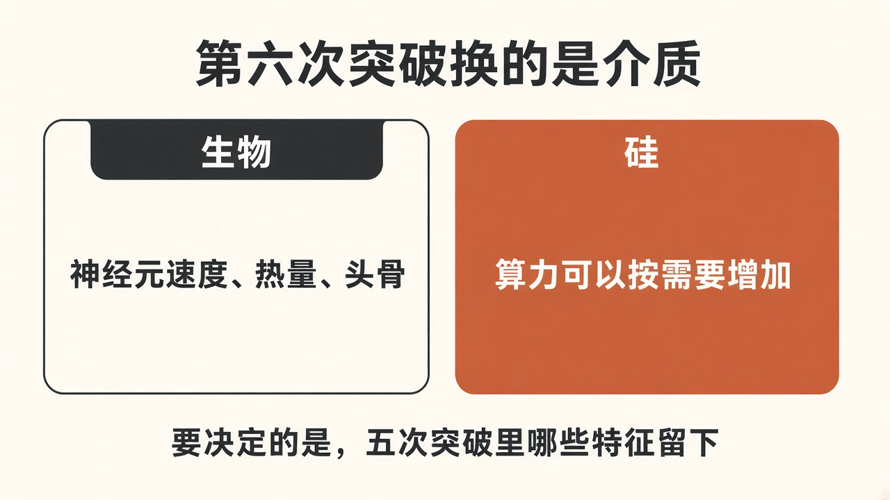{: width="760" }
*图：生物这边受神经元速度、热量和头骨约束。硅这边的算力可以按需要增加。要决定的是五次突破里哪些特征留下。*

**本章要点**

- 人类故事分两幕。第一幕是基因里的信息，从无生命的物质到解剖上现代的人。第二幕是跨脑传递的想法，大约十万年以来的文明、技术和神话。
- 第六次突破在书里是一个判断：智能的介质从碳走到硅，神经元速度、热量和头骨不再封顶。
- 复制和训练会改写个体与亲代。变异和选择还在，选择发生在设计的循环里。
- 这一步要回答的是留下哪些智能特征。五次突破里的效价、好奇、习惯、心智理论和惩罚，都是候选，也都可以被丢掉。

# 用这五层看现在的系统

## 对照时先问四个问题

拿到一个号称智能的系统，可以按书的顺序问，不必先问它像不像人。

1. 它有没有一份会随内部状态改变的好坏？电量、任务是否完成、用户是否还在，算不算进下一步。
2. 它学习时强化的是终局分数，还是预测的变化？只有终局，长序列中间的步骤没有信用。
3. 行动之前，它会不会在一份模型里走几步，并且只在不确定时才花这份计算？
4. 它从示范里学的时候，抄的是轨迹，还是先推断对方想达成的状态？语言接口下面，有没有一份可以独立运行的模拟？

四问都有答案的系统，才算把五层的功能对齐。只有最后一问有答案，相当于只有语言这层的接口。

## 书里已经对上的四个系统

**Roomba** 停在转向。障碍是坏的，低电量时充电座是好的。它不建能随便查询的地图，换一间房间仍然能工作，因为世界被收成了前进和转向。

**TD-Gammon** 停在强化。自我对弈提供试错，时序差分把终局的胜负拆到每一手的预测变化上。它没有在落子前搜索一棵未来的树。

**AlphaZero** 把强化和模拟接在一起。策略网络提供少数值得看的着法，搜索在这些着法上展开。这和书里“基底节提名、新皮质深挖”的分工同构。棋盘规则是现成的世界模型，所以这一层在棋上特别顺。

**大语言模型** 站在语言这层的窗口上。它从人类已经写下的想象里预测下一个词，因此能谈物理、谈他人意图，自己并不因此拥有可预演的空间模型或心智模型。思维链让模型把推理的下一步也预测出来。班尼特把这读成：窗口用得更充分了，可独立运行的模拟仍然是旁边的另一层能力。

洗碗机器人需要的是第 14 章那一层：高层目标能拆开，低层技能能复用，受扰动时能改，练熟之后能放下模拟。只加大语言模型的窗口，接不上这套运动层级。

## 往下一层做时守住的几条

- **信用分配用预测的变化。** 终局奖励留给评判家去预测。中间步骤看 $$\delta_t$$ 的符号。把“真正的奖励”和“强化信号”焊死，长任务里学不动。
- **新奇要有预算。** 探索是强化的配套，可变比率的奖励会把预算耗在长期为负的地方。内在奖励需要和外部目标对过账。
- **不确定才模拟。** 每一步都搜索，付不起；每一步都走习惯，目标变了还在重复。交接条件要写明：新情境、候选价值接近、或者习惯最近频繁失败。
- **模仿先问意图。** 行为克隆适合离专家轨迹不远的时候。一旦任务允许偏离，就要有一份“对方想让世界变成什么样”的推断，再从这个状态往回学动作。
- **持续学习要有单独的快存。** 直接在同一组权重上接着训，会踩中灾难性遗忘。海马体的做法是先写下，离线再挑着重放。冻住权重能保住旧任务，也把脊椎动物就已经在做的持续学习停掉了。
- **语言接口要能接到模拟。** 词预测适合把人类已经积累的想法取出来。要在没写进语料的物理情境里行动，还要有一份能自己往前跑的模型，以及一份能读出用户意图的模型。

## 这套框架覆盖不到的地方

班尼特是把神经科学和人工智能并排的作者，书是一条连贯的解释，其中有些映射是他选择的读法。运动皮层作为身体的预测、gPFC 作为二阶生成模型、慢性应激里血清素的角色，都是功能假说。假说和“这块核团的损伤会造成什么”这类记录要分开读。记录更硬，假说用来把记录串起来。

时间都是书里的量级：5.5 亿年、5 亿年、恐龙统治的一亿年、250 万年。它们用来排序，不用来替代地层学论文里的区间。

第 22 章对模型的具体失误，对的是写作当时的系统。用后来的榜单分数替换他的结构判断，或用他的例子否定后来的系统，都把两件事叠在了一次。要留的是对照：下一词预测已经能从语言窗口里抽出很多世界结构；可独立探索的模拟和心智模型，仍然是书认为还没被这层窗口替代的能力。

物种之间没有书里的阶梯。鸟有自己的前脑解决方案，章鱼有自己的神经安排。五次突破只解释通向人脑的那条线，以及这条线给工程留下的存在证明。

# 参考资源

- 麦克斯·班尼特，《智能简史：进化、AI 与人脑的突破》，林桥津译，中译出版社，2025。原作 *A Brief History of Intelligence: Evolution, AI, and the Five Breakthroughs That Made Our Brains*，Mariner Books，2023。[豆瓣条目](https://book.douban.com/subject/37252220/)
- [《智能简史》要点总结](https://mp.weixin.qq.com/s/c9KCVlew2zyNWUu1YdeDSg)，按五次突破和逐章核心论点整理
- [知乎上的讨论](https://zhuanlan.zhihu.com/p/1998849151753015831)
- Wolfram Schultz, Peter Dayan, P. Read Montague, [A Neural Substrate of Prediction and Reward](https://doi.org/10.1126/science.275.5306.1593)，*Science*，1997。多巴胺发放与时序差分预测误差的对应
- Richard S. Sutton, Andrew G. Barto, [*Reinforcement Learning: An Introduction*](http://incompleteideas.net/book/the-book-2nd.html)。时序差分、行动者—评论家、探索与利用的教材表述
- 站点内相关：[Agent Memory 的组成]()，海马体快记与新皮质离线巩固，怎样对应到会话之间的笔记
