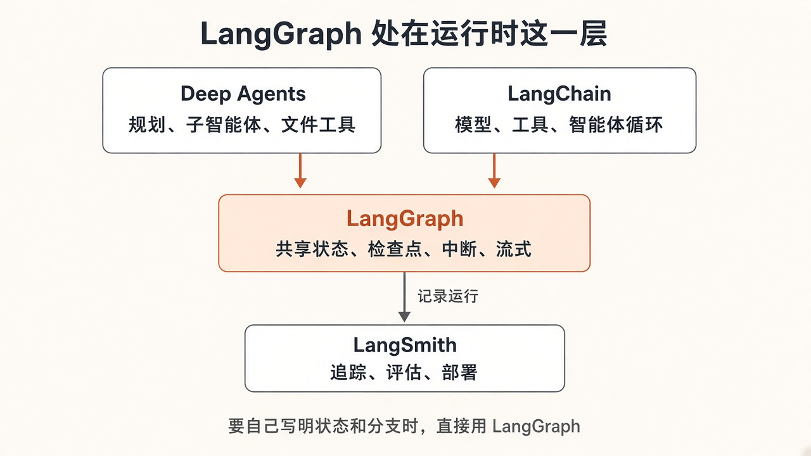
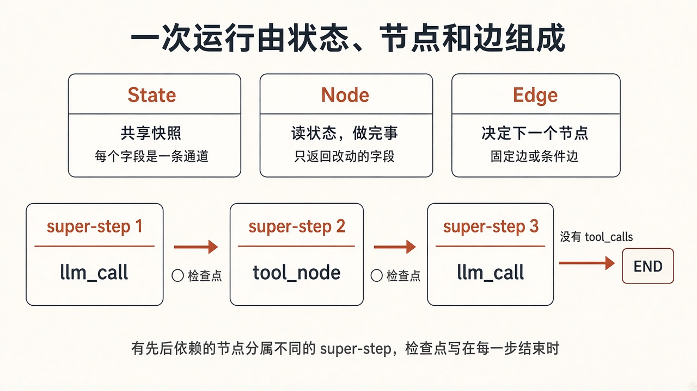
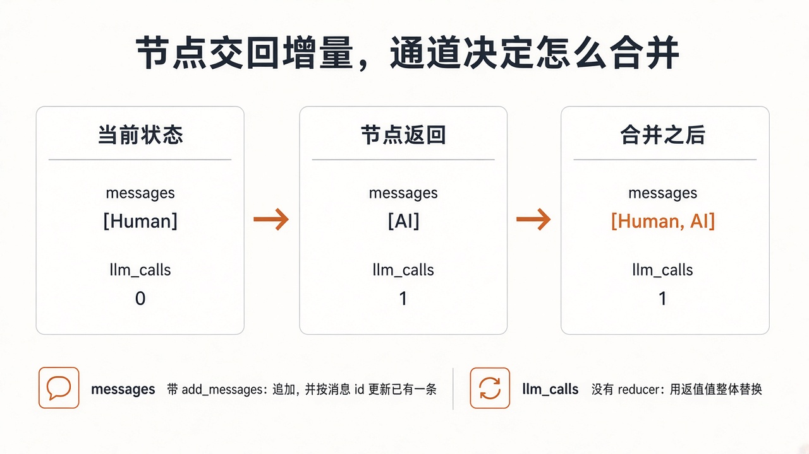
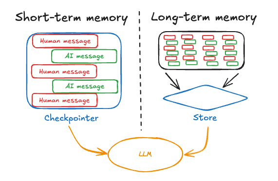
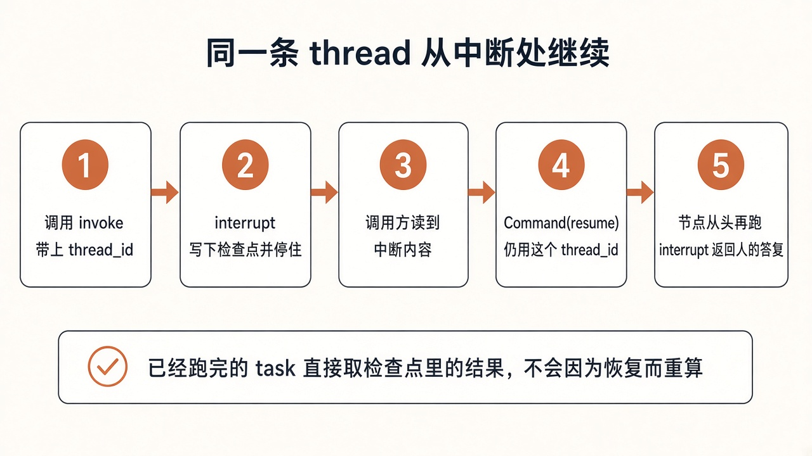
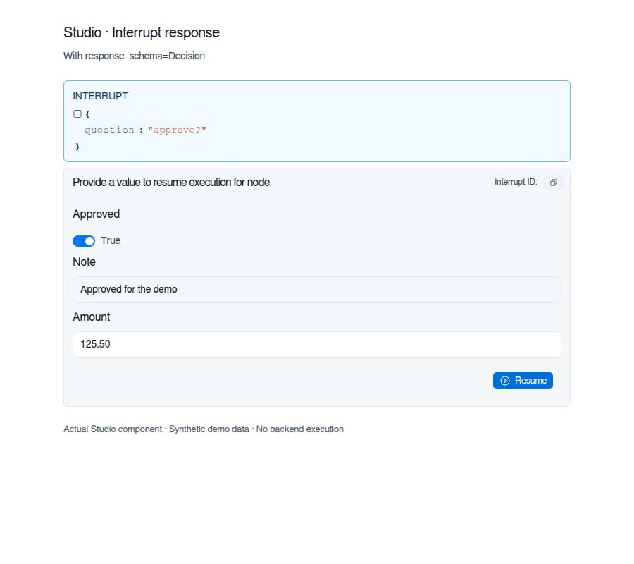
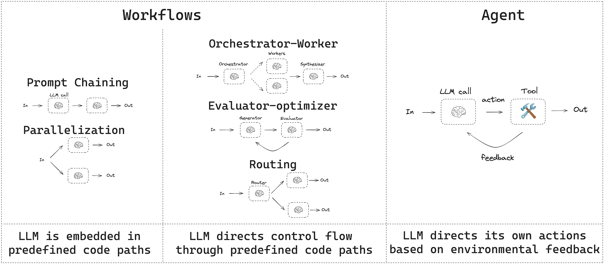

* Do not remove this line (it will not be displayed)
{:toc}

> 运行模型和接口以这些文档为准。[LangGraph overview](https://docs.langchain.com/oss/python/langgraph/overview) 说明它是长程、有状态智能体的编排运行时。[Graph API](https://docs.langchain.com/oss/python/langgraph/graph-api) 定义状态、节点、边、super-step、`Send` 和 `Command`。[Persistence](https://docs.langchain.com/oss/python/langgraph/persistence) 与 [Memory](https://docs.langchain.com/oss/python/langgraph/memory) 区分一条 thread 上的检查点和跨 thread 的 Store。[Interrupts](https://docs.langchain.com/oss/python/langgraph/interrupts) 写暂停与恢复。[Workflows and agents](https://docs.langchain.com/oss/python/langgraph/workflows-agents) 给出常见控制流。[Quickstart](https://docs.langchain.com/oss/python/langgraph/quickstart) 用加减乘除把工具循环走通。仓库 [README](https://github.com/langchain-ai/langgraph) 说明执行方式借鉴 Pregel 和 Apache Beam。会话之间更长的记忆怎么分层，见 [Agent Memory]()。
{: .prompt-info }

LangGraph 把一次长流程写成一张图。图上有一份共享状态，有若干节点，还有决定下一步去哪的边。节点做事情，可以是一段普通代码，也可以是一次模型调用。边负责顺序、分支和循环。检查点记在每一步的边界上。进程中途退出、人要先看一眼、或者同一次对话要接着聊，都用同一个 `thread_id` 从记下的状态继续。

提示词和循环形状由调用方决定。模型、工具和现成的智能体循环可以由 LangChain 提供，节点里也可以直接调用别的客户端。

# 背景

一条把模型调用串起来的链，适合步骤在写代码时已经排好、并且每步只往下走的任务。智能体经常不满足这两点。模型看完工具结果，可能还要再调一次工具，也可能直接回复用户。转账、删数据和发信要停下来等人。研究任务可能跑很多分钟，中间进程会重启。这些都要一份能活过单次函数调用的状态，以及一张允许回到前面节点的图。

LangGraph 的执行方式借鉴 [Pregel](https://research.google/pubs/pub37252/) 和 [Apache Beam](https://beam.apache.org/)。图按叫做 super-step 的离散步骤推进：这一步里该运行的节点一起运行，步与步之间交换状态更新。对外建图的写法接近 [NetworkX](https://networkx.org/)：声明状态，添加节点和边，编译之后调用。仓库 README 写明，LangChain 做了这层运行时，使用时可以不依赖 LangChain。

它旁边还有几层产品，各管一件事。Deep Agents 和 LangChain 都使用 LangGraph 这份运行时。Deep Agents 自带规划、子智能体和文件工具。LangChain 提供模型、工具，以及更高层的智能体循环。LangSmith 把这些运行记下来，做追踪和评估，也可以承担部署。

{: width="760" }
*图：Deep Agents 和 LangChain 都建在 LangGraph 上。LangSmith 记录这些运行。*

> 只想要现成的规划、子智能体和文件工具时，从 [Deep Agents](https://docs.langchain.com/oss/python/deepagents/overview) 开始。只想要一个标准的工具循环时，用 LangChain 的智能体。分支、暂停点和状态字段要自己定，就写 `StateGraph`。模型窗口外面更宽的一层约束，见 [Harness Engineering]()。
{: .prompt-tip }

JavaScript / TypeScript 有对应实现 [LangGraph.js](https://github.com/langchain-ai/langgraphjs)，概念与 Python 相同，文档在 [JS overview](https://docs.langchain.com/oss/javascript/langgraph/overview)。

# 原理与核心概念

## 一张图由状态、节点和边组成

`StateGraph` 在编译前把这三样拼起来。

状态是整张图共享的一份快照，通常用 `TypedDict` 声明。需要默认值时可以用 `dataclass`。需要校验时可以用 Pydantic 的 `BaseModel`。文档建议优先 `TypedDict` 或 `dataclass`。更高层的 `create_agent` 要求状态是 `TypedDict`。

节点是普通的同步或异步函数。它读当前状态，做完事情，返回一份部分更新。返回值里只写这一步改动的字段。

边决定下一个节点。固定边总是走向同一个节点。条件边调用一个函数，用当前状态选出下一步。`START` 是入口，用户输入从这里进入图。`END` 表示这条路径结束。

{: width="760" }
*图：模型决定调用工具时，工具节点在下一个 super-step 执行；模型不再请求工具时，图进入 END。*

编译会检查结构，例如有没有没被连上的节点，也是在这一步挂上检查点和缓存。编译之后才能 `invoke` 或 `stream`。

## 节点只交回增量

LangGraph 把状态里的每个字段放进一条通道。节点返回的部分更新，按该通道的规则并进当前值。

没有 reducer 的通道使用覆盖：返回值替换旧值。带 reducer 的通道把「通道里的当前值」和「节点返回的新值」交给一个二元函数。`Annotated[list[str], operator.add]` 会把两段列表接起来。对话消息用 `add_messages`。新消息追加到列表末尾。带有相同 id 的消息会更新已有的那一条。人在回路里改一条已经存在的消息，就靠这个按 id 更新。`operator.add` 只把两段列表接在一起，改不到已经在列表里的那一条。

{: width="760" }
*图：当前 messages 里有一条 Human。节点交回一条 AI 和 llm_calls = 1。合并后消息列表是两条，llm_calls 变成 1。*

从 `{"foo": 1, "bar": ["hi"]}` 出发，`foo` 没有 reducer，`bar` 使用 `operator.add`。节点只返回 `{"bar": ["bye"]}` 时，结果是 `{"foo": 1, "bar": ["hi", "bye"]}`。`foo` 保持 1，因为这次没有人写它。

库里预置了 `MessagesState`，里面只有一个 `messages` 字段，reducer 是 `add_messages`。要多记一个计数字段时，继承它再加键即可。

消息通道也接受两种写法：LangChain 的消息对象，或 `{"type": "human", "content": "message"}` 这种字典。读内容用 `state["messages"][-1].content`。

输入输出可以比内部状态窄。有些字段只在节点之间传递，不出现在 `invoke` 的参数或返回值里。节点仍然可以写这些内部通道。

## 运行按 super-step 推进

编译后的图按 super-step 运行。

同一个 super-step 里的节点并行。必须先有前一个结果才能跑的节点，分到后面的 super-step。节点在入边把输入送到它时变为活动；这一步结束、没有待处理消息的节点变为不活动。所有节点都不活动、也没有在途消息时，这次运行结束。

前面那张标着 super-step 1、2、3 的图，画的是一次工具调用的路径：第一次 `llm_call`，然后 `tool_node`，然后又一次 `llm_call`。第三次模型没有再请求工具，边指向 `END`。如果第三次仍然请求工具，条件边会再进入 `tool_node`，那就是下一个 super-step。模型节点和工具节点有先后依赖，分属前后两个 super-step。

一个节点同时连出多条边时，那些下游在下一个 super-step 里并行。条件边也可以返回节点名列表，效果相同。

检查点写在 super-step 的边界。节点函数执行到一半时，这一步的快照还没写上。进程在节点内部失败，或者停在后面要讲的 `interrupt()` 上，恢复都从该节点的函数开头再执行。写在暂停点前面的外部调用会跟着再跑一遍。

一次运行的 super-step 次数有上限。超过上限会抛出 `GraphRecursionError`。数字和改法放在文末的注意事项里。

## 边可以按状态分支，也可以按列表展开

条件边的路由函数收到当前状态，返回下一个节点的名字、`END`、名字列表，或若干个 `Send`。也可以再给 `add_conditional_edges` 一张表，把函数的返回值映射成节点名。

`Send` 用在子任务的个数要运行时才知道的时候。编排节点产出一份列表，路由函数为每一项构造一个 `Send(节点名, 该项的输入)`。这些调用在下一个 super-step 里并行，各自拿到 `Send` 里的那份输入。worker 写回共享字段时，靠该字段的 reducer 合并。官方文档里的报告例子就是这样：规划节点拆出若干 section，每个 section 发给一个写作节点，最后再合成。

`Command` 用在同一步既要改状态、又要选下一步的时候。节点返回 `Command(update={...}, goto="下一个节点")`。从子图跳到父图的某个节点时，加上 `graph=Command.PARENT`。人在回路恢复时，调用方传入 `Command(resume=...)`。工具函数里也可以返回 `Command`，用来在工具结束后改状态并改道。

只做路由时，用条件边更直接。`update` 和 `goto` 必须绑在一起、或者要表达恢复时，再用 `Command`。

同一个节点的出边只选一种：固定边、条件边，或 `Command` 的 `goto`。固定边再加条件边或 `Command` 时，两条路都会执行。

## 检查点把一条 thread 留下来

持久化有两套，范围不同。

检查点（checkpointer）保存一张图在某条 thread 上的状态快照。范围是这一条 thread。它用来接着聊、人在回路、回看每一步，以及失败后继续。调用时在 config 里带 `thread_id`。这个 id 就是这条快照序列的名字。同一个 id 再调用，会读到之前留下的状态。

Store 保存应用自己定义的键值，范围跨 thread。用户偏好、可以复用的事实，放在这里。条目按 namespace 和 key 组织，namespace 常常带上用户或组织。`InMemoryStore` 可以配嵌入函数做语义检索；生产环境换成数据库后端。

{: width="560" }
*图：一条 thread 里的消息历史留在检查点，跨 thread 的条目留在 Store，两边都可以被模型读到。来源：[Memory overview](https://docs.langchain.com/oss/python/langgraph/memory)。*

| | Checkpointer | Store |
| --- | --- | --- |
| 存什么 | 图状态的快照 | 应用自己的键值 |
| 范围 | 一条 thread | 跨 thread |
| 常见内容 | 对话消息、检索到的文档、这一轮的中间结果 | 用户偏好、事实、共享知识 |
| 怎么访问 | config 里的 `thread_id` | 节点或业务代码里 `get` / `put` / `search` |

短期记忆最常见的形态是 `messages`。对话一长，整表消息会超出窗口，模型也容易被旧内容带偏，费用和延迟一起上去。消息要有裁剪、摘要或别的遗忘策略。做法写在 [Memory](https://docs.langchain.com/oss/python/langgraph/memory) 的短期记忆一节。

Store 里的长期条目，文档按记下来的内容分成三类：关于用户或世界的事实，过去一次次是怎么做成的，以及会跟着反馈改写的指令。什么时候写，可以放在当轮回复之前，也可以放到后台任务里。当轮写，下一次马上用得上，回复会多花一次判断。后台写，当轮更短，别的 thread 要等这次后台跑完才看得见。站内 [Agent Memory]() 讨论的是另一套分层：日志、笔记、整理后的表示，以及每次会话开头注入的短索引。那套分层可以决定 Store 里写什么、注入层留多短。LangGraph 提供的是这些内容放在哪、按什么范围读回来。

同一条 thread 上，每一步都有快照。编译后的图可以用 `get_state`、`get_state_history` 查看，用 `update_state` 改某一拍再继续。调用形状以 [Persistence](https://docs.langchain.com/oss/python/langgraph/persistence) 为准。

`InMemorySaver` 把快照放在进程内存里。进程退出，快照就没了。本机要落到文件，用 `SqliteSaver`。生产用 `PostgresSaver`，文档里的建表调用是 `PostgresSaver.from_conn_string(...)` 然后 `setup()`。部署到 LangSmith Agent Server 时，检查点和 Store 由服务端提供，应用代码里不必再接一个内存版。

## 人在回路是一次可以等很久的暂停

`interrupt(payload)` 写在节点里希望停下的位置，payload 必须能 JSON 序列化。运行停住，检查点记下当前图状态，调用方拿到这份 payload。图会一直等。恢复时用同一个 `thread_id` 调用 `graph.invoke(Command(resume=回答), config)`。

{: width="760" }
*图：暂停和恢复使用同一个 thread_id。已完成的 task 从检查点取回结果。*

节点从函数开头再跑一遍。再次执行到 `interrupt()` 时，这次直接返回 resume 的值，返回值后面的代码接着运行。写在 `interrupt()` 前面的外部副作用会再执行一次。模型调用、发信、写文件放到 `@task` 里，已完成的 task 在恢复时取回检查点里的结果。

默认的 `invoke` 把中断放在返回值的 `__interrupt__` 里。加上 `version="v2"` 时，返回值是 `GraphOutput`：状态在 `.value`，中断在 `.interrupts`。`stream_events(..., version="v3")` 则看 `stream.interrupted` 和 `stream.interrupts`。

从 `langgraph>=1.2.12` 起，`interrupt` 可以带 `response_schema`，类型是 Pydantic 模型、`TypedDict` 或 dataclass。恢复值会按这个类型校验。Studio 按模式画出批准、备注这类字段。

{: width="520" }
*图：`response_schema` 为 Decision 时，Studio 把恢复值画成表单。来源：[Interrupts](https://docs.langchain.com/oss/python/langgraph/interrupts)。*

静态断点是「某个节点之前或之后一定停」。`interrupt()` 是动态的，可以按金额、工具名或别的条件才停。

既要流式看到模型输出，又要在暂停时读人的回答，用 `stream_events(..., version="v3")`。`graph` 事先用 checkpointer 编译，`config` 里是同一个 `thread_id`。第一轮输入是普通状态字典。每一轮读 `stream.messages` 里的 token。`stream.interrupted` 为真时，下一轮改传 `Command(resume=...)`，直到不再暂停。下面用一条用户消息作为第一轮输入。前面的计算器示例本身没有 `interrupt`，套上这段循环会在第一轮结束后离开。界面里把 `input` 换成自己的表单。

```python
from langgraph.types import Command

stream_input = {"messages": [{"type": "human", "content": "Add 3 and 4."}]}
while True:
    stream = graph.stream_events(stream_input, config, version="v3")
    for message in stream.messages:
        for token in message.text:
            print(token, end="", flush=True)
    if not stream.interrupted:
        break
    stream_input = Command(resume=input("resume: "))
```

## 已有代码可以不改成图

Graph API 适合新建的智能体：状态字段和分支都显式写在图上，也能把图导出成图片来对边。

[Functional API](https://docs.langchain.com/oss/python/langgraph/functional-api) 用 `@entrypoint` 和 `@task` 把已有函数包进同一套检查点、中断和流式。控制流仍然是普通的 `if` 和循环，值留在函数作用域里，没有一张静态图可以画。文档把它的主要用途写成：已有的 Claude Agent SDK、Strands、CrewAI、AutoGen 等智能体要部署到 LangSmith Agent Server，又不想重写成 `StateGraph`。新建的图优先用 Graph API。

`@task` 有两个和恢复直接相关的性质。调用任务会立刻开始，入口函数等到 `.result()` 时才阻塞，因此彼此无关的任务可以重叠。任务的返回值写入检查点，恢复时已完成的任务把这个值交回来。入口函数和任务的输入输出在配置了 checkpointer 时必须能 JSON 序列化。

# 使用场景

官方把控制流分成工作流和智能体。工作流的路径在代码里先定好。智能体的下一步要等模型看完环境反馈再决定，用哪些工具、走几步，写代码时不知道。

{: width="760" }
*图：左边和中间是工作流，右边是智能体。来源：[Workflows and agents](https://docs.langchain.com/oss/python/langgraph/workflows-agents)。*

图从左到右是三列。第一列里模型嵌在写好的路径中，对应链式和并行。第二列里模型在写好的几条路径之间做选择，对应路由、编排工人和生成后评分。第三列里模型按工具反馈自己决定下一步，对应智能体。六种形状分开看：

| 形状 | 谁决定下一步 | 适合的事情 |
| --- | --- | --- |
| Prompt chaining | 代码排好先后，模型嵌在每一步里 | 先翻译，再检查前后是否一致 |
| Parallelization | 代码排好若干路一起跑 | 同一份材料同时抽关键词、查格式 |
| Routing | 模型在代码写好的几条路径里选一条 | 售前问题分到价格、退款或退货 |
| Orchestrator-worker | 模型当场拆出若干子任务，再汇合 | 要改的文档篇数事先不知道 |
| Evaluator-optimizer | 生成和评分来回，直到达标或人点头 | 译文反复改，直到意思对齐 |
| Agent | 模型按工具结果自己决定下一步 | 算术、检索、订票，步数事先不知道 |

编排工人用 `Send`。工人个数来自规划节点刚产出的列表：

```python
from langgraph.types import Send

def assign_workers(state):
    return [Send("write_section", {"section": section}) for section in state["sections"]]
```

`write_section` 若把结果写进同一个列表字段，这个字段要带 reducer，例如 `operator.add`。并行写入才会接成一份列表。该字段没有 reducer 时，后完成的写入会盖掉先完成的。

这些形状可以叠在一个业务里。客服可以先做路由：问价格走报价节点，问物流走查询节点。需要外部数据的那一支再进入工具循环。金额超过阈值的动作，在真正调用付款接口之前 `interrupt`。研究或改多份文档，用 `Send` 把段落分给工人，最后一个节点读合并后的列表做总结。多个专家可以做成子图，父图的路由节点决定进入哪一张。

子图有自己的检查点命名空间。父图要的结果，让子图写进两边约定的字段，或写进 Store。

仓库 README 列出 Klarna、Replit、Elastic 等在用这层运行时做智能体。各家系统的具体做法见 [Built with LangGraph](https://www.langchain.com/built-with-langgraph)。

# 使用方法

安装运行时：

```bash
pip install -U langgraph
```

最小的一张图没有模型。状态里只有 `text`。节点把字母 `a` 接在后面。`invoke({"text": ""})` 的返回值是 `{"text": "a"}`。

```python
from typing_extensions import TypedDict

from langgraph.graph import END, START, StateGraph

class State(TypedDict):
    text: str

def node_a(state: State):
    return {"text": state["text"] + "a"}

graph = (
    StateGraph(State)
    .add_node("node_a", node_a)
    .add_edge(START, "node_a")
    .add_edge("node_a", END)
    .compile()
)

print(graph.invoke({"text": ""}))
```
{: file="hello_graph.py" }

这一小段只确认图能编译、能跑完。要同时看到循环、暂停和恢复，用下一节的 Hello World。那个脚本不调用模型。

要在进程里留下这次的快照，编译时传入 checkpointer，调用时带上 `thread_id`。`State`、`node_a`、`START`、`END` 与上一份代码相同。跑完后 `get_state` 读到的是 `{"text": "a"}`。

```python
from langgraph.checkpoint.memory import InMemorySaver

builder = StateGraph(State)
builder.add_node("node_a", node_a)
builder.add_edge(START, "node_a")
builder.add_edge("node_a", END)
graph = builder.compile(checkpointer=InMemorySaver())

config = {"configurable": {"thread_id": "demo-1"}}
graph.invoke({"text": ""}, config)
print(graph.get_state(config).values)
```

`text` 没有 reducer。同一条 thread 上若再传入 `{"text": ""}`，这份输入会盖掉已经保存的 `"a"`，节点再接一个 `a`，结果仍是 `"a"`。要保留历史的字段得配 reducer，下一节计算器里的 `messages` 就是这样：新的用户消息会接在已有消息后面，图从 `START` 再走一遍。图正停在 `interrupt` 上时，下一笔调用传入 `Command(resume=...)`。这两种调用的差别在注意事项里再走一遍。

模型名和数据库句柄放在运行时 context 里，节点通过 `Runtime` 读取。下面这个图把 context 里的供应商名字写进 `output`。`invoke` 传入 `context={"llm_provider": "anthropic"}`，返回值是 `{"output": "anthropic"}`。

```python
from dataclasses import dataclass

from typing_extensions import TypedDict

from langgraph.graph import END, START, StateGraph
from langgraph.runtime import Runtime

class State(TypedDict):
    output: str

@dataclass
class Context:
    llm_provider: str = "openai"

def node_a(state: State, runtime: Runtime[Context]):
    return {"output": runtime.context.llm_provider}

graph = (
    StateGraph(State, context_schema=Context)
    .add_node("node_a", node_a)
    .add_edge(START, "node_a")
    .add_edge("node_a", END)
    .compile()
)
print(graph.invoke({"output": ""}, context={"llm_provider": "anthropic"}))
```

编译后的图可以用 `get_graph().draw_mermaid_png()` 导出成图片，用来核对边有没有接错。追踪每一步的耗时和状态变化时，设置 `LANGSMITH_TRACING=true` 和 `LANGSMITH_API_KEY`，在 [LangSmith](https://www.langchain.com/langsmith) 里看这次运行。

# 使用示例

## Hello World：本地跑通，再挂成服务点一次

下面这张图不调用模型。`greet` 写下 hello，`tick` 把计数加 1 并再记一步。计数小于 3 时，条件边回到 `tick`；数满 3 次后进入 `ask`。`ask` 用 `interrupt` 停住，等人回答批准与否。`finish` 按这个回答写下 `approved` 或 `stopped`。

直接运行脚本时，`main` 用 `InMemorySaver` 把两次运行分开记在 `hello-1` 和 `hello-2`。文件末尾的 `graph` 编译时不带检查点，留给本地服务。`langgraph dev` 会自己接上持久化，同一条 thread 仍然可以停住再恢复。

`langgraph dev` 官方要求 Python 3.11 及以上。只跑脚本时，用已经能 `import langgraph` 的解释器即可。

```python
import operator
from typing import Annotated, TypedDict

from langgraph.checkpoint.memory import InMemorySaver
from langgraph.graph import END, START, StateGraph
from langgraph.types import Command, interrupt


class State(TypedDict):
    name: str
    steps: Annotated[list[str], operator.add]
    n: int
    approved: bool


def greet(state: State):
    return {"steps": [f"hello {state['name']}"]}


def tick(state: State):
    n = state["n"] + 1
    return {"n": n, "steps": [f"tick {n}"]}


def route(state: State):
    if state["n"] < 3:
        return "tick"
    return "ask"


def ask(state: State):
    decision = interrupt({"question": "approve hello?", "name": state["name"]})
    return {"approved": decision is True}


def finish(state: State):
    word = "approved" if state["approved"] else "stopped"
    return {"steps": [word]}


def build(checkpointer=None):
    builder = StateGraph(State)
    builder.add_node("greet", greet)
    builder.add_node("tick", tick)
    builder.add_node("ask", ask)
    builder.add_node("finish", finish)
    builder.add_edge(START, "greet")
    builder.add_edge("greet", "tick")
    builder.add_conditional_edges("tick", route, ["tick", "ask"])
    builder.add_edge("ask", "finish")
    builder.add_edge("finish", END)
    return builder.compile(checkpointer=checkpointer)


# langgraph dev loads this graph and attaches its own checkpointer.
graph = build()


def main():
    app = build(InMemorySaver())
    start = {"name": "world", "steps": [], "n": 0, "approved": False}

    yes = {"configurable": {"thread_id": "hello-1"}}
    paused = app.invoke(start, yes)
    payload = paused["__interrupt__"][0].value
    assert payload == {"question": "approve hello?", "name": "world"}
    print("paused:", payload)

    done = app.invoke(Command(resume=True), yes)
    assert done["n"] == 3
    assert done["approved"] is True
    assert done["steps"] == [
        "hello world",
        "tick 1",
        "tick 2",
        "tick 3",
        "approved",
    ]
    print("approved:", done["steps"])

    no = {"configurable": {"thread_id": "hello-2"}}
    app.invoke(start, no)
    stopped = app.invoke(Command(resume=False), no)
    assert stopped["approved"] is False
    assert stopped["steps"] == [
        "hello world",
        "tick 1",
        "tick 2",
        "tick 3",
        "stopped",
    ]
    print("stopped:", stopped["steps"])
    print("hello world ok")


if __name__ == "__main__":
    main()
```
{: file="hello_langgraph.py" }

```bash
pip install -U langgraph
python hello_langgraph.py
```

断言通过时，输出是：

```text
paused: {'question': 'approve hello?', 'name': 'world'}
approved: ['hello world', 'tick 1', 'tick 2', 'tick 3', 'approved']
stopped: ['hello world', 'tick 1', 'tick 2', 'tick 3', 'stopped']
hello world ok
```

`hello-1` 的第一次 `invoke` 停在 `ask`。这时 `steps` 里已经有 hello 和三次 tick，`finish` 还没写最后一词，返回值里同时有 `__interrupt__`。`Command(resume=True)` 让 `ask` 从函数开头再跑，`interrupt` 这次返回 `True`，`finish` 接上 `approved`。`hello-2` 用 `False` 恢复，最后一词是 `stopped`。两条 thread 各走各的，第二次恢复不会改到第一条的 `steps`。

要把同一张图挂成服务再手动点一次，在同一个目录放上依赖和配置。`graphs.hello` 指向模块里的 `graph`。

```text
langgraph
```
{: file="requirements.txt" }

```json
{
  "dependencies": ["."],
  "graphs": {
    "hello": "./hello_langgraph.py:graph"
  }
}
```
{: file="langgraph.json" }

```bash
pip install -U "langgraph-cli[inmem]"
langgraph dev --no-browser
```

内存服务起来后，API 在 `http://127.0.0.1:2024`，交互文档在 `http://127.0.0.1:2024/docs`。这是开发核对用的进程，退出后 thread 不保留。生产部署用 LangSmith Agent Server。要在 Studio 里看轨迹时，再按 [本地服务说明](https://docs.langchain.com/oss/python/langgraph/local-server) 配置 `LANGSMITH_API_KEY`。

下面先建一条 thread，跑到中断，再用同一个 `thread_id` 恢复。`assistant_id` 是配置里的 `hello`。

```bash
THREAD=$(curl -s -X POST http://127.0.0.1:2024/threads \
  -H 'Content-Type: application/json' \
  -d '{}' | python -c 'import json,sys; print(json.load(sys.stdin)["thread_id"])')

curl -s -X POST "http://127.0.0.1:2024/threads/$THREAD/runs/wait" \
  -H 'Content-Type: application/json' \
  -d '{"assistant_id":"hello","input":{"name":"world","steps":[],"n":0,"approved":false}}'
```

这次返回的 `steps` 停在 `tick 3`，`approved` 仍是 `false`，`__interrupt__` 里的 `value` 是 `{"question": "approve hello?", "name": "world"}`。`id` 每次不同。

```bash
curl -s -X POST "http://127.0.0.1:2024/threads/$THREAD/runs/wait" \
  -H 'Content-Type: application/json' \
  -d '{"assistant_id":"hello","command":{"resume":true}}'
```

恢复之后，`steps` 的最后一项是 `approved`，`approved` 字段是 `true`。把 `resume` 换成 `false` 时要换一条新 thread，最后一项才会是 `stopped`。已经跑完的那条 thread 再送 `resume`，不会从头开始一次新的 hello。

## 计算器：模型决定调用工具还是直接回复

官方 quickstart 用 `StateGraph` 做一个算术智能体。状态是消息列表再加一个调用计数。两个节点：`llm_call` 让模型看全部消息，决定回复用户还是发出工具调用；`tool_node` 执行最新一条模型消息里的全部工具调用，把观察结果写成 `ToolMessage`。条件边看最新消息有没有 `tool_calls`。有，就去 `tool_node`，工具节点再用固定边回到 `llm_call`。没有，就去 `END`。

`State` 继承 `MessagesState`，所以 `messages` 使用 `add_messages`。`llm_calls` 没有 reducer，节点返回的整数会替换旧值。

下面这段需要一个支持工具调用的模型。quickstart 用 Anthropic，密钥放在环境变量里：

```bash
pip install -U langgraph langchain langchain-anthropic
export ANTHROPIC_API_KEY="your-api-key"
```

换供应商时，安装对应的集成包，并修改 `init_chat_model` 的模型名。密钥使用该供应商要求的环境变量。

```python
from typing import Literal

from langchain.chat_models import init_chat_model
from langchain.messages import HumanMessage, SystemMessage, ToolMessage
from langchain.tools import tool
from langgraph.graph import END, START, MessagesState, StateGraph

model = init_chat_model("claude-sonnet-4-6", temperature=0)


@tool
def multiply(a: int, b: int) -> int:
    """Multiply a and b."""
    return a * b


@tool
def add(a: int, b: int) -> int:
    """Add a and b."""
    return a + b


@tool
def divide(a: int, b: int) -> float:
    """Divide a by b."""
    return a / b


tools = [add, multiply, divide]
tools_by_name = {tool.name: tool for tool in tools}
model_with_tools = model.bind_tools(tools)


class State(MessagesState):
    llm_calls: int


def llm_call(state: State):
    """Let the model answer or request a tool."""
    response = model_with_tools.invoke(
        [
            SystemMessage(
                content=(
                    "You are a helpful assistant tasked with performing "
                    "arithmetic on a set of inputs."
                )
            )
        ]
        + state["messages"]
    )
    return {
        "messages": [response],
        "llm_calls": state.get("llm_calls", 0) + 1,
    }


def tool_node(state: State):
    """Run each tool call on the latest model message, in order."""
    result = []
    for tool_call in state["messages"][-1].tool_calls:
        selected = tools_by_name[tool_call["name"]]
        observation = selected.invoke(tool_call["args"])
        result.append(
            ToolMessage(content=observation, tool_call_id=tool_call["id"])
        )
    return {"messages": result}


def should_continue(state: State) -> Literal["tool_node", END]:
    """Continue only when the latest message requested a tool."""
    if state["messages"][-1].tool_calls:
        return "tool_node"
    return END


builder = StateGraph(State)
builder.add_node("llm_call", llm_call)
builder.add_node("tool_node", tool_node)
builder.add_edge(START, "llm_call")
builder.add_conditional_edges("llm_call", should_continue, ["tool_node", END])
builder.add_edge("tool_node", "llm_call")
agent = builder.compile()

result = agent.invoke({"messages": [HumanMessage(content="Add 3 and 4.")]})
for message in result["messages"]:
    message.pretty_print()
print("llm_calls =", result["llm_calls"])
```
{: file="agent.py" }

用「Add 3 and 4.」走一遍，工具被调用时的顺序是：

1. 输入消息是一条 Human，内容为 Add 3 and 4.。
2. 第一个 super-step 跑 `llm_call`。模型请求调用 `add`，参数 `a=3`、`b=4`。`messages` 在 Human 之后多了一条带 `tool_calls` 的 AI 消息。`llm_calls` 变成 1。
3. `should_continue` 看见 `tool_calls`，第二个 super-step 跑 `tool_node`。`add` 的返回值是 7，写成一条 `ToolMessage` 再追加进 `messages`。
4. 固定边回到 `llm_call`。第三个 super-step 里，模型看到工具结果 7，写出给用户的回复。`llm_calls` 变成 2。
5. 这条回复没有 `tool_calls`，`should_continue` 返回 `END`。

最终回复的措辞因模型而异。工具消息里的 7 来自 `add` 的返回值。模型若自己口算、不发出工具调用，图会在第一次 `llm_call` 之后结束，`messages` 里没有 `ToolMessage`，`llm_calls` 停在 1。系统提示写明要做算术，并把温度设为 0，是为了让它更稳定地走工具。同一次回复里若有多个 `tool_calls`，`tool_node` 按列表顺序逐个执行。

这个 `compile()` 没有 checkpointer。进程结束，这次状态就没了。要接着聊，加上前面的 `InMemorySaver` 和固定的 `thread_id`。下一轮把新的用户消息放进普通字典再 `invoke`。`add_messages` 会把它接在已有消息后面，图从 `START` 再跑，模型看得到之前的 Human、工具结果和回复。

## 转账确认：执行前停下来等人

计算器里的除法会直接执行。转账在调用付款之前要等人点头。下面这段没有模型，用来把暂停和恢复看清楚。`review` 把金额交给 `interrupt`。人的回答是布尔值 `True` 时，`approved` 写成 `True`，`pay` 才填写 `paid 125`。

```python
from typing import TypedDict

from langgraph.checkpoint.memory import InMemorySaver
from langgraph.graph import END, START, StateGraph
from langgraph.types import Command, interrupt


class State(TypedDict):
    amount: int
    approved: bool
    receipt: str


def review(state: State):
    decision = interrupt(
        {"question": "approve this transfer?", "amount": state["amount"]}
    )
    return {"approved": decision is True}


def pay(state: State):
    if state["approved"]:
        return {"receipt": f"paid {state['amount']}"}
    return {"receipt": "cancelled"}


builder = StateGraph(State)
builder.add_node("review", review)
builder.add_node("pay", pay)
builder.add_edge(START, "review")
builder.add_edge("review", "pay")
builder.add_edge("pay", END)

graph = builder.compile(checkpointer=InMemorySaver())
config = {"configurable": {"thread_id": "transfer-1"}}

paused = graph.invoke(
    {"amount": 125, "approved": False, "receipt": ""},
    config,
)
print(paused["__interrupt__"][0].value)

finished = graph.invoke(Command(resume=True), config)
print(finished["receipt"])
```
{: file="transfer.py" }

输入里的 `approved` 先占一个位置，值是 `False`。`review` 在人做出决定之后才改它。

第一次 `invoke` 进入 `review`，执行到 `interrupt` 就停住。`pay` 还没有运行。打印出来的 payload 是 `{"question": "approve this transfer?", "amount": 125}`。

第二次 `invoke` 仍用 `transfer-1`，传入 `Command(resume=True)`。`review` 从函数开头再执行。再次遇到 `interrupt` 时，返回值就是 `True`，于是节点返回 `{"approved": True}`。接着 `pay` 运行，`receipt` 变成 `paid 125`。

把 `True` 换成 `False` 时，`decision is True` 不成立，`receipt` 是 `cancelled`。要看这两条结果，用两个 `thread_id`。已经跑完的 `transfer-1` 再送一次 `Command(resume=...)`，恢复的是这笔已经结束的运行。新的一笔转账换一个 `thread_id`，并用普通字典传入 `amount`。

`review` 里写在 `interrupt` 前面的代码会在恢复时再跑一遍。这个例子里那一段只是组装 payload。如果在 `interrupt` 之前已经请求了银行，恢复会再请求一次。那种写入要放到 task 里，或做成带幂等键的请求。

# 最佳实践

消息列表用 `add_messages`。人要改已经生成的某一条、或者工具结果要替换同一条消息时，按 id 更新才办得到。`operator.add` 只把新列表接在末尾，改不了已经在列表里的那一条。

工具的说明写在 docstring 里，参数用类型标注。模型靠这些文字选择工具和填参数。算术这种希望稳定走工具的例子，把温度设为 0。

节点是检查点边界，也是可以改道的地方。解析、拼字符串，如果后面没有分支，可以留在节点内部的普通函数里，节点重跑时一起重跑。模型调用和外部写入放到 task 里，恢复时取回已完成的结果。一步做完之后可能走向不同节点，或者要在这一步暂停，就单独做成图节点：恢复从该节点开始，前面的节点不会再跑。一张子图有自己的状态和分支、或者会被多张父图复用时，做成子图。

并行 worker 写入的字段带上 reducer。带合并 reducer 的字段，节点若返回空列表，旧内容还在。要整段替换或清空，用文档里的 `Overwrite`。

状态里只放后面的节点还要读的数据。连接、模型对象放进 context。检查点要序列化状态，放不进序列化的对象会在落盘时失败。

`thread_id` 用稳定的会话 id。`PostgresSaver` 里这个字段有长度限制，文档要求短于 255 个字符，过长可以用 UUID。

检查点会随对话变长。生产里给旧快照定保留期限，避免每次读取都拖着完整历史。`InMemorySaver` 只适合单测和本地演示。

路由函数保持纯读。它根据状态返回节点名，不在里面改状态、不在里面调用会写外部系统的接口。改状态和选路要绑在一起时，放到节点返回的 `Command` 里。

# 注意事项

> 恢复时，暂停所在的节点从函数开头再执行。`interrupt()` 前面的外部写入会再执行一次。下一轮对话传入普通字典，图从 `START` 开始。正停在中断上时，传入 `Command(resume=...)`。`InMemorySaver` 的快照在进程内存里，进程退出即消失。
{: .prompt-warning }

## 恢复时节点会从头再跑

检查点在 super-step 边界。节点函数执行到一半失败，或者停在 `interrupt()`，恢复都从该节点的第一行再跑。已完成的 task 按调用顺序把检查点里的结果交回来。task 或 `interrupt()` 的先后顺序如果在恢复点之前被改掉，对不上缓存下来的结果。随机数和时钟若参与分支，放进 task，恢复时才会拿到同一次的值。

副作用做成可以安全重放的操作：带幂等键、先读再写，或先查询这笔请求是否已经成功。

## 下一轮对话传入普通字典

新的一句用户话写成普通字典，并使用同一个 `thread_id`。有 `add_messages` 时，新消息接在历史后面，图从 `START` 再执行。

`Command(resume=...)` 用在图正停在 `interrupt` 上的时候。`update` 和 `goto` 用在节点的返回值里。把 `Command(update={"messages": [...]})` 传给 `invoke` 时，运行时从最近的检查点恢复。已经结束的 thread 会停在原地，新的那句话不会从 `START` 再走一遍。

## 改图之后，停着的 thread 还认原来的节点名

已经正常结束的 thread，节点和边可以增删改名。正停在中断里、下一步将要进入某个节点的 thread，可以改边、可以加节点。即将进入的那个节点要保留原来的名字。恢复时按这个名字查找，找不到就失败。

状态加字段或删字段，旧快照仍然能读。字段改名之后，旧快照里的值不会跟着搬到新名字上。把某个字段收窄成旧快照里没有的必填类型，读旧 thread 会失败。

## 检查点会一直涨，子图也不共享命名空间

长对话里每一步都落一份快照，延迟和存储会上去。按时间删掉过旧的检查点，或定保留策略。

子图的内部字段记在它自己的命名空间里。父图在同一步读不到这些内部字段。要共享的数据写 Store，或由子图写回父图约定的字段。

递归上限在 1.1.4 及之后默认是 10007 个 super-step，1.0.6 到 1.1.3 是 10000。超过会抛 `GraphRecursionError`。用环境变量 `LANGGRAPH_DEFAULT_RECURSION_LIMIT` 调整，或在 config 的顶层写 `recursion_limit`。`configurable` 里放 `thread_id` 这类运行参数。工具循环若因为模型反复调用同一工具而撞上上限，先收紧提示词和停止条件，再考虑把上限调高。

# 参考资源

官方文档：

- [LangGraph overview](https://docs.langchain.com/oss/python/langgraph/overview)
- [Quickstart](https://docs.langchain.com/oss/python/langgraph/quickstart)（计算器智能体）
- [Graph API](https://docs.langchain.com/oss/python/langgraph/graph-api)
- [Functional API](https://docs.langchain.com/oss/python/langgraph/functional-api)
- [Workflows and agents](https://docs.langchain.com/oss/python/langgraph/workflows-agents)
- [Persistence](https://docs.langchain.com/oss/python/langgraph/persistence)
- [Memory](https://docs.langchain.com/oss/python/langgraph/memory)
- [Interrupts](https://docs.langchain.com/oss/python/langgraph/interrupts)
- [Streaming](https://docs.langchain.com/oss/python/langgraph/streaming)
- [API reference](https://reference.langchain.com/python/langgraph)
- [LangGraph GitHub](https://github.com/langchain-ai/langgraph)
- [LangChain Academy：Intro to LangGraph](https://academy.langchain.com/courses/intro-to-langgraph)
- [Built with LangGraph](https://www.langchain.com/built-with-langgraph)

执行模型：

- [Pregel: A System for Large-Scale Graph Processing](https://research.google/pubs/pub37252/)
- [Apache Beam](https://beam.apache.org/)

中文材料：

- [LangGraph 中文文档](https://github.langchain.ac.cn/langgraph/)
- [ForceInjection：LangGraph 实战导读](https://github.com/ForceInjection/AI-fundamentals/blob/main/98_llm_programming/langgraph/langgraph_intro.md)（用一个客服流程串起状态、条件边和追踪）

站内：

- [Agent Memory 的组成]()
- [Harness Engineering]()
- [智能体设计模式阅读笔记]()
